# Art history

Every iteration of every asset, newest first. Generated by `tools/snapshot.mjs`. Do not edit by hand.

## buildings

### buildings v03

2026-11-10

v03: arched windows no longer leave transparent holes (Ivan's 'transparent pixels'), Little Portugal azulejo tile facades, graffiti-lane murals on rear walls.

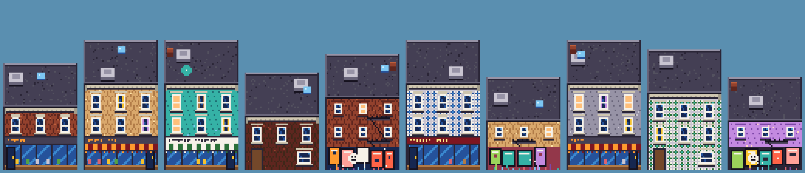

### buildings v02

2026-11-09

Calmer textures: painted brick gets subtle mortar only; less weathering; quieter roof gravel.

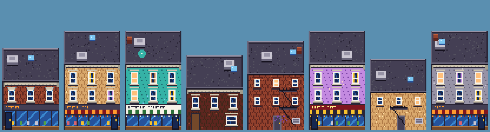

### buildings v01

2026-11-09

First pass procedural Queen West buildings: brick bond texture, sash windows (some arched/lit/curtained), storefronts (sign band w/ pseudo-lettering, striped awnings, display glass, recessed door, bulkhead), cornices; rear walls w/ fire escapes, AC, graffiti; roofs w/ parapet, HVAC, skylight, chimney, patio umbrella.

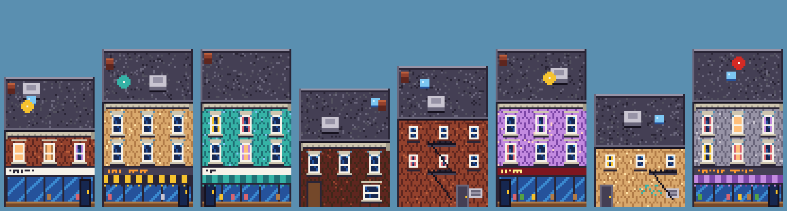

## cyclists

### cyclists v01

2026-11-10

v01: cyclists (bike share, parent with kid seat...), 4 directions.

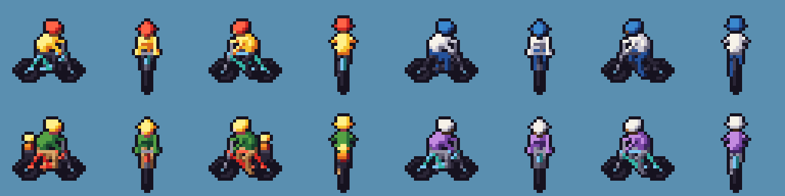

## dogfraud

### dogfraud v06

2026-11-10

v06 per Ivan's M0 review: moustache removed, swept white hair, more dog (longer muzzle, bigger nose with nostrils, whisker spots, flews, folded dog ears, tan eye patch).

### dogfraud v05

2026-11-09

Laugh: real open mouth (teeth, tongue) for FRA-HA-HA.

### dogfraud v04

2026-11-09

Nose + moustache brought forward of muzzle; ears moved out/forward.

### dogfraud v03

2026-11-09

More dog: protruding muzzle w/ split lip, droopy jowls over collar, big pointed horn-ears, smug arched brows, smaller body.

### dogfraud v02

2026-11-09

Fix framing (origin anchored at bottom).

### dogfraud v01

2026-11-09

First pass portrait (grin / laugh / shock). SDF: pear head (skull+jowls smooth-union), dog nose, handlebar moustache, horn-like ear tufts, painted face features, tiny suit + dotted tie.

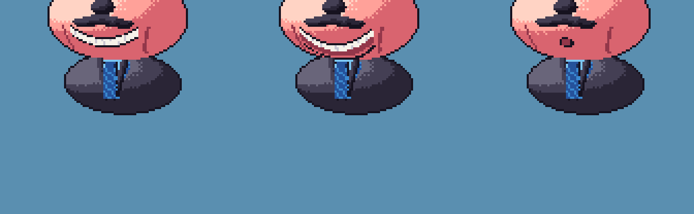

## dvp

### dvp v01

2026-11-10

v01: intro highway backdrop (DVP-style ravine, river, lake, sunset, skyline) + back-view cars at 8 depths. First pass trees too sparse -> dense back-to-front canopy.

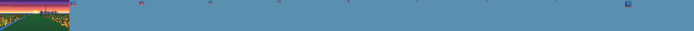

## font

### font v01

2026-11-09

Original 5x7 uppercase font: plain, outline, shadow, 2x outline (titles).

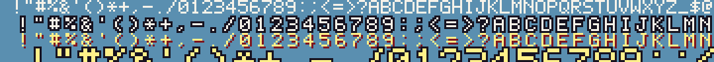

## park

### park v01

2026-11-10

v01: Trinity Bellwoods gates (front elevation + 3/4 tops; first pass had the iron grilles filled solid by the auto-outline - iron now drawn after outlining), Toronto green/blue/grey bins, park lamp, white squirrel.

## park_decals

### park_decals v01

2026-11-10

v01: dog bowl (Garrison Creek hollow; first pass had hard sector shading, now Bayer-dithered), tennis courts with standing south fence, baseball diamond.

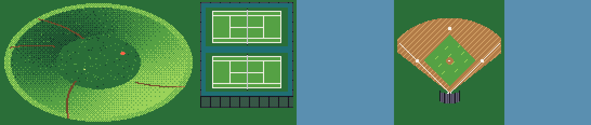

## people

### people v01

2026-11-10

v01: pedestrians (9 variants incl. kid and dog walker), 4 directions, SDF + 32-degree camera like the raccoon.

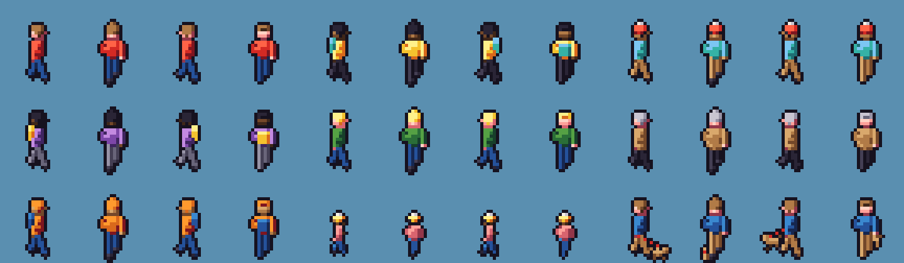

## props

### props v03

2026-11-10

v03: chunkier Toronto hydrant (M0 one read as a red gem).

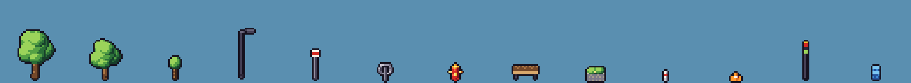

### props v02

2026-11-09

Thicker poles (TTC stop, bike ring) so they survive pixel sampling.

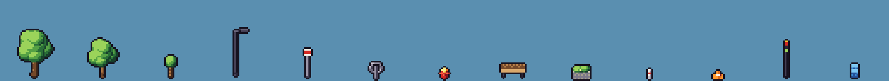

### props v01

2026-11-09

First pass props: trees, sapling, streetlight, TTC stop, post-and-ring bike stand, hydrant, bench, planter, bollard, cone, traffic signal, news box.

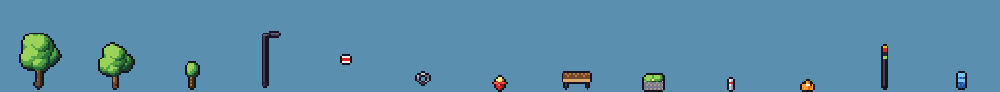

## raccoon_side

### raccoon_side v03

2026-11-10

v03: trash-can lid replaced by a yellow bike pump swung like a bat (lid didn't read at this scale). First try was a grey tube thrust forward - read like a gun, rejected. Frames grew 48x36 -> 56x44 for swing headroom.

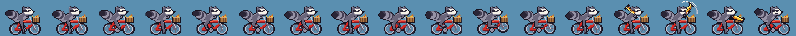

### raccoon_side v02

2026-11-09

Frame widened to 48 (tail no longer clipped), 2px eye with pupil for expression.

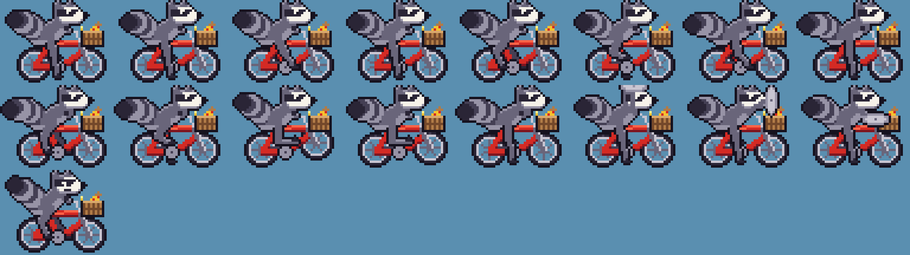

### raccoon_side v01

2026-11-09

First pass: hand-painted head grid + procedural bike, IK legs, trash-can-lid attack. Known issues: tail clipped at left edge, small eye, thin legs.

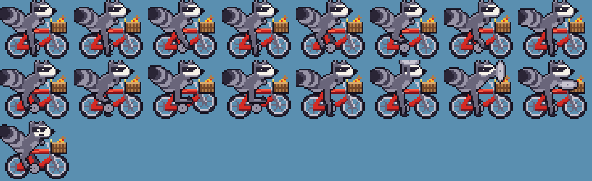

## raccoon_top

### raccoon_top v02

2026-11-09

Chubbier: wider torso/head/mask/bars so N/S views read; bigger tail sway.

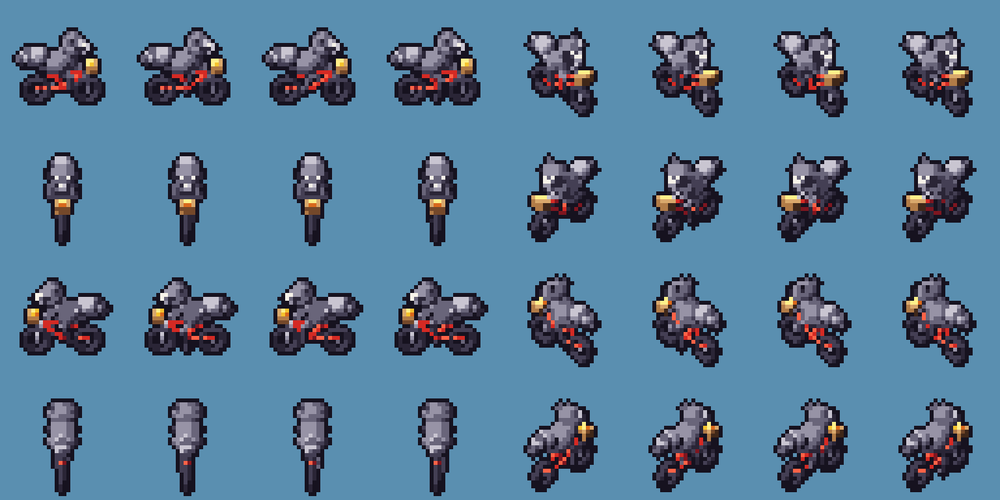

### raccoon_top v01

2026-11-09

SDF-rendered, 8 dirs x 4 pedal frames, 32deg character camera. (Earlier passes - 45deg oblique, too pale/skinny, then flipped camera - were not preserved.) Known issue: N/S views narrow.

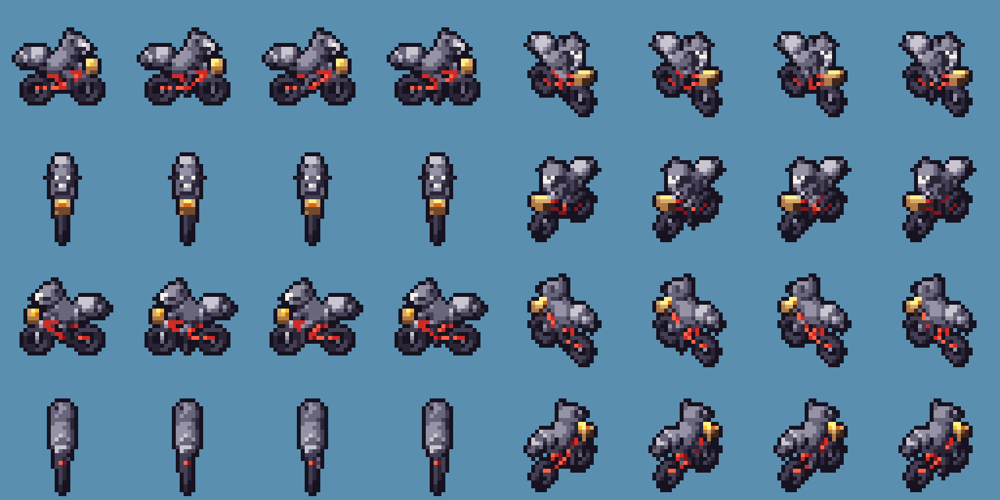

## rats

### rats v03

2026-11-09

Ears moved back/up so eyes + hats read.

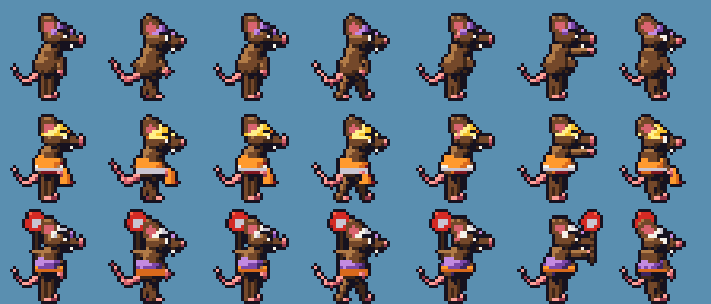

### rats v02

2026-11-09

Bigger (x1.18), bigger head/ears, white eyes w/ pupils + angry brows; flagger holds STOP paddle aloft in back hand.

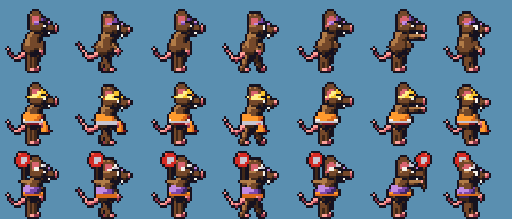

### rats v01

2026-11-09

First pass: SDF rats, side view. Rows: basic (purple DF cap), construction (hard hat, hi-vis, cone), traffic (flagger w/ STOP paddle). Frames: walk x4, windup, attack, hurt.

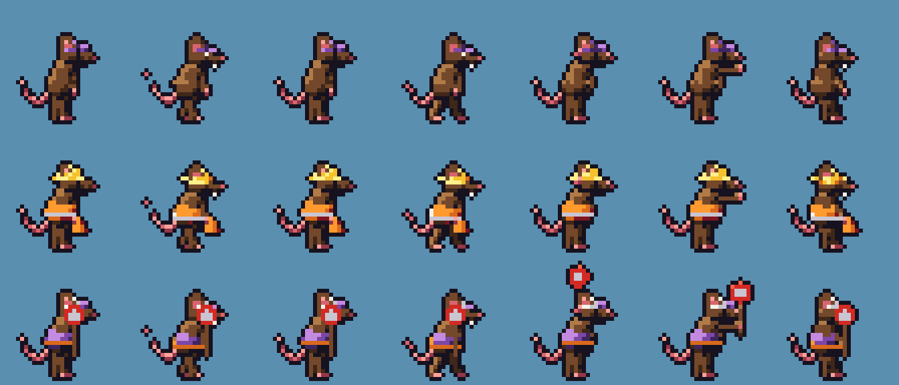

## side_bg

### side_bg v01

2026-11-09

First side-view composition: dithered sky (day/dusk), skyline w/ CN Tower + dome, back row, Queen West facade strip, street strip (painted vs protected lane).

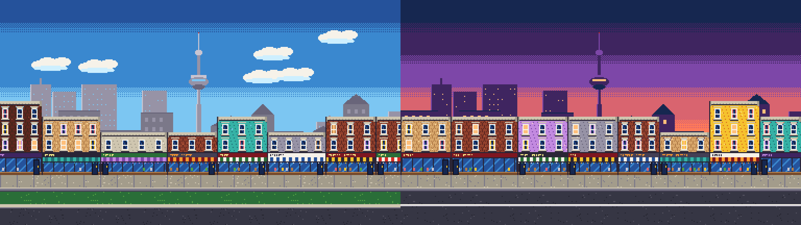

## tiles

### tiles v02

2026-11-10

v02: N-S road lanes with centre line + stop bars, north parking lane, park lawn, calmer laneway.

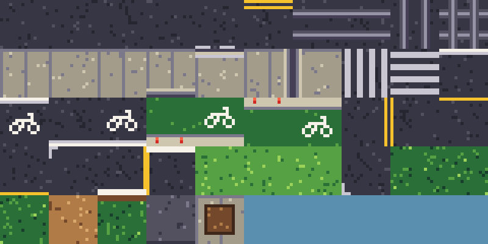

### tiles v01

2026-11-09

First tile set: asphalt variants, lane markings, embedded streetcar tracks (E-W, N-S, crossing), sidewalks, curbs, zebras, painted + protected bike lanes, parking, grass, park path, laneway, tree pit.

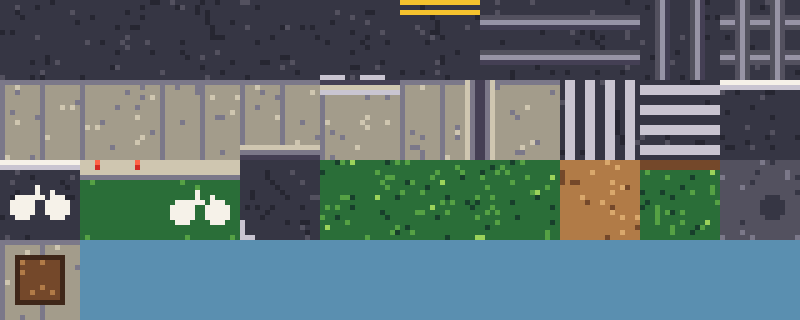

## vehicles

### vehicles v02

2026-11-09

Streetcar: grey roof instead of white slab, taller dark window band.

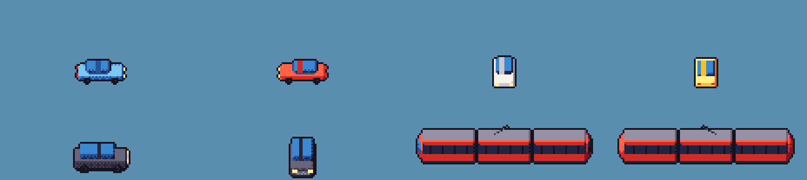

### vehicles v01

2026-11-09

First pass vehicles: car (4 dirs/colours), SUV, 3-section TTC-style streetcar.

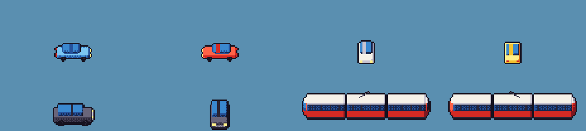
