# Art history

Every iteration of every asset, newest first. Generated by `tools/snapshot.mjs`. Do not edit by hand.

## airport

### airport v02

2026-11-15

M3.4: left-facing jet tug frame with the lettering drawn after the flip (it read mirrored).

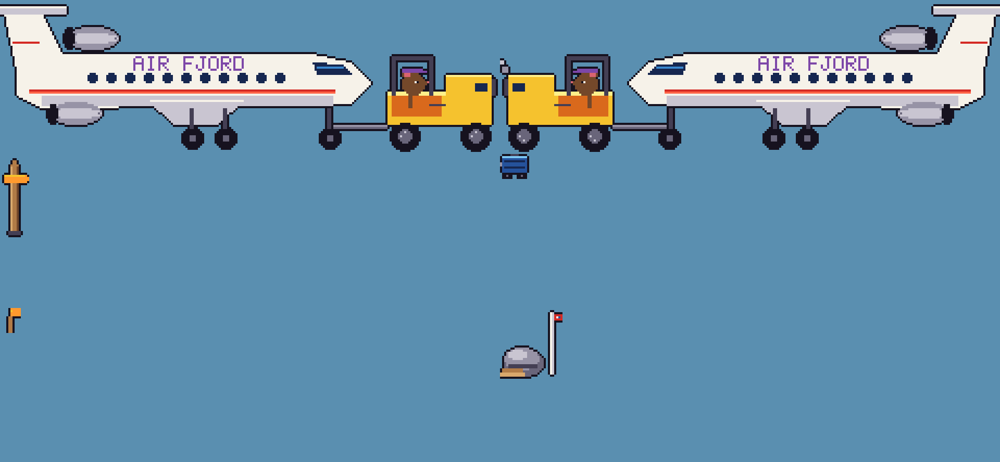

### airport v01

2026-11-15

M3.4: the island airport mission: the JET TUG boss (a baggage tug towing Dog Fjord's private jet), survey stakes, the rolling suitcase, the Little Norway boulder.

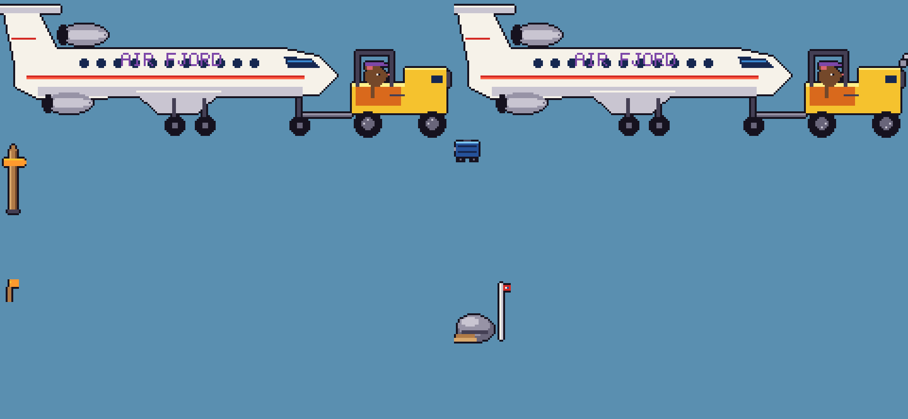

## app_icon

### app_icon v01

2026-11-13

M3.2: home-screen icon for the web-app manifest (fullscreen launch on iPhone).

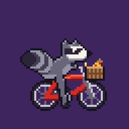

## buildings

### buildings v05

2026-11-10

Ivan M1.1: the 'transparency under the windows' (his circled screenshot) was the teal brick's speckle colour C = #7cc6f2, the exact daytime sky blue, so random wall pixels read as holes. Teal speckle is now pale grey H. Fixes every teal building in both views.

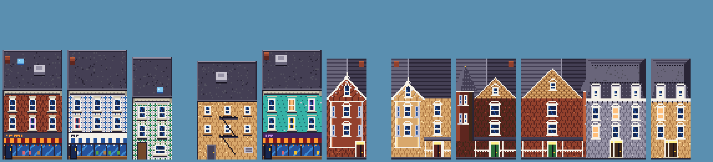

### buildings v04

2026-11-10

v04: Victorian house styles from Ivan's M1 review: Gothic Revival bay-and-gable (gable + gingerbread bargeboard + 2-storey bay), Queen Anne (round turret + cone, fish-scale gable, spindle porch), Second Empire (slate mansard, dormers, bracketed cornice). Gables/mansards rise in front of the roof.

### buildings v03

2026-11-10

v03: arched windows no longer leave transparent holes (Ivan's 'transparent pixels'), Little Portugal azulejo tile facades, graffiti-lane murals on rear walls.

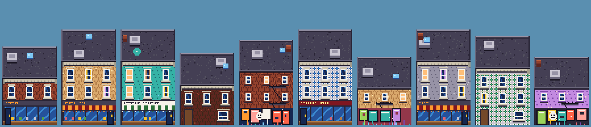

### buildings v02

2026-11-09

Calmer textures: painted brick gets subtle mortar only; less weathering; quieter roof gravel.

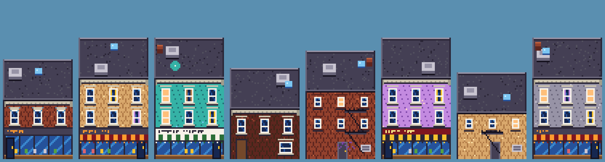

### buildings v01

2026-11-09

First pass procedural Queen West buildings: brick bond texture, sash windows (some arched/lit/curtained), storefronts (sign band w/ pseudo-lettering, striped awnings, display glass, recessed door, bulkhead), cornices; rear walls w/ fire escapes, AC, graffiti; roofs w/ parapet, HVAC, skylight, chimney, patio umbrella.

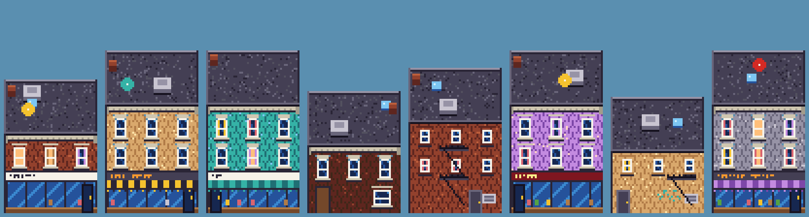

## cn_tower

### cn_tower v03

2026-11-15

M3.3 (Ivan: the top looked tilted/offset; it mixed with the night sky): every band is symmetric about one column; at dusk the pod's window band is lit, the rims and mast are pale purple, the band light is red.

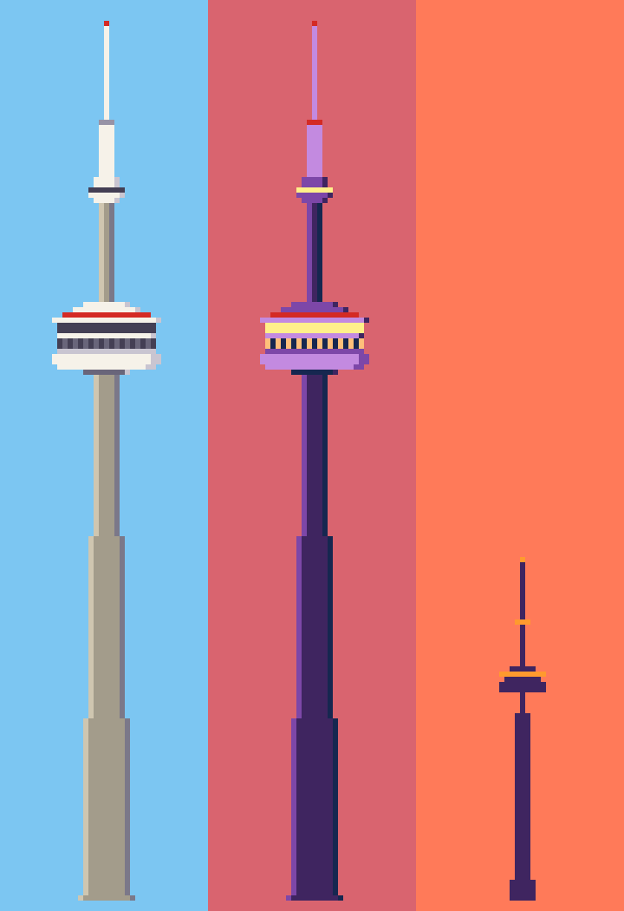

### cn_tower v02

2026-11-13

M3.2 (Ivan: 'I want to see the white donut at the bottom of the main pod'): the skyline pod re-profiled from the close-up photo: white donut, dark ribbed outdoor deck, white band, window band, widest rim, thin red line, upper drum.

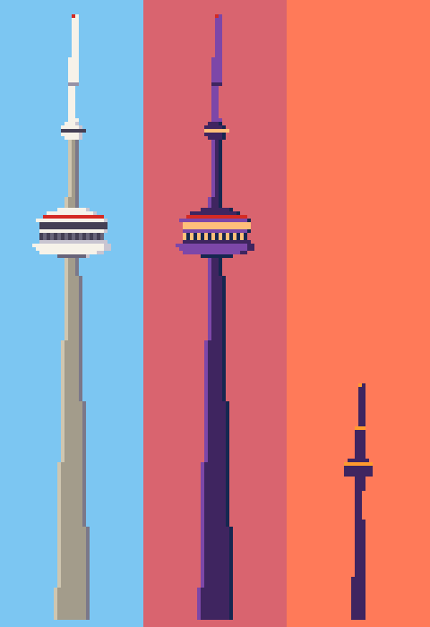

### cn_tower v01

2026-11-10

v01: CN Tower re-drawn against Ivan's photo: tapering shaft, banded main pod (glass / widest white rim / window band / cap), thin upper shaft, SkyPod, long white antenna. First pass had 2px stair-steps on the taper - quarter-pixel offset fixes it.

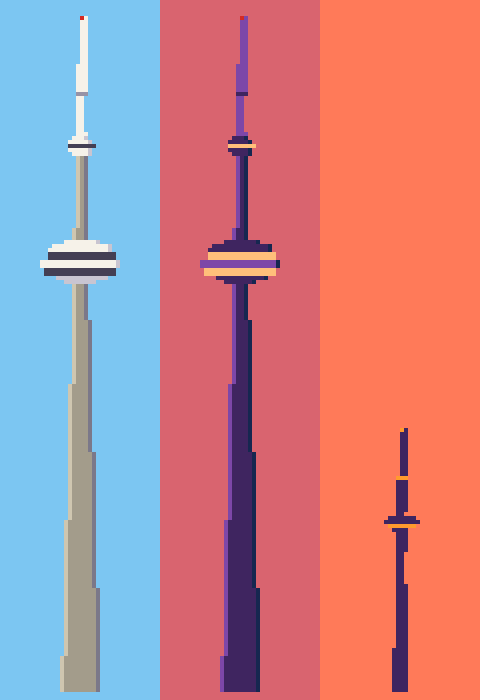

## cn_tower_map

### cn_tower_map v03

2026-11-19

v03 (Ivan, M4.4: 'the base should very gradually narrow down to the top... the top part doesn't look very convincing', with a new close-up of the top): one smooth taper from the ground to the pod; the pod as a stack (rounded bowl, dark/light/dark window bands, white rim, a narrower drum, lift housings, grey roofs), the ribbed SkyPod, the antenna thick and segmented with a red light band, then thin with a red tip

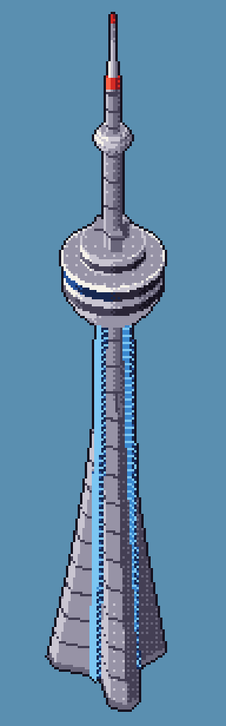

### cn_tower_map v02

2026-11-19

M4.4 (Ivan: make the CN Tower's shape better): the whole tower on the map: trefoil base, shaft, main pod with its window band, the SkyPod, the antenna

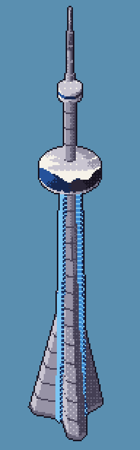

### cn_tower_map v01

2026-11-15

M3.4 (Ivan): the shaft is the trefoil base continued, one SDF render: the foils merge into the core and carry on as thinning ribs, the core narrows from 9 to 5, the lifts ride up the corners.

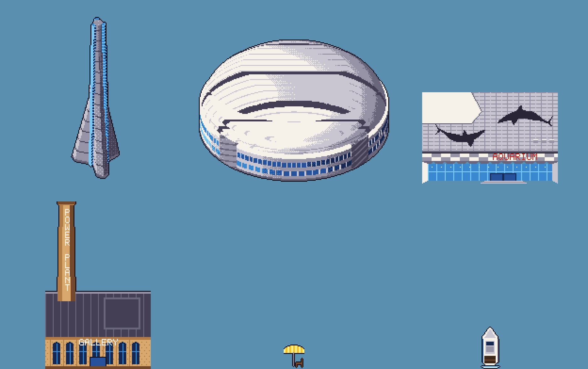

## cyclists

### cyclists v03

2026-11-19

M4.4 (Ivan): the bike share bikes are orange; rider e in teal

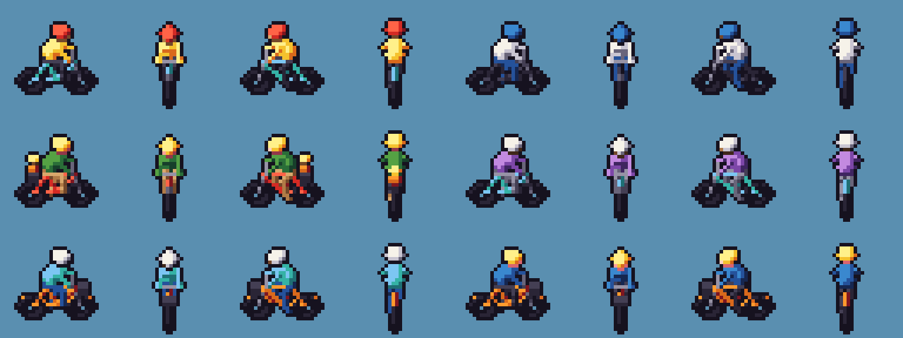

### cyclists v02

2026-11-18

M4.3: two bike share riders (unbranded green step-throughs with fenders and a basket)

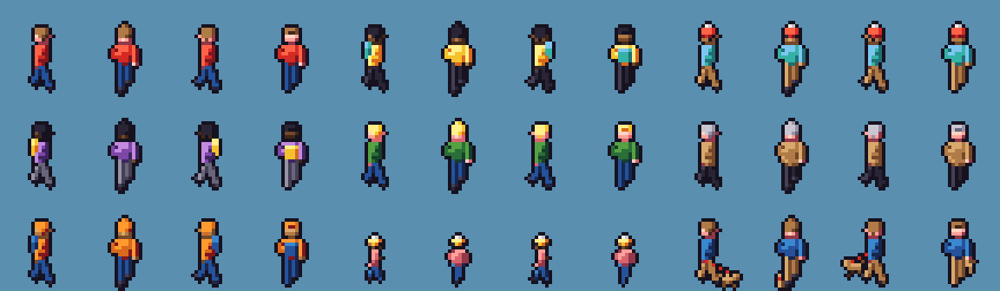

### cyclists v01

2026-11-10

v01: cyclists (bike share, parent with kid seat...), 4 directions.

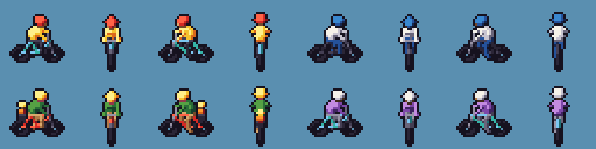

## dogfjord

### dogfjord v07

2026-11-19

v07 (Ivan, M4.4 VERSUS: 'fix his mouth, it looks weird'): the laugh is a proper open D: a full row of upper teeth, a tongue, two small lower fangs (before: teeth only at the corners over a black hole)

### dogfjord v06

2026-11-10

v06 per Ivan's M0 review: moustache removed, swept white hair, more dog (longer muzzle, bigger nose with nostrils, whisker spots, flews, folded dog ears, tan eye patch).

### dogfjord v05

2026-11-09

Laugh: real open mouth (teeth, tongue) for FRA-HA-HA.

### dogfjord v04

2026-11-09

Nose + moustache brought forward of muzzle; ears moved out/forward.

### dogfjord v03

2026-11-09

More dog: protruding muzzle w/ split lip, droopy jowls over collar, big pointed horn-ears, smug arched brows, smaller body.

### dogfjord v02

2026-11-09

Fix framing (origin anchored at bottom).

### dogfjord v01

2026-11-09

First pass portrait (grin / laugh / shock). SDF: pear head (skull+jowls smooth-union), dog nose, handlebar moustache, horn-like ear tufts, painted face features, tiny suit + dotted tie.

## dogfjord_inworld

### dogfjord_inworld v06

2026-11-22

M4.13 (Ivan: redraw from the hero artworks): the hero full-body and a ComfyUI laughing take, downscaled to 72 px on his palette, despeckled, black outline; 3/4 view facing left

### dogfjord_inworld v05

2026-11-22

M4.12: the hero's navy suit, red tie, grey hair, his pinks, a solid brown eye patch

### dogfjord_inworld v04

2026-11-22

before M4.12: grey suit, purple tie

### dogfjord_inworld v03

2026-11-12

M3.1 (Ivan): arms and torso separated by tone (darker sleeves, light sleeve edge, seam) instead of one diagonal shadow.

### dogfjord_inworld v02

2026-11-12

M2.1 (Ivan: the upper torso looked weird): the head render is clipped at the jowls, and a proper suit is drawn: shoulders as wide as the jowls, lapels, shirt V, dotted tie, arms + paws; podium gets a microphone.

### dogfjord_inworld v01

2026-11-10

M2: Dog Fjord in the world (side vignettes). The portrait's SDF head re-rendered at 0.44 scale on a tiny suit; the first pass doubled the shirt + tie (the head render already includes them). Podium with the DF crest.

## downtown

### downtown v03

2026-11-16

M4.1 (Ivan): City Hall modelled in 3D and drawn from above (crescent roofs, the saucer, the podium roof garden); the Freedom Arches' feet on the concrete either side of the pool.

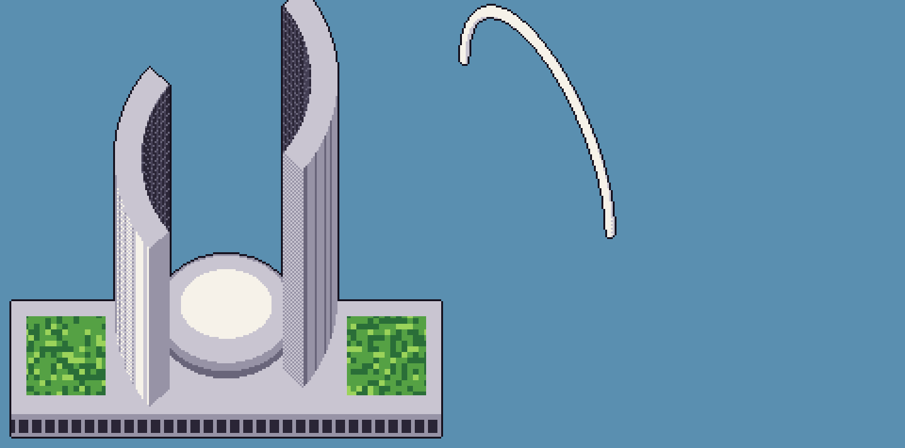

### downtown v02

2026-11-12

M2.1 (Ivan's refs): City Hall v02 from city-hall.jpg (two curved towers: white convex backs, dark ribbed concave faces, crescent roofs, the saucer between, the walkway ring); Old City Hall v02 from his photo (banded sandstone, arched windows, brown metal roofs with conical turrets, rose-window gable, clock tower with arcaded belfry + pyramid spire); one Freedom Arch spanning the pool north-south, seen slightly from the west like the photo; a brighter news van facing east.

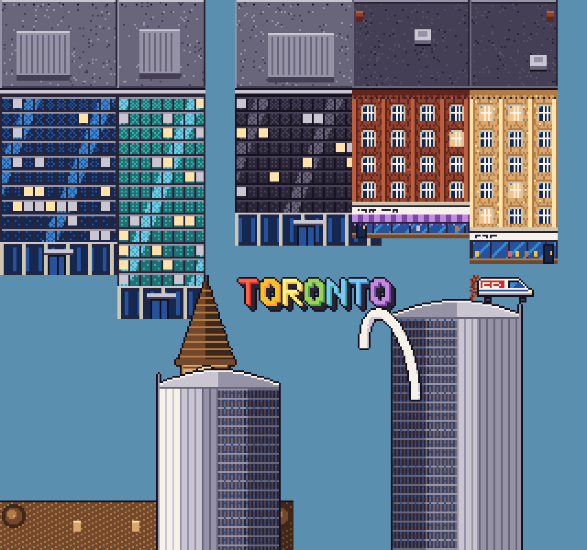

### downtown v01

2026-11-10

M2 Downtown: glass curtain-wall towers (mullion grid, spandrels, sky reflection band, lobby + canopy), King West brick-and-beam warehouses, Old City Hall (sandstone, clock tower, slate hips + copper turrets), City Hall (two curved towers + saucer on the podium), the TORONTO sign, the Freedom Arches, the news van in the wall at 299 Queen W.

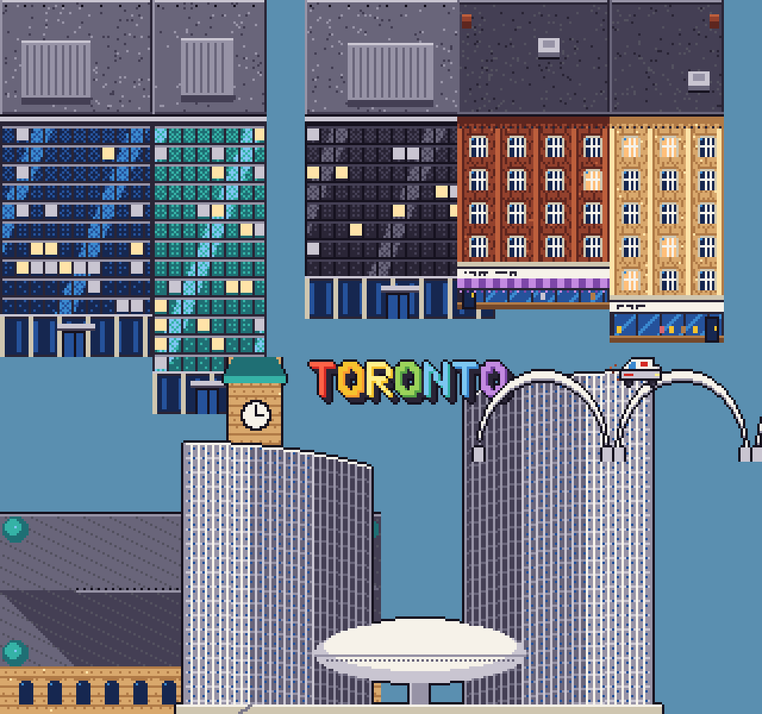

## dvp

### dvp v03

2026-11-10

Ivan M1.1: back-view cars should show tail lights, trunk and rear window. SDF version replaced by a hand-built parametric back view painted natively at each depth scale (roof, tinted rear window + third brake light, trunk shut line, glowing tail lights in dark housings, plate, bumper, reflectors, tyres, mirrors). SUV is taller with roof rails.

### dvp v02

2026-11-10

v02: river ~3x wider (Ivan), CN Tower silhouette uses the new profile.

### dvp v01

2026-11-10

v01: intro highway backdrop (DVP-style ravine, river, lake, sunset, skyline) + back-view cars at 8 depths. First pass trees too sparse -> dense back-to-front canopy.

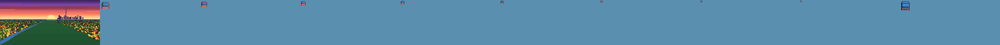

## eastend

### eastend v05

2026-11-18

M4.3: the Megamart wall in three bays (store front, garden centre, pickup bay), rooftop units, lamp posts

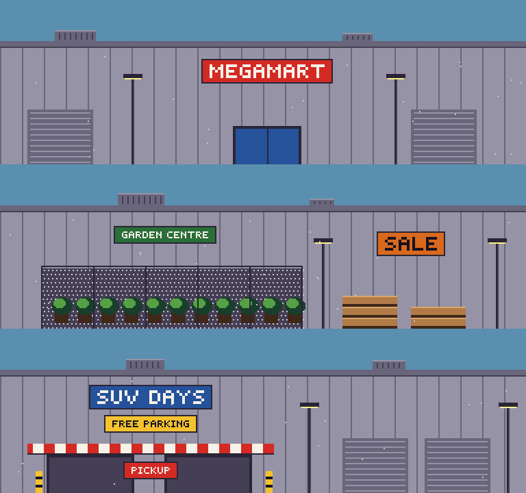

### eastend v04

2026-11-16

M4.1 (Ivan's photo): the Don Jail redrawn: the tall rusticated centre block with its pediment and porch, khaki wings, two brick ventilation towers.

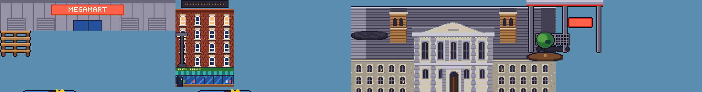

### eastend v03

2026-11-12

M3.1: the Don Jail (1864) facade; cart shelter + pallets for the Monster SUV fight.

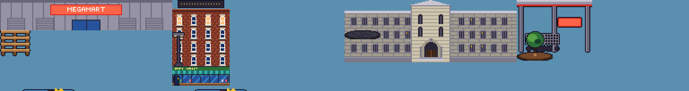

### eastend v02

2026-11-12

MEGAMART sign lettering redrawn with 5-px glyphs (v01's 3x4 blocks read as blank squares at game scale).

### eastend v01

2026-11-12

M3 East End: MEGAMART big-box facade, the Broadview Hotel, lot lights, asphalt patch -> soil + sapling (depave), the Monster SUV boss.

## font

### font v02

2026-11-19

M4.4: a '^' glyph (an upside-down V) for the city map's arrows; the north and side labels had no arrow, the font had no '^'

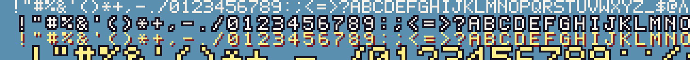

### font v01

2026-11-09

Original 5x7 uppercase font: plain, outline, shadow, 2x outline (titles).

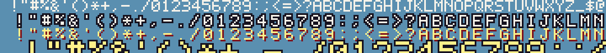

## heroes

### heroes v05

2026-11-22

M4.13: dog_vs from Ivan's fixed-fist Gemini image (fringe removed), stand_md, side_src, dfs_grin/dfs_laugh; bust_sm/stand_sm gone

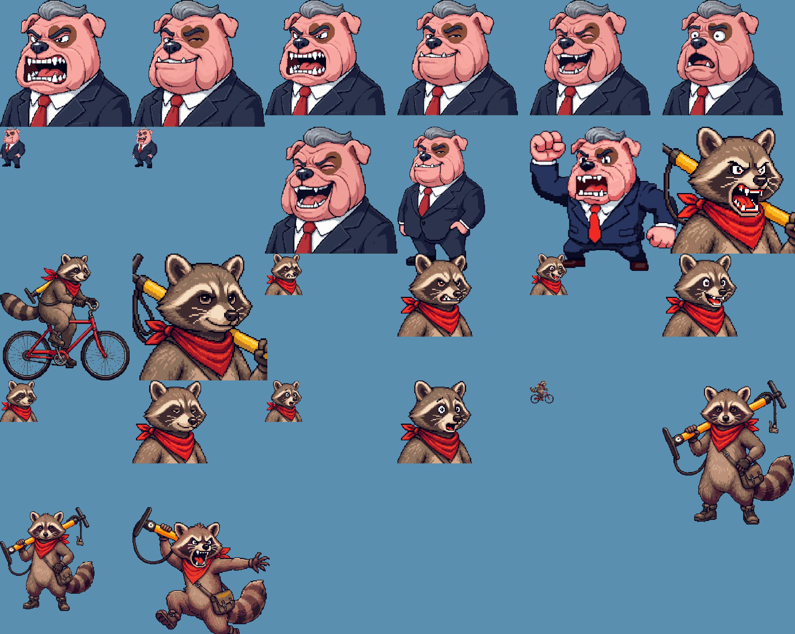

### heroes v04

2026-11-22

M4.12: R1A, D1A with a three-finger fist, Happy1 + Shock2, HD dog portraits (200 px), a smaller bust, the large faces kept

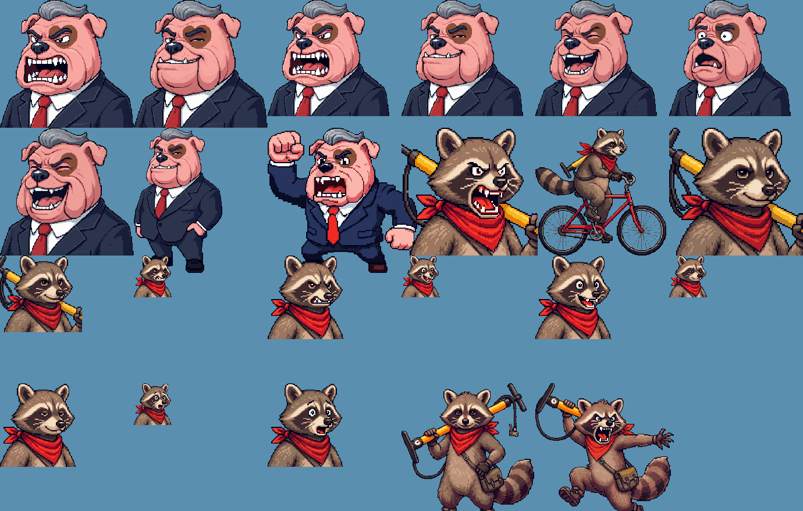

### heroes v03

2026-11-22

M4.11: the hero set in the game (R1b, D1c, A3b, faces rest1 / happy2-s3 / angry1 / shock1)

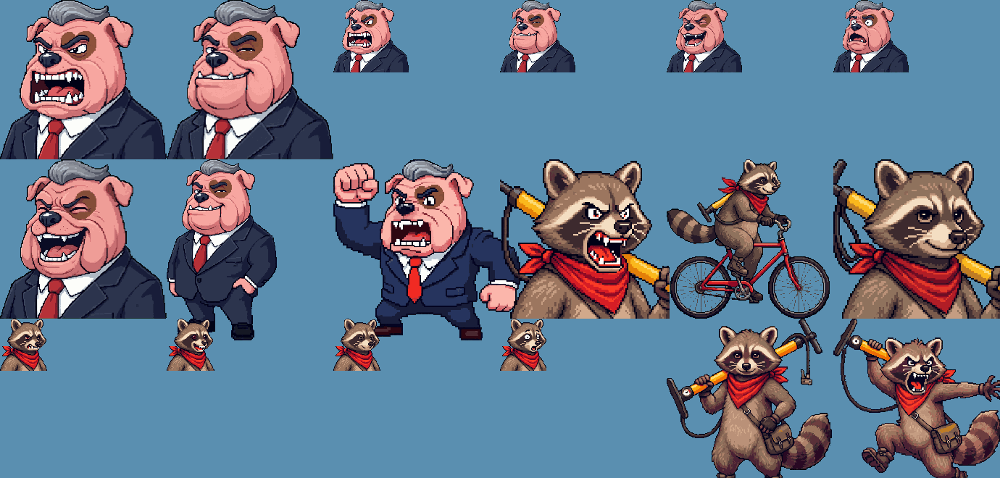

### heroes v02

2026-11-21

M4.10: palettes remade without the green-screen spill (no green slots left)

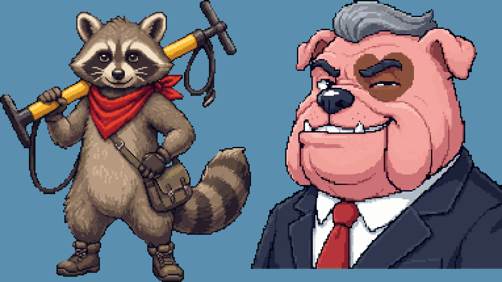

### heroes v01

2026-11-21

M4.10: the raccoon and Dog Fjord from their Gemini masters, pixel to pixel on locked 48-colour palettes

## highpark

### highpark v03

2026-11-16

M4.1 (Ivan's photo): Colborne Lodge as the Regency cottage: verandah, low hip, small upper storey, three white chimney pots.

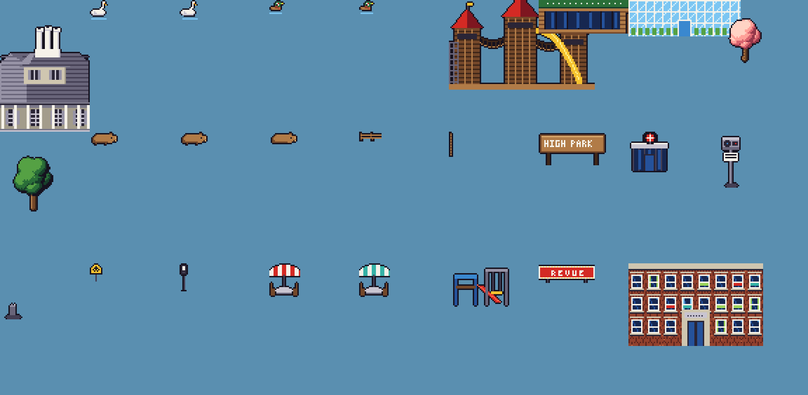

### highpark v02

2026-11-12

M2.1: swans + wood ducks for Grenadier Pond (Ivan), the Jamie Bell Adventure Playground (wooden towers, turret roofs, rope bridges, tube slide), the Grenadier Cafe and the greenhouse facades.

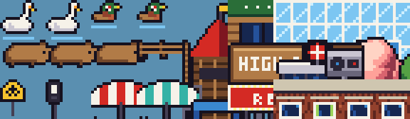

### highpark v01

2026-11-10

M2 High Park / Roncesvalles: cherry + black oak trees, capybaras (v02: added head, ear, eye, nose; v01 read as loaves), zoo rail fence, HIGH PARK sign, TTC station entrance, Parkside speed camera + its cut stump, school-zone sign, transit-priority signal head, King St patio sets, playground, the Revue's marquee, a red-brick school.

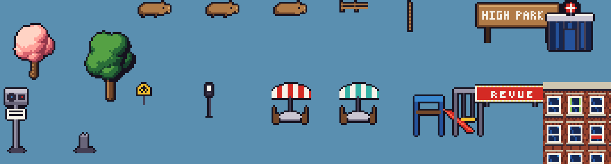

## lane_eater

### lane_eater v01

2026-11-12

M3 mission 5 boss: the Lane Eater, a road-paving machine that eats bike lanes. Three weak points (conveyor, cab, grinder) shown intact and smashed.

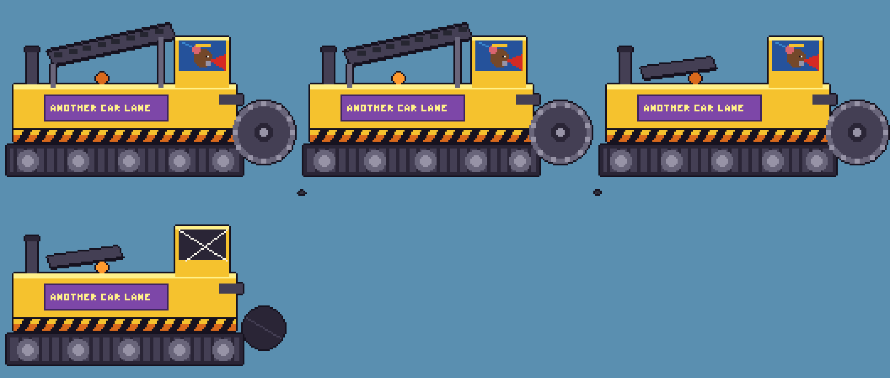

## m43_props

### m43_props v04

2026-11-19

M4.4 (Ivan): orange share bikes in the docks and on the trailer

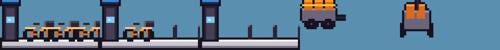

### m43_props v03

2026-11-18

M4.3: three bikes, spaced, no global outline (it clumped them)

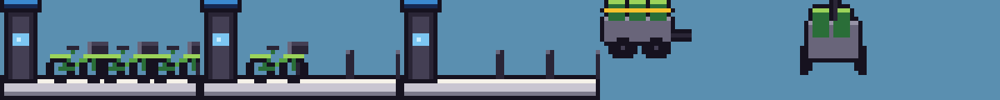

### m43_props v02

2026-11-18

M4.3: docked bikes in side profile (the end-on ones read as dark blobs)

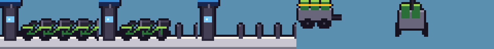

### m43_props v01

2026-11-18

M4.3 first pass: the bike share dock (kiosk + 4 step-throughs), part-empty docks, the dock trailer (E-W and end-on)

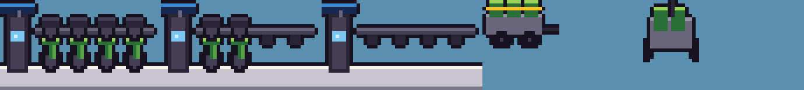

## m4_props

### m4_props v03

2026-11-16

M4.1: laid rail 72 px wide so the pieces join; ONTARIO LINE / OPENING SOON hoarding on two lines; the Mega Rat's barrel; the Gardiner strip without the floating towers.

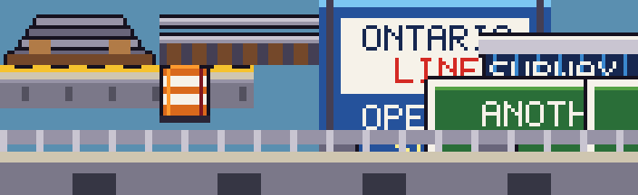

### m4_props v02

2026-11-15

M4: the Highway Mech's sign drawn with its border (the first cut filled it white).

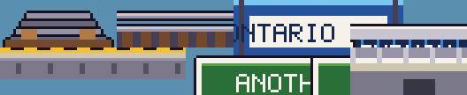

### m4_props v01

2026-11-15

M4: rail segments, the hoarding, a station entrance, the slab platform, the HIGHWAY MECH (closed + vent open), the strip under the Gardiner.

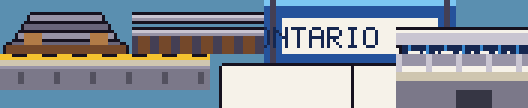

## north

### north v02

2026-11-15

M4: + the crate, the Van de Graaff exhibit, the Wrecker crane.

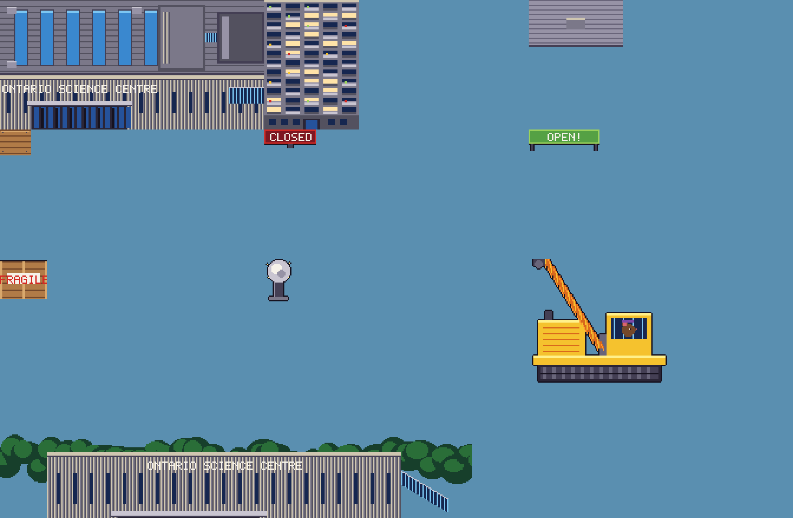

### north v01

2026-11-15

M4: the North district: the Science Centre (Moriyama's ribbed pavilion with the pods behind), Flemingdon Park slabs, the boards + CLOSED sign + OPEN banner, the mission 6 side strip.

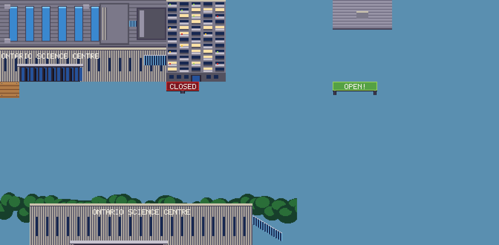

## park

### park v04

2026-11-12

M2.1: picnic tables a little smaller (Ivan), S 11 -> 9.

### park v03

2026-11-10

Ivan M1.1: picnic tables didn't look good. Rebuilt as a tiny 3D model (slatted top, two benches, A-frame legs) projected with the map's 3/4 oblique and painted back to front, so it can sit at 45 degrees as Ivan suggested; dithered ground shadow. Pairs alternate +45/-45.

### park v02

2026-11-10

v02 per Ivan's M1 review + photo reference: gates redrawn (smooth white stone, domed inner piers with panelled lantern, gabled outer piers, inscribed lintels, arched iron carriage gate, plaque). Added the classic green picnic table (SDF version lost its legs at this size, so it's hand-painted) and a stand-alone graffiti sheet (laid over walls instead of baked into buildings).

### park v01

2026-11-10

v01: Trinity Bellwoods gates (front elevation + 3/4 tops; first pass had the iron grilles filled solid by the auto-outline - iron now drawn after outlining), Toronto green/blue/grey bins, park lamp, white squirrel.

## park_decals

### park_decals v03

2026-11-12

M3.1: High Park's outdoor pool replaces two of the three diamonds.

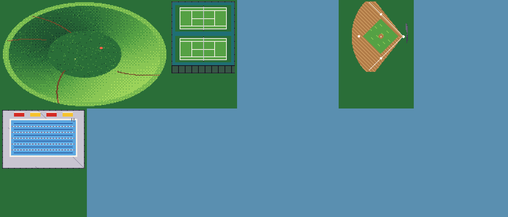

### park_decals v02

2026-11-10

v02: dog bowl reshaped for its new place in the park; diamonds can face east (home plate on the right, as on the park map).

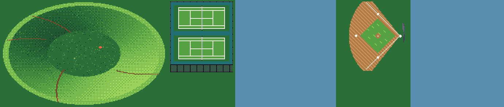

### park_decals v01

2026-11-10

v01: dog bowl (Garrison Creek hollow; first pass had hard sector shading, now Bayer-dithered), tennis courts with standing south fence, baseball diamond.

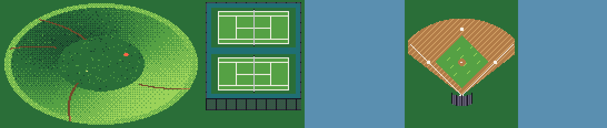

## people

### people v01

2026-11-10

v01: pedestrians (9 variants incl. kid and dog walker), 4 directions, SDF + 32-degree camera like the raccoon.

## portraits_2d

### portraits_2d v30

2026-11-20

M4.9 round 10: final (head fur pass, done with light)

### portraits_2d v29

2026-11-20

M4.9 round 09: polish: one solid barrel highlight, the far ear's last jaggy, no fur over the pump

### portraits_2d v28

2026-11-20

M4.9 round 08: the shock's eyes seated (lid shadow, top-arc lid line), one laugh crease, no cream sliver under the paw, pixelcheck clean on the dog

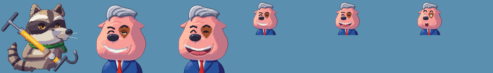

### portraits_2d v27

2026-11-20

M4.9 round 07: Dog's laugh and shock lit like the grin (teeth casting into the mouth, a tongue dome, lit lips, cheeks up; a tall O, value-only eyes), a flat lit belly, the paw's knuckles

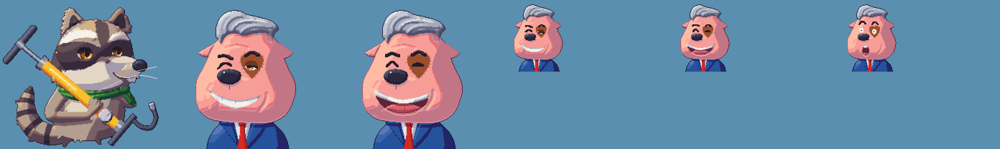

### portraits_2d v26

2026-11-20

M4.9 round 06: the lit belly back inside the falloff, a knotted short scarf end, the tail lit as one tube, the far ear in shadow, the smirk as a crease shape

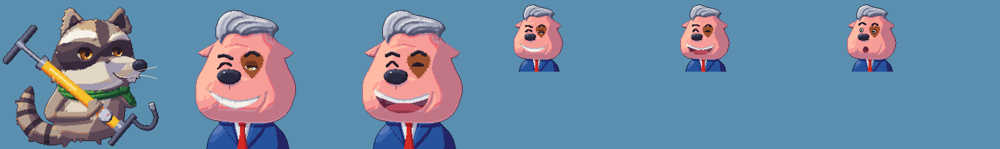

### portraits_2d v25

2026-11-20

M4.9 round 05: faces done with light (wet-sphere eyes, lit teeth, nose), light falloff to the bottom, hand-placed tufts, the scarf end, ear nick

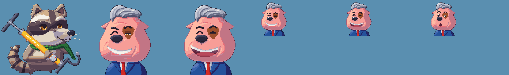

### portraits_2d v24

2026-11-20

M4.9 round 04: no rim, a thick bushy tail, a tan forearm against the cream bib, warmer coat shadows, Dog's far side as one form-following shadow

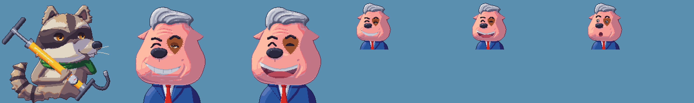

### portraits_2d v23

2026-11-20

M4.9 round 03: designed light: hand-placed terminators, hue-shifted threshold ramps, a cool rim, the paw as a grip, Dog's far-cheek plane

### portraits_2d v22

2026-11-20

M4.9 round 02: lit volume, cel bands (variant a): coat-coloured arms, cream bib, lighter warm coat, salmon dog, no dither

### portraits_2d v21

2026-11-20

M4.9 round 01: painted with light (variant a, volume): one value map x material map, lit volumes + designed cast shadows, yellow straight pump

### portraits_2d v20

2026-11-20

M4.8 round 10: polish

### portraits_2d v19

2026-11-20

M4.8 round 09: low-risk finishing: no contact shadow outside the feet (a darker sole inside), mask lobe sheen, the lip shadow on the teeth fading to the corners, cone-shaded fangs, a 1 px forearm ridge, a bigger darker shock O with 1 px fangs at 112

### portraits_2d v18

2026-11-20

M4.8 round 08: Dog Fjord's mouth back to round 05's wide white crescent (pink palette kept), light-touch teeth, soft jowls with no outline, a thin lip edge; the raccoon's body light pass (near side brighter, far side and underside darker, deeper chest shadow, ground shadow), mask strands curving back, bigger catchlight, brighter nose top

### portraits_2d v17

2026-11-20

M4.8 round 07: chunky blocky dog teeth (lower teeth behind the thrust lip), pendulous drapes with a cast shadow, darker body and a dark lip margin; raccoon face strands per zone (mask out of the eye corners, muzzle thinned to its shade zones, fan on the forehead), longer body tufts, forearm ridge and wrist tufts, lit tail-ring rims, longer barrel

### portraits_2d v16

2026-11-20

M4.8 round 06: fur strands inside the raccoon's face zones (new furClusters, calm zones round the eyes and nose); Dog Fjord pink again (warm pink-peach lights, mauve only in shadow, a rosy-red terminator, no olive stipple), hanging drapes, dog teeth with the lip's shadow; darker upper arms with lit rims, body strands, grip highlights, lighter knuckles

### portraits_2d v15

2026-11-20

M4.8 round 05: Dog Fjord re-laid (features lower, wide bulldog crescent grin, drapes as curtains at the corners, fangs over the lip) in a hue-shifted skin palette (peach-ochre lights, desaturated mid, one mauve jaw core shadow, bounce at the collar); the raccoon's pump mid-stroke (slim barrel, chrome rod, wide T-bar, one paw per grip), forearms, rim light, cast shadows, body fur, toe lobes

### portraits_2d v14

2026-11-20

M4.8 round 04: the final direction, one pruned drawing: the raccoon standing on short legs with the full pump as a cane (paws stacked on the T-handle), ringed tail, cap + bandana + teal pump; Dog Fjord chin-up bulldog on sunk navy shoulders, iter_04 ears, soft drapes, comma nostrils, gold car tie

### portraits_2d v13

2026-11-20

M4.8 round 03: variant a: the bat pose (pump on the near shoulder behind, fist on hip, face clear), bandana + teal pump; Dog Fjord as a bulldog (underbite canines, hanging flews, nose rope, rose ears, smug lid), sunk in navy shoulders, gold car tie

### portraits_2d v12

2026-11-20

M4.8 round 02: variant a: warm-coat raccoon at 1.15x, cherry pump across the chest in front, green scarf, real hands, 4-tone mask; Dog Fjord modelled (flews, jowls, shadow-shape folds, chestnut patch), three-quarter, navy + gold car tie

### portraits_2d v11

2026-11-20

M4.8 round 01: variant A (planted staff): straight vertical pump, red bandana, 9-step hue-shifted fur ramp, tufted edges + fur strokes, selective outlines; Dog Fjord on iter_04's head, 8-step pink ramp, navy suit, red tie

### portraits_2d v10

2026-11-20

M4.7 iteration 09: 1-px gap between eye and nose at 112

### portraits_2d v09

2026-11-20

M4.7 iteration 08 (final): dog lip-pad edge as a tapered sliver (no gum bar), left outer fold removed, lit wedge starts at the brow line; comments tidied

### portraits_2d v08

2026-11-20

M4.7 iteration 07: dog ears as 45-degree points at the top corners, split-face seam removed, one strong right muzzle/jowl fold; raccoon thorn notches removed

### portraits_2d v07

2026-11-20

M4.7 iteration 06: dog compact pompadour on the crown, ears folded forward at the top corners, muzzle volume in flat shapes; raccoon polish (arm light edge, wider cast shadow, fur notches)

### portraits_2d v06

2026-11-20

M4.7 iteration 05: dog hair as the top of the dome (one convex head+hair outline, ~148 tall), jowl weight from flat P shapes and folds; raccoon chunky tapered arms, bigger fist, broader tail arc, shoulder creases

### portraits_2d v05

2026-11-20

M4.7 iteration 04: dog head outline traced from the 3D silhouette, sideburn wedges, lit wedge; raccoon hand-on-hip triangle, lowered shoulders, shorter near arm, bushy tapered tail

### portraits_2d v04

2026-11-20

M4.7 iteration 03: raccoon bust narrower than the head inside the frame, outlined tube arms, ringed tail, grey jaw, knuckle fist; dog organic head outline running up into the hair, flat heavy patch lid

### portraits_2d v03

2026-11-20

M4.7 iteration 02: dog pompadour + wink/lid smug grin + flews, no muzzle oval, heavier jaw, angular rose ears; raccoon shoulders, separate arms, chest patch, lower nose, eyes off the mask

### portraits_2d v02

2026-11-20

M4.7 iteration 01: re-proportioned to the 3D busts (raccoon head centred + short snout, dog bell head + cap hair + rose ears), flat cel shading

### portraits_2d v01

2026-11-19

M4.6 (Ivan: redraw the raccoon and Dog Fjord portraits in pure 2D pixel art, no 3D): first 2D pass. Flat shapes, hard outlines, cel shading (tools/lib/draw2d.mjs). Raccoon: whole torso with a fur ruff, near paw's fingers round the pump, fist on the hip, the smirk. Dog Fjord: facing left, grin / laugh / shock.

## portraits_2d_explore

### portraits_2d_explore v16

2026-11-20

M4.9 round 09 wildcard: iter_09 + a ref-03 fur pass on the raccoon, done with light (strands only at tone boundaries, calm eyes/nose/smirk)

### portraits_2d_explore v15

2026-11-20

M4.9 round 02 variant c: chunky wildcard, the value map read in 2x2 clusters, 3 tones per material (ref 05)

### portraits_2d_explore v14

2026-11-20

M4.9 round 02 variant b: dark raccoon forearms and paws separated by light (lit rim, deep cast shadow), far paw behind the barrel

### portraits_2d_explore v13

2026-11-20

M4.9 round 02 variant a: lit volume + hard cel bands, coat-coloured near arm and paws, cream bib

### portraits_2d_explore v12

2026-11-20

M4.9 round 01 variant c: RICH, volumes with long ramps, dither strips, rim + bounce light, fur at the light's edge (ref 03)

### portraits_2d_explore v11

2026-11-20

M4.9 round 01 variant b: CEL, flat lit base + hand-designed shadow crescents and shapes, 3 tones + accent, hard edges (refs 04/05)

### portraits_2d_explore v10

2026-11-20

M4.9 round 01 variant a: VOLUME, each mass a lit volume in 5 flat bands + designed cast shadows and creases

### portraits_2d_explore v09

2026-11-20

M4.8 round 03 variant c: elbow lean on a pump at screen-left, cycling cap + bulldog dog sunk in royal blue, cream chin blaze

### portraits_2d_explore v08

2026-11-20

M4.8 round 03 variant b: cane pose (paws stacked on the T-handle) + bulldog dog chin up (nostrils from below, double chin), charcoal pinstripe

### portraits_2d_explore v07

2026-11-20

M4.8 round 03 variant a: bat pose + bulldog dog sunk in navy, gold car tie

### portraits_2d_explore v06

2026-11-20

M4.8 round 02 variant c: cycling cap + chrome pump; dog chin down, sunk into big royal-blue shoulders, bold shapes + cool rim light

### portraits_2d_explore v05

2026-11-20

M4.8 round 02 variant b: red bandana + teal pump; dog chin up with a double chin, charcoal pinstripe, red tie, dense skin texture

### portraits_2d_explore v04

2026-11-20

M4.8 round 02 variant a: green scarf + cherry pump; dog three-quarter, navy, gold car tie, medium density

### portraits_2d_explore v03

2026-11-20

M4.8 round 01 variant c: over the rail, 1.22x close crop leaning on a level yellow pump, cycling cap, lost lit-side outlines; dog broad black suit + striped blue tie + pocket square

### portraits_2d_explore v02

2026-11-20

M4.8 round 01 variant b: the swagger, teal pump held diagonally across the chest, warm taupe coat, green knit scarf; dog charcoal pinstripe + gold car tie + flag pin

### portraits_2d_explore v01

2026-11-20

M4.8 round 01 variant a: planted staff, vertical yellow pump, red bandana, cool blue-grey fur; dog navy + red tie

## posters

### posters v04

2026-11-19

M4.5 final: the whole bust inside the frame (rounded bottom, arms ending in dark paws), so no poster shows it cut off

### posters v03

2026-11-19

M4.5: the ears rebuilt as flattened rounded cones (v02's had flat tops and read as slabs): triangular, a round tip, dark inside, fur-coloured. Posters now use the smirk only (Ivan liked it on the Title poster)

### posters v02

2026-11-19

M4.5 (Ivan on M4.4): raccoon without the red scarf, a proper torso (neck, shoulders, arms), fur-coloured triangular ears with round tips and dark insides, a detailed pump (end caps, band, grip ribs, gauge, hose + chuck, wide T-handle with black grips). Dog Fjord now really faces left; his laugh has a full row of teeth

### posters v01

2026-11-19

M4.4 (Ivan: a hero portrait of the raccoon like Dog Fjord's): the raccoon bust (smirk, yell) and Dog Fjord re-rendered facing left, at twice the game's density

## props

### props v03

2026-11-10

v03: chunkier Toronto hydrant (M0 one read as a red gem).

### props v02

2026-11-09

Thicker poles (TTC stop, bike ring) so they survive pixel sampling.

### props v01

2026-11-09

First pass props: trees, sapling, streetlight, TTC stop, post-and-ring bike stand, hydrant, bench, planter, bollard, cone, traffic signal, news box.

## raccoon_side

### raccoon_side v07

2026-11-22

M4.13: red fork (Ivan); the swing: darker arm with a paw round the pump's grip, wind-up hand further back, bandana stays on top

### raccoon_side v06

2026-11-22

M4.12: the hero look: brown fur, dark mask, cream muzzle, red bandana, yellow pump on his back, satchel, boots (no pizza basket)

### raccoon_side v05

2026-11-22

before M4.12: the grey raccoon with the pizza basket (pre-hero look)

### raccoon_side v04

2026-11-12

M3.1 (Ivan): bigger tail bounce while riding (tip swings -2..+4 px).

### raccoon_side v03

2026-11-10

v03: trash-can lid replaced by a yellow bike pump swung like a bat (lid didn't read at this scale). First try was a grey tube thrust forward - read like a gun, rejected. Frames grew 48x36 -> 56x44 for swing headroom.

### raccoon_side v02

2026-11-09

Frame widened to 48 (tail no longer clipped), 2px eye with pupil for expression.

### raccoon_side v01

2026-11-09

First pass: hand-painted head grid + procedural bike, IK legs, trash-can-lid attack. Known issues: tail clipped at left edge, small eye, thin legs.

## raccoon_side_hero

### raccoon_side_hero v01

2026-11-22

M4.13 (Ivan: a pass over the side view raccoon): the rider cut from the hero bike image at 40 px, the bike, legs, tail sway and pump swing drawn in code; 56x52 frame

## raccoon_style_detailed

### raccoon_style_detailed v02

2026-11-21

M4.10 detailed pass 2: focal-order fur, 52 colours, hand-designed snout/nose/paw/forearm shadows

### raccoon_style_detailed v01

2026-11-21

M4.10 detailed pass 1: long ramps + value-space fur clusters, knit, chrome, gauge dial

## raccoon_style_free

### raccoon_style_free v02

2026-11-21

M4.10 free pass 2: the synthesis, hand-designed shapes on one shared indigo shadow palette, strong outer line, gripping paw, material pump

### raccoon_style_free v01

2026-11-20

M4.10 free pass 1: Streetlamp & Neon, warm sodium key, cyan neon rim, one shared indigo shadow family

## raccoon_style_naive

### raccoon_style_naive v02

2026-11-21

M4.10 naive pass 2: 11 colours, hand-drawn arm and gripping paw, snout underside shadow carries the mouth, jaw plane, 2px shadow-side outline

### raccoon_style_naive v01

2026-11-20

M4.10 naive pass 1: 13 colours, one plum outline, two tones per material, one shadow shape per mass

## raccoon_style_ref03

### raccoon_style_ref03 v02

2026-11-21

M4.10 ref03 pass 2: hand-drawn grip, snout cylinder, clumps by focal order, solid mask, one shadow family

### raccoon_style_ref03 v01

2026-11-21

M4.10 ref03 pass 1: strand-field fur in the light, warped marking edges, ref03 eyes, knit ribs, 38-colour hue-shifted palette

## raccoon_style_ref04

### raccoon_style_ref04 v02

2026-11-21

M4.10 ref04 pass 2: designed cel shadows, minimal inner lines, chibi head and muzzle, bigger eyes

### raccoon_style_ref04 v01

2026-11-20

M4.10 ref04 pass 1: cartoon sprite, 2px dark line, 3-tone cel ramps, big sly eyes, toothy grin

## raccoon_top

### raccoon_top v05

2026-11-22

M4.12: the hero's colours, bandana, pump on his back, satchel; the mask painted on, small eye glints

### raccoon_top v04

2026-11-22

before M4.12: the grey top-down raccoon

### raccoon_top v03

2026-11-12

M3.1: the top-view tail now actually swings (sin(2a) was 0 on all 4 frames) and bobs.

### raccoon_top v02

2026-11-09

Chubbier: wider torso/head/mask/bars so N/S views read; bigger tail sway.

### raccoon_top v01

2026-11-09

SDF-rendered, 8 dirs x 4 pedal frames, 32deg character camera. (Earlier passes - 45deg oblique, too pale/skinny, then flipped camera - were not preserved.) Known issue: N/S views narrow.

## rats

### rats v05

2026-11-15

M3.4: the Baggage Rat (airline cap, rolls a suitcase along the ground) and the Barrier Rat (a striped ROAD CLOSED board held in front).

### rats v04

2026-11-12

M3: + the Lobbyist (navy suit, gold tie, briefcase of cash). Hangs back; rats near him take half damage.

### rats v03

2026-11-09

Ears moved back/up so eyes + hats read.

### rats v02

2026-11-09

Bigger (x1.18), bigger head/ears, white eyes w/ pupils + angry brows; flagger holds STOP paddle aloft in back hand.

### rats v01

2026-11-09

First pass: SDF rats, side view. Rows: basic (purple DF cap), construction (hard hat, hi-vis, cone), traffic (flagger w/ STOP paddle). Frames: walk x4, windup, attack, hurt.

## rats_bureaucrat

### rats_bureaucrat v01

2026-11-10

M2 boss: the Bureaucrat Rat. Same rat model at 1.75x in 48px frames: grey suit (v1 only covered the belly), red tie, camera-facing ring glasses, comb-over, rubber stamp.

## rats_foreman

### rats_foreman v01

2026-11-12

M2.1: the Foreman Rat, mission 1's new boss (Ivan: 'a boss would make it feel accomplished'): the construction rat at boss size.

## rats_megarat

### rats_megarat v01

2026-11-15

M4: the Mega Rat (mission 9 miniboss), the basic rat at 2.6x.

## rats_top

### rats_top v01

2026-11-18

M4.3 first pass: the construction rat on the city map (4 facings x 4 walk frames, the map's character camera)

## science

### science v01

2026-11-16

M4.1: Save the Science moved to the Waterfront (North dropped): a red-brick Harbourfront warehouse strip replaces the Don Mills pavilion.

## side_bg

### side_bg v04

2026-11-12

M3 side views: MEGAMART's lot (stalls + wheel stops, big-box backdrop) and the waterfront promenade (lake, islands, railing, Martin Goodman Trail, boardwalk) with MEGA SPA fence panels.

### side_bg v03

2026-11-10

M2 side views: King St W (warehouses + glass towers, red transit lane), Parkside Dr (High Park hill, oaks + cherries, the school), Queen for the streetcar escort (tracks in the far lane).

### side_bg v02

2026-11-10

v02: new CN Tower profile; daytime tower windows darker so they no longer read as see-through holes.

### side_bg v01

2026-11-09

First side-view composition: dithered sky (day/dusk), skyline w/ CN Tower + dome, back row, Queen West facade strip, street strip (painted vs protected lane).

## side_props

### side_props v03

2026-11-12

M3.1: the speed hump spans the road (no more cross-section); extra lives are hearts.

### side_props v02

2026-11-12

M2.1 (Ivan): the raised crosswalk now runs across the whole road with its bars along the road (not brown); the curb extension is a sidewalk bulb-out with a tree, planting and bollards; the extra-life raccoon token.

### side_props v01

2026-11-10

M2 side-view mission props: signal pole with a TSP call box (red / green / priority white bar), RAT EXPRESS van, the SUV Rat (driver found by locating the glass band; first pass sat on the roof), the Bureaucrat's desk + DENIED stamp, the stolen speed camera, build stakes, speed hump, raised crosswalk, curb extension.

## sunset_scene

### sunset_scene v01

2026-11-22

M4.13 (Ivan's reference): the Toronto Islands lagoon, his Gemini image with its raccoon removed (ComfyUI), on its own 48 colours

## tiles

### tiles v07

2026-11-18

M4.3: bike lanes in N-S streets' curb columns (painted, protected) and the slow street's sharrows

### tiles v06

2026-11-12

M3.1: rail corridor tiles (ballast, ties, rails) north of Bremner Blvd.

### tiles v05

2026-11-12

M3 tiles: flowerbed, parking lot / stall / wheel stop, Don bridge rails, DVP median, Martin Goodman Trail, sand, Queens Quay's grassy streetcar median.

### tiles v04

2026-11-12

M2.1: Hillside Gardens flower beds (tulip rows).

### tiles v03

2026-11-10

M2 tiles: N-S streetcar lanes, TSP detector loops, pond water + shores + reeds, plaza paving, speed humps, raised crosswalks, SLOW stencil (SCHOOL didn't fit 16px), King's red TTC lane, patio decks, trails, zoo pen.

### tiles v02

2026-11-10

v02: N-S road lanes with centre line + stop bars, north parking lane, park lawn, calmer laneway.

### tiles v01

2026-11-09

First tile set: asphalt variants, lane markings, embedded streetcar tracks (E-W, N-S, crossing), sidewalks, curbs, zebras, painted + protected bike lanes, parking, grass, park path, laneway, tree pit.

## toronto_sunset

### toronto_sunset v01

2026-11-22

M4.12: Toronto from the lake against the sunset (CN Tower, Rogers Centre, the financial district)

## vehicles

### vehicles v06

2026-11-16

M4.1 (Ivan): the streetcar's white side swoosh runs over the nose (it turned yellow at the front).

### vehicles v05

2026-11-13

M3.2 (Ivan: 'can we have streetcars turn in 3 sections?'): the Flexity split at its joints into rear (2 modules), mid (pantograph), front (2 modules), each rendered at 8 facings; a turning car lays them along its curve.

### vehicles v04

2026-11-12

M3.1 (Ivan: notice the skewed front): the Flexity's cab ends are raked (the end face leans back toward the roof, bumper forward), grey double doors; 45-degree frames for streetcars and cars turning at corners.

### vehicles v03

2026-11-12

M2.1: streetcars redrawn as TTC Flexity (Ivan's photo): five modules, black joints, red roof edge, white window frame bands, red body, white skirt, the nose swoosh, big windshield.

### vehicles v02

2026-11-09

Streetcar: grey roof instead of white slab, taller dark window band.

### vehicles v01

2026-11-09

First pass vehicles: car (4 dirs/colours), SUV, 3-section TTC-style streetcar.

## waterfront

### waterfront v07

2026-11-17

M4.2 (Ivan: the tracks double, the turn up Spadina breaks): the 510's curves at radii 40 + 24, concentric on the junction's tile corner; Spadina's straight rails end where they begin.

### waterfront v06

2026-11-16

M4.1 (Ivan): the SkyDome cleaned up: no lift, seams stop short of the rim, flat corner ramps, no ribs.

### waterfront v05

2026-11-16

M4.1 (Ivan): sailboats in colours (white, red, blue, yellow) replace the top-down yachts on the map.

### waterfront v04

2026-11-15

M3.3 (Ivan): the aquarium's roof sharks bend along an arc instead of lying straight; CN Tower base, dome, Power Plant unchanged.

### waterfront v03

2026-11-13

M3.2 (Ivan's M3.1 review + new refs): CN Tower base as the real trefoil (three tapering foils, glass elevators in the corners, turned off-axis); Rogers Centre closed, nested roof panels whose edges read as arcs, glass bands, corner ramps; Ripley's Aquarium from its photos (sharks on the white roof, checker band, glass front); the Power Plant gallery with its smokestack; HTO Park's yellow umbrellas; moored motor yachts.

### waterfront v02

2026-11-12

M3.1: CN Tower base (three tapering legs + pavilion, shaft rising off the map), Rogers Centre dome (ribbed sliding panels), Ripley's Aquarium wave roof, ferry terminal + ferry, Sundial Folly, Ontario Place pods + Cinesphere from Ivan's photos, Gardiner deck + piers, track curves, marina dock.

### waterfront v01

2026-11-12

M3 Waterfront: CN Tower (map), the domed stadium, Cinesphere, a pod, Sugar Beach umbrella, sailboat, Gardiner deck segment, MEGA SPA fence + facade (lettering redrawn 5px tall after the 3x3 glyphs read as HECA SPA).

## waterfront_side

### waterfront_side v01

2026-11-12

M3.1 mission 8: the Pink Digger boss (3 poses), the Toronto Islands band (lighthouse, Billy Bishop airport), a turboprop + a Cessna, sand clod.

