# Art history

Every iteration of every asset, newest first. Generated by `tools/snapshot.mjs`. Do not edit by hand.

## buildings

### buildings v05

2026-11-10

Ivan M1.1: the 'transparency under the windows' (his circled screenshot) was the teal brick's speckle colour C = #7cc6f2, the exact daytime sky blue, so random wall pixels read as holes. Teal speckle is now pale grey H. Fixes every teal building in both views.

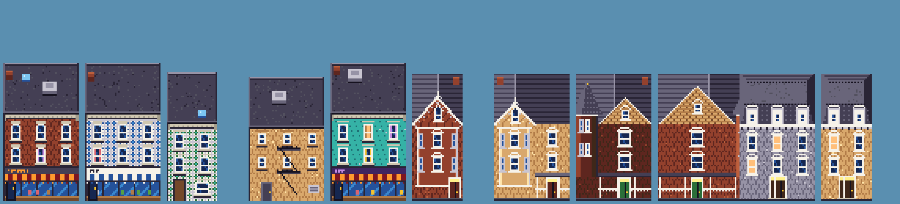

### buildings v04

2026-11-10

v04: Victorian house styles from Ivan's M1 review: Gothic Revival bay-and-gable (gable + gingerbread bargeboard + 2-storey bay), Queen Anne (round turret + cone, fish-scale gable, spindle porch), Second Empire (slate mansard, dormers, bracketed cornice). Gables/mansards rise in front of the roof.

### buildings v03

2026-11-10

v03: arched windows no longer leave transparent holes (Ivan's 'transparent pixels'), Little Portugal azulejo tile facades, graffiti-lane murals on rear walls.

### buildings v02

2026-11-09

Calmer textures: painted brick gets subtle mortar only; less weathering; quieter roof gravel.

### buildings v01

2026-11-09

First pass procedural Queen West buildings: brick bond texture, sash windows (some arched/lit/curtained), storefronts (sign band w/ pseudo-lettering, striped awnings, display glass, recessed door, bulkhead), cornices; rear walls w/ fire escapes, AC, graffiti; roofs w/ parapet, HVAC, skylight, chimney, patio umbrella.

## cn_tower

### cn_tower v01

2026-11-10

v01: CN Tower re-drawn against Ivan's photo: tapering shaft, banded main pod (glass / widest white rim / window band / cap), thin upper shaft, SkyPod, long white antenna. First pass had 2px stair-steps on the taper - quarter-pixel offset fixes it.

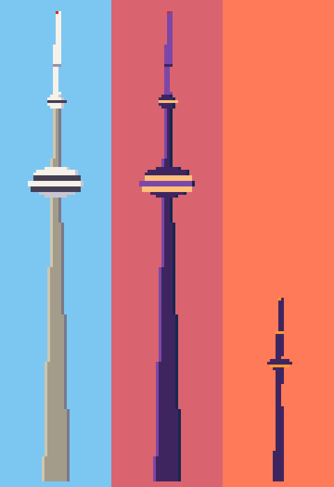

## cyclists

### cyclists v01

2026-11-10

v01: cyclists (bike share, parent with kid seat...), 4 directions.

## dogfraud

### dogfraud v06

2026-11-10

v06 per Ivan's M0 review: moustache removed, swept white hair, more dog (longer muzzle, bigger nose with nostrils, whisker spots, flews, folded dog ears, tan eye patch).

### dogfraud v05

2026-11-09

Laugh: real open mouth (teeth, tongue) for FRA-HA-HA.

### dogfraud v04

2026-11-09

Nose + moustache brought forward of muzzle; ears moved out/forward.

### dogfraud v03

2026-11-09

More dog: protruding muzzle w/ split lip, droopy jowls over collar, big pointed horn-ears, smug arched brows, smaller body.

### dogfraud v02

2026-11-09

Fix framing (origin anchored at bottom).

### dogfraud v01

2026-11-09

First pass portrait (grin / laugh / shock). SDF: pear head (skull+jowls smooth-union), dog nose, handlebar moustache, horn-like ear tufts, painted face features, tiny suit + dotted tie.

## dogfraud_inworld

### dogfraud_inworld v03

2026-11-12

M3.1 (Ivan): arms and torso separated by tone (darker sleeves, light sleeve edge, seam) instead of one diagonal shadow.

### dogfraud_inworld v02

2026-11-12

M2.1 (Ivan: the upper torso looked weird): the head render is clipped at the jowls, and a proper suit is drawn: shoulders as wide as the jowls, lapels, shirt V, dotted tie, arms + paws; podium gets a microphone.

### dogfraud_inworld v01

2026-11-10

M2: Dog Fraud in the world (side vignettes). The portrait's SDF head re-rendered at 0.44 scale on a tiny suit; the first pass doubled the shirt + tie (the head render already includes them). Podium with the DF crest.

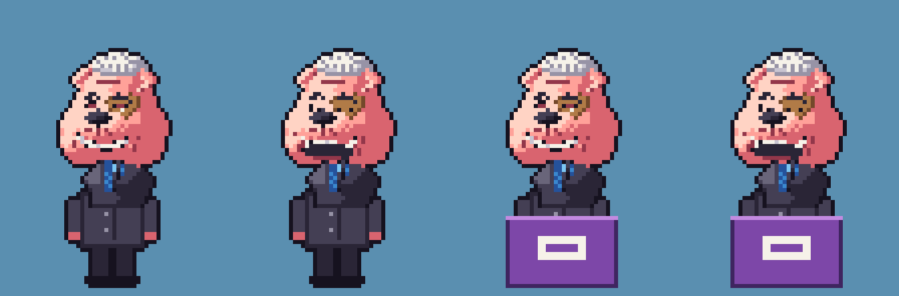

## downtown

### downtown v02

2026-11-12

M2.1 (Ivan's refs): City Hall v02 from city-hall.jpg (two curved towers: white convex backs, dark ribbed concave faces, crescent roofs, the saucer between, the walkway ring); Old City Hall v02 from his photo (banded sandstone, arched windows, brown metal roofs with conical turrets, rose-window gable, clock tower with arcaded belfry + pyramid spire); one Freedom Arch spanning the pool north-south, seen slightly from the west like the photo; a brighter news van facing east.

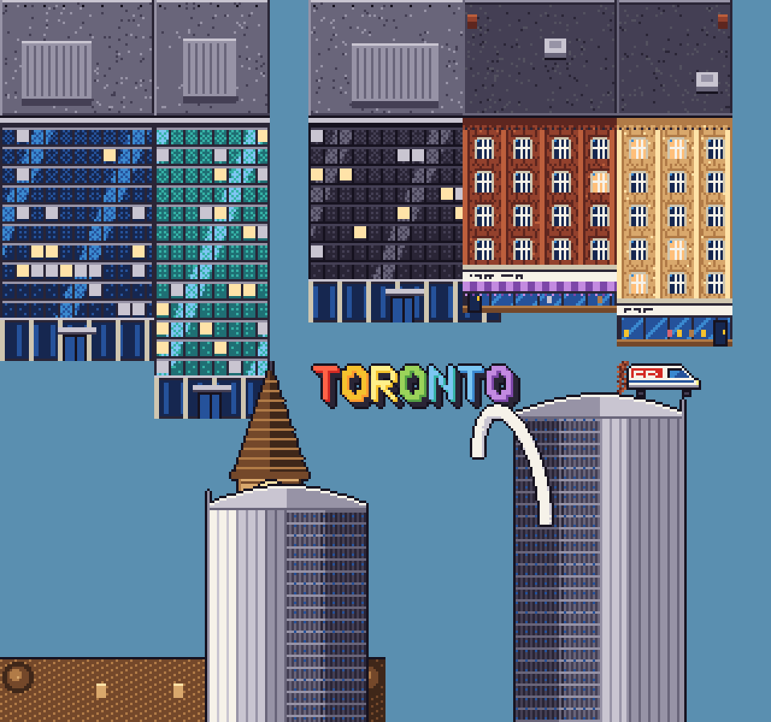

### downtown v01

2026-11-10

M2 Downtown: glass curtain-wall towers (mullion grid, spandrels, sky reflection band, lobby + canopy), King West brick-and-beam warehouses, Old City Hall (sandstone, clock tower, slate hips + copper turrets), City Hall (two curved towers + saucer on the podium), the TORONTO sign, the Freedom Arches, the news van in the wall at 299 Queen W.

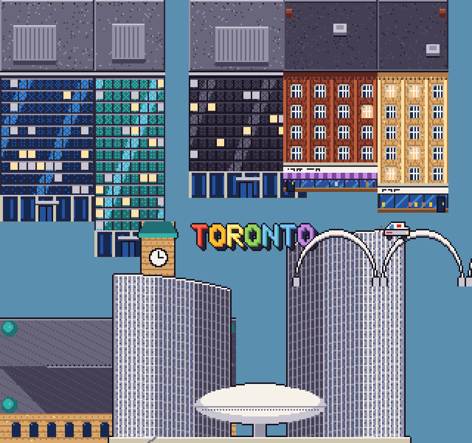

## dvp

### dvp v03

2026-11-10

Ivan M1.1: back-view cars should show tail lights, trunk and rear window. SDF version replaced by a hand-built parametric back view painted natively at each depth scale (roof, tinted rear window + third brake light, trunk shut line, glowing tail lights in dark housings, plate, bumper, reflectors, tyres, mirrors). SUV is taller with roof rails.

### dvp v02

2026-11-10

v02: river ~3x wider (Ivan), CN Tower silhouette uses the new profile.

### dvp v01

2026-11-10

v01: intro highway backdrop (DVP-style ravine, river, lake, sunset, skyline) + back-view cars at 8 depths. First pass trees too sparse -> dense back-to-front canopy.

## eastend

### eastend v03

2026-11-12

M3.1: the Don Jail (1864) facade; cart shelter + pallets for the Monster SUV fight.

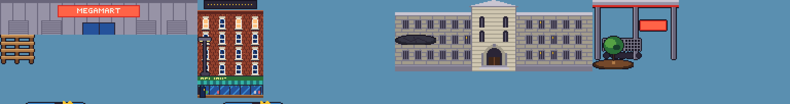

### eastend v02

2026-11-12

MEGAMART sign lettering redrawn with 5-px glyphs (v01's 3x4 blocks read as blank squares at game scale).

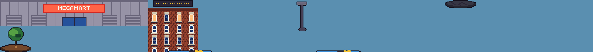

### eastend v01

2026-11-12

M3 East End: MEGAMART big-box facade, the Broadview Hotel, lot lights, asphalt patch -> soil + sapling (depave), the Monster SUV boss.

## font

### font v01

2026-11-09

Original 5x7 uppercase font: plain, outline, shadow, 2x outline (titles).

## highpark

### highpark v02

2026-11-12

M2.1: swans + wood ducks for Grenadier Pond (Ivan), the Jamie Bell Adventure Playground (wooden towers, turret roofs, rope bridges, tube slide), the Grenadier Cafe and the greenhouse facades.

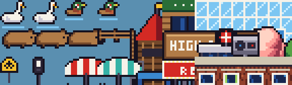

### highpark v01

2026-11-10

M2 High Park / Roncesvalles: cherry + black oak trees, capybaras (v02: added head, ear, eye, nose; v01 read as loaves), zoo rail fence, HIGH PARK sign, TTC station entrance, Parkside speed camera + its cut stump, school-zone sign, transit-priority signal head, King St patio sets, playground, the Revue's marquee, a red-brick school.

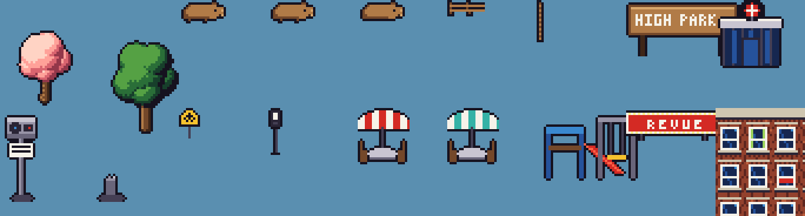

## lane_eater

### lane_eater v01

2026-11-12

M3 mission 5 boss: the Lane Eater, a road-paving machine that eats bike lanes. Three weak points (conveyor, cab, grinder) shown intact and smashed.

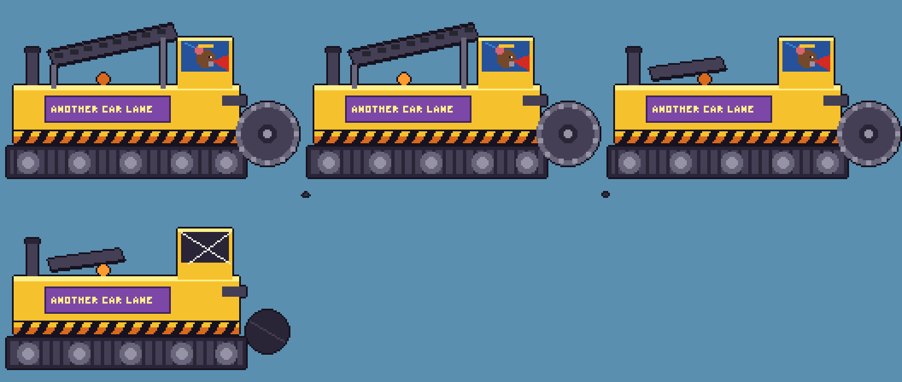

## park

### park v04

2026-11-12

M2.1: picnic tables a little smaller (Ivan), S 11 -> 9.

### park v03

2026-11-10

Ivan M1.1: picnic tables didn't look good. Rebuilt as a tiny 3D model (slatted top, two benches, A-frame legs) projected with the map's 3/4 oblique and painted back to front, so it can sit at 45 degrees as Ivan suggested; dithered ground shadow. Pairs alternate +45/-45.

### park v02

2026-11-10

v02 per Ivan's M1 review + photo reference: gates redrawn (smooth white stone, domed inner piers with panelled lantern, gabled outer piers, inscribed lintels, arched iron carriage gate, plaque). Added the classic green picnic table (SDF version lost its legs at this size, so it's hand-painted) and a stand-alone graffiti sheet (laid over walls instead of baked into buildings).

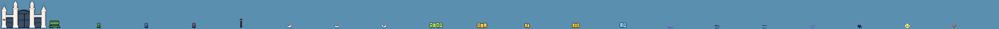

### park v01

2026-11-10

v01: Trinity Bellwoods gates (front elevation + 3/4 tops; first pass had the iron grilles filled solid by the auto-outline - iron now drawn after outlining), Toronto green/blue/grey bins, park lamp, white squirrel.

## park_decals

### park_decals v03

2026-11-12

M3.1: High Park's outdoor pool replaces two of the three diamonds.

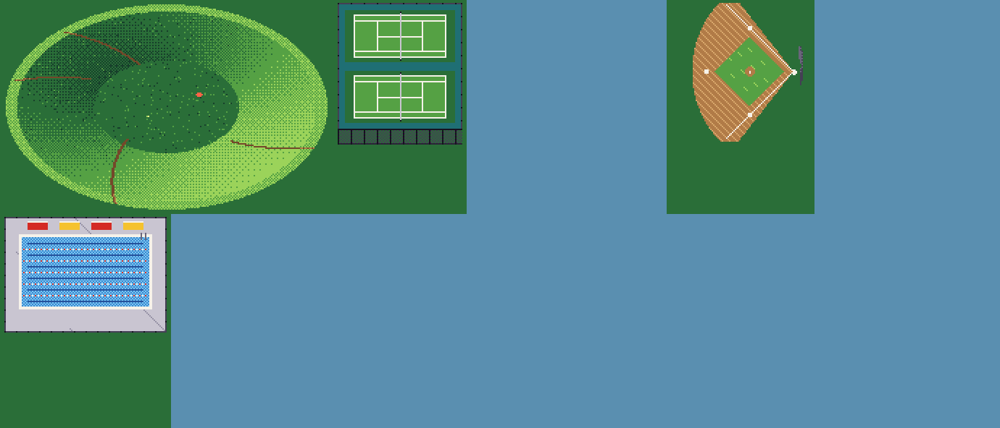

### park_decals v02

2026-11-10

v02: dog bowl reshaped for its new place in the park; diamonds can face east (home plate on the right, as on the park map).

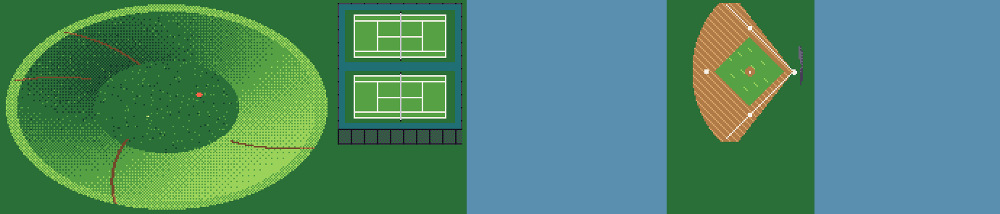

### park_decals v01

2026-11-10

v01: dog bowl (Garrison Creek hollow; first pass had hard sector shading, now Bayer-dithered), tennis courts with standing south fence, baseball diamond.

## people

### people v01

2026-11-10

v01: pedestrians (9 variants incl. kid and dog walker), 4 directions, SDF + 32-degree camera like the raccoon.

## props

### props v03

2026-11-10

v03: chunkier Toronto hydrant (M0 one read as a red gem).

### props v02

2026-11-09

Thicker poles (TTC stop, bike ring) so they survive pixel sampling.

### props v01

2026-11-09

First pass props: trees, sapling, streetlight, TTC stop, post-and-ring bike stand, hydrant, bench, planter, bollard, cone, traffic signal, news box.

## raccoon_side

### raccoon_side v04

2026-11-12

M3.1 (Ivan): bigger tail bounce while riding (tip swings -2..+4 px).

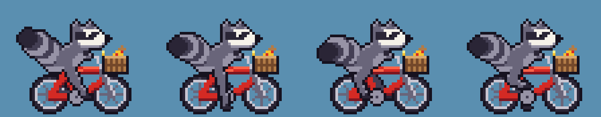

### raccoon_side v03

2026-11-10

v03: trash-can lid replaced by a yellow bike pump swung like a bat (lid didn't read at this scale). First try was a grey tube thrust forward - read like a gun, rejected. Frames grew 48x36 -> 56x44 for swing headroom.

### raccoon_side v02

2026-11-09

Frame widened to 48 (tail no longer clipped), 2px eye with pupil for expression.

### raccoon_side v01

2026-11-09

First pass: hand-painted head grid + procedural bike, IK legs, trash-can-lid attack. Known issues: tail clipped at left edge, small eye, thin legs.

## raccoon_top

### raccoon_top v03

2026-11-12

M3.1: the top-view tail now actually swings (sin(2a) was 0 on all 4 frames) and bobs.

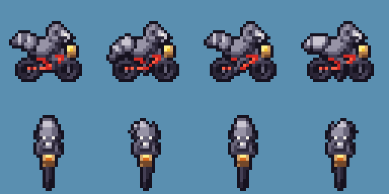

### raccoon_top v02

2026-11-09

Chubbier: wider torso/head/mask/bars so N/S views read; bigger tail sway.

### raccoon_top v01

2026-11-09

SDF-rendered, 8 dirs x 4 pedal frames, 32deg character camera. (Earlier passes - 45deg oblique, too pale/skinny, then flipped camera - were not preserved.) Known issue: N/S views narrow.

## rats

### rats v04

2026-11-12

M3: + the Lobbyist (navy suit, gold tie, briefcase of cash). Hangs back; rats near him take half damage.

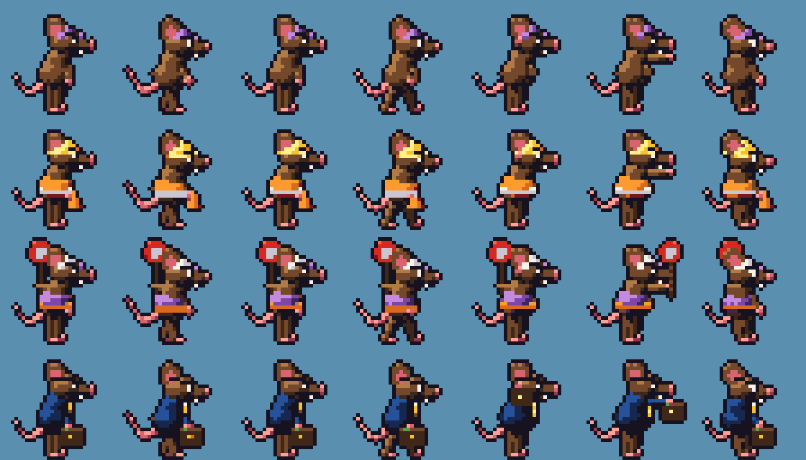

### rats v03

2026-11-09

Ears moved back/up so eyes + hats read.

### rats v02

2026-11-09

Bigger (x1.18), bigger head/ears, white eyes w/ pupils + angry brows; flagger holds STOP paddle aloft in back hand.

### rats v01

2026-11-09

First pass: SDF rats, side view. Rows: basic (purple DF cap), construction (hard hat, hi-vis, cone), traffic (flagger w/ STOP paddle). Frames: walk x4, windup, attack, hurt.

## rats_bureaucrat

### rats_bureaucrat v01

2026-11-10

M2 boss: the Bureaucrat Rat. Same rat model at 1.75x in 48px frames: grey suit (v1 only covered the belly), red tie, camera-facing ring glasses, comb-over, rubber stamp.

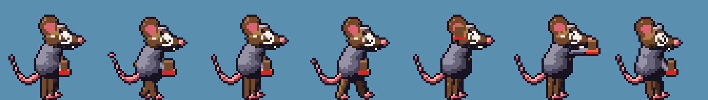

## rats_foreman

### rats_foreman v01

2026-11-12

M2.1: the Foreman Rat, mission 1's new boss (Ivan: 'a boss would make it feel accomplished'): the construction rat at boss size.

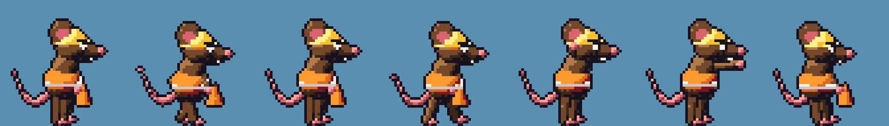

## side_bg

### side_bg v04

2026-11-12

M3 side views: MEGAMART's lot (stalls + wheel stops, big-box backdrop) and the waterfront promenade (lake, islands, railing, Martin Goodman Trail, boardwalk) with MEGA SPA fence panels.

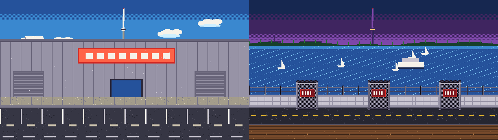

### side_bg v03

2026-11-10

M2 side views: King St W (warehouses + glass towers, red transit lane), Parkside Dr (High Park hill, oaks + cherries, the school), Queen for the streetcar escort (tracks in the far lane).

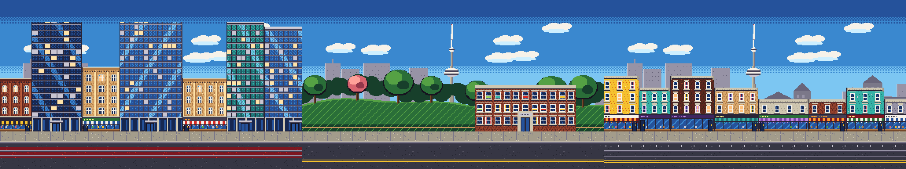

### side_bg v02

2026-11-10

v02: new CN Tower profile; daytime tower windows darker so they no longer read as see-through holes.

### side_bg v01

2026-11-09

First side-view composition: dithered sky (day/dusk), skyline w/ CN Tower + dome, back row, Queen West facade strip, street strip (painted vs protected lane).

## side_props

### side_props v03

2026-11-12

M3.1: the speed hump spans the road (no more cross-section); extra lives are hearts.

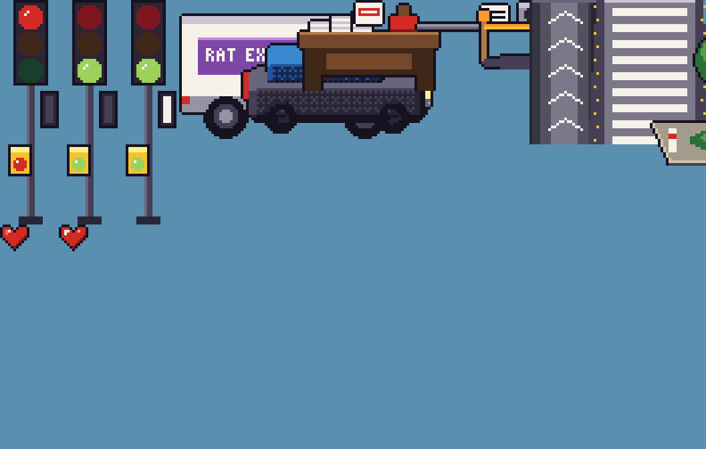

### side_props v02

2026-11-12

M2.1 (Ivan): the raised crosswalk now runs across the whole road with its bars along the road (not brown); the curb extension is a sidewalk bulb-out with a tree, planting and bollards; the extra-life raccoon token.

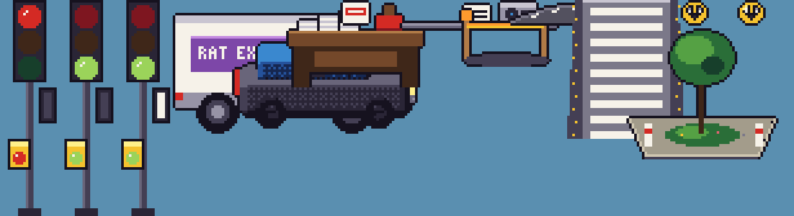

### side_props v01

2026-11-10

M2 side-view mission props: signal pole with a TSP call box (red / green / priority white bar), RAT EXPRESS van, the SUV Rat (driver found by locating the glass band; first pass sat on the roof), the Bureaucrat's desk + DENIED stamp, the stolen speed camera, build stakes, speed hump, raised crosswalk, curb extension.

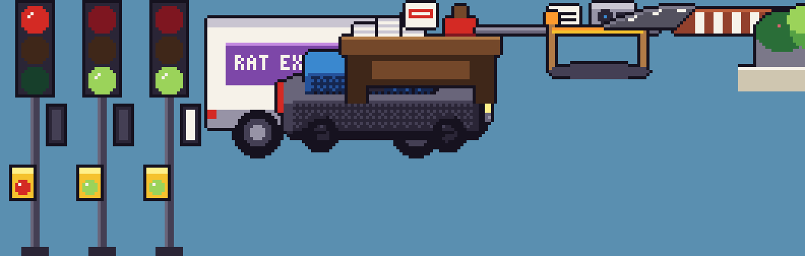

## tiles

### tiles v06

2026-11-12

M3.1: rail corridor tiles (ballast, ties, rails) north of Bremner Blvd.

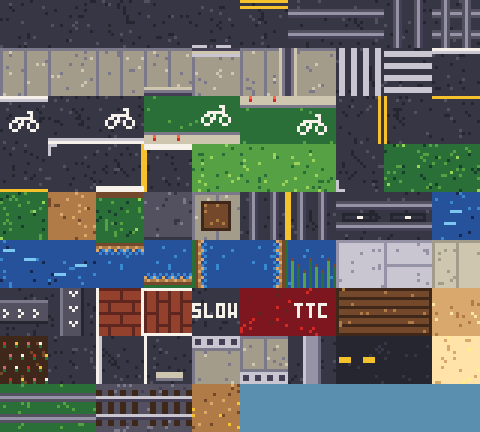

### tiles v05

2026-11-12

M3 tiles: flowerbed, parking lot / stall / wheel stop, Don bridge rails, DVP median, Martin Goodman Trail, sand, Queens Quay's grassy streetcar median.

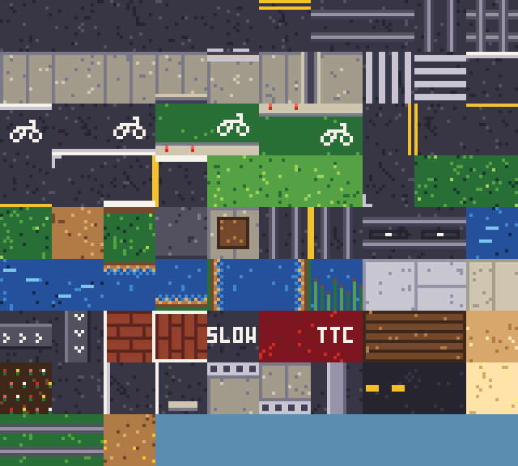

### tiles v04

2026-11-12

M2.1: Hillside Gardens flower beds (tulip rows).

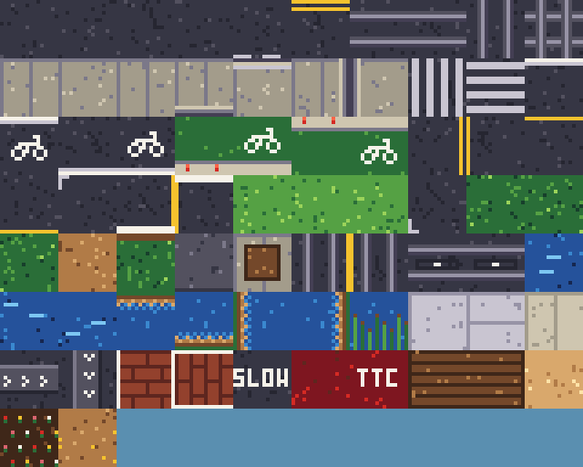

### tiles v03

2026-11-10

M2 tiles: N-S streetcar lanes, TSP detector loops, pond water + shores + reeds, plaza paving, speed humps, raised crosswalks, SLOW stencil (SCHOOL didn't fit 16px), King's red TTC lane, patio decks, trails, zoo pen.

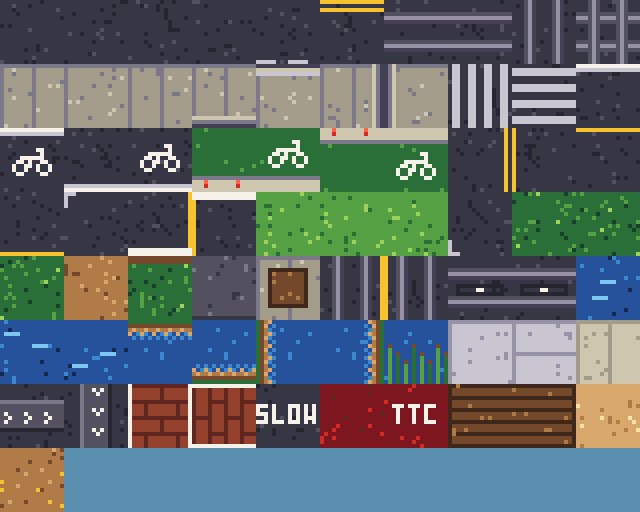

### tiles v02

2026-11-10

v02: N-S road lanes with centre line + stop bars, north parking lane, park lawn, calmer laneway.

### tiles v01

2026-11-09

First tile set: asphalt variants, lane markings, embedded streetcar tracks (E-W, N-S, crossing), sidewalks, curbs, zebras, painted + protected bike lanes, parking, grass, park path, laneway, tree pit.

## vehicles

### vehicles v04

2026-11-12

M3.1 (Ivan: notice the skewed front): the Flexity's cab ends are raked (the end face leans back toward the roof, bumper forward), grey double doors; 45-degree frames for streetcars and cars turning at corners.

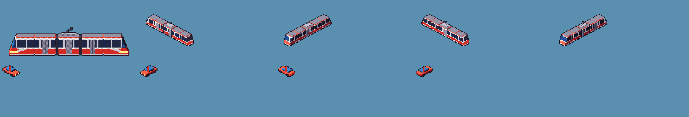

### vehicles v03

2026-11-12

M2.1: streetcars redrawn as TTC Flexity (Ivan's photo): five modules, black joints, red roof edge, white window frame bands, red body, white skirt, the nose swoosh, big windshield.

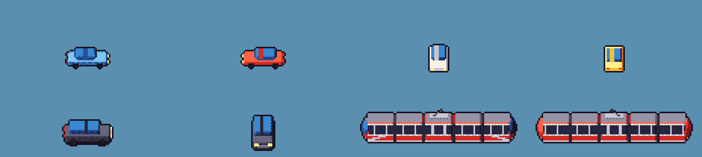

### vehicles v02

2026-11-09

Streetcar: grey roof instead of white slab, taller dark window band.

### vehicles v01

2026-11-09

First pass vehicles: car (4 dirs/colours), SUV, 3-section TTC-style streetcar.

## waterfront

### waterfront v02

2026-11-12

M3.1: CN Tower base (three tapering legs + pavilion, shaft rising off the map), Rogers Centre dome (ribbed sliding panels), Ripley's Aquarium wave roof, ferry terminal + ferry, Sundial Folly, Ontario Place pods + Cinesphere from Ivan's photos, Gardiner deck + piers, track curves, marina dock.

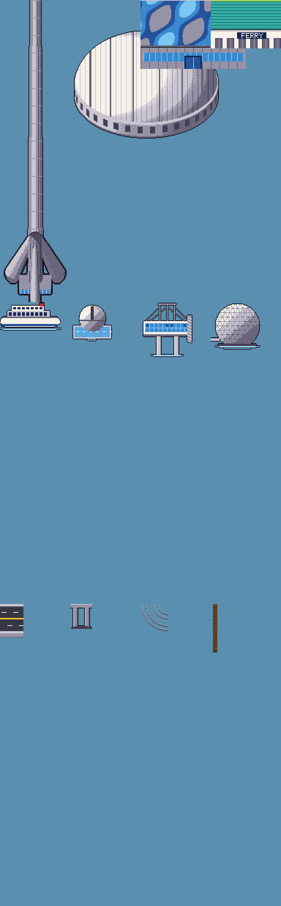

### waterfront v01

2026-11-12

M3 Waterfront: CN Tower (map), the domed stadium, Cinesphere, a pod, Sugar Beach umbrella, sailboat, Gardiner deck segment, MEGA SPA fence + facade (lettering redrawn 5px tall after the 3x3 glyphs read as HECA SPA).

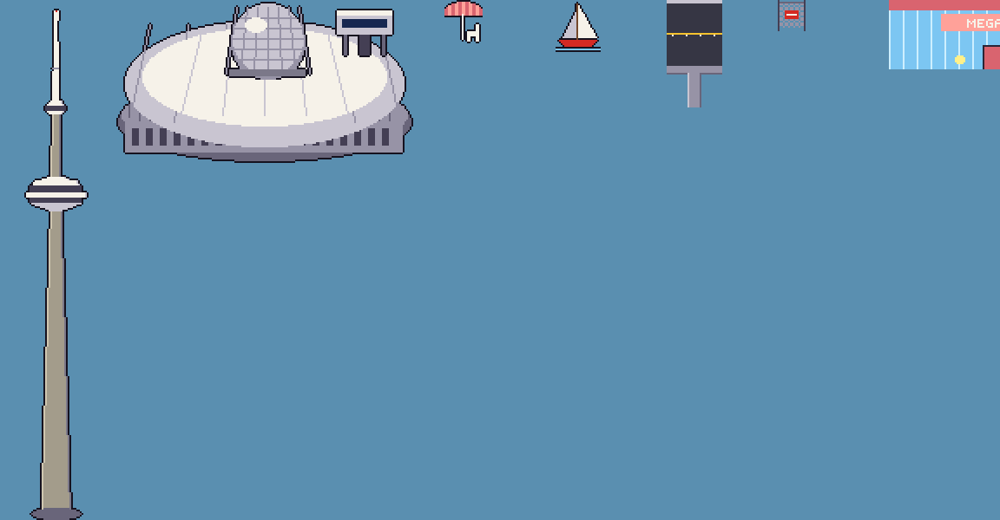

## waterfront_side

### waterfront_side v01

2026-11-12

M3.1 mission 8: the Pink Digger boss (3 poses), the Toronto Islands band (lighthouse, Billy Bishop airport), a turboprop + a Cessna, sand clod.

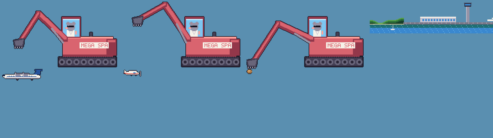
