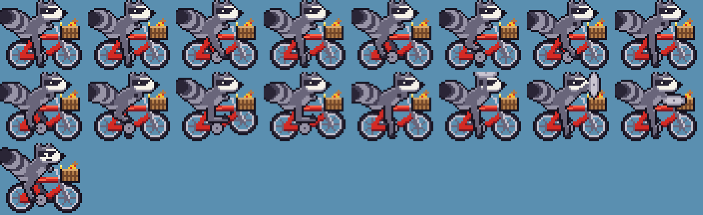
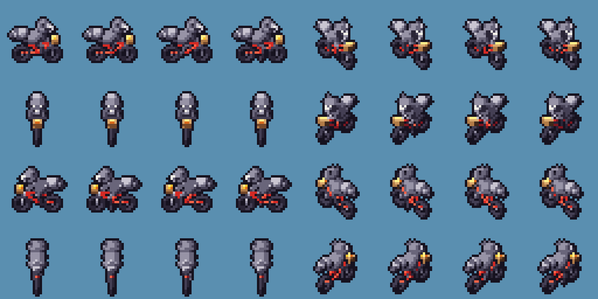
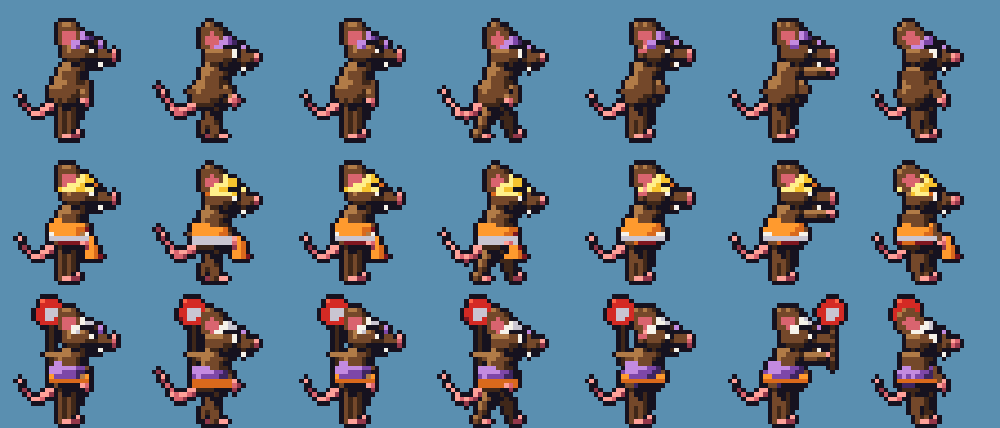
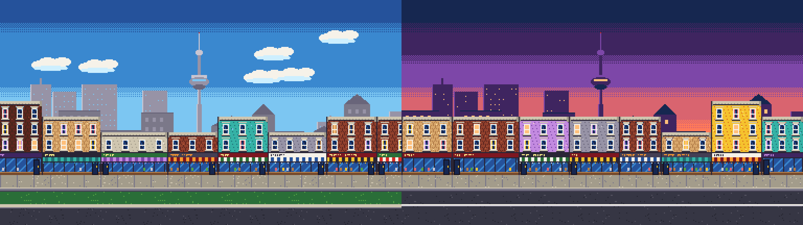
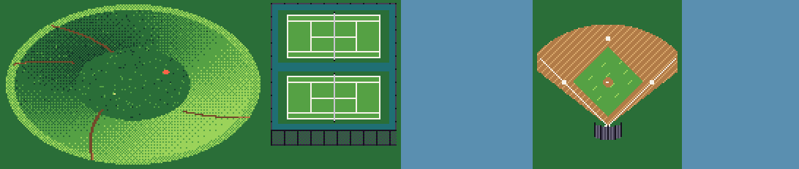
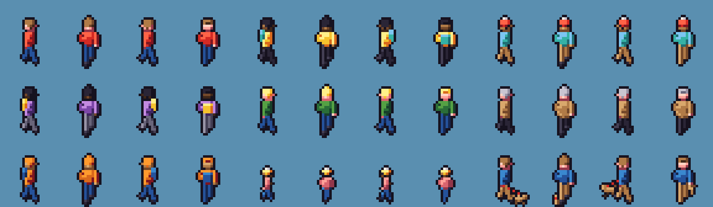
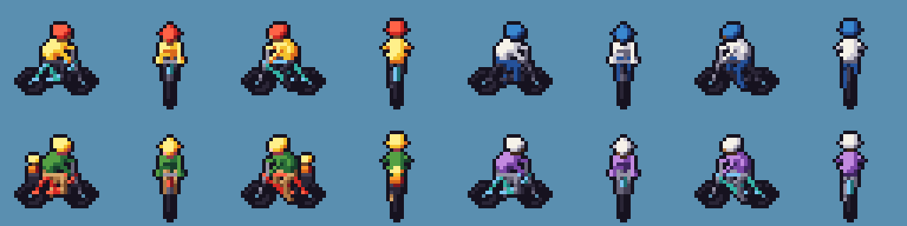
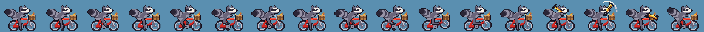
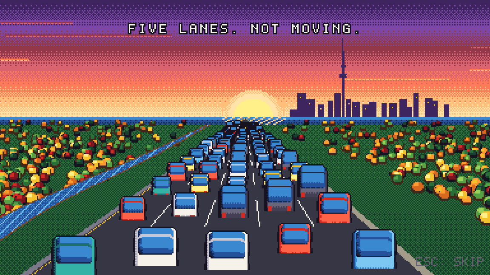

# Trash Panda: Right of Way: Dev Log

A running record of the process: what was tried, what failed, what changed and why. Newest entries are at the bottom of each day. Art iterations are frozen in [`art/history/`](../art/history/INDEX.md).

---

## 2026-11-09: Day 1, M0 kickoff

### Planning decisions (with Ivan)
- **Attack input:** a context button. K/Interact becomes Attack inside missions, and Dash and jump-stomp also hurt rats. Mobile keeps a stick plus 4 big buttons.
- **Hosting:** a public repo at `besit/trashpanda`, auto-deployed to GitHub Pages.
- **Art:** I author all of it as code and data, with an art-direction review gate at M0.
- **Map camera:** 3/4 oblique top-down, so Toronto's brick facades are visible instead of just roofs.
- **Mission added at Ivan's request:** speed cameras. Ontario banned municipal automated speed enforcement and the cameras were removed. Facts are to be verified in `URBAN_RESEARCH.md` before any copy is written.
- **Process rules:** dependencies stay project-local only; every art version is kept; this devlog is kept up to date.

### Stack
Phaser 3.90 (final stable v3), TypeScript 5.9, Vite 8, Vitest 5 and Playwright 1.65. Playwright's Chromium is installed into `node_modules` (`PLAYWRIGHT_BROWSERS_PATH=0`), so nothing is installed globally.

I deliberately chose Phaser 3.90 over the newer Phaser 4.2: v3 is frozen, battle-tested and very well documented. Phaser 4's renderer gains don't matter for a 384×216 pixel game.

### Art pipeline v1: pixel art as code
I can't drive a GUI editor, so all art is authored in code with two techniques:

1. **Hand-painted grids + procedural parts** (`tools/lib/raster.mjs`): text grids where each character is a palette colour, plus primitives (lines, ellipses, polygons), an auto-outline pass and rim lighting. Used for the side-view hero sprites, where expressiveness matters most.
2. **A tiny SDF renderer** (`tools/lib/sdf.mjs`): characters and vehicles are modelled from spheres, capsules, tori and boxes, then ray-marched into the 48-colour palette with stepped shading, Bayer dithering and an auto-outline. One model renders in all 8 directions and every animation frame, consistently. It's the same idea as the 3D-to-pixel pipelines some indie games use, scaled down to a few hundred lines.

Master palette (`tools/palette.mjs`): TTC reds, Toronto brick, lake blues, concrete greys, park greens, Dog Fraud pinks, and sunset oranges and purples. Outlines use a near-black purple instead of flat black, for a warmer arcade look.

### Side-view raccoon v01

The head is a hand-painted 14×10 grid (bandit mask, white brow and muzzle, ears). The bike is procedural: a red steel cruiser, spoked wheels that rotate per frame, swept-back bars, a bell, and a wicker basket with a pizza slice. Legs use 2-bone IK, so the feet really follow the pedals. The attack is a **trash-can lid swing**, chosen for being on-brand and non-violent.

What works: the silhouette and striped tail read immediately, and the red bike pops.
Known issues: the tail clips the frame edge, the eye is too small to emote, and the legs are a bit spindly.

### Top-down raccoon: three failed passes, then v01–v02
- **Pass 1 (not preserved):** rendered with the same 45° oblique projection as the ground. Everything came out pale and the front/back views were long, thin sticks. A true oblique projection stretches anything pointing north-south.
- **Pass 2 (not preserved):** darker shading and a chubbier body. Better, but still stick-like front and back. The key insight: classic 3/4 games *cheat*. The ground is drawn top-down, but characters are drawn from a lower camera.
- **Pass 3:** moved characters to a 32° camera. The first render was upside down because of a sign error in the camera basis (`right = d × up` should have been `up × d`). Fixed.
- **v01:** 8 directions × 4 pedal frames, all from one model.
- **v02:** wider torso, head and mask so the front view shows the face and the back view shows the tail.

*Ivan asked to keep every version from here on. Passes 1–2 were overwritten in scratch before that.*

### Rats v01 → v03
- **v01:** SDF rats read as rats immediately, but they were too skinny, with 1px eyes, and the flagger's STOP paddle covered his face.
- **v02:** scaled up 1.18×, bigger heads and ears, white eyes with pupils and angry brows, paddle moved to the back hand. The new ears then covered the eyes and hats.
- **v03:** ears moved back and up.

### Dog Fraud v01 → v05
Taken from Ivan's street-art reference as *shape language only*: flushed pear head, horn-ears, handlebar moustache, smug grin, tiny suit. He's built as a cartoon bulldog, not a likeness.
- **v01:** the framing bug put the head out of frame.
- **v02:** first real look. Characterful, but closer to a pig than a dog.
- **v03:** added a protruding muzzle with a split lip, droopy jowls over the collar, bigger horn-ears, smug arched brows (the first brows read as angry) and a smaller body. The muzzle now hid the moustache and nose.
- **v04:** nose and moustache brought forward.
- **v05:** the laugh frame gets a real open mouth (teeth and tongue) for FRA-HA-HA.

### Environment
- **Tiles:** asphalt, embedded streetcar tracks (E-W, N-S, crossing), sidewalks with slab seams, curbs, zebras, painted and protected bike lanes (green paint, curb, bollards), parking, grass, park path, laneway, tree pits. The bike stencil first rendered as blobs, so it was replaced with a hand-painted glyph. The flipped north-lane tiles showed an upside-down bike, so proper north-side tiles were drawn.
- **Buildings:** a seeded Victorian storefront generator (sign bands, awnings, sash windows, cornices). Rear walls get fire escapes and graffiti. v02 calmed the noisy painted-brick texture.
- **Props and vehicles:** the TTC stop pole vanished because it was thinner than a pixel, so it was thickened. The streetcar roof read as a white slab and is now grey with a taller window band. Side-view cars looked tiny next to the side raccoon, so they got dedicated 2.2× side renders.
- **Side-view backgrounds:** a dithered day/dusk sky, a skyline with the CN Tower and the Dome, a back row of houses, the Queen West storefront strip, and a street strip with painted and protected variants.

### The game
- **Boot → Title → Cutscene → Explore ⇄ Action**, sharing one GameState.
- **Explore:**
  - tilemap ground; y-sorted buildings and props; building footprints as colliders
  - roofs fade when the raccoon rides behind them
  - traffic on lanes with a signal cycle; cars and streetcars yield and honk or ring
  - mission marker with a zoom + iris transition
  - the **transformation sequence:** the camera pans along Queen while protected lanes sweep in tile by tile with sparkles and planters pop up, then Livability ticks 60 → 64 with a sourced blurb.
- **Action:**
  - parallax layers; arena-lock waves; parked cars to hop on
  - coyote time, jump buffer, variable jump, air dash
  - 3-hit trash-can-lid combo; stomps; hit-stop and shake
  - rats with telegraphed windups; construction rats lob cones you can swat
- **Audio:** a WebAudio chip synth (pulse waves with 12.5/25/50% duty via PeriodicWave, triangle, LFSR noise) and a lookahead sequencer. Songs: *Queen St. Cruise*, *Historic Investment* (Dog Fraud), *Rat Rush*, plus an improvement sting.

### Bugs found by testing (and fixed)
1. **Quick key taps were ignored:** a key pressed and released within one frame cleared Phaser's just-down flag before the scene read it. The input manager now latches taps from keydown events. Headless tests found this, and it would also have bitten fast human tappers.
2. **Preview server served the wrong base path:** `vite preview` runs as "serve", so the `/trashpanda/` base wasn't applied.
3. **The raccoon spawned inside a street tree's collider.**
4. **The wave-clear check could never fire** once dead rats were filtered out of the list. Replaced with explicit per-wave counters.

### Research
Two entries are written in `URBAN_RESEARCH.md`, and the mission's framing changed because of the second one:
- **Speed cameras** (Ivan's request): Ontario's Bill 56 ban took effect November 14, 2025. The SickKids/TMU study found a 45% drop in speeding vehicles in school zones.
- **Protected bike lanes:** Bloor saw a 49% rise in cycling, and the TCAT economic study was positive. Teschke 2012 found cycle tracks had about 1/9 the injury risk. **News since planning:** the Court of Appeal overturned the Charter ruling (August 2026) and Bloor removal work began in October 2026. The in-game blurb now quotes only Teschke 2012.

### Numbers
- 60 fps even at 6× CPU throttle; about 16 MB JS heap; about 575 KB total gzipped download.
- 10 unit tests and 3 end-to-end tests, all passing. Deployed to https://besit.github.io/trashpanda/.

---

## 2026-11-09: Day 1 (evening), M1 pass from Ivan's M0 review

Ivan reviewed M0 on a phone and a desktop. The verdict: "I like the art!" He sent 8 issues, answered the 4 open questions, and left a pile of smaller notes. This pass works through all of it, plus the planned M1 items.

### The freeze (the review's worst bug)
*"The side-view scene hanged after the second wave, probably when the thing the rat throws hits the ground."* He was exactly right. `physics.add.collider(cones, ground, cb)` looks as if it calls `cb(cone, ground)`. But when a **group** collides with a single object, Phaser 3 internally swaps the arguments and calls `cb(ground, cone)` (World.js `collideHandler` → `collideSpriteVsGroup(object2, object1)`). My callback then called `setVelocity` on the ground's *static* body, which threw. An exception inside Phaser's game loop stops the loop, so the game froze.

The e2e test never let a cone land, which is why it slipped through. The fix resolves the cone explicitly. There's also a new regression test, and that test needed its own fix: my first version **passed even with the bug put back**, because the cones hit the (invulnerable-by-HP) player and were destroyed before touching the ground. Making the player truly invulnerable lets the cones fall through. Now the test fails on the old code and passes on the new.

### Smaller bugs from the review
- **"Weird non-moving buildings in the middle-ground"** on the title and cutscene: the back row of houses was the one parallax layer that never scrolled. All layers now drift.
- **"Transparent pixels in top-layer buildings":** arched sash windows rounded their corners by setting pixels to *transparent* instead of wall colour. A scan of 600 generated buildings now finds 0 holes.
- **Cars on the vertical street offset to the left:** the lane centre was computed from the curb column (`XS + 1.5`) instead of the road centre (`XS + 2`), so it was off by 8px. Vertical car sprites were also clipped by a too-short frame.
- **North-side flowerbeds in the wrong place:** the planters were on the sidewalk side of the north lane. They now sit on the separator, the traffic side, for both lanes.

### Decisions applied
| Ivan said | Done |
|---|---|
| K isn't natural; use E or R. What are the other controls? | Left hand on WASD: **E** act/attack (also R), **Q** dash, **Space** hop/jump, **Shift** boost, **M** map, **Esc** pause, plus an arrow-key layout (Z/X/C/V). Controls show in the first-run toast, on mission title cards, and on new Controls pages (pause and title). |
| Small street things shouldn't be obstacles; trees are fine | Only trees, buildings, the gate piers and parked cars are solid now. |
| "Another CAR lane" | The catchphrase, intro title and rat signs now say ANOTHER CAR LANE. |
| The park should be Trinity Bellwoods, north of Queen, with the white gates | The whole district was rebuilt (below). |
| Queen has no bike lanes; the mission should add them | Queen now starts with curb parking lanes. The mission turns them into protected lanes, and the parked cars drive away as the sweep passes. |
| Dog Fraud: no moustache, white hair, a bit more dog | Dog Fraud v06 (below). |
| Stretch to fill wide screens | The view width now adapts from 384 to 480px. An 844×390 phone gets 468px of city and no black bars. |
| A bike pump reads better than the lid | Raccoon side v03 (below). |
| Speed cameras: main mission | *Slow Down, Dog* is now main mission 4, in the High Park school zone. |
| The bell ring comes from his butt | A new ring effect comes from the handlebars, in the direction he faces. |
| Rotate-your-phone should overlay the darkened game | It's now a translucent, blurred overlay, and gameplay auto-pauses. |
| A small map? | **M** opens a district map built from the live tilemap, so improvements show up on it. It shows streets, landmarks, missions and your position. |
| Intro roads gag: DVP-style highway into the lake at sunset, then another lane, still jammed | New intro shot (below). |
| Add Dundas, since the removal happens there? | Researched: the 2026 removals target Bloor, Yonge, University, Queen's Park and Avenue Road, not Dundas. Dundas is on the map anyway (it really is the park's north edge), and the removal story will move to Bloor in the High Park district. |

### The new Queen West
Real geography first: Trinity Bellwoods sits *between* Queen and Dundas, with its gates on Queen facing Strachan Ave. The map is now 104×76 tiles:
- **Dundas St W** with the 505 and Little Portugal shops, including a new **azulejo** tiled-facade material.
- **The park:**
  - the **gates**, with a plaque you can read with E
  - the **dog bowl** (the hollow left by buried Garrison Creek)
  - tennis courts and a baseball diamond
  - smooth paved paths (one Catmull-Rom decal instead of blocky tiles)
  - park lamps and Toronto's raccoon-resistant **green bins** (of course)
  - the **white squirrel**, which flees when you ride up
- **Queen St W** with the 501.
- **Ossington** and **Bellwoods** at signalised intersections, and **Strachan** south from the gates.
- A **graffiti lane** behind Queen, with procedural murals: bubble letters, drips and little faces.

Failed first passes:
- The gates' iron grilles came out as **solid black slabs**: the auto-outline pass filled every 1px gap between bars. The iron is now drawn *after* outlining.
- The dog bowl's shading had hard **pie-slice sectors**. It now uses a continuous slope term with Bayer dithering.

### Ambient life
- **Pedestrians:** 9 variants, including a kid, a dog walker and a senior in a coat. They walk sidewalks and park paths, stop for you, and sometimes answer the bell ("NICE BELL!").
- **Traffic** was rewritten around data-driven lanes and intersections:
  - streetcars stop at TTC stops
  - one signal cycle for all intersections
  - **cyclists**: before the upgrade, a few brave ones ride in the streetcar lane and cars queue behind them honking. After it, they get the protected lanes, and there are more of them. The map itself makes the argument.

### Dog Fraud v06
- Removed the moustache.
- Added a big **swept white coif**.
- More dog: a longer muzzle, a bigger nose with nostrils, whisker spots, flews, and folded dog ears (the horns now read as ears).
- Added an eye patch. The first one was dark pink and read as a **black eye**, so it became a tan fur patch.

### Bike pump (raccoon side v03)
- **First try:** a grey tube thrust straight forward. It read as a **gun**. Rejected immediately.
- **Second try:** a red pump swung like a bat. It merged into the red bike, and the raised frame clipped out of the 48×36 frame.
- **Final:** a **yellow** barrel with a black T-handle, a hose loop and a white swoosh on the big swing. Frames grew to 56×44 for headroom.

### Intro: "ANOTHER CAR LANE"
The ROAD×8 gag is replaced by Ivan's idea. A baked backdrop shows a ravine of autumn woods, the river, the lake at sunset and the skyline with the CN Tower. The road is drawn live, so a lane can be added on screen.
- Five lanes of back-view cars (pre-rendered at 8 depth scales), crawling.
- Dog Fraud: "...ANOTHER CAR LANE!"
- A sixth lane paves in from the horizon. Cars pour in for a moment of hope, then gridlock. Caption: "SIX LANES. STILL NOT MOVING." (induced demand: URBAN_RESEARCH §14).

The first pass let the jam *drain* away from the camera over time, so the road emptied. Lanes now refill from behind the camera.

### Before/after vignettes
- **Before:** Queen at 8:14 am. A parent with a kid seat rides between parked cars and an approaching 501, wobbles, and gets honked at. Rats with an ANOTHER CAR LANE sign claim the curb lane. The raccoon: "WHAT QUEEN NEEDS IS A BIKE LANE. A REAL ONE, WITH A CURB."
- **After:** the same street with green protected lanes and planters, the parent, a bike-share rider and the streetcar gliding by. Caption: "NOW A KID CAN RIDE IT."

The first passes overlapped captions and let the streetcar hide the cyclist entirely. Side-view scenes now put the dialogue box at the top, so it doesn't cover the actors.

### Also
- Pause menu: resume, city map, controls, music and sound volume, screen shake, save + quit.
- Rats no longer stack into one blob.
- A chunkier hydrant (it read as a red gem).
- Touch controls gained map and pause buttons.

### Numbers
- 60 fps at 1×/4×/6× CPU throttle, with a 21 MB heap (was 16 MB).
- JS 349 KB gzipped; generated art 1.05 MB raw.
- 10 unit tests and 6 end-to-end tests, all passing.
