# Trash Panda: Right of Way: Dev Log

A running record of the process: what was tried, what failed, what changed and why. Newest entries are at the bottom of each day. Art iterations are frozen in [`art/history/`](../art/history/INDEX.md).

---

## 2026-11-09: Day 1, M0 kickoff

### Planning decisions (with Ivan)
- **Attack input:** a context button. K/Interact becomes Attack inside missions, and Dash and jump-stomp also hurt rats. Mobile keeps a stick plus 4 big buttons.
- **Hosting:** a public repo at `besit/trashpanda`, auto-deployed to GitHub Pages.
- **Art:** I author all of it as code and data, with an art-direction review gate at M0.
- **Map camera:** 3/4 oblique top-down, so Toronto's brick facades are visible instead of just roofs.
- **Mission added at Ivan's request:** speed cameras. Ontario banned municipal automated speed enforcement and the cameras were removed. Facts are to be verified in `URBAN_RESEARCH.md` before any copy is written.
- **Process rules:** dependencies stay project-local only; every art version is kept; this devlog is kept up to date.

### Stack
Phaser 3.90 (final stable v3), TypeScript 5.9, Vite 8, Vitest 5 and Playwright 1.65. Playwright's Chromium is installed into `node_modules` (`PLAYWRIGHT_BROWSERS_PATH=0`), so nothing is installed globally.

I deliberately chose Phaser 3.90 over the newer Phaser 4.2: v3 is frozen, battle-tested and very well documented. Phaser 4's renderer gains don't matter for a 384×216 pixel game.

### Art pipeline v1: pixel art as code
I can't drive a GUI editor, so all art is authored in code with two techniques:

1. **Hand-painted grids + procedural parts** (`tools/lib/raster.mjs`): text grids where each character is a palette colour, plus primitives (lines, ellipses, polygons), an auto-outline pass and rim lighting. Used for the side-view hero sprites, where expressiveness matters most.
2. **A tiny SDF renderer** (`tools/lib/sdf.mjs`): characters and vehicles are modelled from spheres, capsules, tori and boxes, then ray-marched into the 48-colour palette with stepped shading, Bayer dithering and an auto-outline. One model renders in all 8 directions and every animation frame, consistently. It's the same idea as the 3D-to-pixel pipelines some indie games use, scaled down to a few hundred lines.

Master palette (`tools/palette.mjs`): TTC reds, Toronto brick, lake blues, concrete greys, park greens, Dog Fjord pinks, and sunset oranges and purples. Outlines use a near-black purple instead of flat black, for a warmer arcade look.

### Side-view raccoon v01
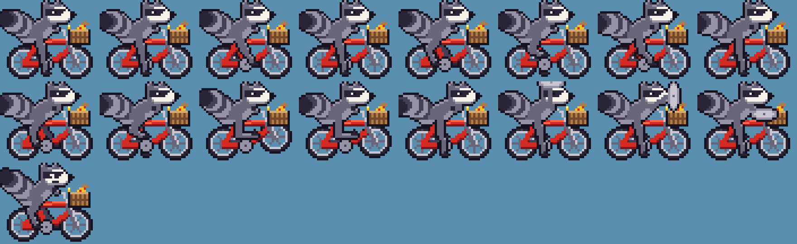

The head is a hand-painted 14×10 grid (bandit mask, white brow and muzzle, ears). The bike is procedural: a red steel cruiser, spoked wheels that rotate per frame, swept-back bars, a bell, and a wicker basket with a pizza slice. Legs use 2-bone IK, so the feet really follow the pedals. The attack is a **trash-can lid swing**, chosen for being on-brand and non-violent.

What works: the silhouette and striped tail read immediately, and the red bike pops.
Known issues: the tail clips the frame edge, the eye is too small to emote, and the legs are a bit spindly.

### Top-down raccoon: three failed passes, then v01–v02
- **Pass 1 (not preserved):** rendered with the same 45° oblique projection as the ground. Everything came out pale and the front/back views were long, thin sticks. A true oblique projection stretches anything pointing north-south.
- **Pass 2 (not preserved):** darker shading and a chubbier body. Better, but still stick-like front and back. The key insight: classic 3/4 games *cheat*. The ground is drawn top-down, but characters are drawn from a lower camera.
- **Pass 3:** moved characters to a 32° camera. The first render was upside down because of a sign error in the camera basis (`right = d × up` should have been `up × d`). Fixed.
- **v01:** 8 directions × 4 pedal frames, all from one model.
- **v02:** wider torso, head and mask so the front view shows the face and the back view shows the tail.

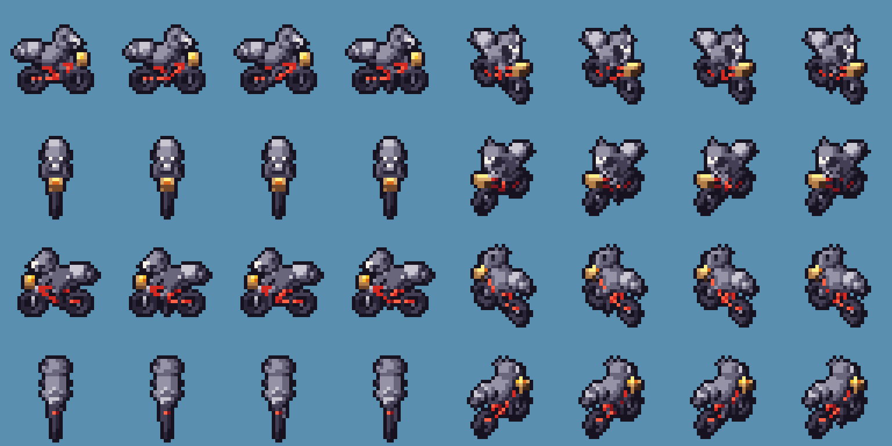

*Ivan asked to keep every version from here on. Passes 1–2 were overwritten in scratch before that.*

### Rats v01 → v03
- **v01:** SDF rats read as rats immediately, but they were too skinny, with 1px eyes, and the flagger's STOP paddle covered his face.
- **v02:** scaled up 1.18×, bigger heads and ears, white eyes with pupils and angry brows, paddle moved to the back hand. The new ears then covered the eyes and hats.
- **v03:** ears moved back and up.

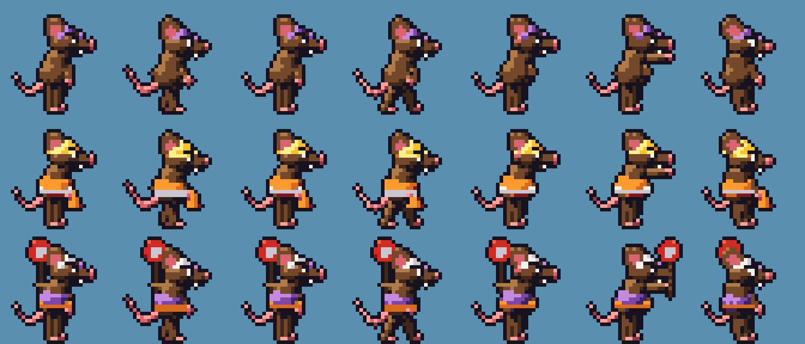

### Dog Fjord v01 → v05
Taken from Ivan's street-art reference as *shape language only*: flushed pear head, horn-ears, handlebar moustache, smug grin, tiny suit. He's built as a cartoon bulldog, not a likeness.
- **v01:** the framing bug put the head out of frame.
- **v02:** first real look. Characterful, but closer to a pig than a dog.
- **v03:** added a protruding muzzle with a split lip, droopy jowls over the collar, bigger horn-ears, smug arched brows (the first brows read as angry) and a smaller body. The muzzle now hid the moustache and nose.
- **v04:** nose and moustache brought forward.
- **v05:** the laugh frame gets a real open mouth (teeth and tongue) for FRA-HA-HA.

### Environment
- **Tiles:** asphalt, embedded streetcar tracks (E-W, N-S, crossing), sidewalks with slab seams, curbs, zebras, painted and protected bike lanes (green paint, curb, bollards), parking, grass, park path, laneway, tree pits. The bike stencil first rendered as blobs, so it was replaced with a hand-painted glyph. The flipped north-lane tiles showed an upside-down bike, so proper north-side tiles were drawn.
- **Buildings:** a seeded Victorian storefront generator (sign bands, awnings, sash windows, cornices). Rear walls get fire escapes and graffiti. v02 calmed the noisy painted-brick texture.
- **Props and vehicles:** the TTC stop pole vanished because it was thinner than a pixel, so it was thickened. The streetcar roof read as a white slab and is now grey with a taller window band. Side-view cars looked tiny next to the side raccoon, so they got dedicated 2.2× side renders.
- **Side-view backgrounds:** a dithered day/dusk sky, a skyline with the CN Tower and the Dome, a back row of houses, the Queen West storefront strip, and a street strip with painted and protected variants.

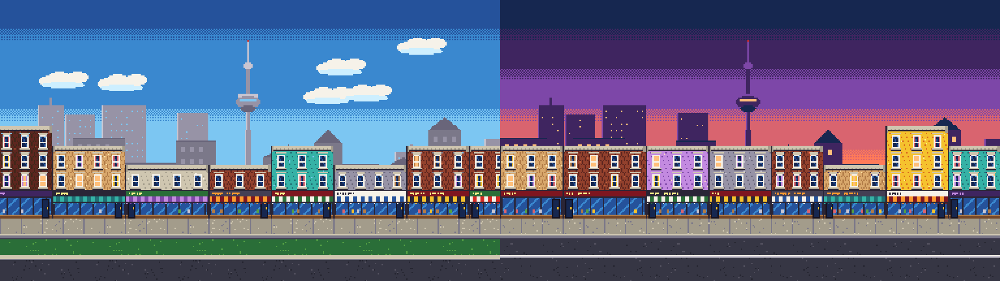

### The game
- **Boot → Title → Cutscene → Explore ⇄ Action**, sharing one GameState.
- **Explore:**
  - tilemap ground; y-sorted buildings and props; building footprints as colliders
  - roofs fade when the raccoon rides behind them
  - traffic on lanes with a signal cycle; cars and streetcars yield and honk or ring
  - mission marker with a zoom + iris transition
  - the **transformation sequence:** the camera pans along Queen while protected lanes sweep in tile by tile with sparkles and planters pop up, then Livability ticks 60 → 64 with a sourced blurb.
- **Action:**
  - parallax layers; arena-lock waves; parked cars to hop on
  - coyote time, jump buffer, variable jump, air dash
  - 3-hit trash-can-lid combo; stomps; hit-stop and shake
  - rats with telegraphed windups; construction rats lob cones you can swat
- **Audio:** a WebAudio chip synth (pulse waves with 12.5/25/50% duty via PeriodicWave, triangle, LFSR noise) and a lookahead sequencer. Songs: *Queen St. Cruise*, *Historic Investment* (Dog Fjord), *Rat Rush*, plus an improvement sting.

### Bugs found by testing (and fixed)
1. **Quick key taps were ignored:** a key pressed and released within one frame cleared Phaser's just-down flag before the scene read it. The input manager now latches taps from keydown events. Headless tests found this, and it would also have bitten fast human tappers.
2. **Preview server served the wrong base path:** `vite preview` runs as "serve", so the `/trashpanda/` base wasn't applied.
3. **The raccoon spawned inside a street tree's collider.**
4. **The wave-clear check could never fire** once dead rats were filtered out of the list. Replaced with explicit per-wave counters.

### Research
Two entries are written in `URBAN_RESEARCH.md`, and the mission's framing changed because of the second one:
- **Speed cameras** (Ivan's request): Ontario's Bill 56 ban took effect November 14, 2025. The SickKids/TMU study found a 45% drop in speeding vehicles in school zones.
- **Protected bike lanes:** Bloor saw a 49% rise in cycling, and the TCAT economic study was positive. Teschke 2012 found cycle tracks had about 1/9 the injury risk. **News since planning:** the Court of Appeal overturned the Charter ruling (August 2026) and Bloor removal work began in October 2026. The in-game blurb now quotes only Teschke 2012.

### Numbers
- 60 fps even at 6× CPU throttle; about 16 MB JS heap; about 575 KB total gzipped download.
- 10 unit tests and 3 end-to-end tests, all passing. Deployed to https://besit.github.io/trashpanda/.

---

## 2026-11-09: Day 1 (evening), M1 pass from Ivan's M0 review

Ivan reviewed M0 on a phone and a desktop. The verdict: "I like the art!" He sent 8 issues, answered the 4 open questions, and left a pile of smaller notes. This pass works through all of it, plus the planned M1 items.

### The freeze (the review's worst bug)
*"The side-view scene hanged after the second wave, probably when the thing the rat throws hits the ground."* He was exactly right. `physics.add.collider(cones, ground, cb)` looks as if it calls `cb(cone, ground)`. But when a **group** collides with a single object, Phaser 3 internally swaps the arguments and calls `cb(ground, cone)` (World.js `collideHandler` → `collideSpriteVsGroup(object2, object1)`). My callback then called `setVelocity` on the ground's *static* body, which threw. An exception inside Phaser's game loop stops the loop, so the game froze.

The e2e test never let a cone land, which is why it slipped through. The fix resolves the cone explicitly. There's also a new regression test, and that test needed its own fix: my first version **passed even with the bug put back**, because the cones hit the (invulnerable-by-HP) player and were destroyed before touching the ground. Making the player truly invulnerable lets the cones fall through. Now the test fails on the old code and passes on the new.

### Smaller bugs from the review
- **"Weird non-moving buildings in the middle-ground"** on the title and cutscene: the back row of houses was the one parallax layer that never scrolled. All layers now drift.
- **"Transparent pixels in top-layer buildings":** arched sash windows rounded their corners by setting pixels to *transparent* instead of wall colour. A scan of 600 generated buildings now finds 0 holes.
- **Cars on the vertical street offset to the left:** the lane centre was computed from the curb column (`XS + 1.5`) instead of the road centre (`XS + 2`), so it was off by 8px. Vertical car sprites were also clipped by a too-short frame.
- **North-side flowerbeds in the wrong place:** the planters were on the sidewalk side of the north lane. They now sit on the separator, the traffic side, for both lanes.

### Decisions applied
| Ivan said | Done |
|---|---|
| K isn't natural; use E or R. What are the other controls? | Left hand on WASD: **E** act/attack (also R), **Q** dash, **Space** hop/jump, **Shift** boost, **M** map, **Esc** pause, plus an arrow-key layout (Z/X/C/V). Controls show in the first-run toast, on mission title cards, and on new Controls pages (pause and title). |
| Small street things shouldn't be obstacles; trees are fine | Only trees, buildings, the gate piers and parked cars are solid now. |
| "Another CAR lane" | The catchphrase, intro title and rat signs now say ANOTHER CAR LANE. |
| The park should be Trinity Bellwoods, north of Queen, with the white gates | The whole district was rebuilt (below). |
| Queen has no bike lanes; the mission should add them | Queen now starts with curb parking lanes. The mission turns them into protected lanes, and the parked cars drive away as the sweep passes. |
| Dog Fjord: no moustache, white hair, a bit more dog | Dog Fjord v06 (below). |
| Stretch to fill wide screens | The view width now adapts from 384 to 480px. An 844×390 phone gets 468px of city and no black bars. |
| A bike pump reads better than the lid | Raccoon side v03 (below). |
| Speed cameras: main mission | *Slow Down, Dog* is now main mission 4, in the High Park school zone. |
| The bell ring comes from his butt | A new ring effect comes from the handlebars, in the direction he faces. |
| Rotate-your-phone should overlay the darkened game | It's now a translucent, blurred overlay, and gameplay auto-pauses. |
| A small map? | **M** opens a district map built from the live tilemap, so improvements show up on it. It shows streets, landmarks, missions and your position. |
| Intro roads gag: DVP-style highway into the lake at sunset, then another lane, still jammed | New intro shot (below). |
| Add Dundas, since the removal happens there? | Researched: the 2026 removals target Bloor, Yonge, University, Queen's Park and Avenue Road, not Dundas. Dundas is on the map anyway (it really is the park's north edge), and the removal story will move to Bloor in the High Park district. |

### The new Queen West
Real geography first: Trinity Bellwoods sits *between* Queen and Dundas, with its gates on Queen facing Strachan Ave. The map is now 104×76 tiles:
- **Dundas St W** with the 505 and Little Portugal shops, including a new **azulejo** tiled-facade material.
- **The park:**
  - the **gates**, with a plaque you can read with E
  - the **dog bowl** (the hollow left by buried Garrison Creek)
  - tennis courts and a baseball diamond
  - smooth paved paths (one Catmull-Rom decal instead of blocky tiles)
  - park lamps and Toronto's raccoon-resistant **green bins** (of course)
  - the **white squirrel**, which flees when you ride up
- **Queen St W** with the 501.
- **Ossington** and **Bellwoods** at signalised intersections, and **Strachan** south from the gates.
- A **graffiti lane** behind Queen, with procedural murals: bubble letters, drips and little faces.

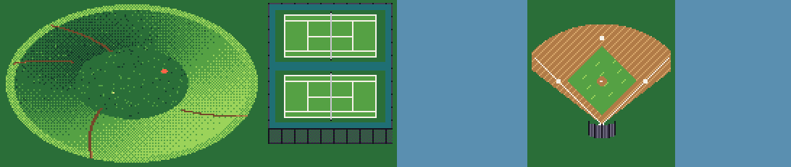

Failed first passes:
- The gates' iron grilles came out as **solid black slabs**: the auto-outline pass filled every 1px gap between bars. The iron is now drawn *after* outlining.
- The dog bowl's shading had hard **pie-slice sectors**. It now uses a continuous slope term with Bayer dithering.

### Ambient life
- **Pedestrians:** 9 variants, including a kid, a dog walker and a senior in a coat. They walk sidewalks and park paths, stop for you, and sometimes answer the bell ("NICE BELL!").
- **Traffic** was rewritten around data-driven lanes and intersections:
  - streetcars stop at TTC stops
  - one signal cycle for all intersections
  - **cyclists**: before the upgrade, a few brave ones ride in the streetcar lane and cars queue behind them honking. After it, they get the protected lanes, and there are more of them. The map itself makes the argument.

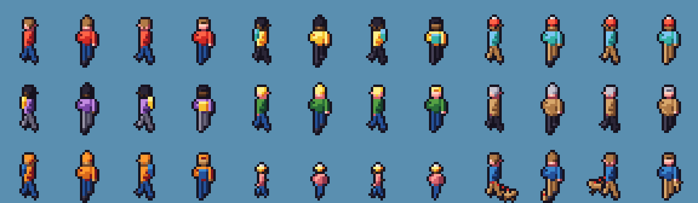
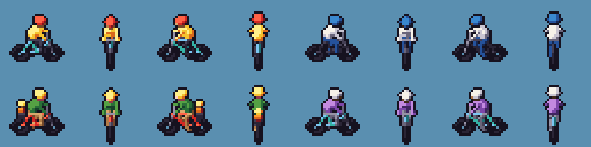

### Dog Fjord v06
- Removed the moustache.
- Added a big **swept white coif**.
- More dog: a longer muzzle, a bigger nose with nostrils, whisker spots, flews, and folded dog ears (the horns now read as ears).
- Added an eye patch. The first one was dark pink and read as a **black eye**, so it became a tan fur patch.

### Bike pump (raccoon side v03)
- **First try:** a grey tube thrust straight forward. It read as a **gun**. Rejected immediately.
- **Second try:** a red pump swung like a bat. It merged into the red bike, and the raised frame clipped out of the 48×36 frame.
- **Final:** a **yellow** barrel with a black T-handle, a hose loop and a white swoosh on the big swing. Frames grew to 56×44 for headroom.

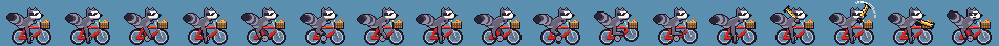

### Intro: "ANOTHER CAR LANE"
The ROAD×8 gag is replaced by Ivan's idea. A baked backdrop shows a ravine of autumn woods, the river, the lake at sunset and the skyline with the CN Tower. The road is drawn live, so a lane can be added on screen.
- Five lanes of back-view cars (pre-rendered at 8 depth scales), crawling.
- Dog Fjord: "...ANOTHER CAR LANE!"
- A sixth lane paves in from the horizon. Cars pour in for a moment of hope, then gridlock. Caption: "SIX LANES. STILL NOT MOVING." (induced demand: URBAN_RESEARCH §14).

The first pass let the jam *drain* away from the camera over time, so the road emptied. Lanes now refill from behind the camera.

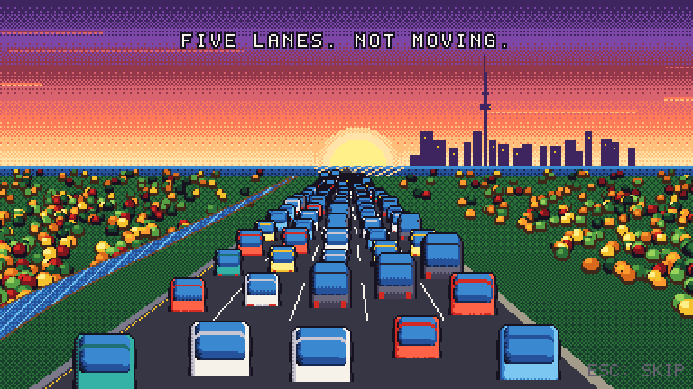

### Before/after vignettes
- **Before:** Queen at 8:14 am. A parent with a kid seat rides between parked cars and an approaching 501, wobbles, and gets honked at. Rats with an ANOTHER CAR LANE sign claim the curb lane. The raccoon: "WHAT QUEEN NEEDS IS A BIKE LANE. A REAL ONE, WITH A CURB."
- **After:** the same street with green protected lanes and planters, the parent, a bike-share rider and the streetcar gliding by. Caption: "NOW A KID CAN RIDE IT."

The first passes overlapped captions and let the streetcar hide the cyclist entirely. Side-view scenes now put the dialogue box at the top, so it doesn't cover the actors.

### Also
- Pause menu: resume, city map, controls, music and sound volume, screen shake, save + quit.
- Rats no longer stack into one blob.
- A chunkier hydrant (it read as a red gem).
- Touch controls gained map and pause buttons.

### Numbers
- 60 fps at 1×/4×/6× CPU throttle, with a 21 MB heap (was 16 MB).
- JS 349 KB gzipped; generated art 1.05 MB raw.
- 10 unit tests and 6 end-to-end tests, all passing.

---

## 2026-11-10: Day 2, M1.1 pass from Ivan's M1 review

Ivan played M1 and sent notes on each area, plus three new references: a photo of the gates, the Friends of Trinity Bellwoods park map, and a CN Tower photo.

### Intro
- The parkway is no longer named on screen. Dog Fjord now says "STUCK IN TRAFFIC? I HAVE THE SOLUTION."
- The "FIVE LANES / SIX LANES" captions are gone (too direct).
- When the sixth lane appears, the cars no longer surge into it. The lane just fills with the same crawl as the others.
- The river is about 3× wider.

### Gates (photo reference)
The memory version was close, but the photo showed what was off:
- The stone is smooth white, not coursed ashlar.
- The inner piers end in a panelled lantern stage and a dome with a finial.
- The outer piers have gabled pinnacles.
- The pedestrian openings sit under stone **lintels carrying the Latin inscriptions**.
- The carriage gate has a segmental iron arch.

The plaque is now three short lines on a bronze plate that fits any screen: THE UNIVERSITY OF / TRINITY COLLEGE / 1852 - 1925. The old one was a long toast that got cut off.

### The park, re-laid from the real map
Everything that already existed was moved to where it actually is. The real park is tall and narrow and ours is wide, so `R(u, v)` maps the map's normalised coordinates into our rectangle:
- the dog bowl in the middle
- the **"Skydome" diamond** in the north-east, plus diamond #2 on the east side (home plates facing east, as on the map)
- the tennis courts by Queen on the east
- the **circle path**, the long diagonal, the west spine to Dundas, the Lobb Ave crossing, and the field-house path around the bowl
- **picnic tables** at numbered picnic areas 2–8
- the white squirrel, living where the map draws its squirrel

The SDF picnic table lost its legs at this size (thin parts vanish when sampled), so it's hand-painted instead.

### Buildings
- **Three Victorian house styles** for the blocks beside the park (`tools/sprites/houses.mjs`):
  - Gothic Revival **bay-and-gable** (Toronto's signature): a steep gable with white gingerbread bargeboard and a pointed-arch window over a two-storey bay.
  - **Queen Anne:** a round turret with a candle-snuffer cone, a fish-scale gable and a spindle porch.
  - **Second Empire:** a slate mansard with arched dormers, a bracketed cornice and hooded windows.

  The gable or mansard is drawn *in front of* the top-down roof, because in 3/4 view it's the front plane rising. The first pass drew hip-roof lines that looked like a **TV antenna** on every Queen Anne, so they were removed.
- **Graffiti is now a separate sheet** (bubble throw-ups, tags, a raccoon stencil, a smiley, a heart) laid over walls at map-build time, as Ivan suggested. Building images are graffiti-free again, and any wall can carry a piece.

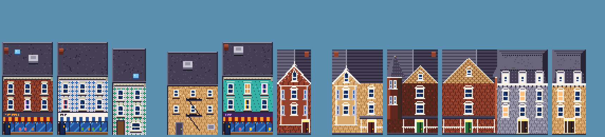

### CN Tower (photo reference)
Redrawn as one shared scanline profile used by every skyline:
- a tapering shaft
- the banded main pod: glass, the widest white rim, a window band, the cap
- a thin upper shaft and the SkyPod
- a long white antenna

The proportions follow the real heights. The first pass tapered in 2px stair-steps; a quarter-pixel centre offset makes each side step separately.

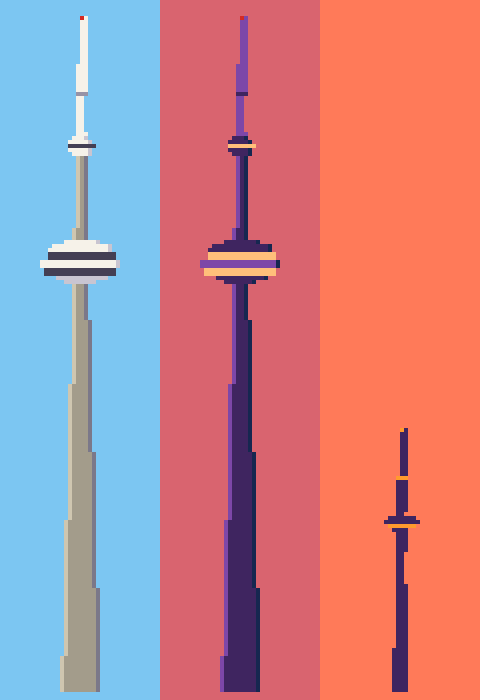

### Feel
- **Traffic speeds:** cars 72–98 px/s, streetcars 52, cyclists 32–39, pedestrians 16–26. A cyclist in the streetcar lane now visibly holds the cars up.
- **Bell replies** from pedestrians now stay readable for 2 s.
- **Side view:** the front buildings scroll with the sidewalk; they used to drift at 0.7× and looked detached. Vignettes no longer pan, so parked cars and planters stay planted on the street.
- **Arena lock:** when rats appear, the arena locks exactly where the camera already is (no jump). After the wave, the camera catches up gently.
- **"Transparent pixels" in the side view:** no holes exist in any facade (all 600+ map buildings and the side strip were checked by script). My best guess is that the daytime skyline towers' windows were sky-blue, so they read as see-through. They're darker now, but this one is flagged for Ivan to confirm.

### Touch bugs (found by Ivan, then a second one found by the new test)
1. **The overlay flickered closed:** the finger that tapped MAP or II was still down when the overlay opened, so its first frame saw a fresh press and closed it again. The paused gameplay scene also never saw the finger lift, which left the button stuck. Now:
   - the overlay ignores input held at open
   - touch state is released whenever a scene pauses or resumes
   - map and controls stay open until the new **X** button (or M/Esc) closes them
2. **Quick taps were dropped:** the new e2e test taps MAP the way a headless browser does (down and up within one frame) and the overlay never opened. It's the same sub-frame problem the keyboard had in M0. Touch buttons now latch taps like keys do.

### Bloor
Per Ivan, the Bloor removals get their own main mission: **The Lane Eater** (GAME_DESIGN, mission 5). It's an auto-scrolling chase ahead of a lane-eating paving machine. Ring the bell at cyclists to grow a peloton that shields you and slows the machine, then break its three weak points.

### Numbers
- 60 fps at 1×/4×/6× throttle; 22 MB heap.
- 10 unit tests and 7 end-to-end tests, all passing.
- Art history: 37 versions.

---

## 2026-11-10: Day 2 (afternoon), M2: three districts, missions 2–4

Ivan's M1.1 notes came in with a screenshot of the "transparent pixels", and a go for M2.

### The "transparency" was a colour, not a hole
Ivan circled a spot right under a window on a teal building. A script had already shown there were no alpha holes anywhere, so I zoomed into his screenshot. Inside the teal wall were **single sky-blue pixels**. The teal brick's weathering speckle used palette `C` (#7cc6f2), which is *exactly* the daytime sky colour. Every speckle read as a pinhole through the building. It's a one-character fix (speckle → pale grey `H`), and it fixes every teal building in both views. New art-bible rule: no wall colour may equal a sky colour.

### The other M1.1 notes
- **Picnic tables:** Ivan suggested 3/4 at 45°. The flat sprite was replaced by a tiny 3D build: slatted top, two benches and A-frame legs as boxes and lines, projected with the map's own oblique (screen y = ground y − height) and painted back to front. Now the table can sit at any angle. Pairs alternate ±45°, with a dithered shadow.
  
- **Cars from behind:** the SDF back view was mostly windshield. It's now a hand-built parametric back view, painted natively at each of the 8 depth scales: roof, tinted rear window with a third brake light, trunk shut line, glowing tail lights in dark housings, plate, bumper, reflectors, tyres, mirrors.
  
- **"Bikes and cars should move":** I had read the M1.1 note as "hold the camera still"; Ivan meant "move everything together". Vignettes are now tracking shots. Facades, sidewalk, parked cars, planters and anyone standing on the street scroll as one plane, while riders and the streetcar hold their place on screen. A new `pan` step eases the speed, so the shot can glide to a stop before the rats walk in.
- **The jump on unlock:** found in Phaser itself. `camera.startFollow()` **snaps** the camera onto the target the moment it's called; the lerp only applies afterwards. The fix keeps the current scroll after `startFollow` and tweens the lerp up from 0.01.

### Three districts, joined at their streets
- Queen West's generator was refactored into a shared toolkit (`tools/map/common.mjs`): streets, crossings, building rows, furniture, parked cars, lanes and exits. A byte-for-byte comparison caught exactly one difference: the old code placed a tree pit on **Strachan's curb** (its local "is this a N-S street?" check forgot Strachan). That's a fix.
- **Decision: separate district maps, not one giant tilemap.** Each district is its own generator and its own lazily loaded building atlas. Streets continue across the seam at the same rows, and a blinds wipe plays as you ride off the edge. Downtown's towers alone make an 810 KB atlas, so phones should only ever hold one district.
- **High Park:** Grenadier Pond (the shore is solid), cherry trees along its east shore, black oak savanna, car-free park roads, the zoo with **capybaras** (plaque: Bonnie + Clyde, 2016), the HIGH PARK sign, the Parkside school zone and its **speed camera stump**, Roncesvalles with the 504 and the **Revue**'s marquee, and Bloor with its bike lanes (mission 5 will fight for them).
- **Downtown:** **Nathan Phillips Square**, with City Hall's two curved towers cradling the saucer, the TORONTO sign, and the pool under the Freedom Arches. Also Osgoode Hall's fence, **Old City Hall**'s clock tower, **Chinatown**'s lanterns at Spadina, **Graffiti Alley** (moved here from Queen West, as Ivan noted), the **news van bursting out of 299 Queen**, and King West warehouses giving way to glass towers.

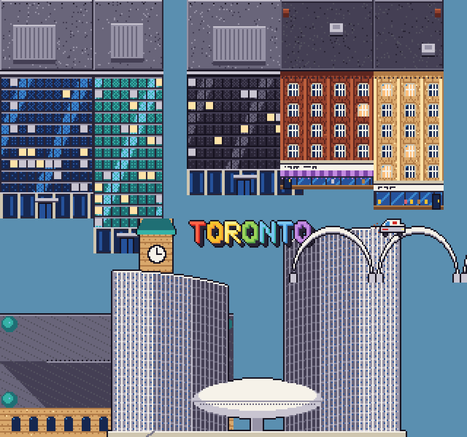
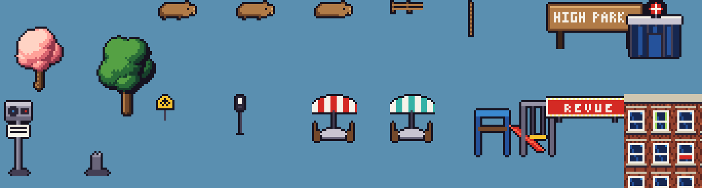

Failures along the way:
- The capybaras v01 read as loaves until they got a head.
- The SUV Rat's driver sat on the roof; the fix locates the glass band in the image and puts the driver behind the front window.
- In-world Dog Fjord v01 wore two ties, because the portrait head already includes its shirt and tie.
- The SCHOOL stencil doesn't fit in 16 px, so the lane says SLOW.
- The font has no `[ ]`, and `*` looks like `#`.

### Missions 2–4 and a playtest bot
Research first (URBAN_RESEARCH §3, §4, §16):
- the 1991 TTC signal-priority demonstration (−35% streetcar delay at six intersections)
- the King St pilot (~4 minutes faster, 72k→84k weekday riders, made permanent in 2019)
- the real Parkside camera: cut down 7 times in under a year and once dumped in a park pond, which *is* mission 4's plot

The missions:
- **Let the Streetcar Through:** an escort with no combat. Pump call boxes for priority, move a double-parked van and a left-turner, swat the cones off the tracks. Delay drains the schedule.
- **King of the Street:** **SUV Rats** (stomp the roof or pump the bumper; "RIGHT TURN ONLY!"), then the **Bureaucrat Rat**: stamps, a shove, summoned clerks and red tape.
- **Slow Down, Dog:** chase the camera haulers before the pond, then build a hump, a raised crosswalk and a curb extension under traffic.

I wrote a **playtest bot** (`tools/scratch/bot.mjs`) that plays with real key presses. It earned its keep:
- The chase was caught in 3 s (too easy). After a retune it could never be caught: the rubber band made the rats faster than an average boosting player. It's now **140 px/s with a gentle 1.05× near band**, catchable only by boosting smartly, in about 7 s.
- The Bureaucrat died in 6 s, so its HP went from 18 to 32.
- SUVs killed the bot repeatedly: a pump hit only slowed the car, which then drove into you anyway. Hits now **stall** the car (no contact damage while stalled), so the combo can land.
- **Two rat AI bugs that M1 also had:** a ranged rat spawned off-screen could back away forever and snipe cones from outside the arena, and a rat stuck at the edge never entered. Rats now always walk in first and stay inside a locked arena.

### Numbers
- **Performance:** 60 fps everywhere at 1×/4×/6× CPU throttle, including Downtown (38 MB heap).
- **Downloads:** first load about 1.8 MB (budget 2.5 MB); Downtown's 930 KB loads only when you ride in.
- **Tests:** 14 unit tests (new: v1→v2 save migration, every mission's marker and patch exist, every district exit has its partner) and 11 end-to-end tests (new: crossing districts; missions 2–4 from marker to saved payoff), all passing.
- **Art history:** 47 versions.

---

## 2026-11-11: Day 3, M2.1 pass from Ivan's M2 review

Ivan played M2 and sent a long, precise list, plus five references: the City's High Park map, two City Hall photos, Old City Hall, and a Flexity streetcar.

### The one-pixel seam (round two)
His description: a single row under the 2nd-floor windows changes colour, from the left of the screen up to the CN Tower's left edge, and the border **moves with the skyline**. A seam that tracks a *different* parallax layer can't be in the facade art. A per-row frame-diff harness (two captures, compare each row against the expected scroll) found nothing at 1:1 on my GPU. So I removed the whole class of bug instead of chasing a driver: every side-view layer (missions, vignettes, the title) is now a `ScrollLayer` made of plain images placed on whole pixels, replacing Phaser `TileSprite`s, whose shader-side texture wrapping is the only thing that could tie one row to another layer's content. To be confirmed on Ivan's machine.

### Systems
- **Side view moved up 18px** (`ui/sideLayout.ts`, one place for all the lines). Streetcars now sit on their rails in every vignette and mission, and the street strip is taller so the road reaches the bottom.
- **District seams by street name**, not by row (Ivan: maps can differ in size). The Queensway continues as Queen, Bloor as Dundas. That let High Park grow taller (to match the real park's shape) and Downtown push King south.
- **Lives.** Lose all your hearts and you lose a life (raccoon tokens between the hearts and the stamina bar) and the mission restarts. At zero lives you go back to the map with 3 lives again. Failing an objective (late streetcar, splash) just restarts. Two hidden extra-life tokens per district glint on the map.
- **Missions end on their last beat**: the boss falls → debrief. No riding past the desk.
- **Text that fits**: titles scale down, end cards wrap, and the map payoff shows a headline and then the evidence in a **box at the bottom that waits for a key** and pages long text.
- **Debug menus** (`?debug`): SELECT MISSION (any mission, briefing included) and WATCH VIGNETTES.
- **City map paging**: A/D or arrows page through districts; the strip marks the one on screen and "(YOU)".
- **Ctrl+M** mutes (a tiny DOM toast, so it works over every scene; M alone still opens the map).
- Rats stop their walk cycle when they stand still. Lanes can have a range, so John St's cars no longer drive through the buildings north of Queen. SUV Rats rise in from below the frame, as if turning in from a side street.

### Art (from the references)
- **City Hall v02**: the two curved towers read right at last: white convex backs, dark ribbed concave faces, crescent roofs, the saucer between, the walkway ring.
- **Old City Hall v02**: banded sandstone, arched windows, brown roofs with conical turrets, the belfry and spire.
- **Freedom Arches** span the pool north-south. Seen straight from the south an N-S arch is just a vertical bar, and the photo shows exactly that sliver, so the camera turns 28° to the west to let the curve read.
- **Flexity streetcars** on the map and in the side view; the old 3-section car is gone.
- **High Park re-laid from the map**: Grenadier Pond (with swans and wood ducks), Spring Creek ponds, all five park roads, the Grenadier Cafe, the dog park, the zoo, the greenhouse, Hillside Gardens, the Jamie Bell Adventure Playground, Colborne Lodge, and cherry trees along the pond.
- Downtown: Graffiti Alley between Queen and King and **rideable** (King's buildings were covering it), murals on every wall, the news van out of the CHUM building's east wall onto John, Osgoode Hall dropped.
- Dog Fjord's standing body redrawn (the portrait's own shoulders are clipped off); the Foreman Rat; smaller picnic tables; a Hillside tulip-bed tile.

### Missions
- **M1** gets a boss: **the Foreman Rat** (cones, a jackhammer shove, a whistle, and a JACKHAMMER charge that leaves him dizzy).
- **M2**: a progress strip with every signal, blocker and cone, a LAST STOP with people who cheer, 4 signals and 3 blockers, 12 s of slack. The end vignette is now a tracking shot of the streetcar while each signal flips to the white transit bar as its nose arrives.
- **M3**: Dog Fjord watches the boss fight from his podium ("GET HIM, PAPERWORK!") and runs off when it ends. The end vignette has people at the patios and the streetcar fully on screen.
- **M4**:
  - The haulers have a health bar (8 pumps to drop the camera).
  - The pond is in the park, and they leap over the sidewalk into it.
  - The camera tips over (same sprite, rotated) instead of swapping art.
  - Build stakes say what they become, and the raised crosswalk runs across the road.
  - The last car rolls over the hump instead of shaking.

### Failures
- Vitest suddenly failed even a one-line test with "reading 'config'". The editor had reopened the project as `c:\...` instead of `C:\...`, and Vitest loaded its own module twice under two drive-letter casings. Running from the upper-case path fixes it.
- City Map paging ignored fast key taps: menus read held keys, and a quick tap is gone by the next frame. Menus now get the frame's taps too.
- My bot couldn't finish M4's build, because it assumed the stakes are built in order.

## 2026-11-12: Day 4, M3: the East End, the Waterfront, missions 5, 7 and 8

Ivan's M2 answers: district seams are fine; keep the speed camera ("maybe we even remove the ban as a mission result"); go straight on to M3 after the fixes and fold the M2 feedback into the M3 review. M2.1 shipped (tag `m2.1`); this entry is the M3 content on top of it.

### Two new districts
- **East End** (east of Downtown):
  - The Don Valley first: the river, the Lower Don trail and the DVP. The river and the highway are solid, so you cross on the **bridges** at Dundas, Gerrard and Queen. The Queen St bridge carries Eldon Garnet's inscription as a plaque.
  - Broadview (504 streetcar) and the **Broadview Hotel**, Riverdale Park East on its hill, East Chinatown's lanterns on Gerrard, and Leslieville.
  - South of Queen: **MEGAMART** and its sea of parking (fictional).
- **Waterfront** (south of Downtown), the first district reached by riding **south**:
  - **N/S exits are new.** Exits used to be rows on the west/east edges. Now an exit is a span along any edge, matched by street name, and you arrive at the same distance along the span. Spadina, University and Bay line up with Downtown's columns, so riding down University drops you onto University.
  - The **Gardiner** overhead (deck segments drawn above everything), Lake Shore beneath it, mid-rises in its shadow.
  - **Roundhouse Park** with the CN Tower and the domed stadium.
  - **Queens Quay** with the streetcar in its grassy median. Its lanes are `transitOnly`: streetcars only, no cars or bikes.
  - The **Martin Goodman Trail** (bike-only lanes), the promenade, the boardwalk, **Sugar Beach**'s pink umbrellas, sailboats drifting about their moorings.
  - Out west, an island with the **Cinesphere**, two pods and Dog Fjord's fictional **MEGA SPA**, fenced off behind a locked gate on the causeway.

### Three new missions
- **5. The Lane Eater** (High Park, Bloor West):
  - An auto-scrolling chase with a paving machine behind you that eats the bike lane.
  - Ring your bell at cyclists to grow a **peloton**. Every rider takes a hit for you and slows the machine.
  - At the end of Bloor the machine turns on you: a 3-weak-point boss (conveyor, cab, and a grinder that's only open while it's overheated).
  - The after-vignette is a protest ride. The payoff headline ("THE PELOTON FILLS BLOOR. THE BIKE LANES STAY.") is labelled as the game's fantasy outcome, since the real removals began in October 2026.
- **7. The Great Parking Lot** (East End):
  - Two waves, then a locked **depave** arena: pump five cracked asphalt patches into soil and saplings.
  - Then the **Monster SUV** boss: it charges, stalls at the arena edge, and while it's stalled you stomp its roof and pump its tyres.
  - The lot becomes a park. The blurb is sourced from Toronto's December 2021 parking-minimum repeal.
- **8. The Waterfront Heist** (Waterfront):
  - The new rat is **the Lobbyist** (navy suit, gold tie, a briefcase stuffed with cash). He never fights. He keeps 120–170 px away, backing off when you approach, and every rat near him glints gold and **takes half damage**. The lesson is the order: corner the lobbyist, then fight the rest.
  - The middle beat reuses the depave arena with a `fence` style: four MEGA SPA fence panels across the promenade topple when pumped down.
  - The map payoff removes the fences and opens the causeway; the island gets a public beach, trees and picnic tables.

### The Ontario Place question
The real story behind mission 8 is the 95-year Therme lease at Ontario Place. I kept the spa **fictional** (MEGA SPA, never "Therme") and let the upgrade blurb carry only what I could source today: the lease (CBC, October 2024) and roughly 850 trees cut. Sources say 850 to 865, so the blurb uses the conservative "about 850". The blurb ends on a question rather than a verdict. One line I wrote for the lobbyist quoted a day-pass price. I cut it: it was invented, and it would read as a fact about the real spa.

### Fixes found while building
- **Map strip overflow:** with five districts, the City Map's strip ran under the close button. The fix is short names when the full ones don't fit, and "YOU: <district>" moved to the footer. My first attempt used `[ ]` and `*`, which the bitmap font doesn't have (`*` drew as a `#`-like star).
- **Unreadable signs:** "MEGA SPA" read as **HECA SPA** in 3×3 glyphs, and MEGAMART's sign was eight white squares. Both now use 5-px-tall glyphs (art history `waterfront/v01`, `eastend/v02`).
- **The island:**
  - The first island was drawn with `shore_n` on every edge, so it looked shredded. Shore tiles are now chosen per side.
  - The whole lake was one solid box, so the island was unreachable. The lake is now solid per row of water, so the island and the causeway stay rideable.
  - The first MEGA SPA stood *on the trail*, and its fence ran across the bike path. Both moved out to the island.
- **Captions:** two lines in the after-vignettes stacked on top of each other (in `lot_after` too, since M3's first pass). Each now clears first.

### Failures
- **The bot "lost" two missions that were winnable.**
  - In the parking lot it hammered fixed offsets from the camera, not the patches. The debug state now lists the open spots and the bot walks to them.
  - On the Lane Eater it attacked the grinder from the wrong side.
  - I probed both directly: every patch, every fence and every weak point registers hits. With the fixes the bot wins M7 (with 2 deaths) and M8 (no damage taken). The Lane Eater's conveyor and cab sit high and need jump attacks, which the bot doesn't do. Those two zones are verified by direct hits instead.
- **The unit tests had silently stopped covering the East End.** The test's generator table listed only three districts. It now generates all five and requires every exit to pair on the **opposite** edge.

### Numbers
Unit tests 14/14, e2e 18/18 (4 new in `m3.spec.ts`: the N/S ride, and marker → briefing → action → debrief → payoff for missions 5, 7 and 8). All scenes hold 60 fps with a p95 of 16.8 ms up to 6× CPU throttle. First load is about 2.3 MB of the 2.5 MB budget (see PERFORMANCE).

## 2026-11-12: Day 4 (later), M3.1: Ivan's M3 review

Ivan's M3 notes ran to about forty items across the five districts, the missions and the systems. All of them are addressed in this pass; the review doc ([docs/reviews/M3.1.md](reviews/M3.1.md)) has a screenshot for every visual change, as he asked, so he doesn't have to replay a mission to see a speed hump.

### The bug that only happened on Ivan's monitor
"The screen didn't move" in the Lane Eater. It never reproduced here, because my tests run at 60 Hz. Phaser floors `camera.scrollX` every frame when `roundPixels` is on. At 62 px/s and 60 Hz the step is just over 1 px, so it survives the floor. At 120 Hz or more it's about 0.5 px, gets floored away every frame, and the camera never moves. The fix keeps the scroll position in a float and floors only what it hands to the camera. The regression test launches Chromium with `--disable-frame-rate-limit --disable-gpu-vsync` (rAF ran at 522/s) and checks the camera moves.

**Lesson:** any per-frame increment written straight into a property Phaser rounds is a high-refresh bug waiting to happen.

### Systems
- **Difficulty** (EASY / NORMAL / HARD) is chosen at NEW GAME. It sets the mission health bar (7 / 5 / 3 hits per life) and the score multiplier (×1 / ×1.5 / ×2).
- **Scores** for:
  - rats and SUV Rats
  - bosses, built pieces, peloton riders, missions
  - plaques, hearts and easter eggs (these count once per run)
- **Arcade initials** and a local top-10 per device.
- **Save version 3:** v2 saves become NORMAL runs that start scoring from 0.
- **Online leaderboard client** over Firestore's REST API (no SDK, so about 2 KB instead of about 100 KB). It's switched off until Ivan creates the Firebase project ([docs/LEADERBOARD.md](LEADERBOARD.md)).
- **Hearts** replace the raccoon life token, on the map and in the HUD.
- **Footprint collision:** only the ground under a building is solid, so you can ride behind it and it fades.
- **Bridges over traffic:** a second tile layer redraws the bridge decks above the traffic and walkers that run under them (`overpasses`, `lane.under`).
- **Turning traffic:** a vehicle can take a quarter-circle into another lane, using new 45° frames. Lanes can be fed only by turns (`noSpawn`).
- **Elevated lanes** (the Gardiner): drawn above everything on the ground, fast, with a jam that forms and clears every 34 s.
- **Full-scale map PNGs** (`tools/mapshots.mjs`): the game steps its camera over the whole map, snapshots each screen and stitches them together. They're in `docs/maps/`.

### Maps
- **East End re-laid:** Gerrard north of Dundas, as Ivan pointed out. Riverdale Park East is now a real hill north of Gerrard, the Riverdale Park footbridge crosses the Don and the DVP, and the Don Jail stands on Gerrard.
- **Waterfront re-laid:**
  - **North of the Gardiner:** the dome west of the CN Tower, Ripley's south-east of it, Roundhouse Park, Bremner Blvd's plaza, and the rail corridor along the top.
  - **The streets:** Spadina, University and Bay end at Queens Quay, and the 510 curves onto it on its own rails.
  - **The lake edge:** Harbour Square Park and the Sundial Folly, the ferry terminal and a ferry, two marinas, and Ontario Place's pods and Cinesphere redrawn from Ivan's photos.
  - **After the win:** the MEGA SPA building goes along with its fences.
- **High Park cleaned up:**
  - one capybara pen, placed by a search that clears every road
  - trails that all end somewhere, and park roads that meet the street through driveways
  - one diamond plus a pool
  - picnic tables nudged off roads and out of the water

### Missions
- **The Monster SUV** gets cart shelters to climb (pallets are the step up). Their roofs are above the SUV, so the charge passes under you.
- **Mission 8:**
  - The Lobbyist swings his briefcase when cornered, and lobbies for **every** rat on screen (a third of the damage).
  - Bigger waves, and a boss: **the Pink Digger**, the spa's excavator with a rat in a bathrobe. It raises its bucket over a red mark, slams, sticks, and flings sand.
  - The background is now the Toronto Islands and the island airport, with a turboprop landing (no jets at Billy Bishop) and a Cessna.
- **Smaller fixes:**
  - The Parkside camera is carried by both rats, one end each.
  - The speed hump spans the road.
  - Intro and end-card text stacks instead of overlapping.
  - The payoff box measures real glyph widths.

### Art
- **The Flexity's raked cab ends** (Ivan's line drawing): an SDF box cut by a plane that leans back toward the roof.
- **New sprites:**
  - the CN Tower base (three flattened tapering legs + the glass pavilion, raster shaft above)
  - the SkyDome roof panels, Ripley's wave roof
  - the Sundial Folly, the ferry and its terminal
  - pods, the Cinesphere, the digger, the planes
  - rail tiles, the pool, the Don Jail
- **The game font is drawable onto sprites now** (`drawText`): the FERRY and MEGA SPA signs use it.
- **Dog Fjord's arms and torso** are separated by tone. **The tail bounces more** in both views.

### Failures
- **The top-view tail never swung at all.** `sin(2·angle)` is 0 at all four frame phases (t = 0, ¼, ½, ¾). Nobody noticed for three milestones.
- **The first M3.1 e2e run passed against the old build.** The suite uses `vite preview` of `dist/`, which `npm run e2e` doesn't rebuild. I caught it, rebuilt, and two title-flow tests failed as they should have. Lesson: build before e2e.
- **Playwright's instant key taps were missed by the title menu.** It polled the key state once per frame. Menus and initials now use keydown events, which is better for players too.
- **A new run wasn't saved until the first map event,** so quitting straight after choosing HARD would have lost it. It's saved on NEW GAME now.
- **The map exporter dropped the new overlay fields.** `build-assets` lists map fields by name, so the East End bridge overlay didn't render until I added `overpasses` and `underWalks` there.
- **Bash heredocs mangle backslashes** in Python edit scripts (`\n` became a newline inside JS strings). Scripts now go through files, or build the characters with `chr(92)`.
- **The first Rogers Centre render read as a flat plate.** It needed a bigger rise, a lower ambient light and a side light before the panels showed.

### Numbers
- Unit tests: 16 (difficulty, score, v2 → v3 migration added). End-to-end: 22 (difficulty + initials, the uncapped-fps scroll, turning traffic, plaque scoring added).
- 60 fps (p95 16.8 ms) in every changed scene at 1×, 4× and 6× CPU throttle. That includes the Waterfront after 40 s of traffic build-up (about 110 vehicles).
- First load about 2.38 MB: 1,542 KB boot, 466 KB Queen West, 370 KB gzipped JS. That's against the 2.5 MB budget, so lazy map JSON is due in M4.

## 2026-11-13: The online leaderboard goes live

Ivan created the Firebase project (`trashpanda-trow`), published the rules from [LEADERBOARD.md](LEADERBOARD.md) and sent the web config. Only `projectId` and `apiKey` went into [src/data/leaderboard.config.ts](../src/data/leaderboard.config.ts). The rest of the config (authDomain, storageBucket, appId) isn't needed, because the game talks to Firestore's REST API without the SDK.

**Checked against the live database before switching it on:**

| Request | Expected | Got |
|---|---|---|
| top-10 query | allowed (empty) | 200, empty |
| entry with lowercase initials | refused | 403 |
| valid entry `TST`, score 1 | accepted, server timestamp | 200, `updated` stamped |
| same entry again at once | refused (20 s rate limit) | 403 |
| delete | refused | 403 |

HIGH SCORES then showed "WORLD TOP 10 / 1. TST 000001 N" next to the device table. The test entry needs deleting by hand in the Firestore console, since the rules deny deletes from clients.

**Caught before deploying:** the e2e suite wins missions, so it would have posted real scores to the live board. Posting is now skipped for `?debug` sessions (they have cheat hooks) and automated browsers (`navigator.webdriver`, which Playwright sets). Reading the board still works everywhere.

## 2026-11-13 (later): M3.2, Ivan's M3.1 review

Ivan's notes covered the Lane Eater, the Waterfront and High Park, plus fullscreen on phones. All of them are in; the review doc is [docs/reviews/M3.2.md](reviews/M3.2.md), with a screenshot for each change.

### The Lane Eater, redesigned to Ivan's pattern
- **Why the machine never showed:** it started 180 px off screen and moved at the scroll speed +10 px/s, **minus 6 px/s per rider**. With any peloton at all it fell further behind and never appeared. Now its front is held a set distance inside the view, and riders push that distance back.
- **The peloton was free:** ringing near a rider recruited them instantly, so spamming E while riding past worked. Now a rung rider *clips in* from a standstill and joins only if you stay within 50 px. The bot showed full speed fails and riding at about camera speed succeeds, which is the intent: slow down for riders while asphalt lands around you.
- **The boss** is Ivan's cycle: charge across the whole screen, only the grinder hurts, slam into the edge, roll back, overheat (the only hittable window), leave that side and come back from it. A perfect bot needs 3 to 5 overheats.
- **Small fixes:** riders level with the raccoon (the rider frames have blank rows under the wheels: measured, then corrected); draw order follows height; the intro raccoon goes behind the machine; outro signs 16 px higher.

**Failure along the way:** my first e2e test for the clip-in passed half the time. The second E press could land on the same frame as the test's teleport and get lost. The game was fine; the test now retries the bell until the rider is clipping in.

### Waterfront, re-laid again
- **Strachan** is the west street, aligned with the Ontario Place causeway. Spadina moved east, and University to Bay shrank from 32 to 20 tiles.
- **New connections:** Ossington, Strachan and Bellwoods in Queen West all lead south onto Strachan. High Park's Parkside and Roncesvalles lead south onto the west end of the trail. That's a connection around a corner (south edge to west edge), so arrivals now fall back to any side with the same street name.
- **Quays and slips:** HTO Park, the Power Plant, a quay of trees, Harbour Square Park West, the ferry terminal and Sugar Beach, with motor yachts in the slips. The facts for the two new plaques are in URBAN_RESEARCH §22 (the Power Plant's exact build year couldn't be confirmed, so the plaque says "1920s").
- **Spadina's tracks:** the junction tiles had overwritten the rails in the intersection's north row and on the stop line, so the curve decal started from nothing. Those tiles are now track.
- **The 3-section streetcar:** the Flexity model takes a module list, and the sections are rendered at 8 facings and trimmed. A turning car lays them along the same route the traffic code steers it on. Assembled straight, the three sections match the one-piece sprite almost pixel for pixel.
- **Art:** the CN Tower base as a trefoil with glass elevators; the closed SkyDome with arc seams; the aquarium with its roof sharks; the Power Plant; the skyline pod's white donut. The first trefoil looked like a delta wing (the foils were too long and tapered too fast); shorter foils that taper steadily up the shaft fixed it. [waterfront v03](../art/history/waterfront/v03/preview.png), [cn_tower v02](../art/history/cn_tower/v02/preview.png), [vehicles v05](../art/history/vehicles/v05/preview.png).

### High Park
- **Road ends:** the roads now run across the sidewalk and are cut square by the decal's own edge at the curb, which replaces the driveway patch.
- **Feature placement:** placement is no longer hand-tuned. Each feature is found by an outward search from its spot on the City's map, leaning the way Ivan asked (pool up-left, tennis and playground right, cafe up-right).
- **Removed and moved:** the dog park and the pond under the roads are gone; Deer Pen Rd now ends on Spring Rd; the south-east pond moved east of the road.
- **East side:** side streets with houses facing them, gardens and two parkettes. They're unnamed, because I couldn't place the real side streets' order from memory.
- **Trees:** canopies are now kept off the roads. A tree had been planted with its trunk just clear of Centre Rd and its crown over it.

### Fullscreen
- **Android and iPad:** the Fullscreen API runs on the first tap, from a real DOM `pointerup`. Browsers refuse it from Phaser's pointerdown, so the pause menu's FULLSCREEN line also acts on pointerup.
- **iPhone:** Safari has no page fullscreen, so a web-app manifest and icon make Add to Home Screen open the game fullscreen in landscape.
- **Pause menu:** the new line made 8 items, so the spacing tightens to keep the list clear of the bottom of the screen.

## 2026-11-14: M3.3, the rename, Ivan's M3.2 notes and the audit pass

Ivan asked two things on top of his M3.2 notes: rename the villain (the working name contained the word "fraud", which is literally an accusation, and he has a permanent-residence application in progress), and take a full creative + technical look at the project and improve whatever I could without his input, in order of value for effort. The audit is [docs/plans/AUDIT.md](plans/AUDIT.md); the review doc is [docs/reviews/M3.3.md](reviews/M3.3.md).

### The rename
The villain is **Dog Fjord**. The rename ran through code, docs, the art history and the gitignored reference; the name lives in one constant now. ABOUT on the title screen carries the satire notice, the fiction label, the AI notice Ivan asked for, the credits and a SOURCES page per claim. The title footer points at it. Earlier entries in this log keep the old name: they're history.

**Failure along the way:** Windows refused to rename the `art/history/dogfraud` folders (a file handle somewhere); copying the trees and deleting the originals worked.

### Bugs Ivan reported, with their causes
- **The pump-frame freeze:** `SidePlayer` stops the animation during a swing and afterwards only restarts the idle if the *current* key differs. After a swing from idle the current key is still `rs_idle`, so nothing restarted. One extra condition (`!anims.isPlaying`) fixed it.
- **"It dies in one jump":** a stomp counted anywhere above the roof while falling, and the bounce made it count again every 150 ms. Stomps count only when landing (feet within a band of the roof), once per landing per target. Tracing the fix frame by frame also showed that a stomp bounce was cut to 5 px by the variable-jump logic; it keeps its height for 0.14 s now.
- **Planes diving into the lake:** the turboprop's tween ended at 38 % of the width and hid. Landings now cross left to right onto the island; take-offs right to left, climbing.
- **Text on text:** four vignettes placed a second caption two pixels below the first with no `clear`. A caption now replaces whatever sits on its line, and mission hints and title cards sit on dark panels.

### What the audit changed
- **Download:** every PNG is now an exact indexed PNG (3.8 MB -> 0.7 MB, 0 pixels different), Phaser is the Arcade-only build, and map JSON loads on demand. First load: 2.38 MB -> 0.59 MB.
- **Story:** Dog Fjord reacts after every second win, quoting the Livability score. A boss theme, a win fanfare, a life-lost sting, and a tempo/key variant of the explore song per district.
- **Exploration:** a collectibles tally on the city map; one heart per district hidden behind a building; replays from FIXED markers for no points.

### Ivan's remaining notes
Streetcar sections now space by heading (the N/S sprites are foreshortened: the one-piece north-facing car is 63 px tall for 96 units of length, so the sections sit at 2/3 spacing when vertical) and draw front over rear. The aquarium's sharks bend. The skyline tower is symmetric and lit at dusk. The footbridge is one tile. High Park's trails stop in the grass. The Gardiner jams more. Queens Quay east leads to Leslie St, and Leslie, Carlaw and Broadview south lead back (exits can name the street they arrive on). The Lane Eater rides further into view and lobs from its front. The digger's red mark is its bucket's shadow.

**Not done:** the Explore CN Tower's shaft as a continuation of the base, the airport mission and the two new rats (M3.4), and the Monster SUV arena's shelters (Ivan's "leave only the pallets" is a judgement call; asked him).

## 2026-11-15: M3.4, the island airport, two new rats, the whole CN Tower

Ivan asked for "a mission about the airport war when Dog Fraud decides it", a rat that attacks along the ground, and (in M3.2) the CN Tower's shaft as a continuation of its base. All three are in: [docs/reviews/M3.4.md](reviews/M3.4.md).

### The research changed the story
I had drafted the airport mission before checking the latest news. The check turned up the ending: on about July 24, 2026 the federal transport minister said Ottawa would stick to safety work and not pursue jets, citing more than 87,000 consultation responses, and council voted 25–1 to demand the land back ([URBAN_RESEARCH §23](URBAN_RESEARCH.md)). So *Grounded* is the first mission whose payoff is the real outcome, not a fantasy one: the after-caption is "OTTAWA SAID NO TO JETS. THE PARK STAYED A PARK." The survey stakes through Little Norway Park are still fiction (the province said it wouldn't develop the park), and the blurb says so.

### Two new rats
- **Baggage Rat:** Ivan's ground attack. It rolls a suitcase at you along the ground; the physics image has no gravity and expires after 3 s. Jump it or swat it.
- **Barrier Rat:** a ROAD CLOSED board held in front. Any hit whose centre is on its facing side is BLOCKED. The first version turned to face you instantly, which made "get behind it" impossible: the bot's hit from behind never landed. It now takes 0.8 s to turn, so a dash past it opens a window.

### The Jet Tug
A baggage tug towing Dog Fjord's private jet across the park. The jet blast behind the tail is a push, not damage: it shoves you toward whatever is coming. The tug can be pumped only while it refuels at the edge; the cabin can be stomped any time (the M3.3 landing rule). **Failure along the way:** the first render flipped the sprite to face left, which mirrored "AIR FJORD" into gibberish; left-facing frames are their own sprites now, and that's a rule in the art bible.

### The CN Tower, whole
The map's tower was an SDF-rendered trefoil base with a raster strip glued on top, which is what Ivan saw "change" partway up. The oblique camera could only see up to z = 60, so the whole thing couldn't be one render. The camera takes a `far` parameter now and the march goes further, and the tower is a single model: the foils merge into the core by z = 66 and carry on as three thinning ribs, the core narrows from 9 to 5, and the glass lifts ride up the corners. One render, 540 px tall, about a second.

### Also
The Monster SUV arena keeps only low pallet stacks (Ivan: "only leave the pallets"); on one you're in the way, a jump from one clears the roof.

## 2026-11-15 (later): M4, the North, missions 6, 9 and 10, the ending

Ivan asked for M4 after M3.3 and M3.4 if the budget allowed. It's in: the sixth district, the last three main missions and an ending. The review doc is [docs/reviews/M4.md](reviews/M4.md).

### What was built
- **The North district:** Don Mills + Eglinton. The boarded-up Science Centre (Moriyama's ribbed pavilion with its pods toward the ravine), the Don's East Branch ravine with its trail, Flemingdon Park's slabs, Line 5's station. Queen West's Ossington/Bellwoods and Downtown's Spadina/University/Bay lead north into it.
- **Mission 6, Save the Science:** the game's first stealth beat. Guard rats stand watch with flashlights that swing; crouch behind a crate or be spotted. Then the exhibits are carried to a moving truck (the Parkside chase, reused with a new goal), then the Wrecker: a crane whose ball swings as a pendulum and then hauls up to reload.
- **Mission 9, Finish the Line:** lay five rail piles into track under attack (the depave arena, a fourth style), then the Mega Rat, a boss-size basic rat whose leap POUNDS shockwaves along the street.
- **Mission 10, Death by Highway:** unlocks last. The intro's highway shot returns ("...ANOTHER LANE?"), and the Highway Mech is a walking stretch of the Gardiner: it stomps, flings cars, vents, and drops slabs at 2/3 and 1/3 health. The payoff takes the deck and piers off the Waterfront map and gives Lake Shore protected lanes and a linear park.
- **The ending:** Dog Fjord concedes, the raccoon rides on, THE RACCOON'S REPORT CARD, the credits with the satire notice. The run is saved and posted first.

### Research that changed the text
Each mission's blurb says where the game departs from reality ([URBAN_RESEARCH §5, §8, §9](URBAN_RESEARCH.md)):
- The Science Centre stays closed in reality; its replacement at Ontario Place is due in 2029.
- The Ontario Line costs about $34 billion and opens "in the early 2030s".
- Toronto voted 24–21 in **June 2015** (not 2016, as my first draft of the blurb said) to keep the east Gardiner, set beside Seoul's Cheonggyecheon.

### Failures along the way
- **The Highway Mech's stomp target was out of reach.** A jump from the slab tops out about 50 px below its sign, so "stomp the sign" was impossible. The deck torso is the target now, and a real-input test (stand on the slab, run, jump) confirms it lands.
- **The Mech's sign rendered as a white box.** `Img.rect` has no outline mode; the "border" filled the sign.
- **A real bug found by the ending test:** after a mission win, Save + Quit then CONTINUE replayed that mission's map payoff. Phaser reuses a scene's last start data when `start()` gets none. Every hand-off now passes data.
- **The camera chase's "caught" wave ended on the frame it locked,** before its rats had spawned. It counts kills now.
- **A flaky stealth test:** it teleported the raccoon into the air in front of the guard, so the beam caught it before it landed behind the crate. It now places the raccoon while the guard faces away.

### Numbers
44 browser tests and 16 unit tests pass; 60 fps at 6x CPU throttle on every new scene; first load 0.62 MB.

## 2026-11-16: M4.1, Ivan's M3.3–M3.4 notes

Ivan reviewed M3.3 and M3.4 (M4 he'll look at next) and sent a long list. Two of its items needed his decision, so I asked. **Drop the North district, move its mission.** **Share buttons after each mission**, with 3–5 poster designs in portrait and landscape carrying the player's numbers. The review doc is [docs/reviews/M4.1.md](reviews/M4.1.md).

### What changed
- **The Bike Bus**, a new mission and the first played on the map itself: lead a bike bus through the East End, stop for nine kids at four stops, ring three SUVs out of the bike lane, beat the school bell. The payoff is a School Street. 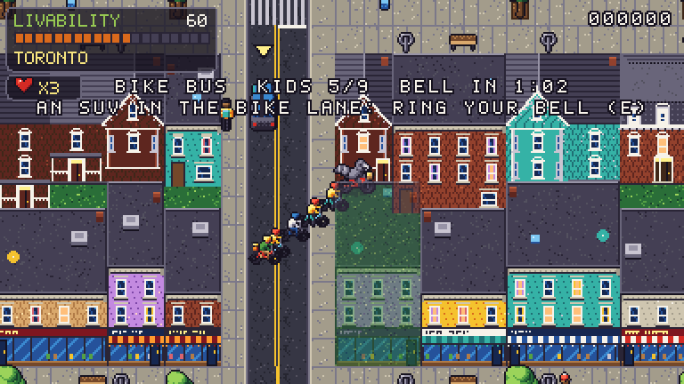
- **Share posters**: four designs × wide/tall, composed from the game's own art in a render texture and upscaled ×5. They go to X, Facebook, Instagram, or the phone's share sheet. 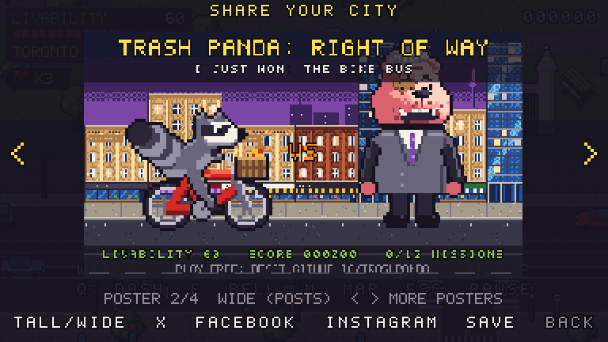
- **The North is gone.** Save the Science moved to a Queens Quay warehouse of the closed Science Centre's exhibits. Checking the facts turned up the real interim Science Centre at Harbourfront Centre, opened June 29, 2026, which also settled an open 🟡 in URBAN_RESEARCH §5.
- **Credits:** the notice once at NEW GAME; ABOUT pages flip with LEFT/RIGHT; links you can click; Ivan's alias and socials instead of his name.
- **Bosses:** the Jet Tug leaves the screen before it turns, hurts only with the tug, and lets you ride its jet; the Highway Mech walks, and its slabs stand on piers; stomps make dust shockwaves; the Mega Rat throws barrels.
- **Art:** the Don Jail and Colborne Lodge redrawn from Ivan's photos; City Hall and the Freedom Arches modelled in 3D in the map's projection; coloured sailboats instead of the top-down yachts; the SkyDome cleaned up; the streetcar's swoosh white to the nose. 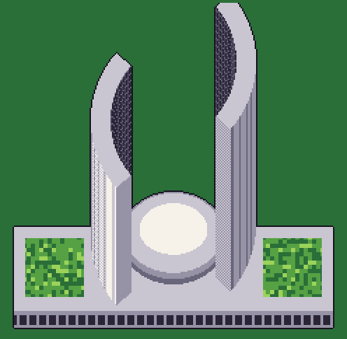
- **Fixes:** the side-view raccoon jitter, the title sidewalk outrunning the buildings, the debug list over the logo, the tennis courts on the path, vignette walkers walking in place.

### Failures along the way
- **The raccoon still jittered after the first camera fix.** I had rounded the scroll in `update()`, but Arcade copies body positions to sprites in POST_UPDATE, after `update()`, so the camera chased last frame's position. Following in a `postupdate` handler, plus a hysteresis on the lag, put the raccoon on one screen pixel at a steady speed (checked by a bot that records its screen x every frame).
- **The first Freedom Arch rendered as a stub** (gallery 50a). Squashing an SDF's height stretches its distances, so the ray marcher overstepped the thin tube. Scaling the distance by the squash factor fixed it. Then the geometry was right but unreadable: an arch spanning north–south in a 45° view folds its far half into a hook. Turning it off-axis (yaw 0.7) and raising it makes both feet land on the concrete and the curve read. Ivan's aerial of City Hall shows the real arches leaning the same way.
- **The Bike Bus never started in the first bot run.** The route was in the map generator's output but `build-assets` writes a whitelist of map fields, so `bikebus` was dropped. Added to the list.
- **Adding a twelfth mission would have hidden the ending:** it fires when *every* mission is done, and the Bike Bus wasn't in Death by Highway's prerequisites. A player could beat the finale and get no ending. The Bike Bus is now required before the finale.
- **Two old tests failed for the right reasons:** the M3.4 test waited for the Jet Tug's removed `taxi` phase, and the ending test expected 11 / 11 missions.
- **Text on text, again:** the "THE BELL RANG!" card landed on the bus HUD, and two boss hints wrapped onto a third line and ran into callouts. The HUD hides on the result card, and a scan of every hint line keeps them within two lines.

### Decisions
- **Explore missions** reuse the side-view win path (award, save, debrief, Dog Fjord's beat, the map payoff), so the Bike Bus feels like every other mission at the end.
- **The share image is ready before you tap:** browsers only allow a share sheet or a popup inside the tap itself, so the PNG is rendered whenever the poster changes.
- **Desktop sharing saves the poster.** X and Facebook can't take an image from a web page; the poster is saved for the player to attach.

### Numbers
48 browser tests and 18 unit tests pass.

## 2026-11-16 (later): M4.2, Ivan's M4.1 notes

Ivan's notes on M4.1: the map screen, a pass for things that pop into view, and fixes across six missions and two districts. The review doc is [docs/reviews/M4.2.md](reviews/M4.2.md).

### What changed
- **The city map** shows only street and park names, marks each neighbouring district outside the frame where it connects, moves between maps by direction (DOWN from High Park is the Waterfront), and scales every map to fill the screen. 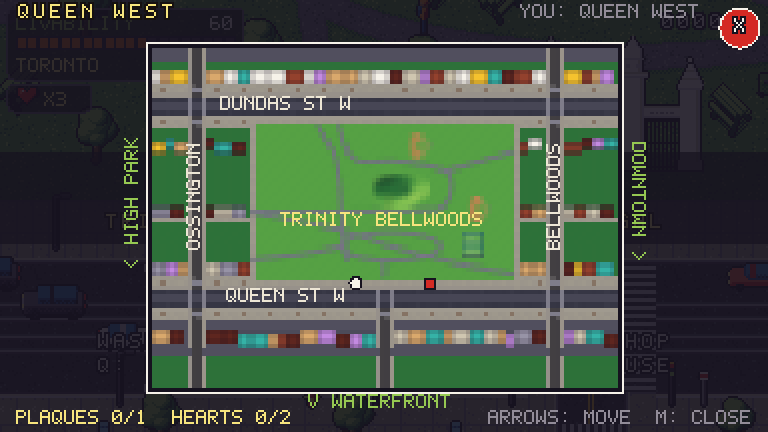
- **No pop-ins:** bosses slide in from off screen; rats called mid-fight come from the screen edge; arena spots are placed before you arrive; the Mech's slabs fall in from above.
- **The Wrecker** was redesigned around dodging: it drives over you, swings or drops the ball, and only the ball hurts. 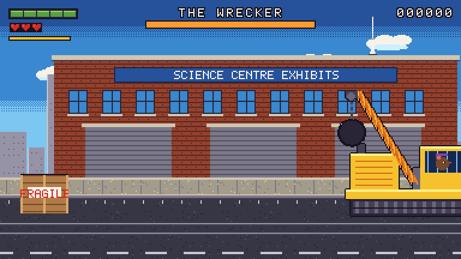
- **Smaller fixes:** the Pink Digger breaks down on screen instead of driving off; hiding behind crates is readable; the movers' truck takes the exhibit away if the rats reach it; the Jet Tug revs, then crosses fast; the Bike Bus's arrow is big and its stops are on the map; the mission list is numbered in unlock order; the 510's junction and turning streetcars are fixed; the arches moved.

### Causes worth remembering
- **The Monster SUV's roof line was 18 px above its drawn roof.** Rendering the sprite and measuring it showed the bounce happening in mid-air. The stomp check is now a crossing test against the previous frame's position, so a tighter window can't be skipped at a low frame rate.
- **The Lane Eater's "flickering flowerbeds"** were the paved lane, redrawn every frame from the camera edge at fractional coordinates.
- **The Gardiner's flicker** was a dither: a slow parallax layer moving one pixel at a time inverts a checkerboard. Moving slow layers in 2-px steps keeps it still.
- **"Hide behind the crate" didn't read** because the crate was drawn *behind* the raccoon (depth 99 vs 100).
- **The tight 16 px streetcar turn** was the real reason the car turning up Spadina broke apart. Re-centring both curves on the junction's tile corner gives radii 40 and 24, keeps them concentric, and makes Spadina's straight rails end exactly where the curves begin. That also removed the doubled rails.
- **The map scale snapped to half steps,** so a 110×104 map landed on 1× while a 120×96 one got 1.5×.

### Failures along the way
- **Park names vanished** on the first redraw of the map: green text on green grass. They're yellow now.
- **The footer's two lines overlapped** (text on text) on the first layout; "YOU:" moved up to the title row.
- **A new test found a real bug:** the redesigned Wrecker's symmetric pendulum swung its ball back through its own cab and hurt a raccoon standing by the truck. The swing is one-sided now.
- **The first boss-entrance test was flaky:** by the time it looked, the boss had already slid partly in. It now records the position on the first frame the boss exists.

### Numbers
53 browser tests and 18 unit tests pass.

## 2026-11-17: M4.3, bike share, a bike network that grows, and a code + game review

Ivan asked for bike share (unbranded), Strachan's real bike lanes, a Livability that doesn't compare Toronto to Amsterdam and Copenhagen, and a code review and game review. Asked about the major changes first; he chose all three recommendations (grow the network + X/100, a top-down Dock Drop, and the checkpoint, ranks and hit feedback). The review doc is [docs/reviews/M4.3.md](reviews/M4.3.md).

### What changed
- **The bike network:** 28 streets on five maps, each made PROTECTED or SLOW by a mission (`src/data/network.ts`). The map generators got `netEW` / `netNS` / `paintNS`: tile patches, planters, bike lanes in traffic, calmed lanes. The HUD and the report card count streets instead of naming a tier. 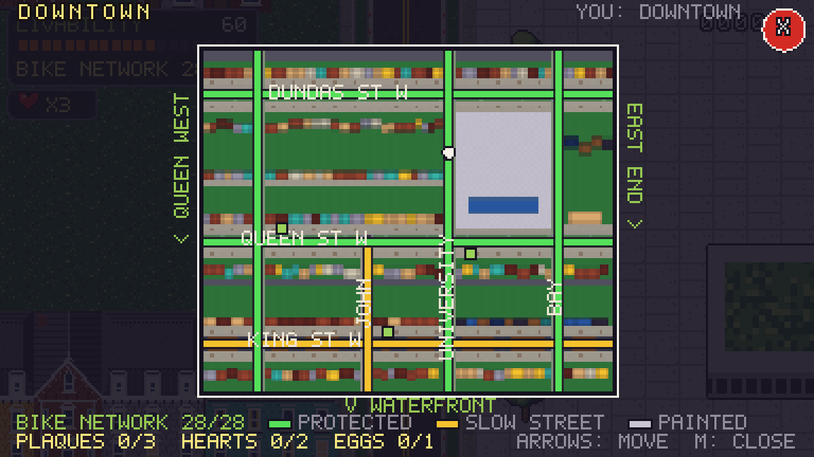
- **Dock Drop:** the second map mission. Tow docks to six gaps, ring the clutter crew off the new stations; afterwards stations on every map and share bikes in traffic. 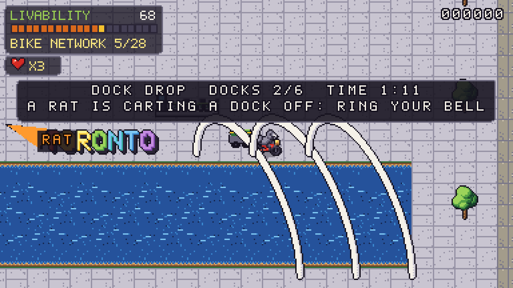
- **From the reviews:** ten code-review fixes, the boss checkpoint, mission ranks, impact stars and a swing swoosh, a three-bay Megamart wall, and dark bands under every message that sat on busy art.

### Causes worth remembering
- **N-S streets have no parking lane,** so their bike lanes had to fit in the curb column: a narrower sidewalk, the curb, a 5-6 px lane and a separator. The E-W streets swap their parking lanes like Queen did.
- **Bridge decks are a second tile layer** copied from the ground at load, so an improvement on a bridge was hidden under the old deck. `CityMap.putTile` now writes both.
- **"Combat feels floaty" was wrong:** the code already had hit-stop, a flash and shake on every landed hit. The honest gap was a crisp impact at the contact point and a visible swing, and that's what I added (the review doc says so).
- **An impact star has to run on real time:** the hit-stop freezes the scene clock, so a tween would freeze with it.

### Failures along the way
- **The raccoon turned into a rat.** I named the top-down rat's frames `rt_*`, the raccoon's own prefix, and the atlas overwrote the raccoon's four straight facings. I spotted it in the network screenshots (an orange figure where the raccoon should be); the rat frames are `ratop_*` now.
- **Text on text, four times:**
  - The map missions' status lines ran into the lives box.
  - The off-screen arrow's word landed on the bottom hint, then on the TORONTO sign.
  - The win and lose cards sat on the new Megamart signs.
  - The report card's rows ran over the vignette's raccoon (already true before M4.3).

  Each one got a dark band or box.
- **Art that didn't read:**
  - The sideways bike stencil in a sharrow was illegible at 16 px; it's an upright two-wheel mark now.
  - The docked bikes turned into a black clump under the automatic outline; they're outlined by hand now.
- **The first rank said "0 HITS" after a lost life,** because the hit count reset with the restart. Hits now carry across restarts.
- **The colour on "RANK A"** used a fill tint and blotted out the letters.
- **Shell quoting ate several edits** (heredocs with apostrophes); I moved those edits into script files.

### Numbers
57 browser tests (4 new) and 21 unit tests pass. JS is 384 KB gzipped.

## 2026-11-18: M4.4, Ivan's notes on M4.2 / M4.3 (posters, initials, the Science Centre, the CN Tower)

Ivan's list: posters you can read, more of them in the style of classic games, a hero portrait of the raccoon, typed initials (keyboard and phone), the city map's arrows, orange share bikes, guards that walk past your crate, a Wrecker you can only hit after a drop, a better CN Tower, every road west to High Park, the arches' overlap. The review doc is [docs/reviews/M4.4.md](reviews/M4.4.md).

### What changed
- **Posters:** drawn at 768 x 432 (twice the game), saved at 2304 x 1296, previewed as the saved PNG over the canvas. A raccoon hero portrait (SDF, like Dog Fjord's) and six new posters: VERSUS, TITLE, SUNSET, BOSSES, STREETS, SCORES. `tools/posters.mjs` renders all twenty into `docs/reviews/m44/posters/`. 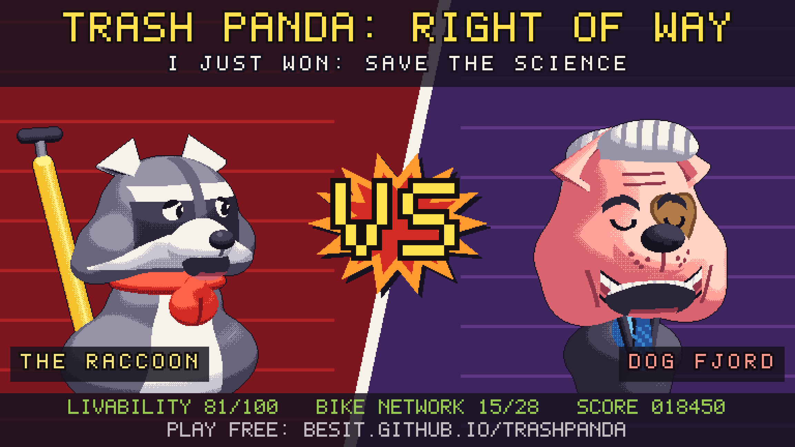
- **Save the Science:** guards walk a beat across a crate (hide, let them pass, take them down from behind); the Wrecker is only hittable while its ball is stuck, and every swing starts high. 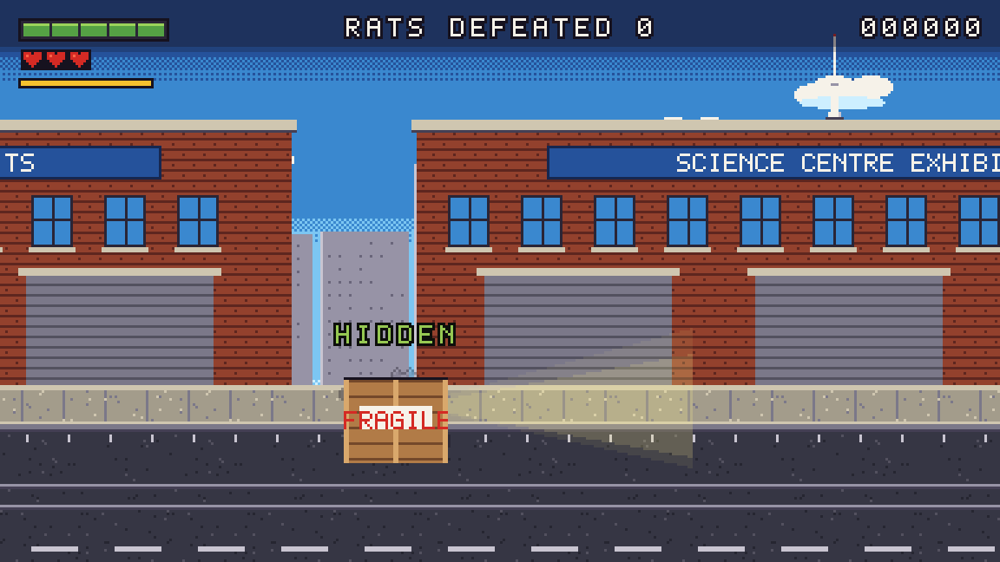
- **Initials** typed on a keyboard, or with the phone's keyboard through a hidden text field. **The CN Tower** whole on the map. 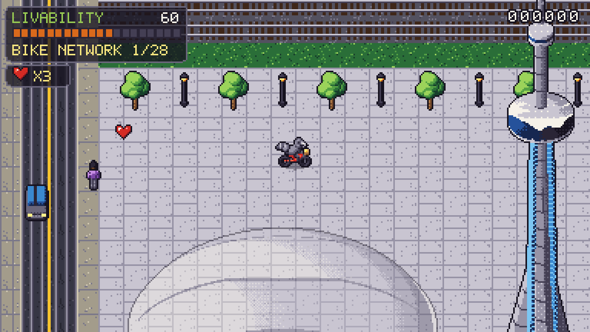

### Causes worth remembering
- **"Unreadable posters" was the preview, not the file:** the game canvas showed a 2304 px poster at 384 px. The fix shows the PNG itself in an `` over the canvas.
- **The font had no `^`.** The north labels on the city map never had an arrow, and Ivan's "the bottom one shows a proper arrow" was the only one that rendered.
- **The unavoidable Wrecker hit:** after driving over you, the swing started with the chain lengthening from 40 to 84 px straight down onto the raccoon's head.
- **Phaser sends Backspace's keydown twice** to a generic `keydown` listener (it's a captured key); letters arrive once. Typed initials dropped duplicate events.
- **The title restarted itself** when a text field took focus: the page scrolled, Phaser fired `resize`, and the restart wiped the open page and its timers (the disclaimer never armed). It now only re-lays out for a new width. A real phone keyboard would have done the same.

### Failures along the way
- **Text on text again, five times:**
  - The tall VS poster's VS landed on THE RACCOON.
  - The high-score title sat on its column headings.
  - The title poster's words sat on the wheel's tyre.
  - The faceoff VS sat on a facade.
  - The big logo showed through the initials panel.

  Each one got a plate, a burst, or the overlap removed.
- **The boss-select poster** drew its sprites in the wrong cells at first: a cropped image keeps its frame's own anchor, so the crop has to be offset by hand.
- **The raccoon portrait** took four renders: first a profile (the camera was looking along the face, not at it), then a bowling-pin body and a hidden pump.
- **A perfect bot killed the new Wrecker in one window** (11 damage in 3.2 s); it has 24 HP now.
- **Heredocs with apostrophes** broke shell edits again; the edits moved into script files.

### Numbers
62 browser tests (5 new) and 21 unit tests pass. JS is 389 KB gzipped; the posters atlas (15 KB) loads only with the share screen.

## 2026-11-18: M4.5, Ivan's notes on M4.4 (names, debug scores, the CN Tower, the raccoon portrait)

Ivan's list: names of up to 10 letters, no debug games on the scoreboard, a CN Tower that narrows gradually with a convincing top (a new close-up photo), the arches drawn left to right, a better raccoon portrait (no scarf, a real torso, triangular ears, a detailed pump), and Dog Fjord on VERSUS turned left with a better mouth. The review doc is [docs/reviews/M4.5.md](reviews/M4.5.md).

### What changed
- **Names** up to 10 letters / digits, keyboard or phone. The online rules need republishing; until then a long name posts its first three letters.
- **Debug runs** are marked (`flags.debugRun`) and kept off both scoreboards for good.
- **The CN Tower:** one taper curve, and the top rebuilt from the photo. 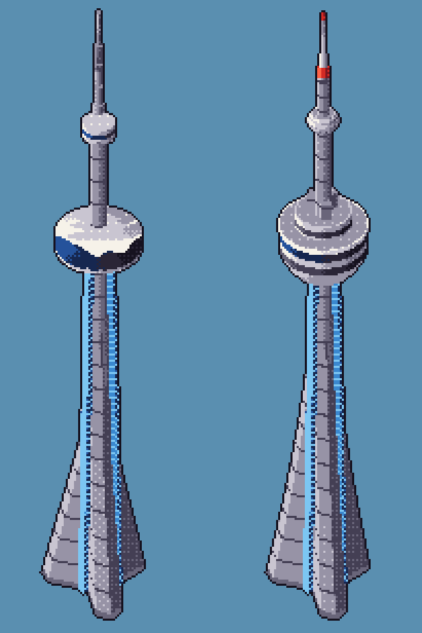
- **The raccoon portrait** rebuilt; Dog Fjord faces left and laughs with a full row of teeth. 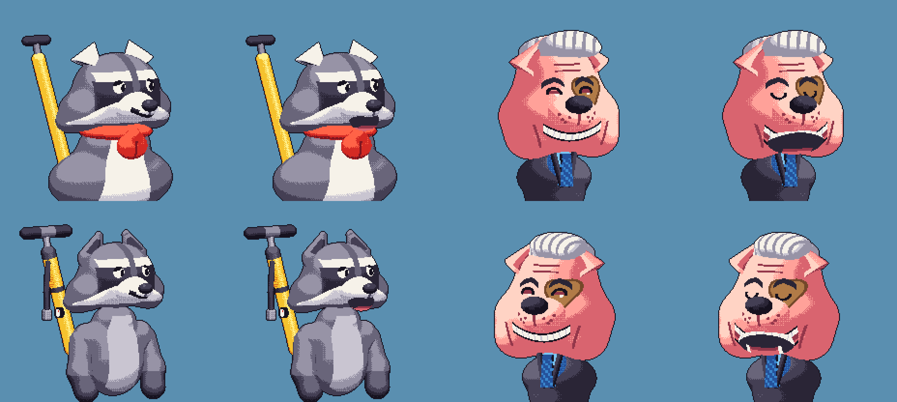

### Causes worth remembering
- **"Arches overlap incorrectly" twice:** in M4.4 I read "drawn left to right" as "the left one on top". It means painter's order: draw the left first, so the right one ends up on top.
- **Dog Fjord "facing left" in M4.4 faced right:** the camera was on the wrong side of the model. It needed a render to check, not reasoning about the camera vector.
- **The flat-topped ears:** a cone truncated at its apex keeps a flat cap after inflating. A capsule with two radii gives a round tip for free.
- **"Looks cut off":** the bust ran out of the bottom of its own picture, which shows as a hard edge wherever a poster floats it. The bust now fits inside the frame.

### Failures along the way
- **Text on text again:** "< YOU" on the tall high-score poster touched the score, and longer names would have covered it. It's a lit band behind the row now.
- **The red speed lines** first painted over the raccoon when I split the VERSUS background into two passes.
- **Two portrait iterations** before the ears read as triangles (art/history/posters v02 to v04).
- **Heredocs with apostrophes** broke a shell edit again.

### Numbers
64 browser tests and 21 unit tests pass.

## 2026-11-19: M4.6, Ivan's notes on M4.5 (2D portraits, the phone name box, controls, flicker)

Ivan's list: redraw the raccoon and Dog Fjord portraits as pure 2D pixel art (no 3D shapes), show the controls on a first game, a name box that stayed over the next screens on his iPhone, the score over MAP and pause on a phone, flickering flowerbeds in the Bike Lane War, and the arches back as in M4.4. (The CN Tower: "looks great!") The review doc is [docs/reviews/M4.6.md](reviews/M4.6.md).

### What changed
- **The portraits, drawn in 2D:** a new toolkit (`tools/lib/draw2d.mjs`): shapes in design units, each part outlined, cel shadows as flat shapes, details by hand. One drawing per character at every size, including Dog Fjord's in-game portrait. 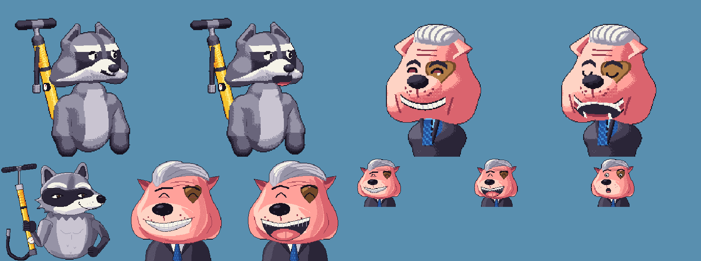
- **The phone name box:** fixed at the cause (below). **The controls** open once, before the first ride. **MAP / pause** moved under the score.
- **The flowerbeds:** drawn at full size once. 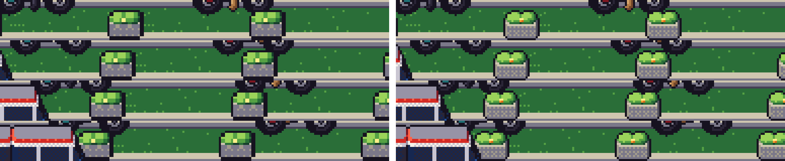

### Causes worth remembering
- **The name box that stayed up:** one tap did two things. The START label finished the name, then the scene's own tap handler saw no name box any more and checked the menu items, which were hidden but still there, and the tap landed on NORMAL: a second name box. Reproduced on an emulated iPhone before touching anything; the test now replays that tap. The same handler also kept calling `getBounds()` on items an earlier action had just destroyed (an error per menu tap).
- **"Redrawn all the time":** the planters weren't redrawn, they were stretched. A sprite at 1.5x is resampled every frame, so which pixel rows double changes as it moves and its dither shimmers. A sprite should be drawn at the size it's shown.
- **Pillow shading makes blobs:** shading every edge toward the middle (what the 3D renders did) reads as a soft blob. Flat shadow shapes on one side, plus outlines between parts, read as drawn.

### Failures along the way
- **The first 2D raccoon** still had a sack for a torso and sausage arms: rebuilt with a tapered torso, elbows and fingers.
- **The first 2D Dog Fjord** had his nose over his own eye and cat ears: the lower face moved down, the ears became folded flaps.
- **A shift-every-coordinate edit** also moved a pair of x positions (the laugh's fangs), which then floated like drops; the fangs went.
- **Heredocs with apostrophes** broke the shell once more: the code went in through a file.

### Numbers
68 browser tests (4 new) and 21 unit tests pass.

## 2026-11-19: M4.7, the portraits in a redraw / judge loop, and the controls text

Ivan on the M4.6 portraits: "it looks a little better, but I want you to take a look and iterate on them... proportions, symmetry, overall shapes were better [in 3D], if we don't consider the blobbiness, but I want the 2D style still." He asked for 5-10 rounds, with one agent redrawing and another judging, and saved raccoon pixel-art refs ("I especially like 3, 4 and 5"). Also: overlapping text on the controls screen. The review doc is [docs/reviews/M4.7.md](reviews/M4.7.md).

### The loop
A drawer agent edited `tools/sprites/portraits.mjs`. A judge agent scored each sheet against the old 3D row and the refs and wrote a ranked fix list, which became the next round's brief. I read every sheet and added art-direction notes where the judge missed things. Nine rounds; every one is in `art/history/portraits_2d` (v02-v10), and every critique is in `docs/reviews/m47/loop/`.

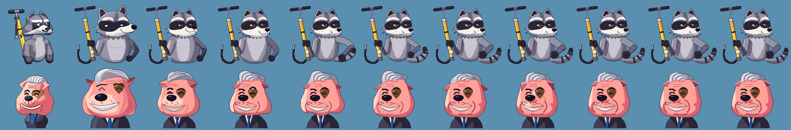

| Round | 00 | 01 | 02 | 03 | 04 | 05 | 06 | 07 | 08 | 09 |
|---|---|---|---|---|---|---|---|---|---|---|
| Raccoon | 5.5 | 7 | 7 | 7.5 | 7.5 | 8 | 8 | 8 | 8 | 8 |
| Dog Fjord | 4.5 | 5.5 | 6.5 | 6.5 | 7 | 7 | 7 | 7.5 | 7.5 | 7.5 |

### What worked, what didn't
- **Measuring the 3D first.** The drawer's study round turned "proportions were better" into numbers. The raccoon's snout was twice the 3D length, its eyes were 50 apart instead of 26, and Dog Fjord's head was 77% of the frame.
- **Hand-guessed outlines oscillate.** The judge's coordinates turned the dog's head from a trapezoid (round 2) into a mushroom (round 3). Tracing the 3D silhouette's outline as the 2D shape's control points ended that in one round (round 4).
- **A judge can be wrong too.** In round 4 it asked for a hair base about 100 wide, which made a bowl cut in round 5. It caught its own error the next round (the 3D hair is about 78 wide).
- **Fixes trade against each other.** The ears went from horns to sideways sheep ears, then tucked inside the outline (an acorn), then folded at the top corners. Each step fixed the last complaint and broke the silhouette somewhere else, until the target was stated as the outline itself.
- **"Done, stop touching it" lists** from round 4 on kept good parts from regressing while the rest moved.
- **The sheet isn't the game.** After the judge's "ship both", the real intro cutscene showed the laughing eye merged into the nose at 112. The sheet only had the grin at that size large enough to see. Round 9 fixed it.

### Also
- **Controls:** on a computer the eight key rows ran into the missions note. The rows are 12 px apart now, and the grey notes sit on a dark band so the ride behind the page doesn't show through.
- **Tall VERSUS poster:** the taller new head put the VS badge over Dog Fjord's eyes, so he sits lower.
- **A constraint the judge didn't know:** it asked for the raccoon's body to run out of the frame. Ivan's M4.5 note ("looks cut off") rules that out, so the bust keeps a finished bottom and the tail curls across it.

### Numbers
68 browser tests and 21 unit tests pass.

## 2026-11-20: M4.8, ten more portrait rounds aimed at ref 03

Ivan on the M4.7 portraits: "Ok, the characters look better, but I want you to run another 10 rounds. This time let's focus on getting quality closer to raccoon-ref_03.jpg. Dog's head from iter_04 looks the best, but other aspects from iter_09. I want the artist agent to be far more creative... change colors, poses. And let's make sure the pump is straight. Right now it's bent." The review doc is [docs/reviews/M4.8.md](reviews/M4.8.md).

### The loop
- **Same two agents, a new brief.** The judge's scale put ref 03's craft at 9 to 10, and on it the M4.7 portraits scored raccoon 4.0 and Dog Fjord 3.5.
- **Rounds 1 to 3 explored.** Each round the artist drew three genuinely different takes, 9 variants in all: a planted staff, a swagger with the pump across the chest, the pump as a rail, the pump on the shoulder, a cane, an elbow lean. Palettes were cool grey, warm taupe and steel. Accents were a bandana, a scarf and a cap.
- **Rounds 4 to 10 refined** one direction: the cane pose standing, with the cap, the bandana and a teal pump, and Dog Fjord chin up on broad navy shoulders.

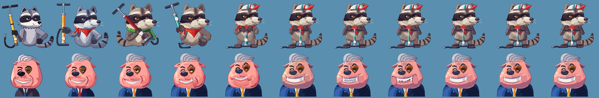

| Round | 00 | 01 | 02 | 03 | 04 | 05 | 06 | 07 | 08 | 09 | 10 |
|---|---|---|---|---|---|---|---|---|---|---|---|
| Raccoon | 4.0 | 5.5 | 5.5 | 5.5 | 6.0 | 6.5 | 6.5 | 7.0 | 7.0 | 7.0 | 7.0 |
| Dog Fjord | 3.5 | 4.0 | 5.0 | 5.5 | 5.5 | 6.0 | 6.0 | 5.5 | 6.5 | 6.5 | 6.5 |

### What worked, what didn't
- **The pump was bent by construction.** The rod was drawn vertical, the barrel 11.6 degrees off vertical, and the handle tilted 7.6 degrees. `pumpAxis()` now places every part along one axis, so it can't bend.
- **Exploration rounds found the pose.** None of round 1's three poses survived, and round 2's diagonal pump covered the face. The cane pose from round 3 is what carried. Without the variants the loop would have polished the old fist-on-hip bust.
- **Toolkit first.** The artist spent round 1 partly on fur helpers (tufted edges, strokes that follow a direction, per-material outlines). Every later round used them.
- **Uniform strands read as hatching.** Round 6's face fur, all horizontal at one density, looked like scanlines. Giving each zone its own flow, plus jitter in direction and length, made it read as fur in round 7.
- **A palette can lose a character.** Round 5's hue-shifted skin turned Dog Fjord grey-mauve, and an olive half-tone read as stubble (a human cue). Round 6 brought the pink back and kept the cool tones in the shadows only.
- **Optimising details into a worse whole.** Rounds 6 and 7 met every item on the fix list (dog teeth, then hanging lips with a dark edge), and Dog Fjord got lumpier and less appealing: pouches, rotten-looking teeth. I asked the judge to compare overall appeal with round 5. It agreed its own notes had pushed anatomy over the cartoon read, and round 8 restored round 5's mouth with round 6's colours. That gave the best Dog Fjord of the loop.
- **The game, not just the sheet.** The standing raccoon's head sits high in his picture, which broke three poster layouts: the raccoon covered Dog Fjord's mouth, the cap sat under the THE RACCOON label, and the bosses grid cropped off the cap. All three were fixed after checking every poster at full size.
- **Rate limit.** The artist hit the 5-hour usage limit partway through round 2. It was resumed with its work intact.

### Numbers
68 browser tests and 21 unit tests pass.

## 2026-11-20: M4.9 (preview), pxl and codixel, and ten rounds of painting with light

Ivan asked whether two pixel-art skills (pxl and codixel) would help, then asked me to take what's good from both and run 10 more rounds on the hero art. His notes: "I liked the iter_02 of the raccoon. The pose and general vibe. Though... it feels like a toddler drawing in terms of separate shapes like fingers, arms. I want it to feel more professional with drawing from shades, not from shapes... The pump should be yellow as in the game. For the dog, honestly the iter_01 was the best... pretty minimal and not overly detailed. You seem to design from details like you think 'nose' and draw a shape. When professional artists draw... they think about how light is scattered and reflected, where are shadows and where are highlights." And: don't update the game until he gives the green light. The review doc is [docs/reviews/M4.9.md](reviews/M4.9.md).

### The two skills
Both are MIT licensed. Neither is installed; the useful parts are ported into `tools/lib/`.
- **pxl** is a code-to-pixel-art tool. Its lint (stray pixels, jaggies, pillow shading) became `tools/pixelcheck.mjs`, and its annotate mode inspired `tools/annotate/`.
- **codixel** is mostly a long skill file plus an engine. Its lit volumes, banding with a dither strip only where two bands meet, hue ramps, rim light and pixel-perfect lines became `tools/lib/light2d.mjs`.
- **Not used:** codixel's main method, pixelating a reference image. Our characters have no source image, and pixelating someone else's art would copy it.

### The loop
New agents (a painter and a critic) and a new brief, built around Ivan's note: silhouette first, one light, parts separated by light and cast shadow, details last. Every round was checked in greys and by the pixel critic. The work stayed in `tools/sprites/portraits_next.mjs`, and the game's portraits rendered pixel-identical throughout.

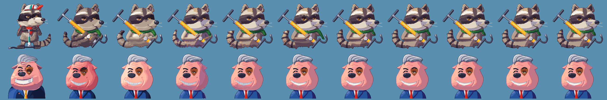

| Round | 00 | 01 | 02 | 03 | 04 | 05 | 06 | 07 | 08 | 09 | 10 |
|---|---|---|---|---|---|---|---|---|---|---|---|
| Raccoon | 4.5 | 5.0 | 5.5 | 5.5 | 6.0 | 6.5 | 7.0 | 7.0 | 7.0 | 7.0 | 7.5 |
| Dog Fjord | 4.5 | 6.0 | 6.0 | 6.5 | 7.0 | 7.5 | 7.5 | 7.5 | 7.5 | 7.5 | 7.5 |

### What worked, what didn't
- **One light map for the whole picture.** The painter's round 1 pipeline puts material names in the pixels and lights the whole picture with one value map, then maps each material onto its own ramp. That is what turned "parts" into "one lit figure": a shadow crosses fur, scarf and pump alike.
- **Dark arms are stickers.** Dark forearms on a mid-dark chest can only read as shapes stuck on top. In the coat's colour they belong to the body, and they read through their lit top edge and the shadow they cast on the cream bib (round 2).
- **Computed light is bland.** Round 2 was correct but soft: bands followed the outline and everything sat in light. Round 3 designed the light instead, with one hand-placed shadow edge per form, 35 to 45% of each form in shadow, cool shadows and warm lights.
- **A light rim on the shadow side read as a halo.** A broken 1 px pale line outside the dark outline looked like a cut-out sticker. Removed in round 4.
- **Fixes regress other fixes.** Round 3's light pass also thinned the tail into a twig and merged the arm into the bib. Each round compared its result with the round before.
- **Dimming the bottom deleted its light.** Round 5's falloff turned the lower body into one dark skirt. Round 6 dimmed the light without merging it into the shadow.
- **Fur only where light meets shadow.** A ref-03-style fur pass, tried as a separate experiment in round 9, helped on the head and hurt the crisp forearm, so round 10 kept it on the head only.
- **A likeness check.** The critic flagged that M4.8's national-flag lapel pin plus patterned tie pointed at a real politician. The new Dog Fjord has iter_01's plain red tie and no pin.

### Not done yet
The game still uses the M4.8 portraits until Ivan's green light. Then `portraits_next.mjs` replaces `portraits.mjs`, every poster is re-checked at full size (the raccoon's pose changes back to a bust) along with the intro cutscene, and it ships.

## 2026-11-20: M4.10 (study), the raccoon in five styles, and the recipe

Ivan on the M4.9 preview: "I am not in love with how it looks, but it seems better... I want to understand what is the recipe for the best pixel-art possible. Can you try and redraw the current state of him in a couple of techniques / styles?" He asked for five: ref 3 polished to the max, ref 4's style, the most naive, the most detailed, and a freestyle. Each got a try, a critique and another pass. The review doc is [docs/reviews/M4.10.md](reviews/M4.10.md), and the recipe is [docs/PIXEL_ART_RECIPE.md](PIXEL_ART_RECIPE.md).

### How it ran
- **Five painter agents worked in parallel,** one per style, each in its own folder (`tools/scratch/piter4/<style>/`).
  - To keep them from colliding on the shared palette, `raster.mjs` gained `registerColors()`: each style registers its own colours at run time under its own block of Unicode keys (Greek, Cyrillic, Hiragana, Katakana).
  - Each style has its own history: `art/history/raccoon_style_<style>/`.
- **One critic reviewed all five** after each pass. Halfway through, the freestyle painter was given the critic's synthesis to build.
- **The usage limit stopped two painters partway through pass 1.** They were resumed with their work intact.

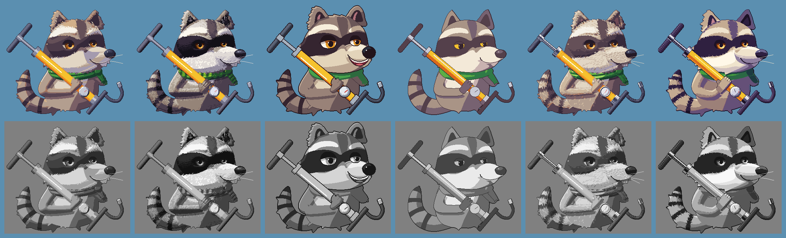

| Style | ref 3 | ref 4 | naive | detailed | freestyle (synthesis) |
|---|---|---|---|---|---|
| Shared scale, pass 1 | 5.5 | 5.5 | 5.0 | 4.5 | 4.5 |
| Shared scale, pass 2 | 6.0 | 6.5 | 5.5 | 5.0 | 7.0 |
| Colours | 37 | 28 | 11 | 52 | 36 |

### What it showed
- **The drawing underneath limited every style, not the technique.** All five inherited the same weak construction: the arm a bent tube around a triangle of chest, a paw sitting on the pump, faceted snout planes. Texture hid it, contrast exposed it, outlines traced it.
- **Hand-drawn shadow shapes beat computed shading cut into tones.** That cutting is what produced the facets, slivers and checkered rings. The painters who switched to drawn shapes gained 1 to 2.5 points; those who kept the pipeline and improved texture gained half a point to a point.
- **More detail is not more quality.** The 73-colour version read as felt at real size. Detail has to follow the focal order: the face first, then the edges where light or colour changes, then the prop.
- **One shared shadow family across all materials** (the freestyle painter's idea) makes the figure one object under one light. It was adopted by two other styles.
- **A strong outer line carries the poster read; inner lines make things look "assembled".** A rim of light belongs inside the outline.
- **The expression has to be made of shapes to read at real size.** ref 4's open grin was the only one that did.

## 2026-11-21: hero images from AI masters, on locked palettes

Ivan wasn't happy with the code-drawn study results and generated the two characters with Gemini, in a pixel-art style, on a flat green background. The plan he chose: Gemini makes the master images, and they're converted into true pixel art and composed with the game's own assets.

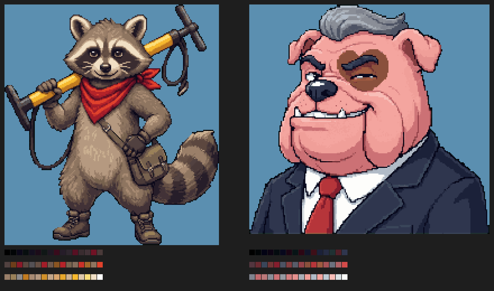

### The conversion, and what we learned on the way
- **A master is not true pixel art.** Its "pixels" are soft blocks of about 4 screen pixels with JPEG smudges. Sampling the median of each block's inner pixels rebuilds a clean grid (about 255 x 255), at the same pixel size as the old poster portraits.
- **My first pass added the splotches Ivan saw.** A crude 32-colour reduction plus an over-eager stray-pixel cleanup made noise that wasn't in the source. A smoothing "polish" pass made it worse: washed-out skin, lost line work.
- **Pixel to pixel was the answer.** Every source pixel maps to its nearest colour, measured in OKLab (a perceptual colour space). On the game's 49 colours the dog speckled, because his smooth shading fell between game colours. On his own 48 colours it was practically identical to the source. 24 looked the same, 16 started losing the eye patch's brown, 12 was too few. Ivan picked 48.
- **The green screen leaked into the outline** and took about 4 palette slots per character as dark greens. Pixels within 2 of the background now lose any green dominance, and both palettes were remade with no green left.

### The palette
- The game palette is back to its original **49** colours. The **60** colours added for the code-drawn portraits (M4.8 and M4.9) moved to `tools/palette_legacy.mjs`, which only the old portrait code loads, so it and the art history still render.
- Each character has a **locked 48-colour palette** (`tools/palettes/<character>.json`), made once from its first master. Every later image of that character maps onto the same colours, so the palette doesn't grow with each new pose and he looks the same everywhere. Both are registered in `tools/palette.mjs` under their own key ranges: **145** colours in all.
- **Performance:** colour count doesn't affect the game at run time, since the GPU stores every texture at full colour. The poster atlas stays well under the 256 colours an 8-bit PNG allows.

### Checks
The game is unchanged: all 60 built asset files are byte-identical before and after (the posters still use the old portraits until Ivan's green light). 21 unit tests pass, and the type check passes.

## 2026-11-21: M4.11 (local preview), the hero images in the game

Ivan generated more Gemini images (a new bust, the bike, Dog Fjord laughing and shocked) and picked from ComfyUI generations: the short-hose standing raccoon, the angry VERSUS pair, the angry busts, Dog Fjord full body. He asked for raccoon faces without the pump, a trial of higher-resolution portraits, and the game and cutscenes updated. The review doc is [docs/reviews/M4.11.md](reviews/M4.11.md).

### What worked, what didn't
- **ComfyUI with Qwen-Image-Edit, driven over its API, made most of the new art** in 5 to 15 seconds per image, with no one in the loop. Pose changes need an empty starting canvas; the standard edit template starts from the reference image and locks its composition, which is why Ivan's attempts kept the pose.
  - **One reference image per run.** With the raccoon and the dog both attached, it drew the dog every time.
  - **Small fixes work as edits:** a shorter hose, a straight tie, four fingers on each hand. Each needed 3 or 4 seeds to get one clean result.
  - **Ask for the action itself.** Asked for a "fighting pose", the raccoon stood still with an angry face. Asked to leap and reach toward the dog, it moved.
- **The palette made from one master missed colours.** The tail's dark warm brown mapped onto the bandana's dark red. Remaking each palette from six masters fixed it.
- **A generation can drift warm.** The VERSUS raccoon's tones are matched to the standing pose's (mean and spread per OKLab channel) before palette mapping.
- **A chosen figure height per image keeps the pair matched,** whatever pixel size the generator drew at.
- **The raccoon gets a talking head:** 4 expressions, one picked per line. It sits beside the dialogue box, not over the scene.

### Numbers
68 browser tests and 21 unit tests pass. The generated assets are 1683 KB, up from 1574 KB.

## 2026-11-21: M4.12 (local preview): Ivan's picks, a Toronto sunset, and the in-game sprites in the hero look

**Ivan's notes on M4.11:**
- R1A, D1A, A3B and the faces Rest1 / Happy1 / Angry1 / Shock2.
- A Toronto skyline behind the sunset poster.
- More of the raccoon in the bosses poster's cell.
- The higher-resolution portraits, yes (but not the double-size raccoon faces).
- TRASH PANDA instead of THE RACCOON on VERSUS.
- Then: "What do you think about updating the in-game sprites now?", followed by "let's do a pass of new sprites to see if it works better in the game".

**What failed:**
- **D1A's raised fist** kept four fingers through 14 ComfyUI tries with two different prompts. Qwen-Image-Edit draws a fist the way it knows a fist. Erasing one knuckle line in the master by hand took one small script (`tools/scratch/comfy/fist.mjs`) and reads correctly at poster size.
- **The sunset's old skyline** was there all along, but tinted the same purple as the sky, so it was invisible.
- **The first new skyline** read as a generic city: needle-thin towers, all the same. Drawing the towers wider than life and clumping the financial district made it read as Toronto.
- **The top-down raccoon's mask** didn't show after recolouring. The two big cream eye spheres covered it at 32 px. The fix was to paint the mask onto the head's surface and shrink the eyes to glints.
- **The first side-view pass:** the pump crossed the back of his head, and the arm hid the bandana. The fix was to tilt the pump behind the shoulder and draw the bandana last.

**Decisions:**
- **Sprites stay the same size, with the same frames and animations.** Only the look changes, so no gameplay or hitbox changes.
- **The sprites use the heroes' palette colours** (already in the game palette), so a sprite and its portrait share exact colours.
- **The pizza basket is gone** (the hero's bike has none). Asked Ivan whether he wants it back.

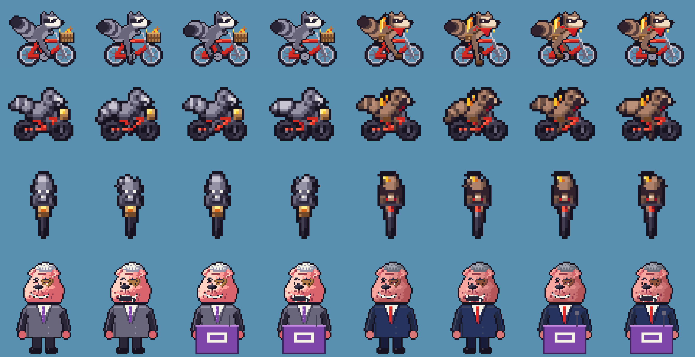

---

## 2026-11-22: M4.13 (local preview): poster fixes, Dog Fjord and the side-view raccoon from the hero art

M4.12 went live on Ivan's go (tag `m4.12`). His notes on it, worked through: [review](reviews/M4.13.md).

### Posters
- **VERSUS:**
  - The new dog master was on white, not green. A flood fill from the borders turned it green.
  - **Failure:** the first pass left the soft blend between the white and the dark outline, and the palette turned it into a white halo (Ivan saw it at once).
  - **Fix:** three passes that also key light, grey pixels touching the background. Hair and fist survive because they are either saturated or not on the edge.
- **Sunset:**
  - The racing road toward the skyline fought the raccoon riding sideways. Ivan made a Gemini reference: the islands lagoon, the skyline in the sun.
  - **Decision:** convert his image rather than redraw it in code, since it is his design and it converts well.
  - ComfyUI (Qwen-Image-Edit) removed its raccoon on all three seeds. `tools/scene.mjs` (new) samples a whole scene, with no green key because leaves would vanish, onto its own locked 48 colours (`tools/palettes/sunset.json`, keys from U+0200).
  - The tall poster is a 1:1 crop around the sun. The scene is in its own atlas, loaded lazily with the posters.
  - Second note: the raccoon moved to the left third on the wide poster.
- **Bosses (wide):**
  - The smaller bust cut the pump at the sides, so the first try was the whole standing raccoon, small.
  - Ivan wanted a portrait instead: the standing pose at 180 px, cropped from the top.
- The procedural Toronto skyline from M4.12 left the atlas. The module stays.

### Dog Fjord in the world
- **Before:** the old 3D-rendered head on a hand-drawn suit.
- **Now:** the hero full-body at 72 px on his palette, plus a laughing take of the same master from ComfyUI.
  - **Problem:** that take had a dark green ground shadow the key would miss. Green-dominant pixels were flattened first.
- **Cleanup:** a despeckle that only removes a lone pixel when it's a near-tone of its neighbours (OKLab < 0.09), so eye glints and teeth stay. Then the game's black outline.
  - **Failure:** the podium frames briefly had a 2-px outline (outline run twice). The podium is now its own outlined layer.
- **Facing:** he's in 3/4 view facing left, so he's flipped in the three places he stands left of the raccoon.

### The side-view raccoon
- **The M4.12 sprite:** the fork is red now. The swing had two problems:
  - the arm was the torso's colour, so it vanished
  - moving the bandana under the arm shattered it, because the shoulder sits where the bandana is

  The bandana now stays on top, the arm has a darker underside, a paw closes round the grip, and the wind-up hand is further back.
- **The new pass (Ivan's ask):**
  - **Checked first:** the hero bike image straight down to sprite height. It has character, but can't pedal, and its 1-px bike breaks up.
  - **So, a hybrid** (`tools/sprites/raccoon_side2.mjs`): the rider is cut from the 40-px downscale at the saddle and the grips. Code draws the bike, legs, tail sway and swing, with joints read off an ASCII dump of the downscale.
  - **The frame:** the hero is upright, so it grew to 56 x 52. SidePlayer's origin and hitbox offset moved by the same rows, so the hitbox stands where it did.
  - **First render:** soft (no outline) with stick legs. Fixed with an outline, thick thighs and visible boots.
- **High scores:** Ivan asked whether 10-letter names show.
  - A read of the live online top list: every name has 3 letters, even after M4.5. The Firestore rules were never republished, so long names are refused and fall back to their first three letters.
  - Ivan has to publish the rules in `docs/LEADERBOARD.md` from the Firebase console.

## 2026-11-22: M4.14 (local preview): Ivan's M4.13 notes, the title poster as the link preview, another side-view raccoon

Ivan's notes on M4.13: the VERSUS dog's white edge wasn't fully gone, the tall sunset looked enlarged and blurred, the bosses portrait could zoom in, and the hero-proportioned side raccoon was worse than M4.12 ("too detailed or the proportions seem weird"). Dog Fjord: good. The rats stay. He published the leaderboard rules. The title poster's buildings floated: it should get a detailed skyline from his new reference and become the game's link preview, with only the name, RIGHT OF WAY and the link.

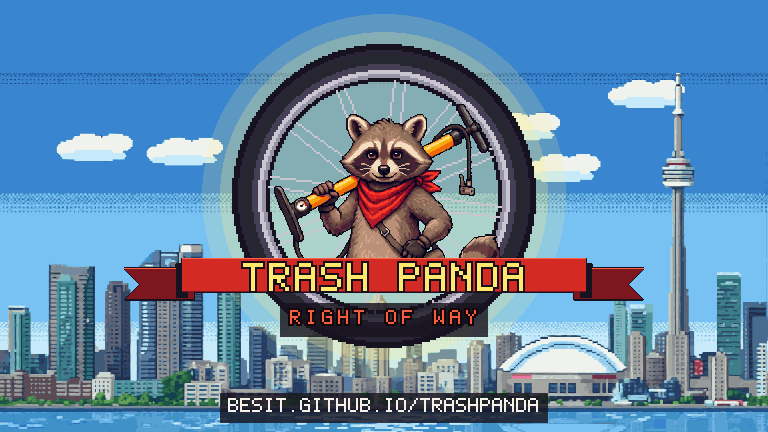

### Posters
- **VERSUS:** his green-screen regeneration of the dog goes straight through the hero pipeline. The white-to-green conversion is gone, and so is the pale edge it left.
- **Sunset (tall):** the M4.13 tall was a 1:1 crop of the master, so it was the AI image itself, not pixel art.
  - ComfyUI recomposed the lagoon as a tall picture from an empty 864 x 1536 latent. Seed 2 (sun centred, the CN Tower in it) is sampled down 2x on the locked sunset palette.
  - Every word moved into the sky, so the raccoon rides the path at the bottom.
- **Title:** ComfyUI removed the wheel, raccoon, ribbon and words from Ivan's reference. All three seeds worked, but the top and bottom bars stayed, so they're cropped.
  - **Failure:** padding the sky by repeating one row smeared its dither, and the CN Tower's spire, into vertical streaks. The pad is now a flat sky colour (the commonest colour of the top rows).
  - The scene has its own palette (`tools/palettes/title.json`, keys from U+0280).
  - The tall one is a ComfyUI tall recomposition. Its skyline came out small, so the crop is 1.5x tighter.
- **The link preview:** a `preview` flag on the share scene draws the title poster with only the three things Ivan named.
  - `tools/og.mjs` renders it in the dev server and writes `public/og.png` (1536 x 864, 204 KB).
  - `index.html` gained og: and twitter: tags.
- **Bosses (wide):** the portrait is the standing pose at 230 px instead of 180.

### The side-view raccoon
- **Back to M4.12** in the game. The rider's pivot now comes from the asset manifest (SidePlayer, the title and the ending), so any side sprite drops in.
  - This also fixes M4.13's title and ending riders, which still used the old 44-row pivot on the 52-row frame.
- **The alternative** (`tools/sprites/raccoon_side3.mjs`): the M4.12 build drawn again with more care. The changes:
  - the head: bigger (17 x 13), a 2 x 2 eye with the pupil in front inside the mask band, ears with a lit inside
  - fur in three tones, and gloves
  - five clear tail rings, lit on top
  - a lit tyre, frame highlights and a toothed chainring
- **Failure on its first render:** outlining the bike layer filled the transparent wheel interiors black. The wheels draw their own tyre, so the bike isn't outlined (it wasn't in M4.12 either).
- **Also removed:** the chest strap and the long bandana tails, because they turned the neck into a red-brown smear.

### Leaderboard
A read-only query after Ivan published the rules: still only the old 3-letter names. No run has finished since the rules changed.
