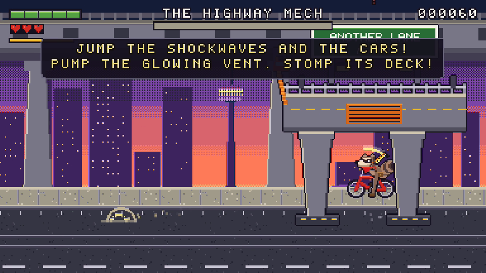

# 1.0 Review: version 1.0, a play counter, promo videos, post drafts (local, not live yet)

## Version 1.0
The title screen says **VERSION 1.0**. The `v1.0` tag goes on when this is pushed.

## The play counter
- **What it sends:** one record per visit, with nothing personal in it:
  - a random player number
  - minutes actually played (the tab is visible and there was input in the last 90 s)
  - missions done
  - phone or computer
  - the version
- **What it doesn't do:**
  - no cookies
  - no counting with Do Not Track or Global Privacy Control on
  - nothing from `?debug` sessions or automated browsers (the tests, the promo recorder)
- **Cost:** about 10 writes for a whole game, inside Firebase's free tier.
- **Where it's disclosed:** on ABOUT and in the README.
- **Reading it:** `node tools/stats.mjs` (or `node tools/stats.mjs 7` for the last week) prints:
  - visits, players, returning players
  - hours played, median minutes per visit and per player
  - how far players got
  - visits per day

**Ivan: republish the Firestore rules** (all of them, from `docs/LEADERBOARD.md`). Until then nothing is counted. The new rules also fix a leaderboard bug: the old rules allowed at most 12 missions and the game has 13, so a finished game's final score was refused. Until you republish, the game retries such a score with 12.

## Bugs the recordings found (fixed)
- **Boss shouts:** they ran off the right edge as a boss rolled in. The Highway Mech's was wider than the screen and sat on the boss bar.
  - Now every boss shout stays on screen, on its own dark panel; the long ones are two lines.
  - The Monster SUV's "TOWED!" and "STALLED!" are on panels too. They had landed on the Megamart's signs.
- **Dog Fjord's "GET HIM, PAPERWORK!"** landed on top of BOSS! and the Bureaucrat's shout. It now comes after them.
- **The Jet Tug's shout** overlapped its first VRRROOOM!. It's shorter now.

## Promo videos
There are four, each 45–50 s at 1920×1080 and 60 fps, with the game's own music. They're in `promo/` (not committed), and each one ends on a card with the link.

| File | Shows |
|---|---|
| `trashpanda_bwl.mp4` | Queen West past the Trinity Bellwoods gates; the briefing; rats; the Foreman Rat; "same street, now a kid can ride it"; Queen gets protected lanes on the map |
| `trashpanda_lot.mp4` | Queen St E; the Megamart briefing; the Monster SUV; "a park for Leslieville"; the lot turns green on the map |
| `trashpanda_sci.mp4` | The Rogers Centre, down Spadina to Queens Quay; Dog Fjord's moving sale; the chase; the Wrecker; science by the lake |
| `trashpanda_hw.mp4` | The Rogers Centre and the CN Tower; Lake Shore under the Gardiner; "...another lane?"; the Highway Mech; a park in the sky |

**How they're made:** `tools/promo/` plays the game in a headless browser, one 1/60 s frame at a time, with the synth's audio rendered in step. That's why they're smooth and in sync. A simple bot plays the fights. Bosses are worn down to their last hit after about ten seconds of real fighting, so each clip stays short.

## Post drafts
Drafts for your socials, r/TorontoBiking and r/toronto are in `promo/POSTS.md`.

## Tests
- 26 unit tests pass, including new ones for the 13-mission score retry.
- 77 browser tests pass on a fresh build, including new ones for the version, the counter's exact fields and boss shouts on screen.
- The Bike Bus test failed once under load and passed on a rerun.
