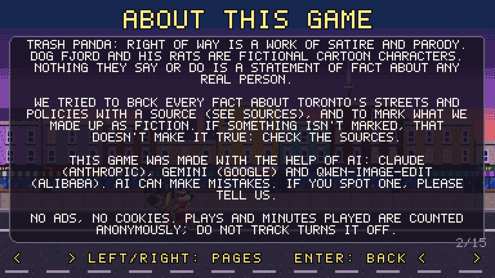
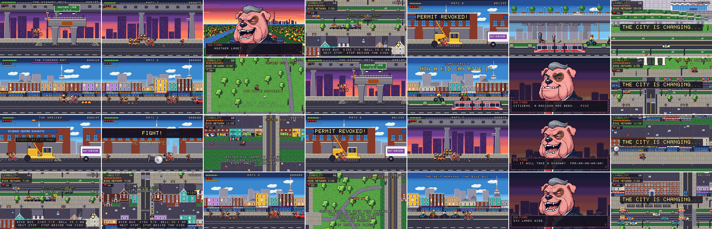
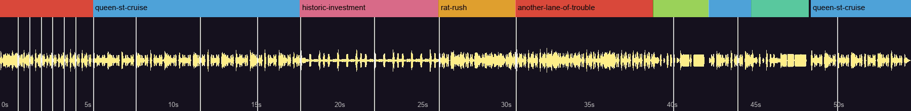

# 1.0 Review: version 1.0, a play counter, promo videos, post drafts (local, not live yet)

## Version 1.0
The title screen says **VERSION 1.0**. The `v1.0` tag goes on when this is pushed.

## The play counter
- **What it sends:** one record per visit, with nothing personal in it:
  - a random player number
  - minutes actually played (the tab is visible and there was input in the last 90 s)
  - missions done
  - phone or computer
  - the version
- **What it doesn't do:**
  - no cookies
  - no counting with Do Not Track or Global Privacy Control on
  - nothing from `?debug` sessions or automated browsers (the tests, the promo recorder)
- **Cost:** about 10 writes for a whole game, inside Firebase's free tier.
- **Where it's disclosed:** on ABOUT and in the README.
- **Reading it:** `node tools/stats.mjs` (or `node tools/stats.mjs 7` for the last week) prints:
  - visits, players, returning players
  - hours played, median minutes per visit and per player
  - how far players got
  - visits per day

**Ivan: republish the Firestore rules** (all of them, from `docs/LEADERBOARD.md`). Until then nothing is counted. The new rules also fix a leaderboard bug: the old rules allowed at most 12 missions and the game has 13, so a finished game's final score was refused. Until you republish, the game retries such a score with 12.

## Bugs the recordings found (fixed)
- **Boss shouts:** they ran off the right edge as a boss rolled in. The Highway Mech's was wider than the screen and sat on the boss bar.
  - Now every boss shout stays on screen, on its own dark panel; the long ones are two lines.
  - The Monster SUV's "TOWED!" and "STALLED!" are on panels too. They had landed on the Megamart's signs.
- **Dog Fjord's "GET HIM, PAPERWORK!"** landed on top of BOSS! and the Bureaucrat's shout. It now comes after them.
- **The Jet Tug's shout** overlapped its first VRRROOOM!. It's shorter now.

## Promo videos (second cut, from Ivan's notes)
There are four, each about 50 s, at 60 fps with the game's own music, and each comes in two versions:
- **landscape** (1920x1080), for Reddit, X and YouTube
- **`_vertical`** (1080x1920), for Reels, Shorts and TikTok. These start on the game's ROTATE YOUR DEVICE screen, then play the landscape video turned on its side.

They're in `promo/` (not committed).

| File | Shows |
|---|---|
| `trashpanda_bwl` | Trinity Bellwoods: a hidden heart, the white squirrel, the gates' plaque. Then the Bike Lane War, rats (hits taken), the Foreman Rat's last hits in one take, STREET CLEARED, "now a kid can ride it", Dog Fjord, and Queen getting protected lanes |
| `trashpanda_bus` | Riverdale Park: the view from the hill, the footbridge's plaque, a heart. Then **the Bike Bus on the map** (kids join at each stop, the bell clears the SUVs), ON TIME, a school street, Dog Fjord's "nobody likes patios!", and the map |
| `trashpanda_sci` | Graffiti Alley (easter egg and heart), down Spadina into the waterfront, the Rogers Centre's plaque. Then the chase, the Wrecker's last drops in one take, Dog Fjord's highway threat, and the boards coming down |
| `trashpanda_hw` | A heart by the Rogers Centre, the CN Tower's plaque, Sugar Beach. Then "...another lane?", rats under the Gardiner, the Highway Mech's end in one take, and a park in the sky |

**Ivan asked whether bosses can't hit you.** They can. The first bot had damage switched off in the recorder. Now the raccoon takes every hit; only a hit that would cost a life is turned into a close call, so the bot never has to restart. The bosses finish for real. Where a fight would be long (the Wrecker, the Mech), it's set a few hits from the end off camera, and the video shows the rest as one take.

## More text on text, found in the new footage (fixed in the game)
- **Toasts:** a long easter-egg toast ran onto the `E: READ THE PLAQUE` prompt. Toasts now end above the prompt, and a plaque and a toast never show together.
- **Mission cards and the RIDE!/GO! bands:** you could read shop signs through them. Now near opaque.
- **Rat bosses:** LANE OPEN! ran off the screen and landed on the boss's points. It's now on a panel, on screen.
- **Wrecker:** PERMIT REVOKED! sat on the SCIENCE CENTRE EXHIBITS sign and BROKEN DOWN! drew over the result card. Now on panels, under the card.
- **Highway Mech:** ANOTHER LANE! and NO MORE LANES. were off the top of the screen, so you never saw them. Now in front of its legs. The slab hint is next to the slab, not over its sign.
- **Map missions:** ON TIME! now has a dark band, and BIKE LANE CLEAR! stays below the HUD.
- **The bell:** ringing it at an SUV no longer makes the pedestrians answer on top of the SUV's words.
- **The map payoff headline** is on a dark band.

## Third cut (Ivan's notes)
- **Vertical:** the videos turn the other way, a quarter clockwise. The rotate icon turns counter-clockwise to match.
- **Marker shots:** they ride all the way in and show the zoom onto the marker.
- **Mission instruction cards:** gone. Each video goes straight into the action.
- **Bike Bus:** one shot from the easter egg to the footbridge's plaque.
- **Bike Lane War:** the raccoon takes one hit in the whole video, in a real Foreman fight shown whole.
- **Death by Highway:** the CN Tower plaque is read from above the Gardiner, so the raccoon stays in view.
- **Save the Science:** no pause before the heart. The Wrecker is played properly: dodge the drop, pump the engine while the ball is stuck, keep clear of the swing. The ending is short, and the raccoon has hearts left.
- **Opening skim, a trial:** `trashpanda_hw_skim.mp4` (and its vertical version) opens with about 4 s of quick flashes from all four videos. Compare it with `trashpanda_hw.mp4`.
- **Game fixes:**
  - `+N LIVABILITY` floated over the HUD after every mission.
  - The Mech's ANOTHER LANE! and the slab hint overlapped.
  - THEY'VE GOT THE EXHIBITS! landed on AFTER THEM!.

## Opening skims for every video (Ivan's notes)
Each video now has a `_skim` version (and `_skim_vertical`): about 4.5 s of quick flashes, then the video. The flashes keep the action in the middle of the screen:
- **Fights:** short extra takes where the raccoon fights in the middle of the arena: a crowd of rats, and the Highway Mech stomping with the raccoon jumping the dust. In the mission takes the camera locks and the raccoon fights near the left wall.
- **Death by Highway:** the streetcar crossing under the park in the sky, and the camera panning while the Gardiner goes green.
- **The others:** the Foreman Rat and rats on Queen, the white squirrel, the kids and the streetcar; the Wrecker's drop, the chase, Graffiti Alley; the bike bus in a line, the bell, the view from the hill. Each ends on its map changing.

| File | Opens with |
|---|---|
| `trashpanda_hw_skim` | the Mech's stomp, rats, ...ANOTHER LANE?, the bike bus, PERMIT REVOKED!, the streetcar, the Gardiner going green |
| `trashpanda_bwl_skim` | the Foreman Rat, rats on Queen, the white squirrel, the Mech, the streetcar and kids, Dog Fjord, Queen's bike lanes |
| `trashpanda_sci_skim` | the Wrecker's drop, the chase, Graffiti Alley, PERMIT REVOKED!, rats, FRA-HA-HA!, the science centre opening |
| `trashpanda_bus_skim` | the bike bus, the bell, rats, the view from the hill, the bike bus down the street, SIX LANES WIDE, the school street |

**Game fix:** on the Bike Bus, OOPS! MOVING! landed on a still-fading ALL ABOARD! 5/9 when an SUV came right after a stop. The bell's words now replace the stop's. The bus video was recorded again with the fix (`trashpanda_bus.mp4` too).

## Sound: the music under the cuts (Ivan's notes)
All the videos had sound, but some players (VS Code's preview, for one) don't play it. Open them in a browser or a video player. The real problem was the cuts. Every clip brought its own moment of the game's music, so the tune jumped at each cut. Now:
- **The music runs on across the cuts.** It's made from clean recordings of the game's own songs. Each clip keeps its own sound effects (hits, stomps, the bell, the text blips).
- **The songs change where the game changes them.** The boss song starts as the boss arrives, the win jingle plays at boss down and runs to its end, and the city-improves jingle plays as the map changes. The end card has the title tune.
- **Every cut is on the beat**, within 8 ms (under one frame).
- **The skims are counted in beats:** seven flashes, four bars of the fight music, then the video starts on the downbeat.
- **The vertical versions** start their first song under the rotate screen instead of in silence.
- **Even levels:** every file is at about −14.5 LUFS, with no gap in the sound.

*Death by Highway with its skim: songs (bands), cuts (lines), sound (waveform).*

**Game fixes the new takes showed (text on text):**
- **Bike Bus:** the bell's two lines (JUST DROPPING OFF! and BIKE LANE CLEAR!) ran into each other as they floated off. They now float off together.
- **Save the Science:** the chase hint and PERMIT REVOKED! left the warehouse sign's letters showing under their boxes. Both boxes now cover the whole sign, and FIGHT! clears the hint.

All the shoots were recorded again for the new sound, so the takes are new. The cuts follow the same plan.

## Post drafts
Drafts for your socials, r/TorontoBiking and r/toronto are in `promo/POSTS.md`.

## Tests
- 26 unit tests pass, including new ones for the 13-mission score retry.
- 77 browser tests pass on a fresh build, including new ones for the version, the counter's exact fields and boss shouts on screen.
- After the sound pass: 26 unit tests and 79 browser tests pass on a fresh build. That includes the Bike Bus bell lines' gap and the Save the Science hint and panel covering the sign.
- The Bike Bus test failed once under load and passed on a rerun.
