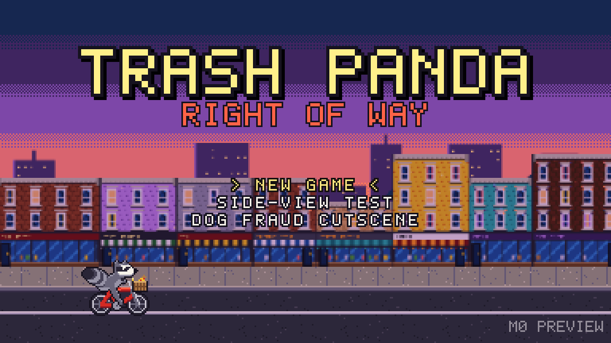
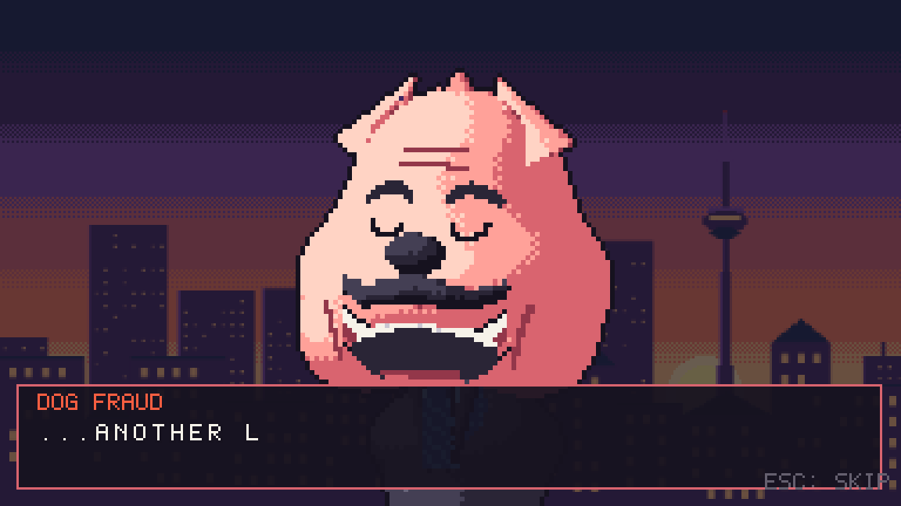
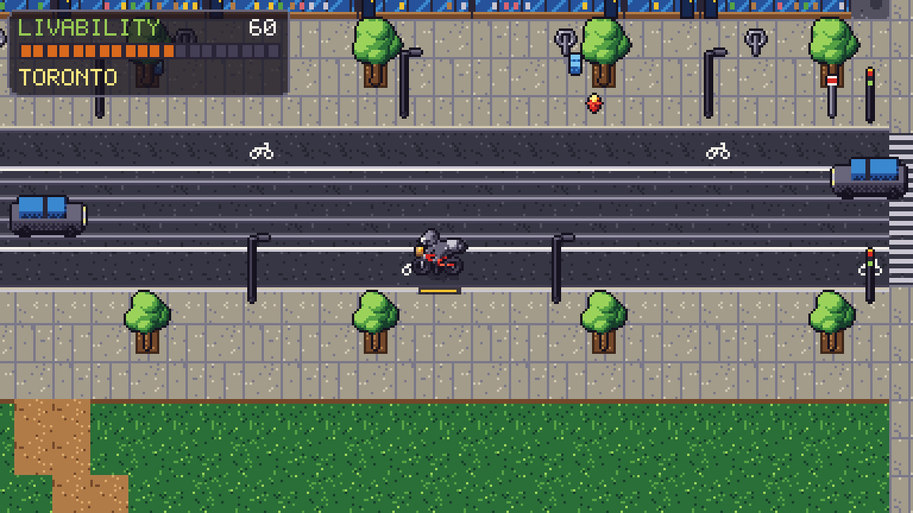
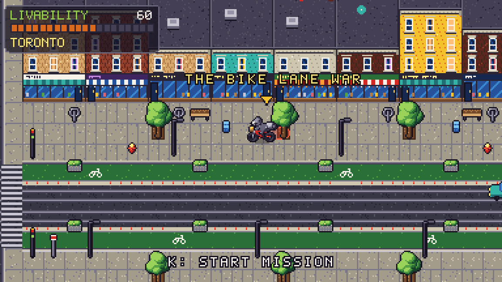
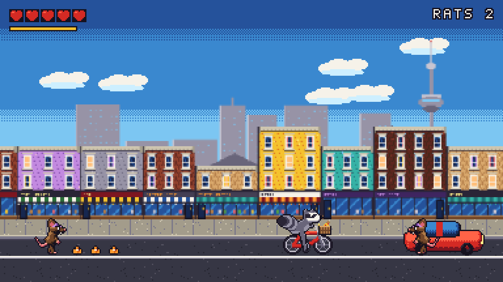
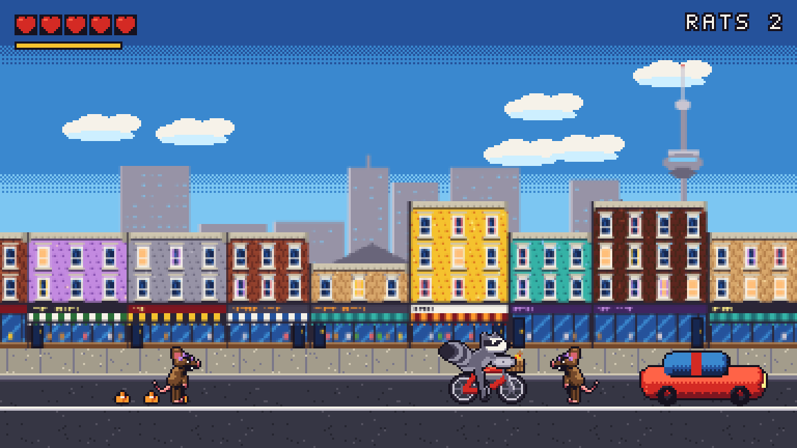
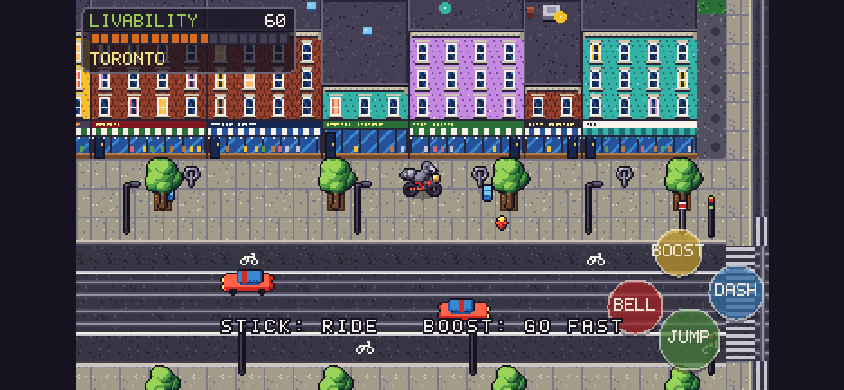
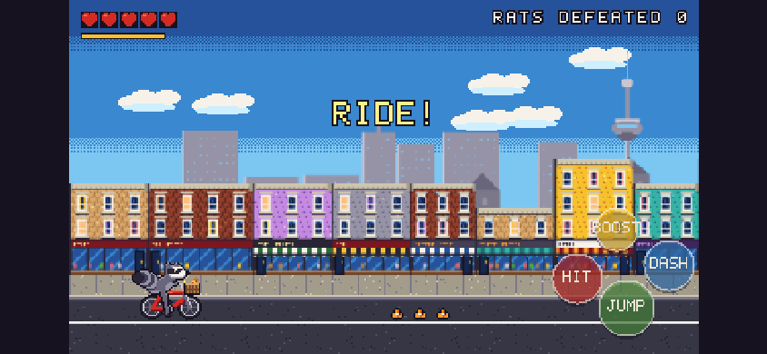

# M0 Review: Foundations + Art Direction

**Play it:** https://besit.github.io/trashpanda/ (a desktop browser with keyboard, or a phone in landscape)
**Debug build:** https://besit.github.io/trashpanda/?debug (T on the map applies the bike-lane upgrade instantly; V in a mission wins it)

## The question for this review
**Is this the look, sound and feel we want?** Art direction is cheap to change now and expensive after M1. Gameplay is a prototype, so judge the feel and the direction, not the content amount.

## What's in M0
| Area | Status |
|---|---|
| Art pipeline (pixel art as code, SDF renderer, versioned history) | ✅ |
| Raccoon on bike: side view (17 frames) + 3/4 view (8 dirs × 4 frames) | ✅ first pass |
| Dog Fraud portrait: grin, laugh, shock | ✅ first pass |
| Rats: basic, construction, traffic (walk / windup / attack / hurt) | ✅ first pass |
| Queen West map chunk: storefronts, streetcar tracks, intersection with signals, park, laneway, props, traffic and streetcars | ✅ |
| Side-view Queen West: parallax skyline with CN Tower and Dome, storefronts, street | ✅ |
| Intro cutscene: TORONTO. → FRA-HA-HA → "...ANOTHER LANE." | ✅ |
| Bike Lane War prototype: ride, 3 waves, lid combo, dash, stomp, thrown cones | ✅ prototype |
| Return to map: transformation sweep to protected bike lanes, Livability 60 → 64 | ✅ |
| Chiptune: 3 songs + sting, about 25 SFX, all synthesized | ✅ |
| Save/continue, touch controls, gamepad | ✅ basic |
| Unit + end-to-end tests, deploy pipeline, perf (60 fps at 6× CPU throttle) | ✅ |

## Screenshots
| | |
|---|---|
|  |  |
|  |  |
|  |  |
|  |  |

## Please check (about 15 minutes)
1. **Title → New Game:** watch the whole intro cutscene once, without skipping. Does Dog Fraud land? Is he funny, and is the parody pitched right: harder, softer, more dog, less dog?
2. **Ride around Queen West** (boost with Shift, dash with Space, hop with J, bell with K). Does the bike feel good? Too slippery, too slow?
3. **Find the red marker** ("THE BIKE LANE WAR", east along the north sidewalk). Press K. Fight: K swings the lid (3-hit combo), Space dashes through rats, and jumping on them works too.
4. **Win and watch the street transform.** Does the before/after read? Is the payoff satisfying?
5. **Phone:** open the link in landscape. Are the touch controls comfortable, and is the text readable?
6. **Sound:** music volume, the bell, the FRA-HA-HA laugh. Is chiptune the right call?

## Decisions I'd like your call on
1. **Dog Fraud's look:** keep, push the parody harder (e.g. more of the reference's sunburn and horns), or make him more dog?
2. **Phone screen:** characters are smallish on phones, and wide phones get black side bars. I'd like to make the game width **stretch to fill wide screens** (384 → about 470px wide), so phones lose the bars and see more city. OK?
3. **Raccoon's attack prop:** trash-can lid (current). Alternatives: bike pump, rolled-up city plan, tail spin.
4. **The new speed-camera mission** is drafted as *"Slow Down, Dog"*, a school-zone safety side mission (research in URBAN_RESEARCH.md §2). Main mission or side mission?

## Known issues / not yet done (planned for M1)
- The intro has no "before" vignette yet (rats tearing up the lane, a parent and child at the curb). The mission ends at "STREET CLEARED!" with no after-vignette.
- No pedestrians or cyclists on the map yet; ambient life comes in M1.
- Hydrants look like red gems from the 3/4 angle; streetcars don't stop at the TTC stops yet.
- There's no pause menu, settings screen or volume control yet (settings are stored, but there's no UI).
- Dog Fraud has no in-world sprite yet (portrait only).
- Map collision is simple boxes, and you can bump into trees and news boxes on the sidewalk. That's intentional, but tunable.
- Side-view rats can stack on top of each other.

## Process
The full process, including the failed attempts, is in [DEVLOG.md](../DEVLOG.md). Every art iteration is in [art/history](../../art/history/INDEX.md) (14 asset folders, 26 versions so far).
