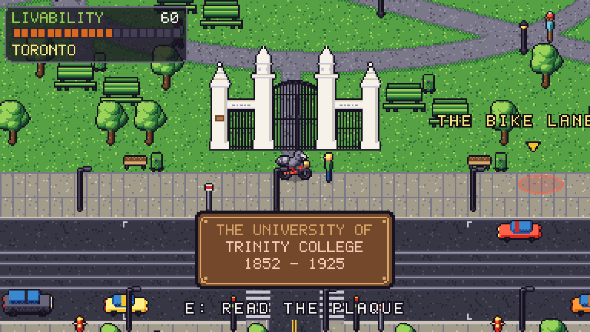
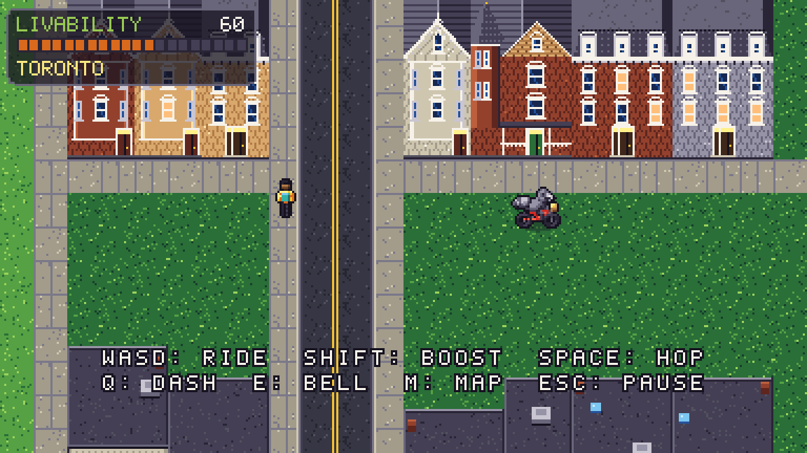
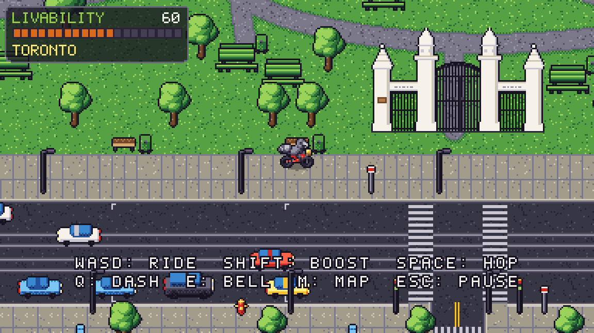
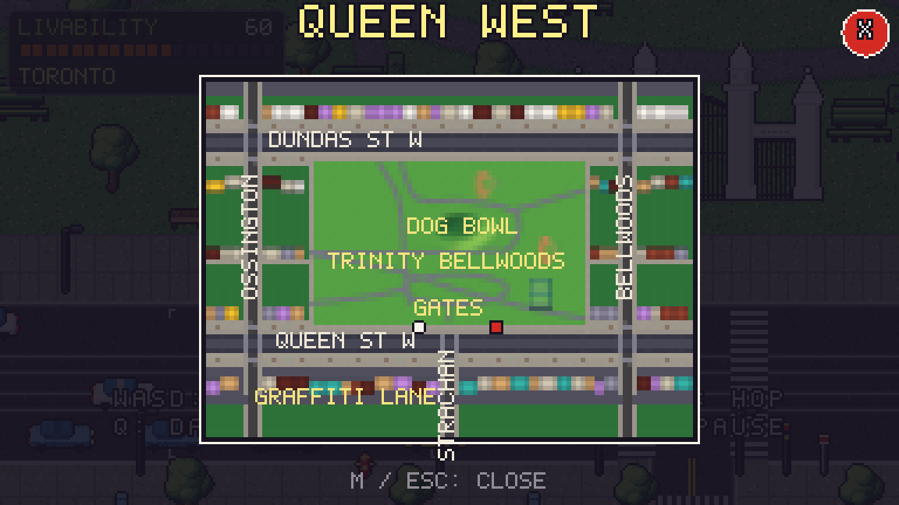
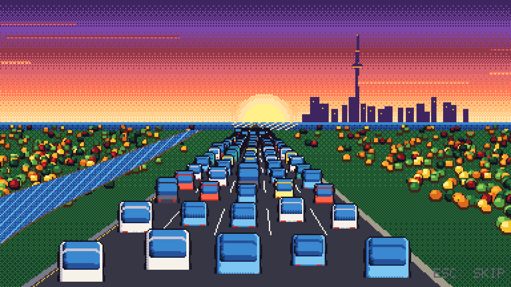
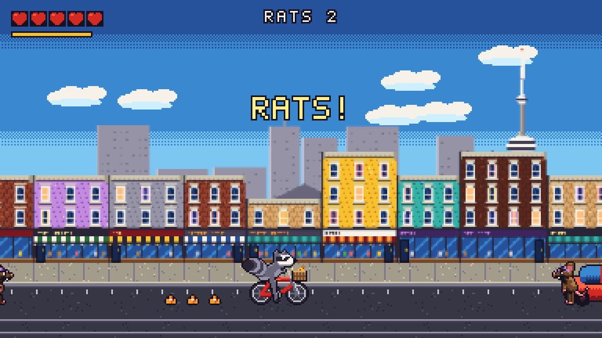
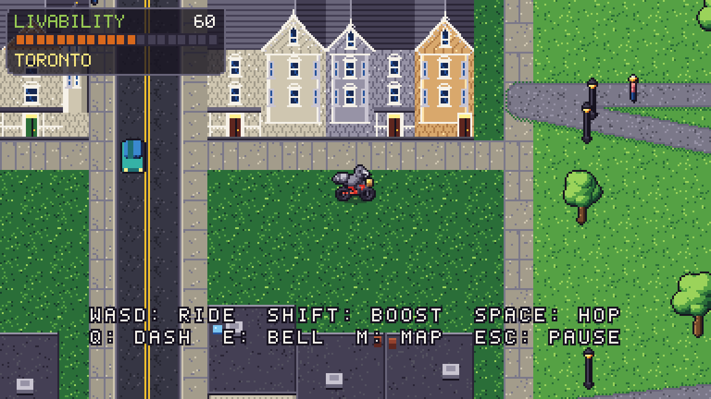
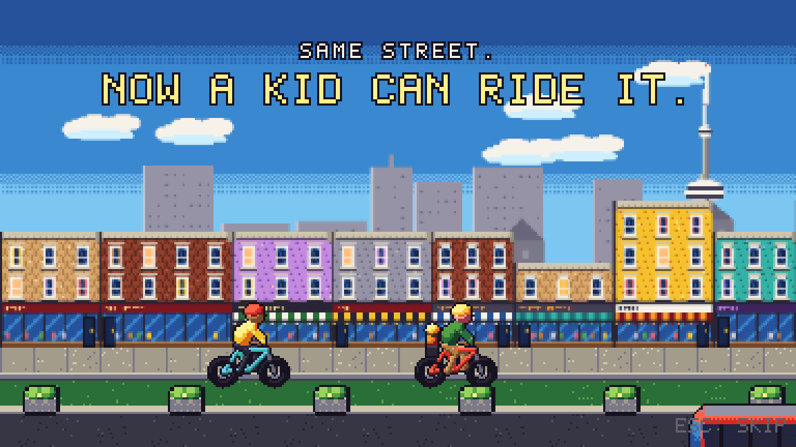

# M1.1 Review: Your M1 Notes

**Play it:** https://besit.github.io/trashpanda/ (desktop or a phone in landscape) · **Debug:** add `?debug`

## Your notes → what changed
| You said | Now |
|---|---|
| Intro: don't name the Parkway | Dog Fraud says "STUCK IN TRAFFIC? I HAVE THE SOLUTION." |
| River 3× wider | Done |
| The added lane shouldn't speed cars up | The sixth lane fills with the same crawl as the others; no surge |
| "Five lanes / six lanes don't move" captions too direct | Removed; the picture tells it |
| Plaque too long, cut off | A bronze plate with three lines: THE UNIVERSITY OF / TRINITY COLLEGE / 1852 - 1925 |
| Graffiti as a separate sheet over existing buildings | Done: a graffiti sheet of throw-ups, tags, a raccoon stencil and more, laid over walls; building images are clean |
| Graffiti Alley is really downtown | Agreed. It stays here for now; noted for the Downtown district |
| Bell text disappears too quickly | Pedestrian replies stay up for about 2 s |
| Picnic tables | The classic green table with two benches, in pairs at the numbered picnic areas |
| Park map ref: place existing things where they are | Re-laid from the map: dog bowl, Skydome diamond plus diamond #2, tennis courts, the circle path, the long diagonal, the west spine, the Lobb crossing, the field-house path, picnic areas, the squirrel |
| Cyclists slower than cars; cars a bit faster | Cars 72–98, streetcars 52, cyclists 32–39, pedestrians 16–26 (px/s). Cars stuck behind a cyclist now read clearly |
| Sidewalk and front buildings should move together | Tied together in missions and vignettes |
| Transparency in the front buildings' pixels | ⚠️ See below: please confirm |
| Planters didn't move with the street in the end vignette | Vignettes hold the camera still now, so nothing slides |
| Screen jumps when rats appear | The arena locks where the camera already is; afterwards the camera eases back into follow |
| Top-right buttons flicker | Fixed (two bugs, below). The map and controls stay open and have an **X** close button |
| Gates: match the reference | Redrawn from the photo (below) |
| District size is good; add building styles | Gothic Revival bay-and-gable, Queen Anne (turret) and Second Empire (mansard) on the blocks east and west of the park |
| Bloor as a separate mission | Main mission 5, **The Lane Eater** (design in GAME_DESIGN): an auto-scrolling chase ahead of a lane-eating paving machine. You grow a peloton of cyclists by ringing your bell, and the peloton shields you and slows the machine, followed by a 3-part boss |
| CN Tower shape | Redrawn against the photo: tapering shaft, banded pod, thin upper shaft, SkyPod, long antenna |

## Screenshots
| | |
|---|---|
|  |  |
|  |  |
|  |  |
|  |  |

## The two touch bugs
1. **Flicker:** your finger was still on MAP/II when the overlay opened. On its first frame the overlay saw a "new" press and closed itself. The paused game also never saw your finger lift, so the button stayed stuck.
2. **Dropped quick taps:** found by the new automated test. A very fast tap (down and up within one frame) was missed entirely, the same problem the keyboard had in M0.

Both are fixed. A new end-to-end test taps MAP, checks the overlay is still open a moment later, closes it with X, then checks that II still works. Headless taps are instant, so please confirm the held-finger case on your phone.

## Please check
1. **Phone:** tap MAP and II. Do they stay open, and does X close them?
2. **The park:** does the layout feel like Trinity Bellwoods now? Look at the circle path near the gates, the diamonds on the east side, and the picnic tables.
3. **The houses** east and west of the park. Are those the styles you meant?
4. **The intro** with the wider river and the quieter lane addition.
5. **A mission wave:** is the camera lock smooth now?

## Questions
1. **"Transparency in the front buildings' pixels":** I scanned every facade by script and found no transparent pixels. My best guess was the daytime skyline towers, whose windows were the same light blue as the sky, so they looked like holes. I darkened them. If you meant something else, a screenshot or a rough location would help me find it.
2. **The Lane Eater:** does the peloton-plus-machine idea feel right for Bloor, or would you like it closer to the real events (e.g. a protest ride with no combat)?
3. **Next step:** I'd go into **M2** next: missions 2–4 (Let the Streetcar Through, King of the Street, Slow Down Dog) and the High Park and Downtown districts. Or do you want another polish pass on Queen West first?
