# M1 Review: Your M0 Feedback + the Vertical Slice

**Play it:** https://besit.github.io/trashpanda/ (desktop keyboard, or a phone in landscape)
**Debug build:** https://besit.github.io/trashpanda/?debug (T on the map applies the bike-lane upgrade; V in a mission wins it; the title menu gets test entries)
**Tip:** your M0 save is from the old map. Start with **NEW GAME** so you see the intro and the new district from the start.

## The question for this review
**Does the vertical slice feel like *the game*?** That's one district that feels like Toronto, one mission with a before and an after, and a payoff that makes the argument. Once this feels right, M2 copies the recipe to the other districts.

## Your M0 notes → what changed
| You said | Now |
|---|---|
| 1. Non-moving buildings in the middle-ground (title, cutscene) | That back-row layer never scrolled; all layers drift now |
| 2. Transparent pixels in top-layer buildings | Arched windows punched holes in the wall; fixed, and verified on 600 generated buildings |
| 3. Side view freezes when a thrown cone lands | Fixed: Phaser was swapping the collision callback's arguments. Now covered by a regression test that fails on the old code |
| 4. Small things shouldn't be obstacles | Only trees, buildings, the gate piers and parked cars block you |
| 5. K is unnatural; what are the other controls? | **E** act/attack, **Q** dash, **Space** hop/jump, **Shift** boost, **M** map, **Esc** pause (plus an arrow-key layout). Full list under Pause → Controls and Title → Controls |
| 6. "Another CAR lane" | Everywhere: intro, title card, rat signs |
| 7. Trinity Bellwoods, north of Queen, white gates; distinct artifacts | A new district (below). The gates have a plaque (E) |
| 8. Queen has no bike lanes; the mission should add them | Queen starts with parking lanes; winning turns them into protected lanes, and the parked cars drive off |
| Dog Fraud: no moustache, white hair, more dog | v06: white coif, dog nose and muzzle, folded ears, tan eye patch |
| Stretch to fill the phone | The view widens up to 480px, so no black bars |
| Bike pump | Done: yellow pump, swung like a bat |
| Speed cameras = main mission | Main mission 4, *Slow Down, Dog* (High Park school zone; built in M2/M3) |
| North-side flowerbeds misplaced | Planters sit on the traffic side of both lanes |
| Bell from his butt | The ring now comes from the handlebars |
| Rotate overlay on grey | A translucent overlay over the dimmed game, which also auto-pauses |
| A small map? | **M** (or the MAP button on touch) |
| Cars on the vertical street offset left | An 8px lane-centre bug; fixed |
| Intro roads: DVP into the lake at sunset, +1 lane, still jammed | New intro shot, below |
| Add Dundas? | Dundas is on the map: it really is the park's north edge. The 2026 removals target Bloor, Yonge, University, Queen's Park and Avenue Road, **not Dundas**, so the removal story moves to **Bloor in High Park** |

## Screenshots
| | |
|---|---|
| 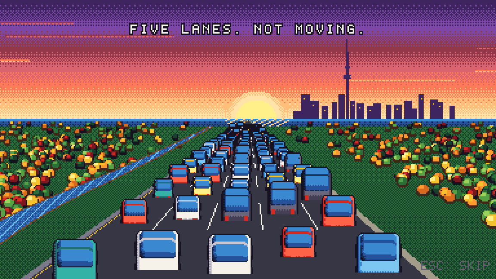 |  |
| 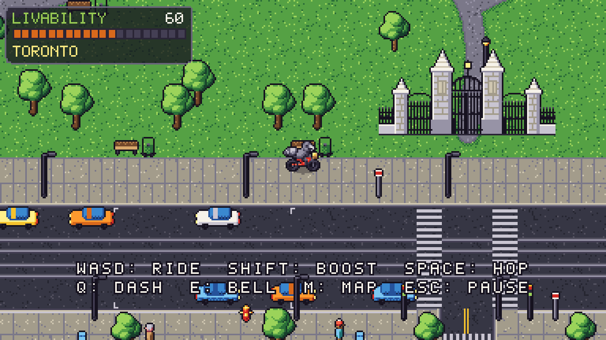 | 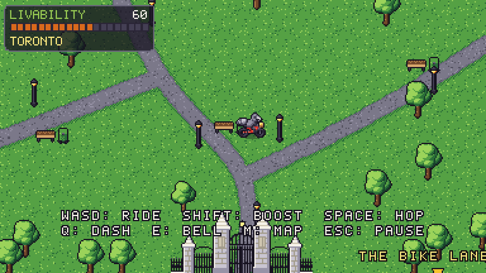 |
| 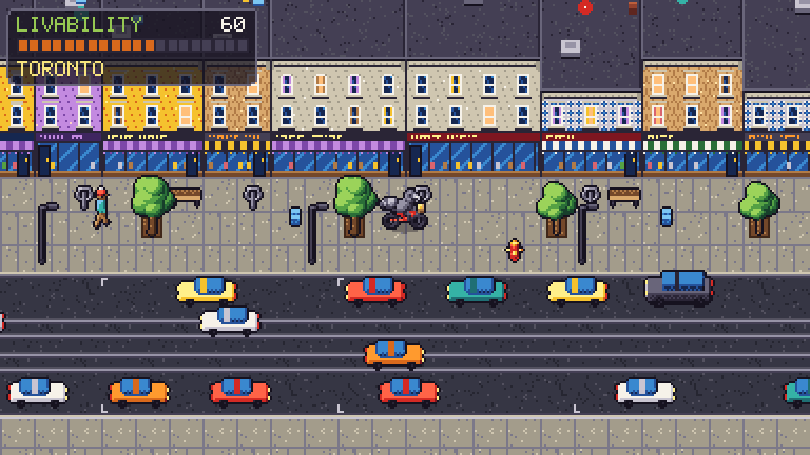 | 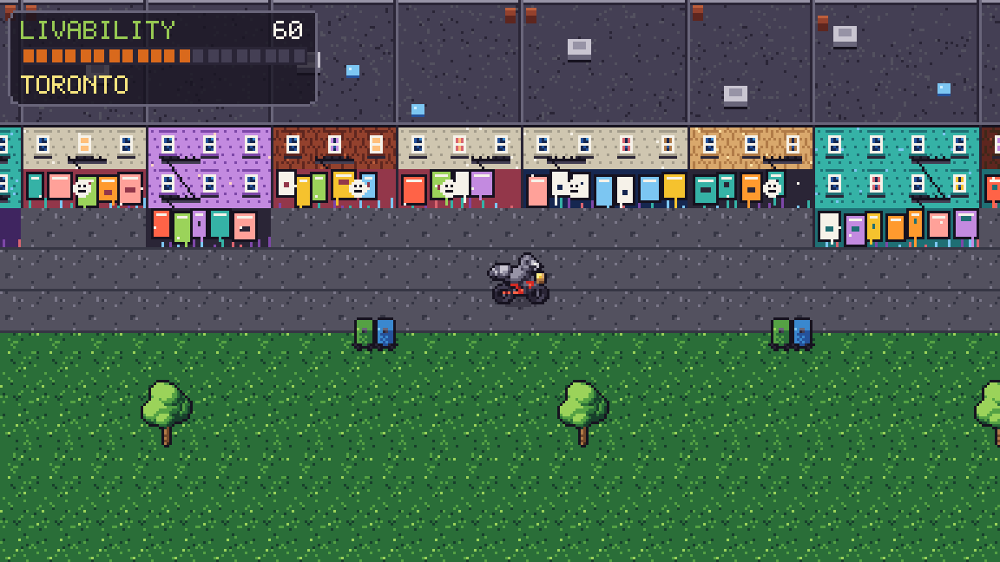 |
| 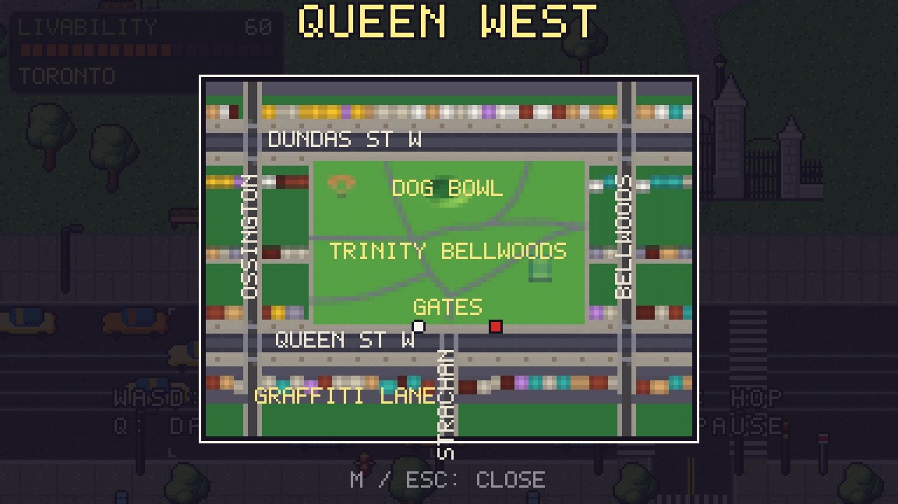 | 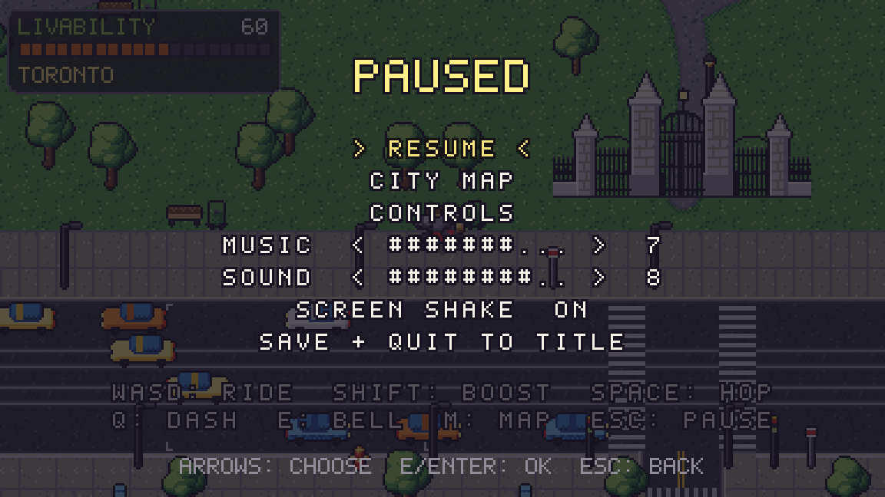 |
| 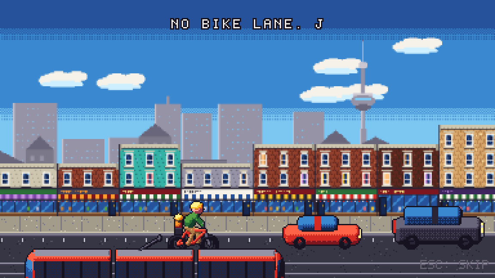 | 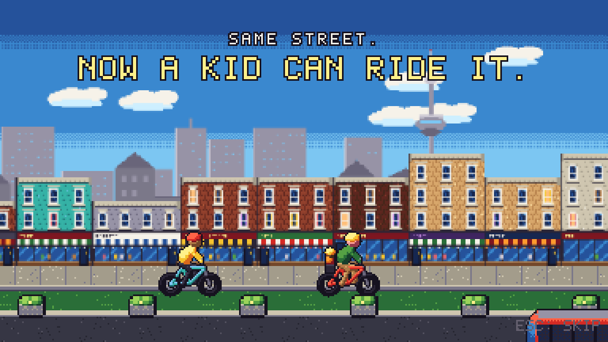 |
| 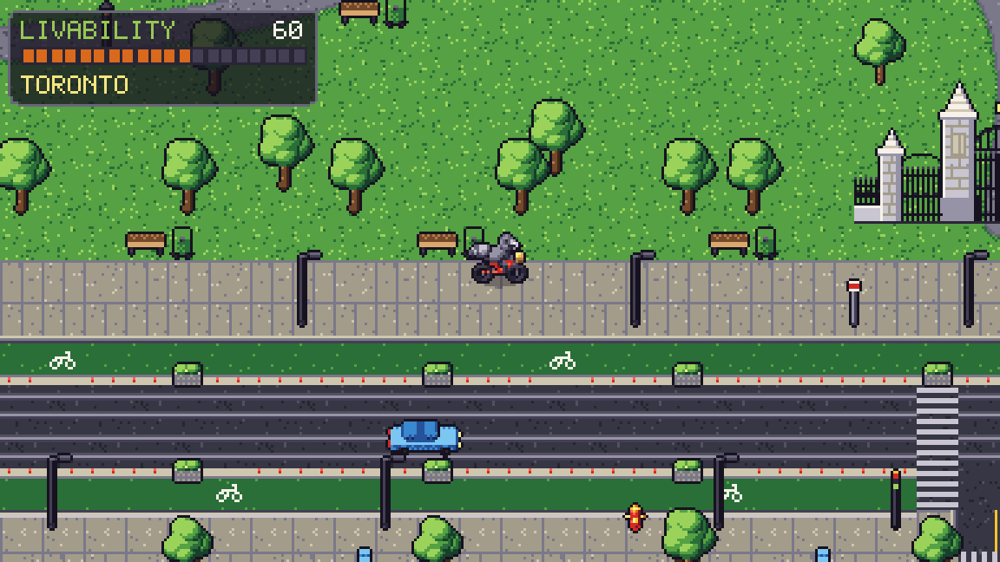 | 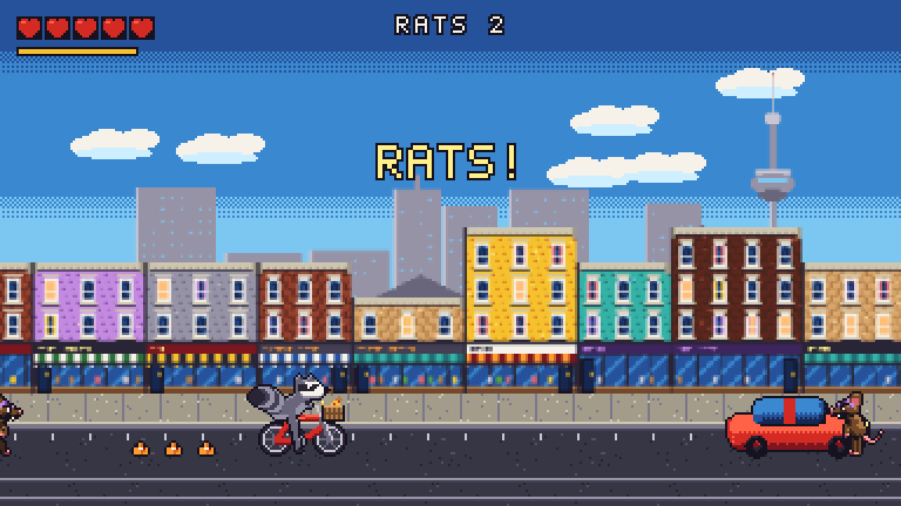 |
| 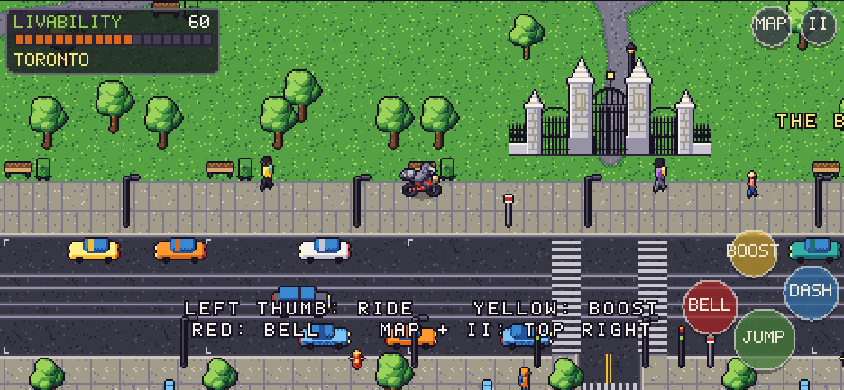 | 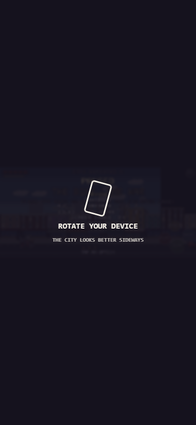 |

All 32 shots are in [`m1/`](m1/).

## Please check (about 20 minutes)
1. **New Game → the intro.** Watch it once without skipping. Does the parkway shot land, with five lanes, then six, then still gridlocked? Is Dog Fraud v06 the right amount of dog?
2. **Ride around Queen West.**
   - The gates: ride up and press E for the plaque.
   - The dog bowl, the tennis courts, Dundas and Little Portugal, the graffiti lane behind Queen.
   - Find the white squirrel near the dog bowl.
   - Ring the bell (E) near people.
   - Open the map (M). Does it feel like *that* corner of Toronto?
3. **Traffic and life.** Watch Queen for a minute. Streetcars stop at the stops, and the occasional cyclist rides in the streetcar lane with cars stuck behind. Too busy? Too quiet?
4. **The mission** (red marker east of the gates):
   - Before-vignette → fight with the pump (E), dash (Q), jump (Space) → after-vignette → the map transforms.
   - After the upgrade, watch Queen again: cyclists use the new lanes.
5. **Phone:** landscape fills the screen now. Check the new MAP and II buttons (top right), and that rotating to portrait pauses the game.
6. **Pause menu** (Esc): volumes, shake, controls.

## Decisions I'd like your call on
1. **Gate reference.** The gates are drawn from memory: stone piers with pinnacle caps, an iron carriage gate with an arched overthrow and lantern, and pedestrian gates. If you have a photo, drop it in `reference/` and I'll match it more closely.
2. **Dog Fraud's ears.** v06 turned the horns into folded dog ears, which read as more dog. Do you want the horn reading back?
3. **Map/district scale.** Queen West is about 4 screens wide and 5 tall. Should the other districts match, or go bigger?
4. **Bloor removal story.** Should High Park get its own "Bike Lane War II: Bloor" mission about the real removals, or should the removals be background only (news ticker, a Dog Fraud speech)?

## Known issues / next (M2)
- Dog Fraud still has no in-world sprite on the map (portrait only).
- Pedestrians walk through each other; they're fine at this density, and there's no avoidance yet.
- Gamepad works, but there's no on-screen gamepad glyph set yet.
- Missions 2+ and the other five districts are M2–M3.
- Your M0 save loads, but your position may be reset to the new spawn (the map changed shape).

## Process
- Everything is in the [DEVLOG](../DEVLOG.md), including the failed first passes: gun-looking pump, black-eye patch, solid-black gate grilles, a draining traffic jam, and a regression test that didn't regress.
- Art versions: [art/history](../../art/history/INDEX.md), now 31 versions across 15 asset folders (M0 had 21, not the 26 I reported then).
- Research added: the Dundas question, Queen's actual bike-lane status, induced demand, and the gates' history (sources disagree on the construction year, so the plaque avoids it). See [URBAN_RESEARCH](../URBAN_RESEARCH.md) §1, §14 and §15.
