# M3.2 Review: your M3.1 notes

**Play it:** https://besit.github.io/trashpanda/. Add `?debug` to get **SELECT MISSION** on the title screen.

**Maps:** full-scale images of all five districts, regenerated for this pass, are in [docs/maps/](../maps/).

Each change below has a screenshot; the numbers in brackets refer to the gallery at the end.

## Your notes, and what changed

### Global
| You said | Now |
|---|---|
| Can we do fullscreen on mobile? | **Android, and iPad:** the first tap goes fullscreen and tries to lock landscape. The pause menu has a **FULLSCREEN ON/OFF** line (30). **iPhone:** Safari doesn't let any web page go fullscreen. The page now has a web-app manifest and icon, so **Share > Add to Home Screen** gives a Trash Panda icon that opens fullscreen in landscape with no browser bars. On an iPhone, the pause menu says so ([icon](../../art/history/app_icon/v01/preview.png)) |

### The Lane Eater
| You said | Now |
|---|---|
| The Lane Eater wasn't shown until I went backwards | It now stays **on screen at the left edge** for the whole chase. Every rider in your peloton holds it further back, and alone it creeps about a quarter of the way in (01). It used to start 180 px off screen and was meant to catch up, but a peloton made it fall further behind, so it never appeared |
| Getting riders is too easy: pass them while ringing | Ringing now makes a rider **clip in**. They pedal up from a standstill and a green bar fills over their head, and you have to **stay beside them** until it's full. Race past at full speed and they lose you ("WAIT UP!"); ring again if they're still on screen (02) |
| The machine should throw asphalt that can hit the raccoon while we gather riders | The conveyor **lobs hot asphalt** ahead of where you're riding, with a red shadow where each gob will land. Gobs leave puddles that hurt for a couple of seconds, and they come more often further down Bloor. A gob that hits you knocks a rider out of the peloton (01) |
| Only the grinder should hurt; it should charge across the whole screen; jump over it, then hit it while it's stuck at the side overheated; then off screen and back the other way | Built as you described (04, 05): **CHARGE** right across the screen; only the grinder drum hurts, so jump it. It **slams into the edge** and rolls back a little. Then it **OVERHEATS**, and only now can you hit the conveyor, the cab or the grinder. It drives off that side and comes back **from there, going the other way**. The foreman calls one rat per stall, and while it lines up off screen the conveyor lobs a couple of gobs. Below half health it charges faster and cools down quicker. My test bot needs 3 to 5 overheats to finish it |
| Riders should ride in the bike lane (they were a bit high), and riders drawn over others should be lower or level | The riders' wheels are now level with the raccoon's, inside the green lane. Draw order follows height on screen, so the lower rider is always in front (01, 03) |
| In the intro the raccoon is drawn over the Lane Eater | It now rides in **behind** the machine and comes out at the grinder (06) |
| In the outro, lift the signs so they don't cover the riders | The signs float 16 px higher, clear of the riders' heads (07) |

### Waterfront
| You said | Now |
|---|---|
| Streetcars should turn in 3 sections | A streetcar taking a corner now bends **at its joints**: the rear (2 modules), the middle with the pantograph, and the front (2 modules). Each section takes the facing of its own stretch of the curve. Once the whole car is round the corner it goes back to one piece (12) ([vehicles v05](../../art/history/vehicles/v05/preview.png)) |
| Access from Queen West: Strachan should go to Ontario Place; Ossington and Bellwoods should also land on Strachan | **Strachan Ave** is now the Waterfront's west street. It comes down from Queen West, ends at Queens Quay, and lines up with the Ontario Place causeway (16). Riding south on **Ossington, Strachan or Bellwoods** in Queen West lands you on Strachan. Riding north on Strachan takes you back to Queen West's Strachan (25) |
| South from High Park should also land on the Waterfront, west on the Martin Goodman Trail | Riding south on **Parkside or Roncesvalles** lands you on the **trail at the Waterfront's west end**, and riding west along the trail takes you back (24, 16) |
| Solve the train tracks issue on Spadina | Spadina's rails stopped short of the intersection, so the curves floated on their own. The rails now run into the junction and the curves pick them up there (11) |
| Rework the SkyDome: closer to the real one, closed, from the air, from the front | Redrawn from your aerial and elevation drawings. The roof is **closed**, in nested panels whose edges read as **arcs** across it. Below it is a ring of concrete levels with two blue glass bands and the diagonal ramp towers at the corners (13) ([waterfront v03](../../art/history/waterfront/v03/preview.png)) |
| Rework the CN Tower base: a trefoil, slightly off-angle; tapering concrete foils; glass elevator shafts at the core | Three **tapering foils with hexagonal tips**, turned about 12° off the grid. They merge into the shaft as they rise, with a **glass elevator strip** up each corner where two foils meet, and the strip continues up the shaft (13) |
| The skyline tower: rework the main pod; I want the white "donut" | The pod was re-profiled from your close-up. From the bottom: a fat **white donut**, the dark ribbed outdoor deck, a white band, the window band, the widest rim, a thin red line, then the upper drum (17) ([cn_tower v02](../../art/history/cn_tower/v02/preview.png)) |
| The aquarium can look better | From your photos: a white angular hall. The roof shows **the two dark sharks** set into the white tiles, plus the raised block to the west. The front has the jutting **grey/white checker band**, the tall glass wall under a raked canopy, and the entrance stairs (13) |
| Move the pods down one square | Done |
| Lakeside: extensions into the water with basins and yachts. Ferry terminal, Harbour Square Park, Sugar Beach, maybe the Power Plant | The shore is now a row of **quays** with **slips** between them, each with a finger dock and moored **motor yachts** and sailboats. West to east (14, 15): **HTO Park**, an urban beach with its yellow umbrellas and a plaque; **the Power Plant** gallery with its smokestack lettered POWER PLANT and a plaque; a quay of trees and benches; **Harbour Square Park West** with the Sundial Folly, at the foot of University; the **Jack Layton Ferry Terminal** at the foot of Bay, with the ferry tied up off its end; **Sugar Beach** |
| Reduce space between Bay and University if needed | Done: the block is 20 tiles instead of 32. Spadina moved east, between CityPlace and the Rogers Centre (10) |

### High Park
| You said | Now |
|---|---|
| Roads meeting the pavement: extend the road onto the sidewalk with a square end | Every park road that reaches a street now runs **straight across the sidewalk to the curb** and ends **square** there. The rounded end in the grass and the driveway patch are gone. This applies at Bloor, the Queensway and Parkside (20, 21) |
| Move the pool off the road | Moved up and left, clear of Colborne Lodge Dr (22) |
| Move the tennis court right a bit | Moved right, clear of the road (22) |
| Remove the brown patch at the centre | The fenced dog park is gone, and oaks fill in (22) |
| Remove the small pond under the roads left of the playground; connect the roads | The pond is gone, and Deer Pen Rd now ends **on** Spring Rd instead of stopping short in the water (22) |
| Move the playground right a little | Done (22) |
| Move the bottom-right pond out from under the roads | It moved east of Spring Rd, with its swan (22) |
| Fill the space between the townhouses with small roads (no traffic), trees, homes, playgrounds, benches | Both blocks east of Parkside now have **quiet side streets** (no car lanes; people walk them), with rows of **houses facing them**, front gardens with trees and benches, street lamps, and a **parkette with a playground** on each side of Roncesvalles (23). I left the streets unnamed: I couldn't place the real Roncesvalles side streets in the right order from memory |

The placement of park features is no longer done by hand. The pool, tennis courts, cafe, greenhouse, playground and Colborne Lodge are each placed by a search outward from their spot on the City's map, to the nearest place that clears every road, trail, pond and other feature, and in the direction you asked where you gave one. Tree canopies are also kept off the roads now.

## Things to check
- **Lane Eater difficulty.** The clip-in range and the gob rate are guesses tuned against a bot. If it's too hard, the easiest knob is the clip-in range (50 px).
- **Fullscreen** on your phone, from the first tap and from the pause menu. On iPhone, try Add to Home Screen.
- **The new connections:** Queen West to the Waterfront on Ossington, Strachan and Bellwoods; High Park to the Waterfront on Parkside and Roncesvalles.

## Known issues
- **Shot 04 is cluttered.** It comes from a debug jump straight to the boss, which sets off every ambush at once; in play the rats arrive one ambush at a time.
- **Strachan doesn't really reach Queens Quay.** In real life Queens Quay ends near Bathurst. The game's Queens Quay runs the whole width so every street has somewhere to turn.
- **The east-side townhouse fill is generic.** It's rows plus gardens, not the real Roncesvalles street grid.

## Gallery
| | |
|---|---|
| 01 Machine on screen, asphalt lobbed 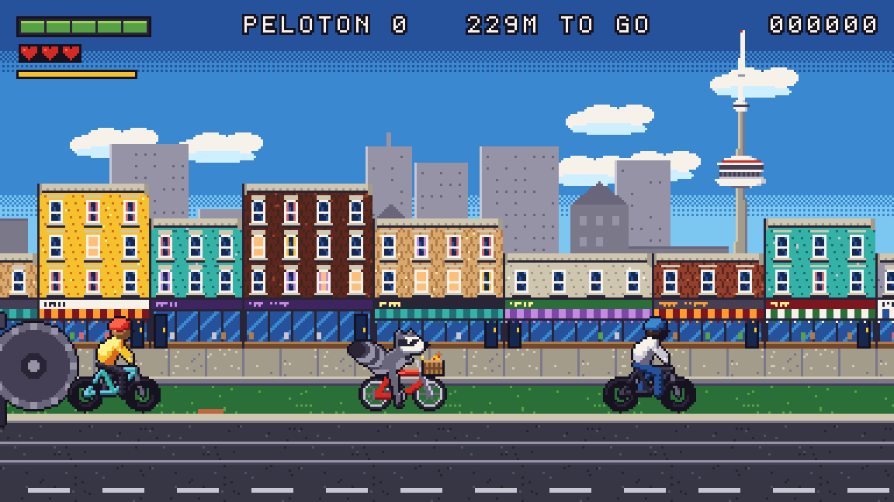 | 02 A rider clipping in 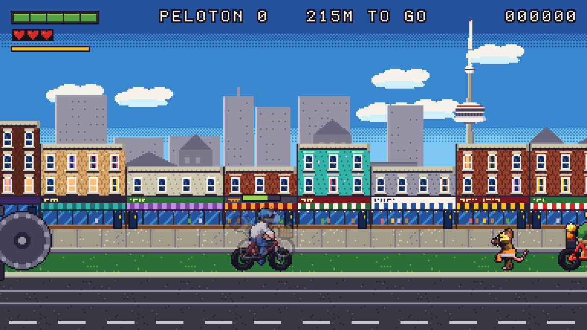 |
| 03 The peloton in the lane 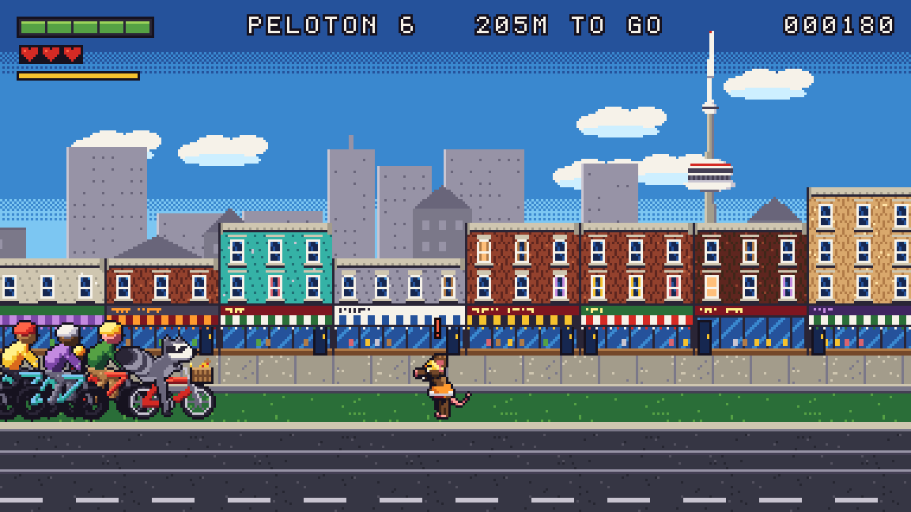 | 04 Boss charge: jump the grinder 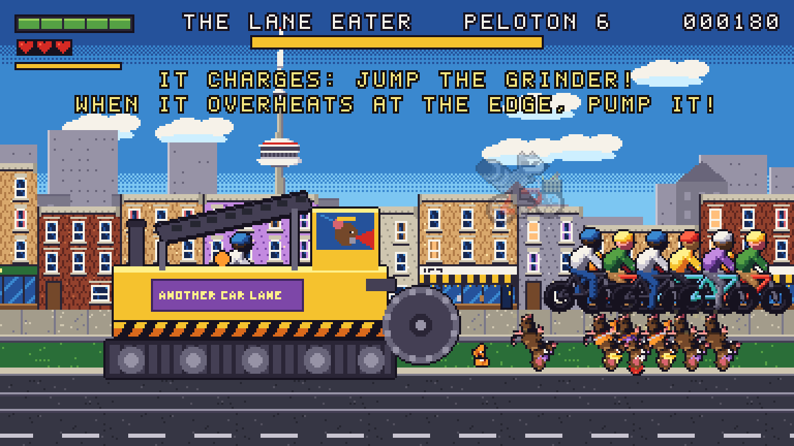 |
| 05 Overheated at the edge 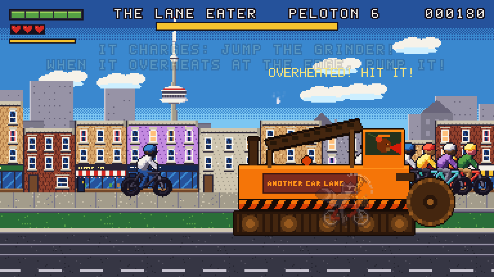 | 06 Intro: the raccoon behind the machine 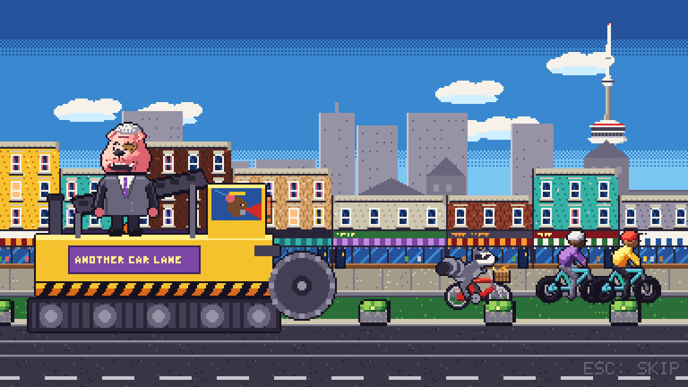 |
| 07 Outro: the signs higher 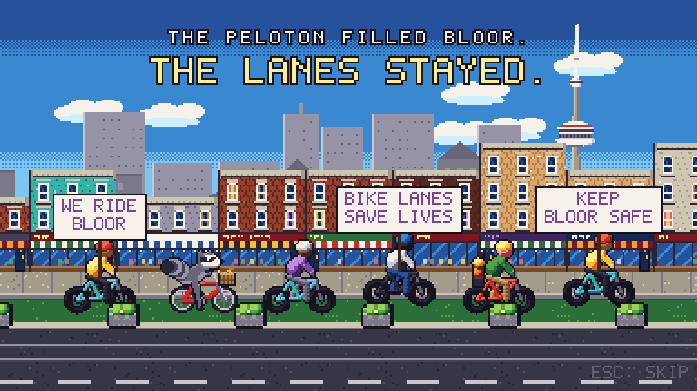 | 10 The Waterfront, whole (half scale) 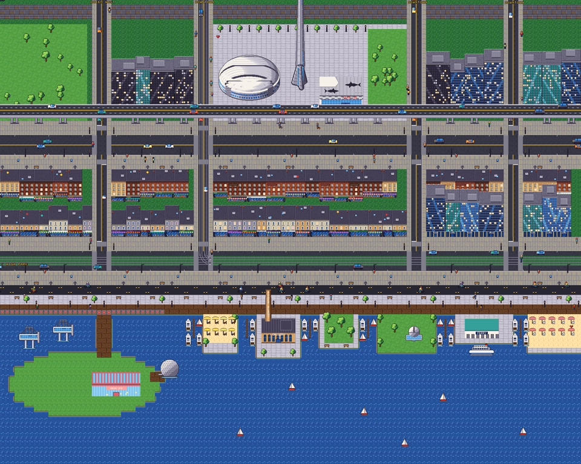 |
| 11 Spadina's rails into the curves 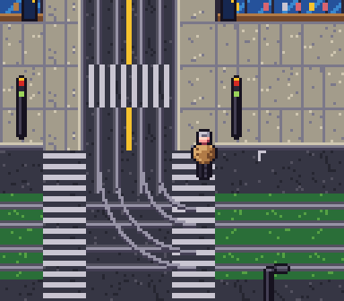 | 12 A streetcar turning in 3 sections 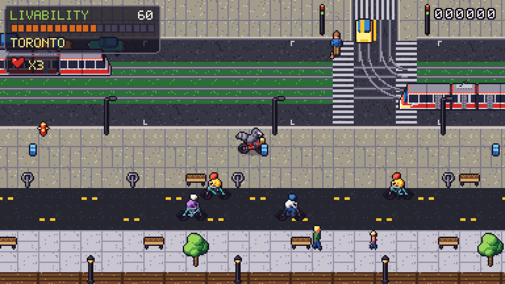 |
| 13 Dome, tower, aquarium 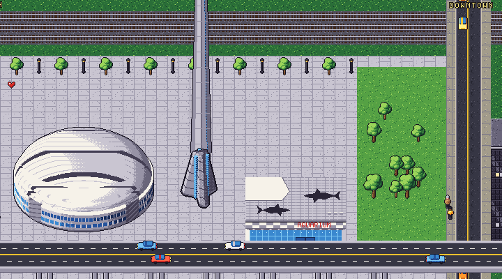 | 14 HTO Park, the Power Plant, slips 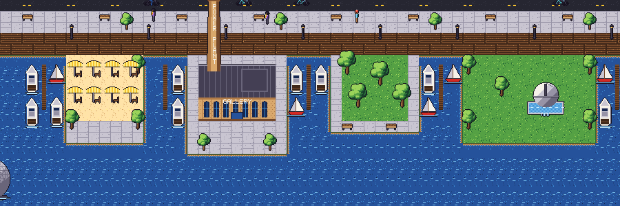 |
| 15 Harbour Square, ferry, Sugar Beach 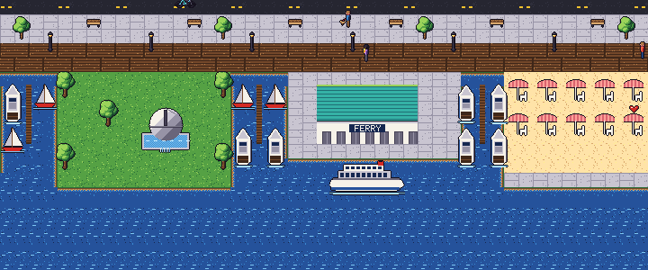 | 16 Strachan to Ontario Place 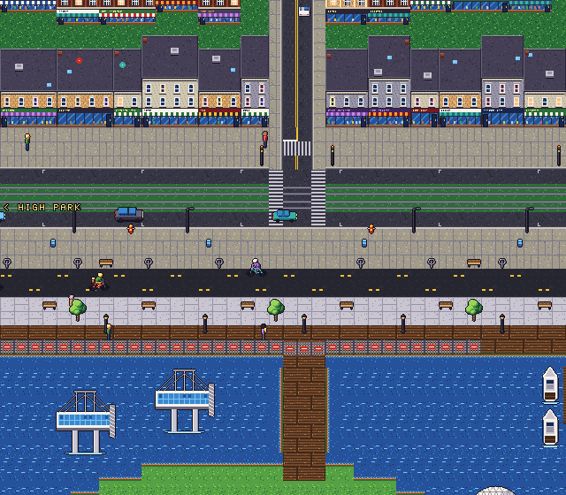 |
| 17 The skyline pod's donut 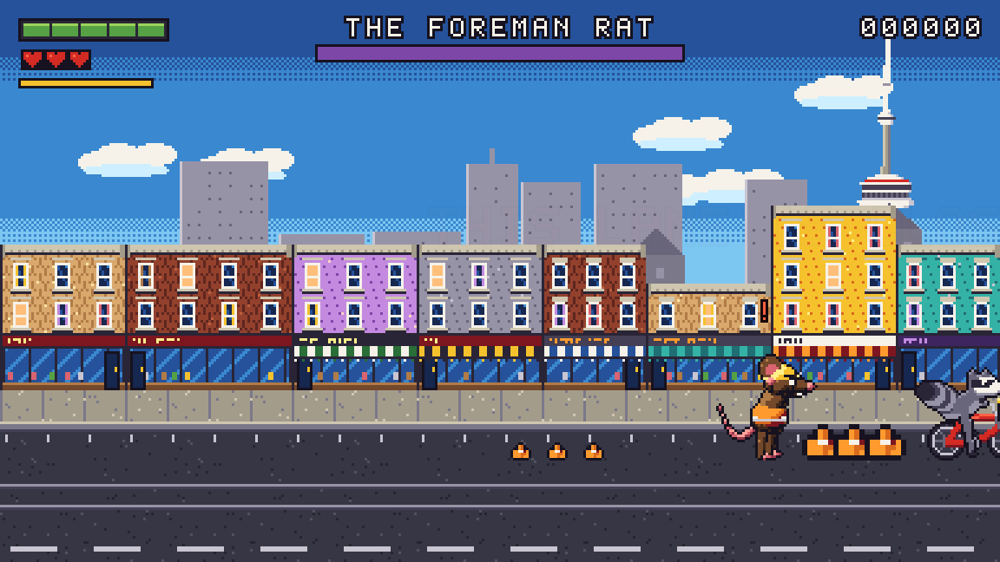 | 20 A road meets Bloor, square 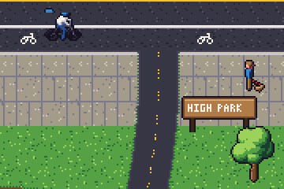 |
| 21 Centre Rd meets Parkside 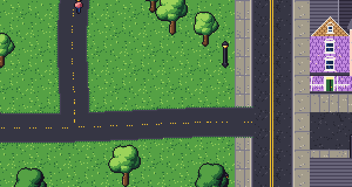 | 22 The park (half scale) 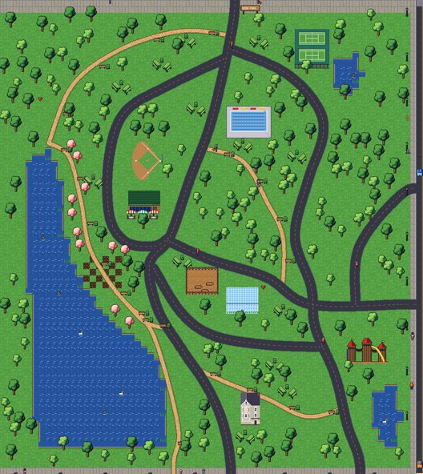 |
| 23 The side streets (half scale) 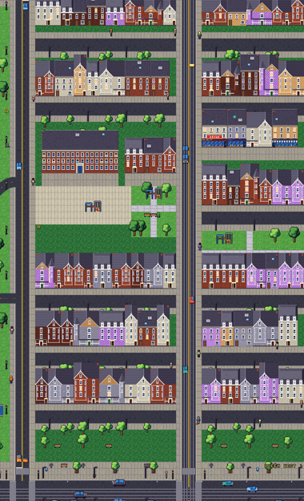 | 24 High Park's south exit 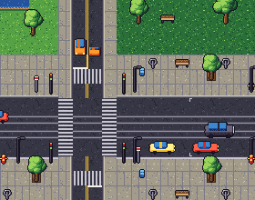 |
| 25 Queen West's south exits 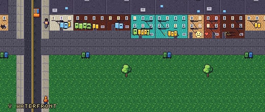 | 30 Pause: FULLSCREEN 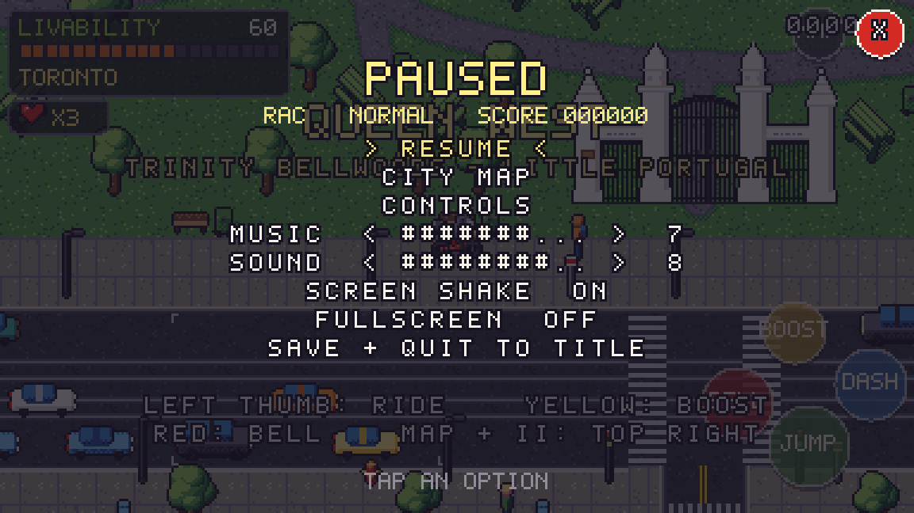 |
