# M3.3 Review: your M3.2 notes + the audit pass

**Play it:** https://besit.github.io/trashpanda/. Add `?debug` for **SELECT MISSION** and **WATCH VIGNETTES** on the title screen.

This pass had two sources: your M3.2 notes, and the creative + technical audit you asked for ([docs/plans/AUDIT.md](../plans/AUDIT.md)). The island airport mission and the new rat types are the next milestone (M3.4), as agreed, so you can review this one sooner. Numbers in brackets refer to the gallery at the end.

## The name and the notice
- The villain is **Dog Fjord** everywhere: dialogue, docs, the art history, the file names. One constant (`src/data/villain.ts`) holds the name.
- **ABOUT** on the title screen (01): the satire notice, the fiction label, the AI line you asked for ("made with the help of AI (Claude, by Anthropic). AI can make mistakes. If you spot one, please tell us."), the credits, then one **SOURCES** page per claim (02). The title footer says "SATIRE. FICTIONAL CHARACTERS. SEE ABOUT." The README carries the same notice.
- Every results card now ends with a **SOURCE:** page naming the study or report behind its claim. The links stay in [URBAN_RESEARCH.md](../URBAN_RESEARCH.md), as agreed.

## Your notes, and what changed
| You said | Now |
|---|---|
| The CN Tower's top looks tilted or offset; at night it mixes with the sky | Every band of the skyline tower is centred on the same column (13). At dusk the pod's window band is lit, the rims and mast are pale, the light on the mast is red (14) |
| A replay button after vignettes and missions in debug mode, with go-back options | After a debug mission or vignette you land on a menu: **REPLAY**, **BACK TO MISSIONS / VIGNETTES**, **MAIN MENU** (03) |
| Links to prove the sources | Source names on every results card and under ABOUT > SOURCES (02); links in the docs. Opening web pages from a fullscreen phone game is awkward, so no live links in the game |
| What rat types do we have? Shall we have one that throws along the ground? | Listed in the chat. The **Baggage Rat** (suitcases rolled along the ground) and the **Barrier Rat** come with the airport mission in M3.4 |
| The raccoon sometimes gets stuck on the pump frame | Found and fixed: after a swing the idle animation was never restarted when it was already the "current" one. A test now covers it |
| A mission about the airport "war" | M3.4, researched and drafted in [docs/plans/M3.3.md](../plans/M3.3.md) §5 |
| Waterfront east should lead to East End south; two roads can lead to one | Riding **east on Queens Quay or Lake Shore** lands you at the bottom of **Leslie St** in the East End (17). South on **Broadview, Carlaw or Leslie** lands you on Queens Quay at the Waterfront's east end. Exits can now name the street they arrive on |
| Hide heart tokens behind buildings sometimes | Each district's second heart sits **behind a building**, under its roof, invisible until you ride behind it and the building fades (19). The first heart stays in the open |
| Avoid text on text in the vignettes | A caption now replaces any caption still sitting on its line (06). The mission hint sits in its own dark box, like the dialogue box without a name, and the title card has a dark band so it never sits on the art |
| Fullscreen doesn't work on my iPhone in Chrome or Safari | iPhone browsers have no page fullscreen at all (Chrome on iPhone runs on Safari's engine). The first time you start on an iPhone, a card explains **Share > Add to Home Screen**, and the game opens fullscreen from that icon. Please try that once |
| **Parkside:** the person and the camera appear from nowhere | They, and the parked cars in King St and MEGAMART and the signal in the streetcar vignette, are on screen from the first frame |
| **Parkside:** text at the top goes over itself | The hint box (one slot, replaced not stacked) and the title band fix this everywhere in missions |
| **Lane Eater:** I can't see the asphalt's whole trajectory; I'd love to see more of the machine | Gobs now leave from the conveyor's mouth near the **front** of the machine, which is always on screen, so the whole arc is visible; the machine rides 26 px further into the view (08) |
| **Lane Eater:** I should be able to attack the driver and conveyor always; only the grinder is protected while it grinds | Done: the cab and conveyor take hits any time; the grinder only while it's overheated |
| **Megamart:** the cars appear from nowhere at the start | The vignette's cars are there from frame one |
| **Megamart:** the jump attack happens over the car, not when I land; it dies in one jump | A stomp now counts only when you **land** on the roof (feet within a short band of it), once per landing. Hovering above never counts. A bounce also keeps its height now instead of being cut to 5 px, so stomp chains feel like stomps. The same rule covers SUV Rats, the Monster SUV and the Pink Digger |
| **Megamart:** platforms lower than the car so a jump avoids the hit; leave only the pallets | Not changed yet: the cart shelters stay for now. Say the word and I'll drop the shelters and keep only the pallet stacks |
| **Waterfront:** text over text at the start of the vignette | Fixed with the caption rule above |
| Airplanes should not fall into water; full crossings along the approach line | The turboprop **lands left to right**, coming down onto the island; the Cessna **takes off right to left**, climbing. Both cross the whole screen; neither dips below the island (07) |
| Shall we remove the red mark under the digger's bucket? | Replaced with the bucket's **shadow**, which grows on the ground as the bucket rises. Still fair, read from the world instead of a UI mark |
| Turning streetcars look odd: no overlap when vertical; keep the spacing gradual | The one-piece north/south sprites are foreshortened by the 32° camera, so the sections now sit closer together the more vertical the car is (about 2/3 of the horizontal spacing), easing through the turn, and they're drawn **front over middle over rear** so a rear section's joint never covers the one ahead (12, 20) |
| CN Tower (Explore): the base is great, then the shaft changes | Not yet: it needs the shaft rendered as the base's continuation. In M3.4 with the other Waterfront art |
| Congestion doesn't happen often enough on the Gardiner | A jam now builds for 15 s in every 26 (was 12 in 34) |
| Aquarium sharks should curve | They bend along an arc now, fins on the curve (11) |
| **East End:** the pedestrian bridge is too wide | One deck tile between the rails, down from two (15) |
| **High Park:** the brown path should stop before the sidewalk | Dirt trails end in the grass; only the paved park roads run to the curb (16) |

## From the audit (no note from you, but worth it)
- **Dog Fjord reacts to your progress:** after the 2nd, 4th and 6th mission win, a short scene: a press conference, then behind closed doors, then a very large office. He quotes your Livability score and goes from dismissive to rattled; the third one sets up the highway finale (10).
- **Music:** a boss theme (*Another Lane of Trouble*), a win fanfare and a life-lost sting. *Queen St. Cruise* plays at a different tempo and in a different key in each district.
- **Replay from a FIXED marker** in a normal game, clearly marked "NO POINTS" (04): the prompt, the title card, the score field and the end card all say so.
- **Collectibles tally** on the city map: plaques, hearts and easter eggs found per district (18).
- **Download:** every PNG is now an exact 8-bit indexed PNG (same pixels, verified against the old files): the generated art went from 3.8 MB to 0.7 MB. Phaser is the Arcade-only build. District map data loads on demand. **First load is 0.59 MB** (it was 2.38 MB).
- **The district card** sits on a dark band in the middle of the screen, clear of the HUD (05).

## Things to check
- The **ABOUT** text, since your name is on the credits page. Tell me if you'd like it worded differently.
- **Fullscreen on your iPhone** via Add to Home Screen.
- The **music variants** per district: too much, too little, or fine.
- The **Lane Eater** now that more of it shows and the gobs leave from the front: can you read the throws?
- The **stomp** feel on the SUV Rats and the Monster SUV.

## Known issues
- The streetcar sections still show a thin dark seam at each joint when horizontal (the accordion); vertical overlap is now right.
- The city map's labels on the Waterfront overlap each other (they did before this pass).
- The interstitials play once per run at wins 2, 4 and 6; an old save that's already past those won't see the earlier ones.

## Gallery
| | |
|---|---|
| 01 ABOUT: the notice 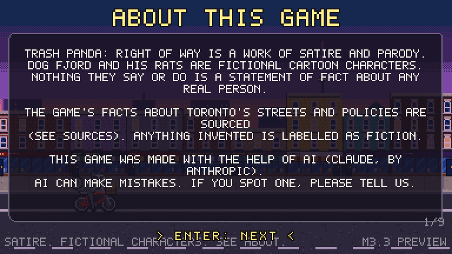 | 02 ABOUT: a sources page 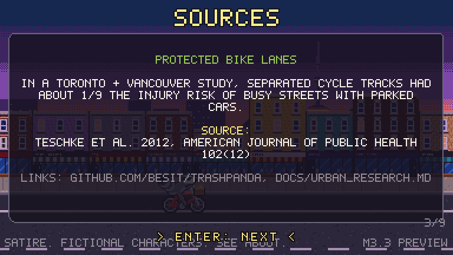 |
| 03 Debug replay menu 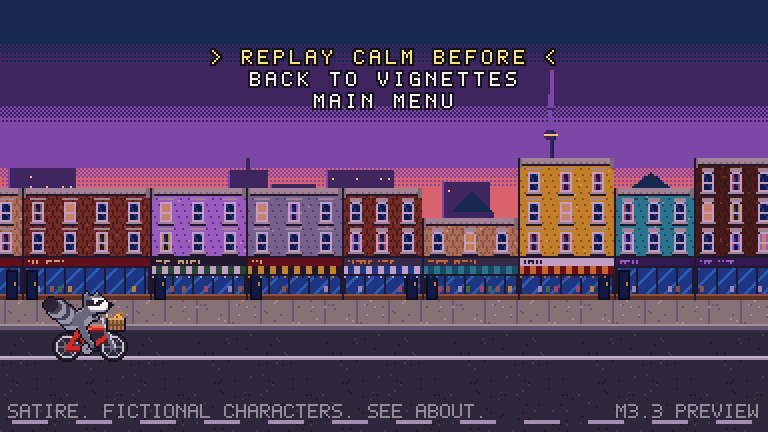 | 04 Replay from a FIXED marker 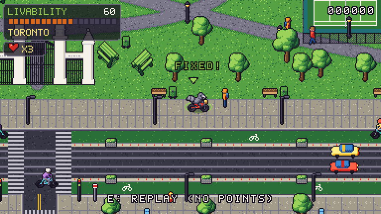 |
| 05 District card on its band 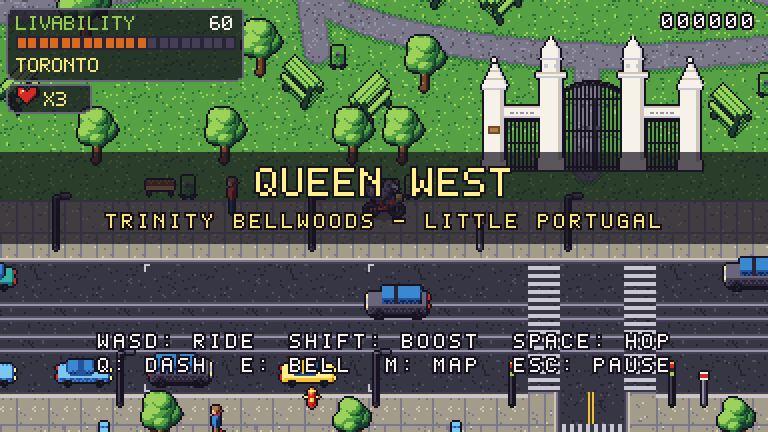 | 06 Captions no longer stack 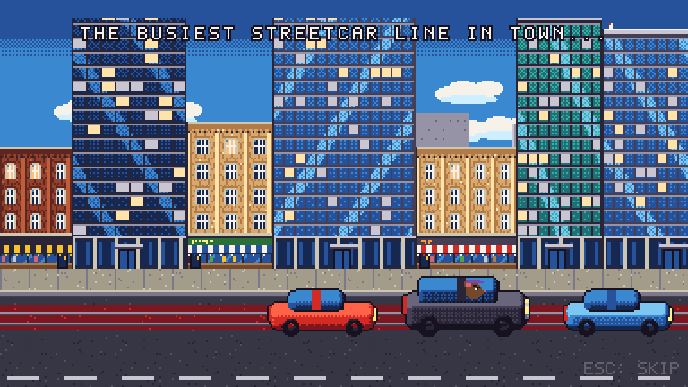 |
| 07 Planes cross fully 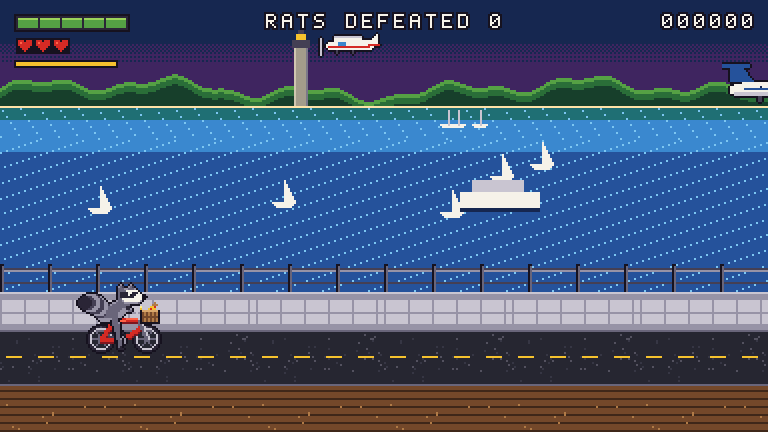 | 08 Lane Eater: more machine, front launch 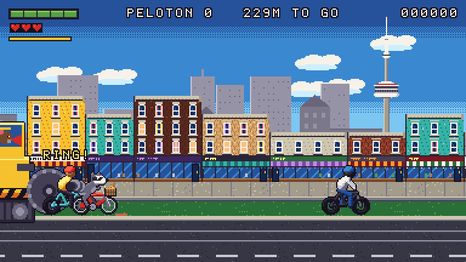 |
| 10 Dog Fjord's interstitial 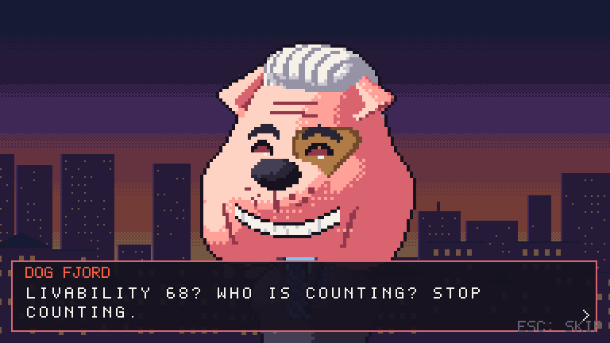 | 11 Aquarium: curved sharks 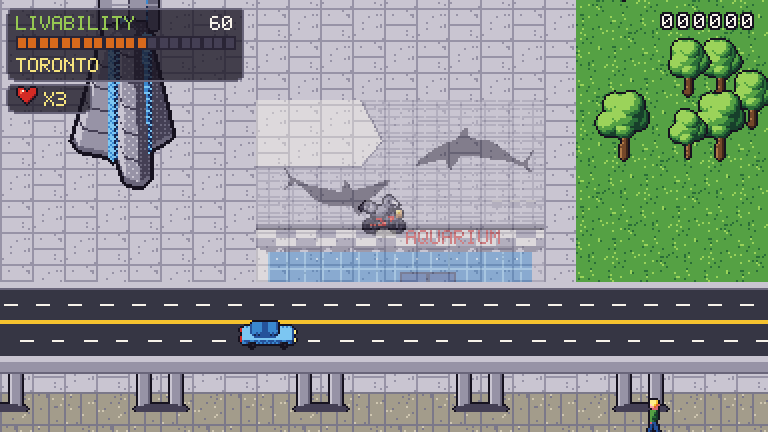 |
| 12 Streetcar sections in a turn 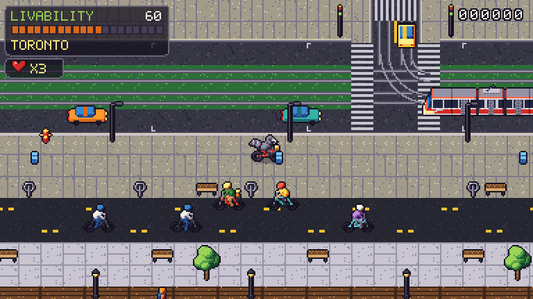 | 13 Skyline tower, day (3×) 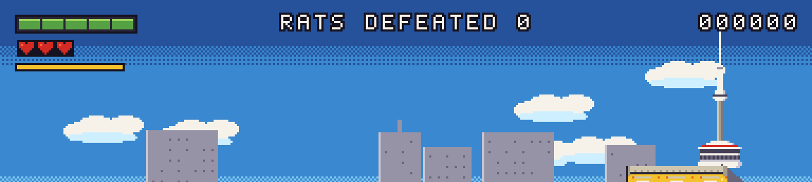 |
| 14 Skyline tower, dusk (3×) 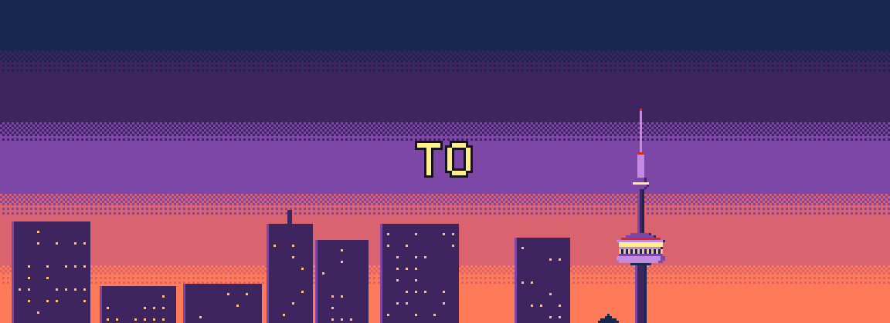 | 15 The footbridge, one tile 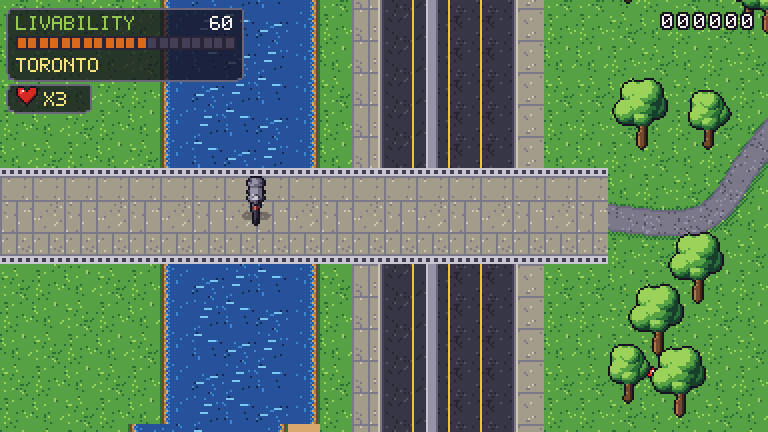 |
| 16 A trail ends in the grass 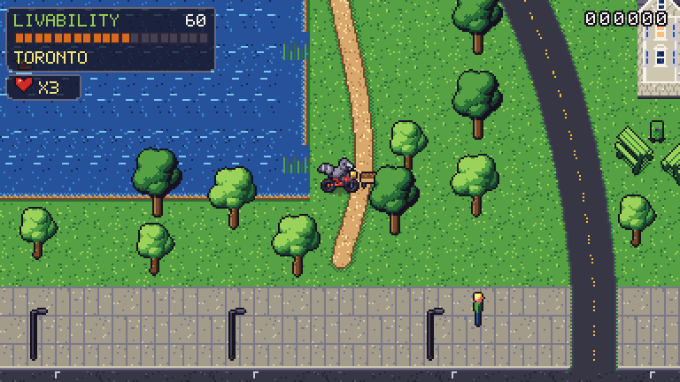 | 17 Waterfront → East End arrival 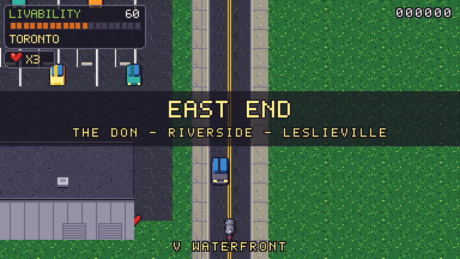 |
| 18 City map with the tally 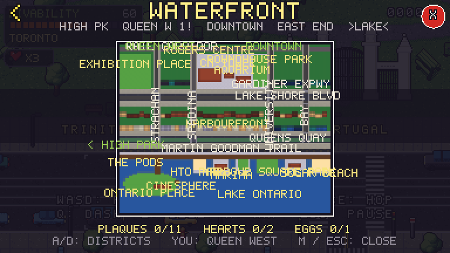 | 19 A hidden heart behind a building 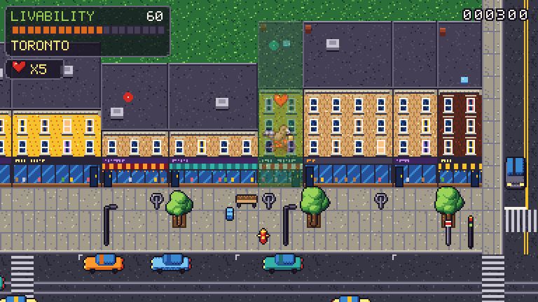 |
| 20 Streetcar spacing study (one-piece vs sections) 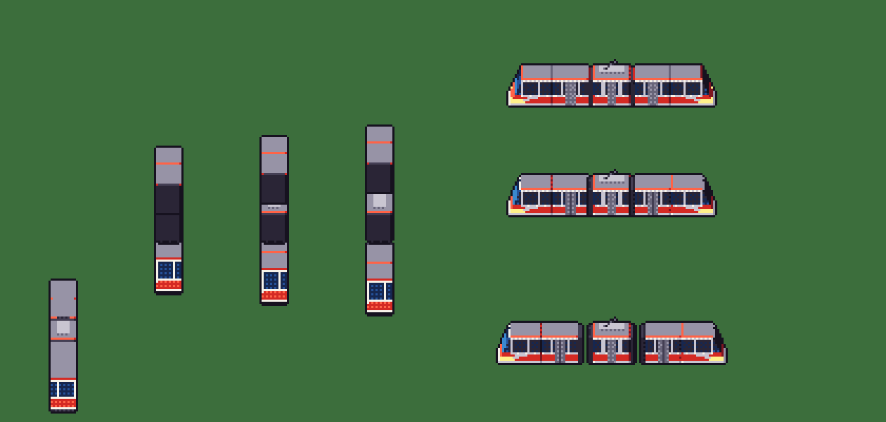 | |
