# M3.4 Review: Grounded, two new rats, the whole CN Tower

**Play it:** https://besit.github.io/trashpanda/. Add `?debug` for **SELECT MISSION** (GROUNDED is the last entry) and **WATCH VIGNETTES** (AIR BEFORE / AIR AFTER).

Three of your asks from M3.2, built as the follow-up milestone we agreed on. Numbers in brackets refer to the gallery.

## What the research turned up
I checked the airport story before building the mission, and it has an ending: on about **July 24, 2026** the federal transport minister said Ottawa would stick to the approved safety work and not pursue jets ("We will not pursue any plans that infringe on treasured public spaces like Little Norway Park..."), after a consultation of more than 87,000 responses; council then voted 25–1 to demand the land back. The province's law (Bill 110) still stands. Everything is sourced in [URBAN_RESEARCH §23](../URBAN_RESEARCH.md). So this is the first mission whose payoff is the real outcome: *"OTTAWA SAID NO TO JETS. THE PARK STAYED A PARK."* The survey stakes through the park are fiction (the province said it wouldn't develop the park), and the blurb says so.

## Your notes, and what changed
| You said | Now |
|---|---|
| A mission about the airport "war" when Dog Fjord decides it | **GROUNDED** (main mission 11, Waterfront, after the heist). Dog Fjord's rats stake a jet runway through **Little Norway Park**. A wave of Baggage Rats (01), a locked arena of four survey stakes to pump out of the ground while Barrier Rats guard them (02), a mixed wave, then the boss (04–07). The park is on the map across from the island airport, with its ball diamond, the Norwegian boulder and a plaque (09); the payoff pulls the stakes and gives it trees, a bench and a picnic table (10) |
| A rat that throws along the ground; any other attack ideas | **Baggage Rat:** rolls a suitcase at you along the ground; jump it or swat it (01). **Barrier Rat:** holds a striped ROAD CLOSED board; hits from the front bounce off ("BLOCKED!", 03). It turns slowly, so dash past and hit it from behind, or stomp it. Both are in the rats sheet ([rats v05](../../art/history/rats/v05/preview.png)) |
| The CN Tower: the base is great, then it changes; the tower should be the exact extension of the base | The map's tower is one model now, rendered in one pass: the three foils merge into the core and carry on up the shaft as thinning ribs, the core narrows, the glass lifts ride up the corners (11). The old one was a rendered base with a drawn strip glued on top, which is what you saw change |
| Megamart: only leave the pallets | The cart shelters are gone. Three low pallet stacks stand in the lot: on one you're still in the SUV's way, but a jump from it clears its roof |

## The Jet Tug
A yellow baggage tug with a rat at the wheel, towing Dog Fjord's white private jet (AIR FJORD) nose first across the park (04). It taxis from edge to edge; its **jet blast** trails behind the tail and **blows you back** without hurting you, toward whatever is coming (05); the rig hurts on contact while it moves. At the edge it stops to **REFUEL**, and only then can the tug be pumped (06). The **cabin can be stomped** any time. Below half health it taxis faster, and every refuel stop sends a suitcase rolling at you. Grounded, it slides off (07). My test bot clears the whole mission; a perfect run of the boss takes three refuel stops.

## Things to check
- **The boss's feel:** is the blast readable as a push, not a hit? Is three refuel stops the right length?
- **The Barrier Rat's turn delay** (0.8 s): long enough to get behind it?
- **The CN Tower on the map** (11), at full scale.
- The **before and after vignettes** (12, 13).

## Known issues
- The Baggage Rat's suitcase and the tug's suitcase look the same; the tug's is meant to be a bigger one.
- The park's quay is a straight rectangle; the real Little Norway Park wraps around the airport ferry dock.

## Gallery
| | |
|---|---|
| 01 Wave 1: a suitcase rolls along the ground 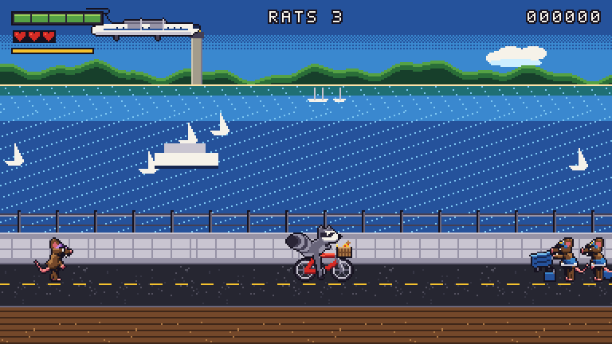 | 02 The stakes arena 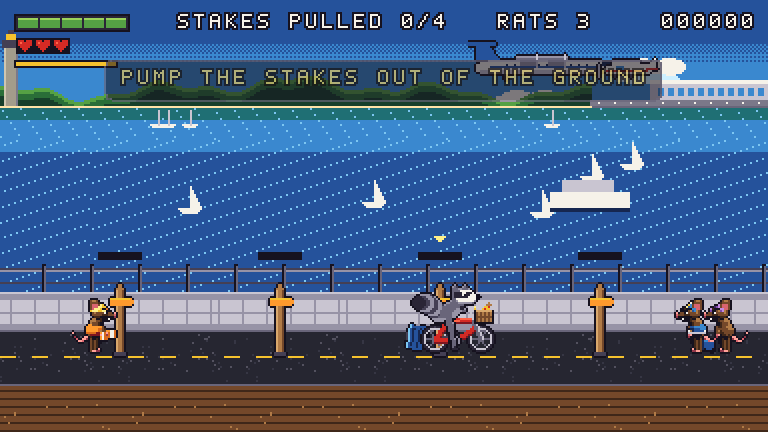 |
| 03 BLOCKED: the Barrier Rat's board 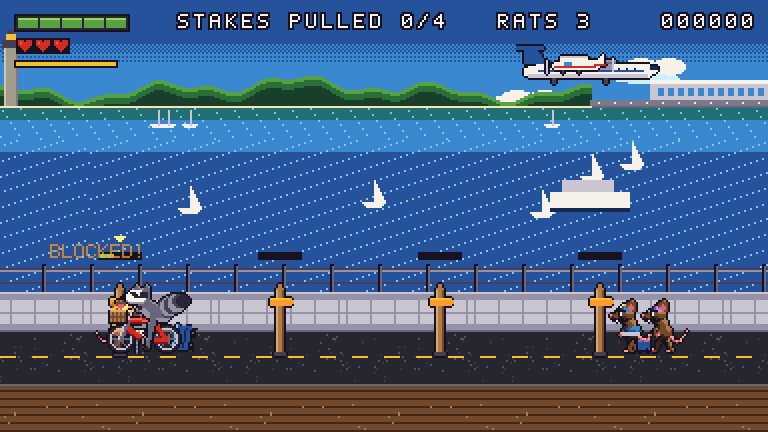 | 04 The Jet Tug taxis 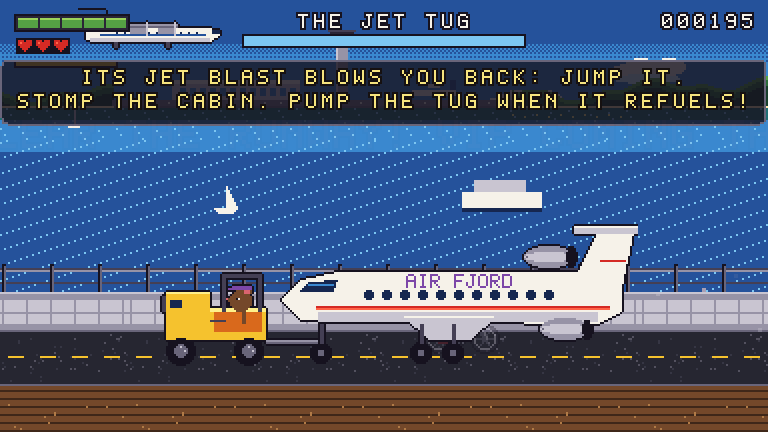 |
| 05 In the jet blast 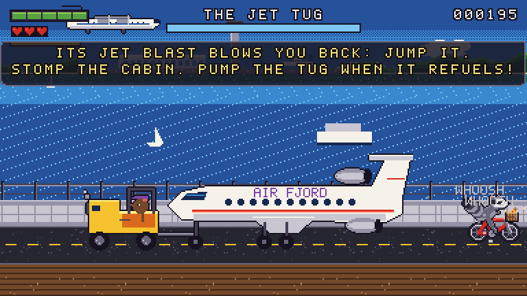 | 06 Refuelling: pump the tug 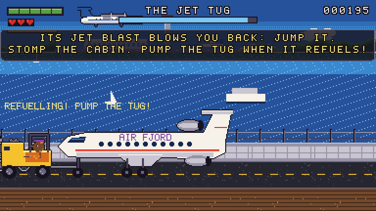 |
| 07 GROUNDED 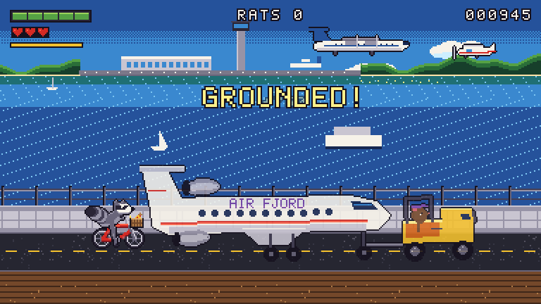 | 08 The end card 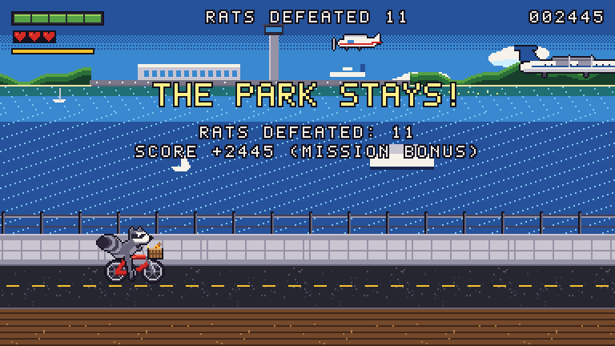 |
| 09 Little Norway Park, staked out 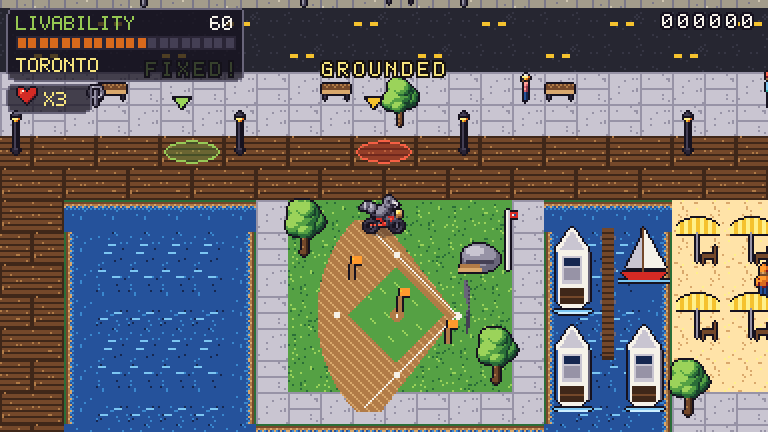 | 10 The park after 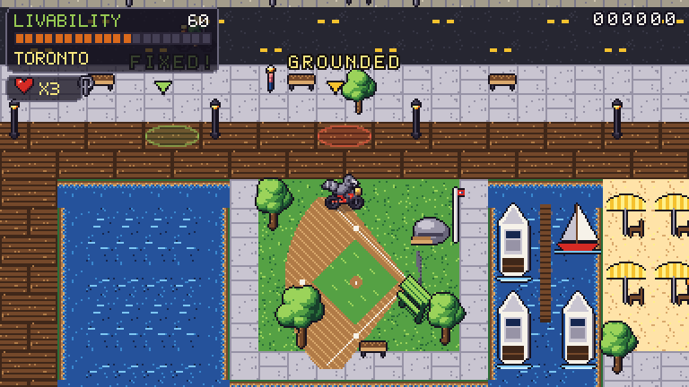 |
| 11 The CN Tower on the map 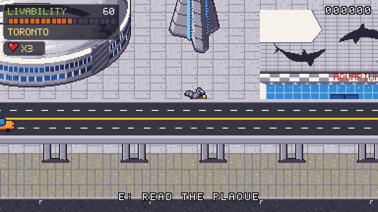 | 12 Before: the rats arrive 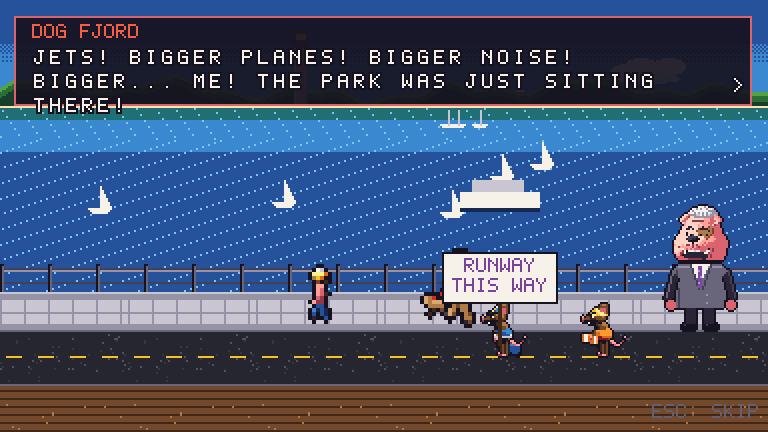 |
| 13 After 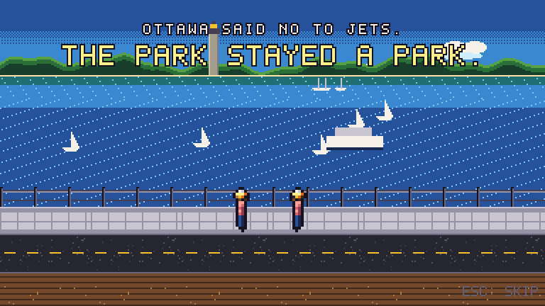 | 14 The title card 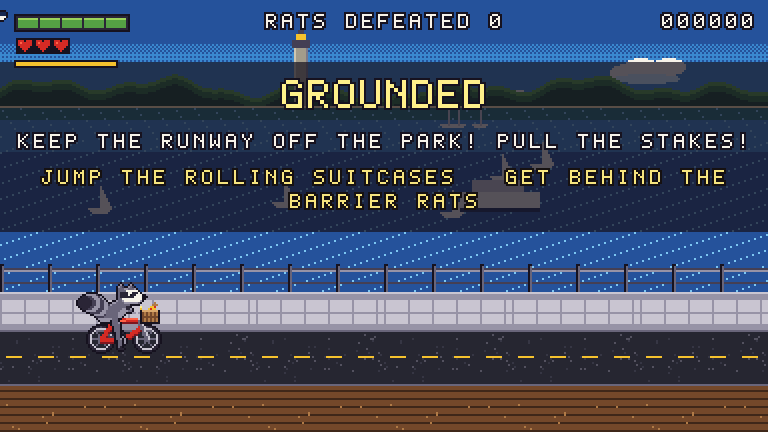 |
