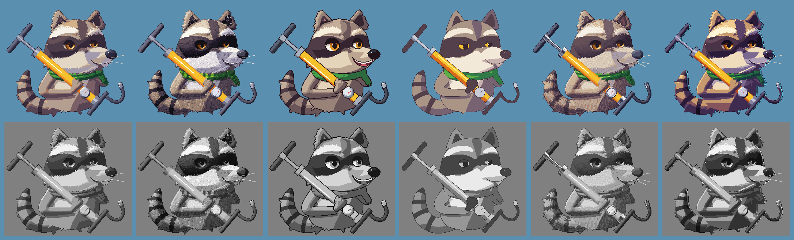
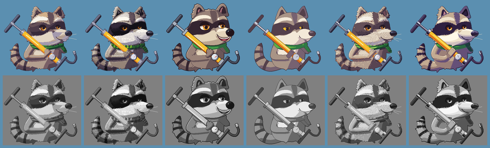

# M4.10 Review: the raccoon in five styles, and the recipe

Your note on M4.9: "I am not in love with how it looks, but it seems better... I want to understand what is the recipe
for the best pixel-art possible. Can you try and redraw the current state of him in a couple of techniques / styles?"
You asked for five styles: ref 3 polished to the max, ref 4's style, the most naive, the most detailed, and a freestyle.
Each got a try, a critique, and a second pass.

**The game is unchanged.** This is a study. Nothing here is in the game or on the posters yet.

**The recipe is written up in [docs/PIXEL_ART_RECIPE.md](../PIXEL_ART_RECIPE.md).** It's a short guide to what makes
the best pixel art, drawn from what this study showed.

## How it ran
- **Five painter agents worked side by side,** one per style. Each started from the current (M4.9) raccoon and kept
  his pose, the yellow pump, the scarf and the tail. The technique was theirs to change.
- **One critic agent reviewed all five** after each pass. It scored each style twice:
  - against its own target (how well it hit ref 3, ref 4, naive, and so on)
  - on one shared scale where your ref 3 is 9.5
- **After pass 1 it found that all five had the same problem.** The drawing underneath was weak: the arm was a bent
  tube around a triangle of chest, the paw sat on the pump instead of gripping it, and the snout had straight
  "low-poly" facets. So every painter redrew those shapes by hand in pass 2 before doing anything else.
- **The freestyle painter's pass 2 became the critic's synthesis:** the best parts of all five, as a test of the
  recipe.

## All five, after each pass
Left to right in each picture: the starting point (M4.9), ref 3, ref 4, naive, detailed, freestyle. The bottom row is
the same in greys, to judge light and shadow.

**Pass 1:**

**Pass 2:**

| Style | Own target (pass 1 → 2) | Shared scale (pass 1 → 2) | Colours | In one line |
|---|---|---|---|---|
| [ref 3](m410/ref03/pass2_hero.png) | 5.5 → 6.0 | 5.5 → 6.0 | 37 | The best face rendering (solid mask, wet eyes, a nose built from planes), but still built on the old drawing |
| [ref 4](m410/ref04/pass2_hero.png) | 6.5 → 7.5 | 5.5 → 6.5 | 28 | The best at real size and the most character: a round head, big eyes, an open grin |
| [naive](m410/naive/pass2_hero.png) | 7.0 → 7.5 | 5.0 → 5.5 | 11 | The cleanest and most charming; shows how little is needed. Low ceiling |
| [detailed](m410/detailed/pass2_hero.png) | 5.0 → 6.0 | 4.5 → 5.0 | 52 | The best pump (chrome, rubber, a full gauge); proof that more detail is not more quality |
| [freestyle → the synthesis](m410/free/pass2_hero.png) | 5.0 → 7.0 | 4.5 → 7.0 | 36 | Drawn from shades across the whole figure, with no artefacts from the drawing tools. The critic's recommendation |

The first passes, for comparison:
- [ref 3](m410/ref03/pass1_hero.png)
- [ref 4](m410/ref04/pass1_hero.png)
- [naive](m410/naive/pass1_hero.png)
- [detailed](m410/detailed/pass1_hero.png)
- [freestyle: a streetlamp-and-neon night palette](m410/free/pass1_hero.png)

Each style also has a real-size sheet on the three poster colours (`m410/<style>/pass2_1x.png`) and a greys view.

## What the study showed (the short version of the recipe)
1. **The drawing and the light plan decide everything, before any detail.** The two painters who threw away the
   computed shading and drew their shadow shapes by hand (freestyle and ref 4) gained 1 to 2.5 points. The two who
   kept the old method and added better texture (ref 3 and detailed) gained half a point to a point. The most
   detailed picture, at 73 colours, scored second-lowest.
2. **One light, and one connected shadow shape across all the parts.** Forms are separated by the shadows they cast,
   not by lines. The face has the strongest contrast; everything else steps down.
3. **A palette of about 12 to 40 colours, every step visible at real size, and shadows leaning violet.** The study's
   best palette idea: every material's darkest tones come from the same few indigo-violets, so the whole figure reads
   as one object under one light.
4. **A strong outline outside, almost none inside.** The dark outer line keeps him readable on every poster colour.
   Lines between body parts are what make art look "assembled".
5. **Detail goes where it matters, in order:** the face, the edges where light or colour changes, the prop, the broad
   areas, and nothing in deep shadow. Fur is clumps at those edges, not lines everywhere. The face must be the
   clearest area, not the busiest, and readable at real size: an open mouth corner, not a 1-pixel line.

## The critic's recommendation
The synthesis (freestyle pass 2), finished with:
- ref 4's open smirk corner
- a slightly rounder head
- a scarf knot with folds
- fur clumps that vary in size and spacing (they're too even now)

It's the only version that meets every rule above. What's left to fix is local, not structural. If you'd rather go
fully cartoon, ref 4 is the alternative, but its arm and chest need redrawing as one shape first.

## For you to decide
- **Which direction for the raccoon:** the synthesis, ref 4, or something else.
- **Whether Dog Fjord gets the same treatment,** so the VERSUS pairing matches.
- **Notes on specific pixels, if you have them.** All five are on the annotate page as `raccoon_ref03.png` ...
  `raccoon_free.png`. Run `node tools/annotate/serve.mjs` and open http://127.0.0.1:4330/.

Every critique, and each painter's notes and recipe for both passes, are in `docs/reviews/m410/loop/`. The code for
each style is in `tools/scratch/piter4/<style>/raccoon.mjs`, and every pass is in `art/history/raccoon_style_<style>/`.
