# M4.11 Review: the hero images in the game (local preview, not live yet)

Your picks:
- **Standing raccoon:** ComfyUI #33, the one with the short hose.
- **Raccoon bust and the bike:** your Gemini images.
- **Dog Fjord's grin, laugh and shock:** your Gemini images.
- **VERSUS:** R1 (with the hose fixed) and D1 (with the tie fixed and four fingers on each hand).
- **Angry busts:** A3 (with the background hose fixed) and B4.
- **Dog Fjord full body:** F2.
- **New:** raccoon faces without the pump.

## The pipeline
1. **Masters** come from Gemini or from ComfyUI with Qwen-Image-Edit, which I drive through its API. They stay private in `reference/`.
2. **`node tools/heroes-build.mjs`** converts every master in one go (the list is in `tools/heroes-build.mjs`):
   - Each master is scaled so the figure is a chosen height. That keeps the raccoon and Dog Fjord the same size in matching poses.
   - The green screen is removed, and each pixel takes the nearest colour from the character's locked 48-colour palette.
   - The VERSUS raccoon came out warmer than the others, so its tones are matched to the standing pose first.
3. The pixel art lands in `art/heroes/`, and the asset build packs it into the game.

**The palettes were remade once, from six masters per character.** Built from one master alone, a dark warm brown was missing, so the tail rings came out in the bandana's dark red.

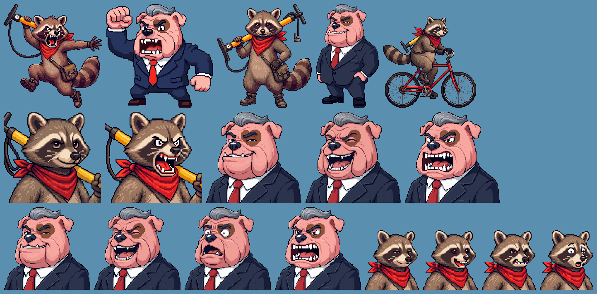

## The posters (all 20)
- **VERSUS:** the angry pair. The raccoon leaps in from the top left and Dog Fjord roars from the bottom right, reaching toward each other.
- **Title:** the standing raccoon's upper body in the wheel; the ribbon hides the crop.
- **Sunset:** the raccoon on his bike.
- **Bosses:** the raccoon bust in the YOU frame, and Dog Fjord's bust in his frame.
- **Take back the streets:** the standing raccoon, with Dog Fjord laughing over the city.
- **High scores (tall):** the bust.
- **Unchanged:** the street scenes (bike bus, lake, queen, faceoff) still use the in-game sprites.

| | |
|---|---|
| VERSUS (wide) 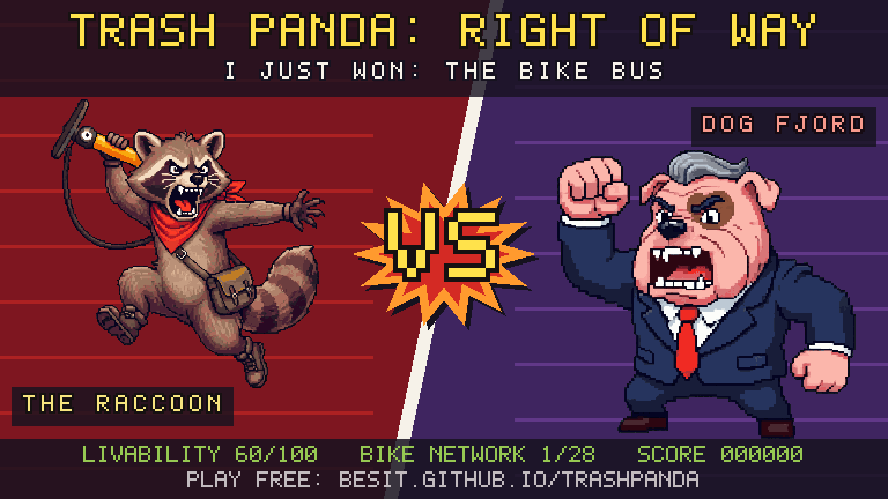 | VERSUS (tall) 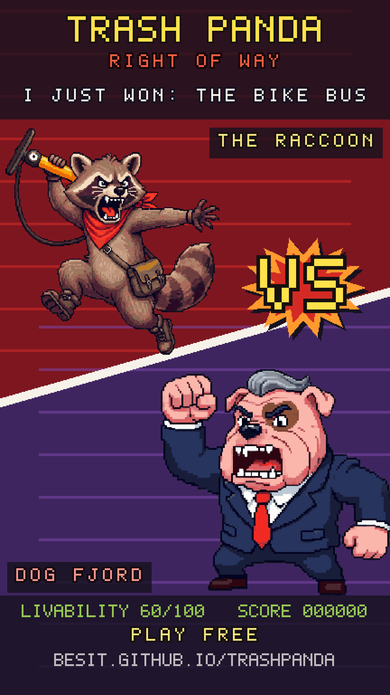 |
| Title (wide) 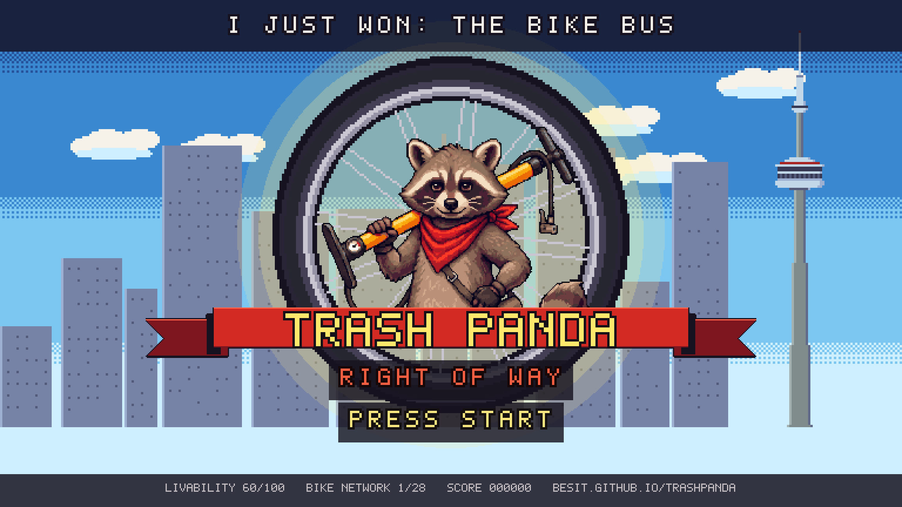 | Sunset (tall) 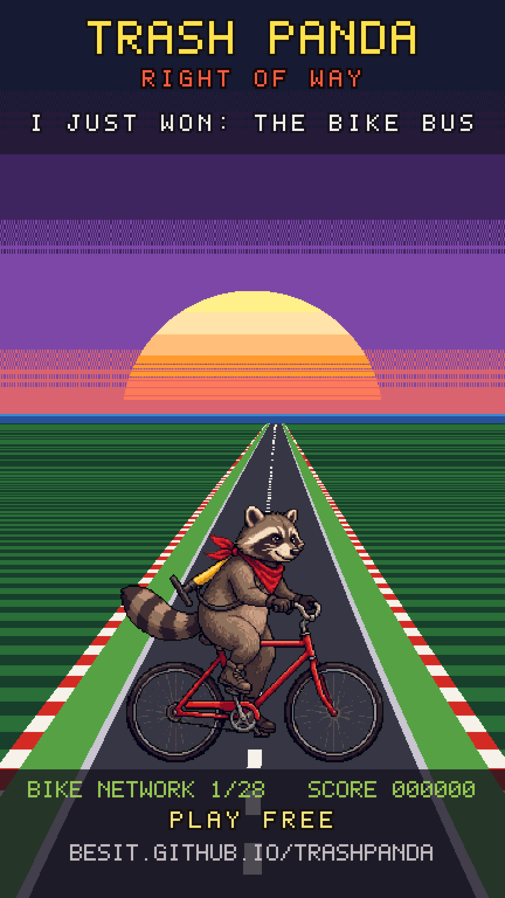 |
| Streets (wide) 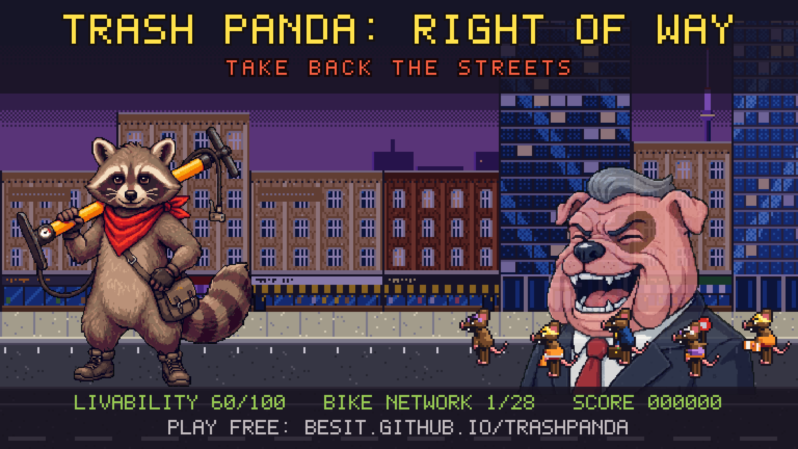 | Bosses (tall) 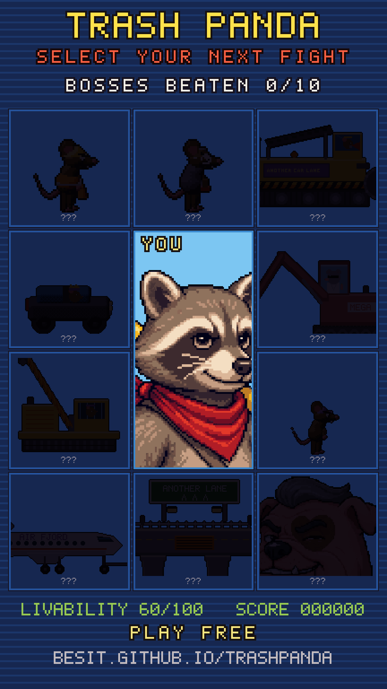 |

The rest are in `docs/reviews/m411/posters/`.

## The cutscenes
- **Dog Fjord's close-ups** are the hero images: grin, laugh, shock, plus a new angry face that no line uses yet. They're shown at double size, like before.
- **New: the raccoon has a talking head.** It appears beside the dialogue box whenever he speaks, in one of four expressions (rest, happy, angry, shocked) chosen to fit each of his 26 lines.

| | |
|---|---|
| 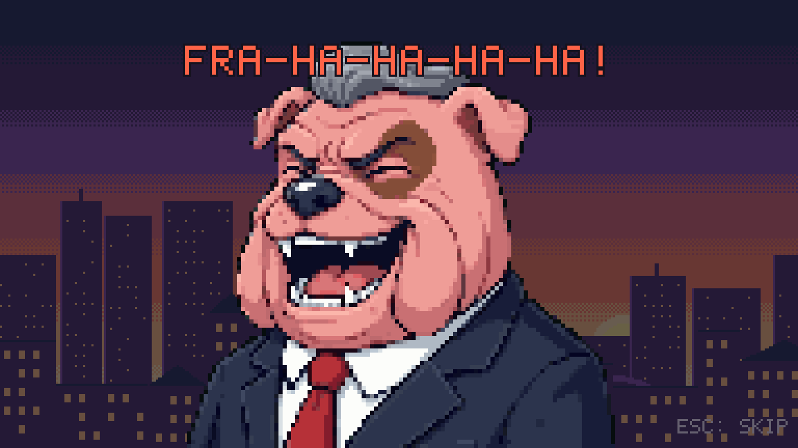 | 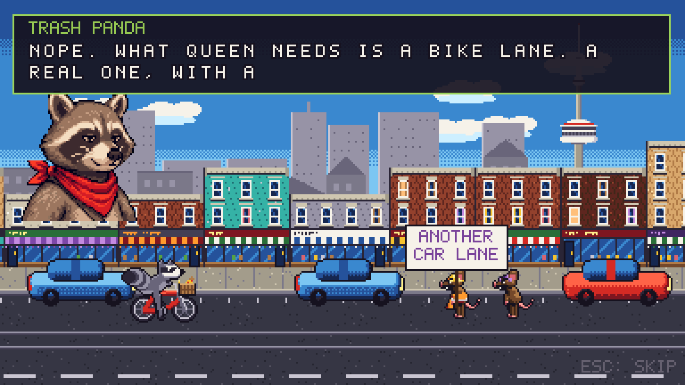 |
| 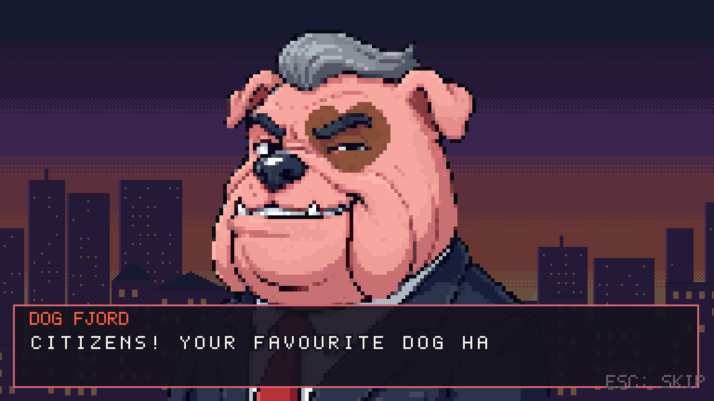 | 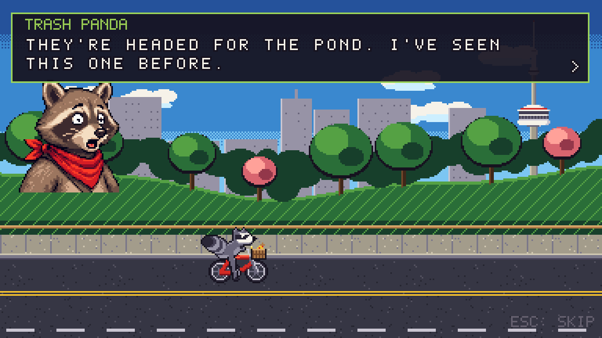 |

## Trial: higher-resolution portraits (not in the game)
Each pair shows the portrait as it is now on the left, and with twice the pixels on the right. The right-hand version uses 1 art pixel per game pixel, the same scale as the world sprites.

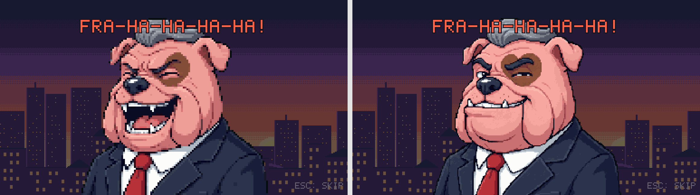
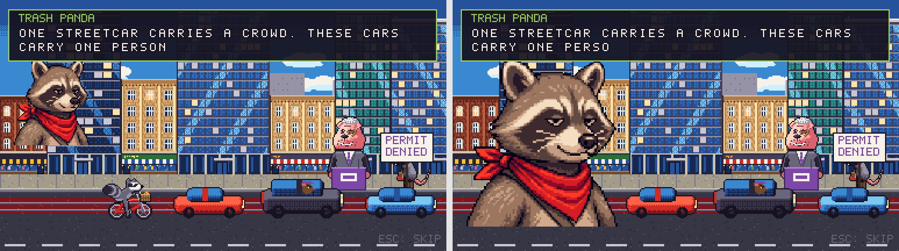

- **Dog Fjord:** the trial is sharper and keeps more of the source's detail. The two screenshots caught different expressions (the trial texture is his grin), but the difference in detail is clear.
- **The raccoon, at twice the size:** much more presence, but it covers a large part of the scene.

Either is a one-line change in `tools/heroes-build.mjs` if you want it.

## Variants to check
`docs/reviews/m411/options/` has the four hose fixes of the VERSUS raccoon (R1a to R1d; I used R1b), the four tie-and-hand fixes of D1 (I used D1c), and the angry raccoon fixes (I used A3b). Say if you'd prefer another.

## Numbers
- 68 browser tests and 21 unit tests pass.
- **Palette:** 49 game colours + 48 for each character = 145.
- **Download:** the generated assets are 1683 KB, up from 1574 KB.
