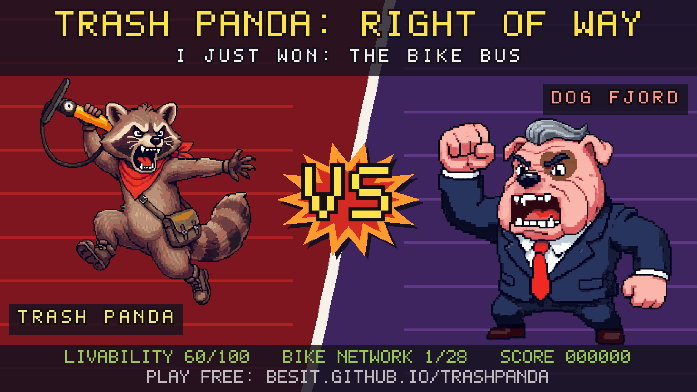
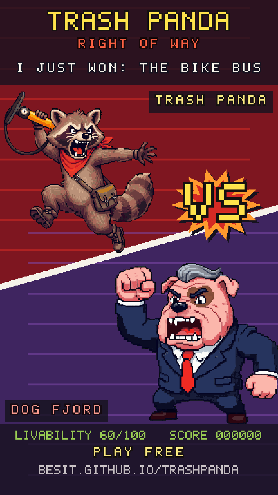
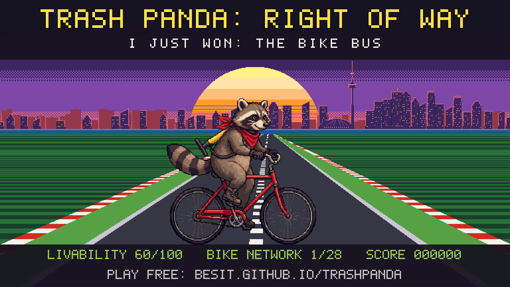
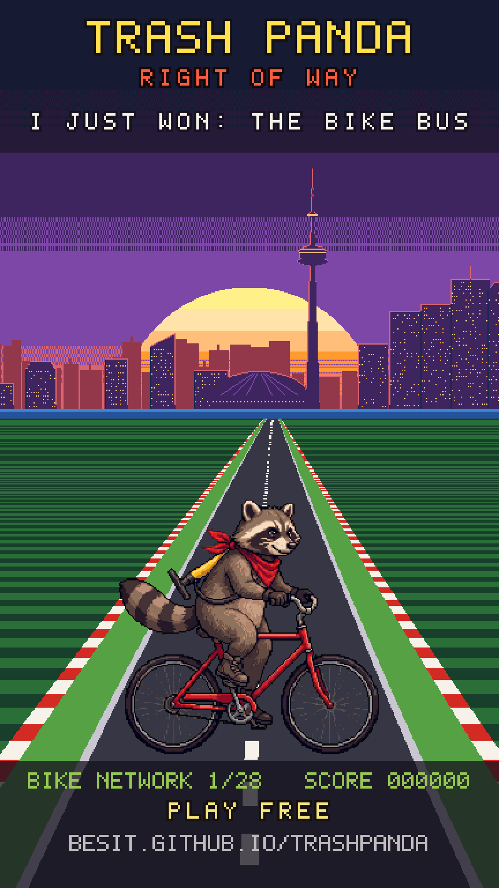
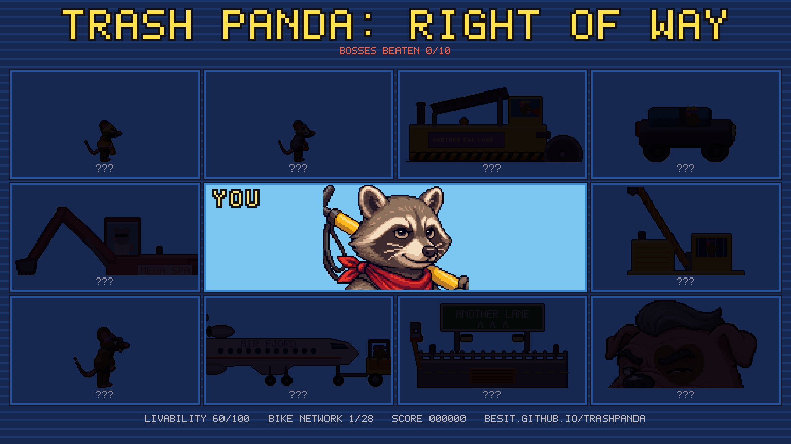
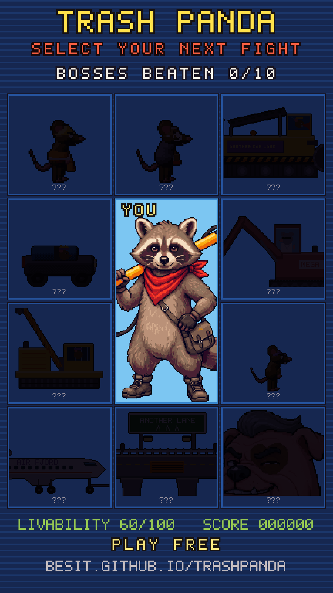
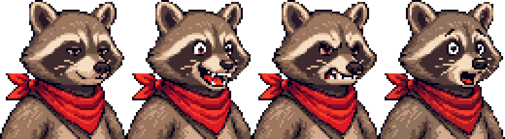
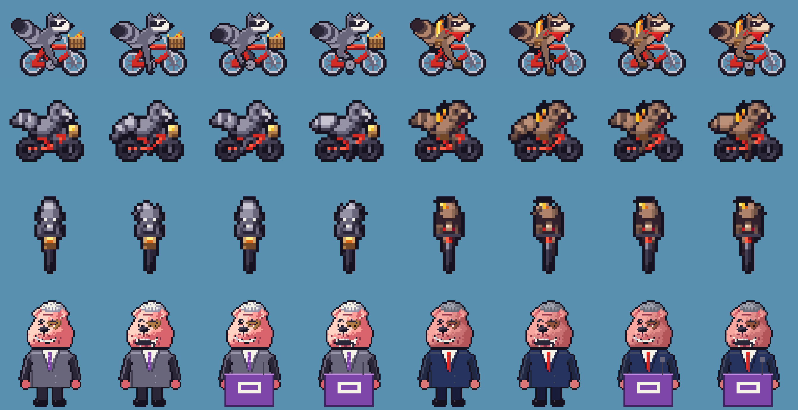
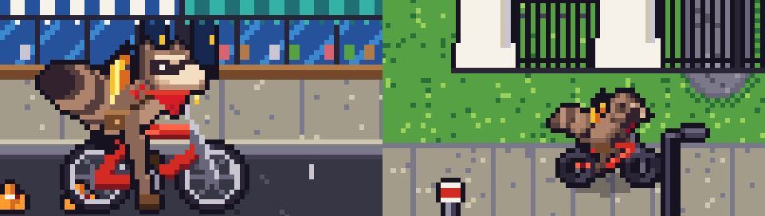
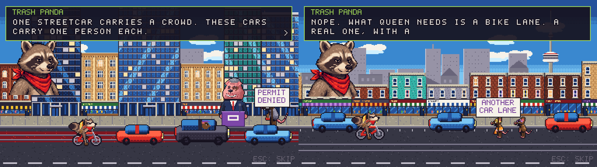

# M4.12 Review: your M4.11 notes, and the in-game sprites in the hero look (local preview, not live yet)

## Your notes on M4.11
- **VERSUS:**
  - **The raccoon:** R1A.
  - **Dog Fjord:** D1A. ComfyUI kept giving his raised fist four fingers (14 tries), so I erased one knuckle line in the master by hand. He now has three fingers and a thumb, like the lower hand.
  - **The name:** TRASH PANDA instead of THE RACCOON.
- **Sunset:** a Toronto skyline seen from the lake, in silhouette against the sun:
  - the CN Tower, with the Rogers Centre dome at its foot
  - the financial district (heights follow the real towers, relative to the CN Tower)
  - the waterfront condos, with lit windows and a warm rim where the buildings face the sun

  On the tall poster the CN Tower crosses the sun. On the wide one it stands just right of the raccoon.
- **Bosses:**
  - **Wide:** a smaller bust, so his head, the pump and the bandana fit.
  - **Tall:** the cell is two rows high, so the whole standing raccoon fits.
- **Higher-resolution portraits:** Dog Fjord's dialogue close-ups now have twice the pixels and are shown at 1x.
- **The raccoon's talking heads:** same size as before. The double-size faces are kept in `art/heroes/` (`rc_*_lg`) but aren't in the game.
- **Faces:** Rest1, Happy1, Angry1 and Shock2.
- **A3B:** kept.

| | |
|---|---|
|  |  |
|  |  |
|  |  |

## New: the in-game sprites in the hero look (first pass)
You asked for a pass to see if new sprites work better in the game. The frame sizes, pivots and animations stay the same, so gameplay is unchanged. The sprites use the heroes' own palette colours, so they match the big images exactly.

- **The raccoon, side view** (the missions):
  - **Look:** warm brown fur, a dark mask, cream brows and muzzle, and ears with a light inner side.
  - **Outfit:** the red bandana, its knot's tails flying behind his neck in time with the tail. He also has a satchel with its strap, and boots.
  - **The yellow pump:** on his back, moving to his hands when he swings it.
  - **Removed:** the pizza basket, because the hero's bike has none.
- **The raccoon, top-down** (the city): the same colours, bandana, pump and satchel. At 32 px, the mask only read once I painted it onto the head and made the eyes small glints.
- **Dog Fjord in the world:** the navy suit, the red tie with a knot, grey swept hair, his pinks, and a solid brown eye patch.
- **Also updated:**
  - the share posters that use the street sprites (queen, faceoff, bike bus, lake)
  - the home-screen icon, which shows the side-view raccoon

**Before (left) and after (right):**

**In the game:**

**Open questions:**
- Do you want the pizza basket back? It was a nice trash-panda touch.
- The top-down raccoon is small, so it reads mostly as colour. It could be redrawn by hand, like the side view, if you want more detail there.
- The rats and other characters are untouched.

## Numbers
- 68 browser tests and 21 unit tests pass.
- The generated assets are 1724 KB.
