# M4.13 Review: your M4.12 notes, Dog Fjord redrawn, and a new side-view raccoon (local preview, not live yet)

M4.12 is live (tagged `m4.12`). This round is local until you say go.

## The posters
- **VERSUS:** Dog Fjord is your new Gemini image with the proper fist. Its white background is turned to green for the pipeline. The white edge you saw was the soft blend between the white and his dark outline; it's removed, so his outline now meets the background directly, and you don't need to regenerate it.
- **Sunset:** your reference, made into the poster:
  - the lagoon on the Toronto Islands, with the skyline small in the setting sun and trees framing it
  - **The scene:** your image, with its raccoon removed by ComfyUI, converted to pixel art on its own 48 colours (a new tool, `tools/scene.mjs`).
  - **The raccoon:** our hero bike image, on the path in front of the wall.
  - **Wide:** he rides on the left third, toward the sun.
  - **Tall:** a crop around the sun.
- **Bosses (wide):** a portrait cropped from the top of the standing raccoon, head to waist. The tall poster keeps the whole standing raccoon.

| | |
|---|---|
| 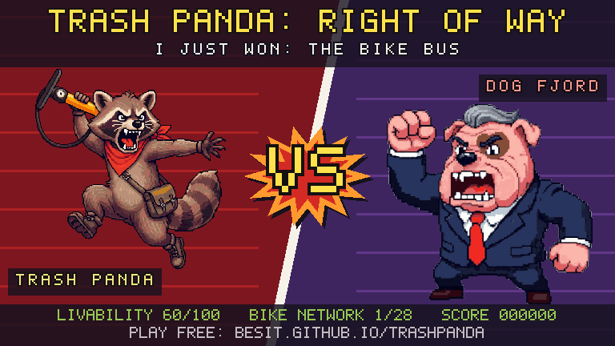 | 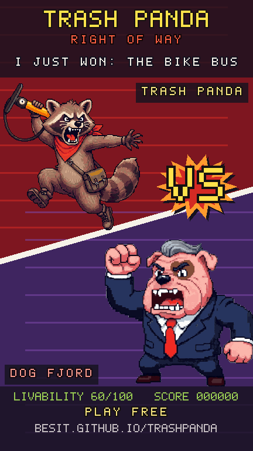 |
| 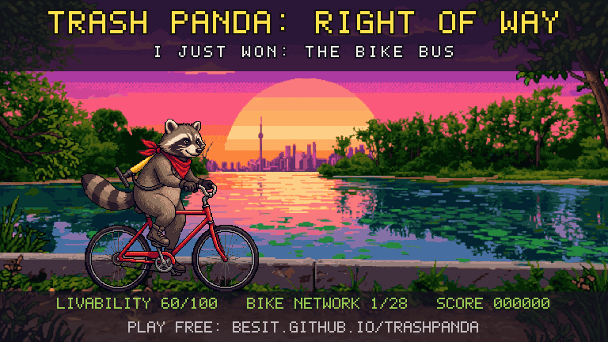 | 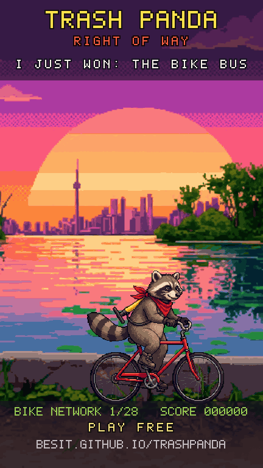 |
| 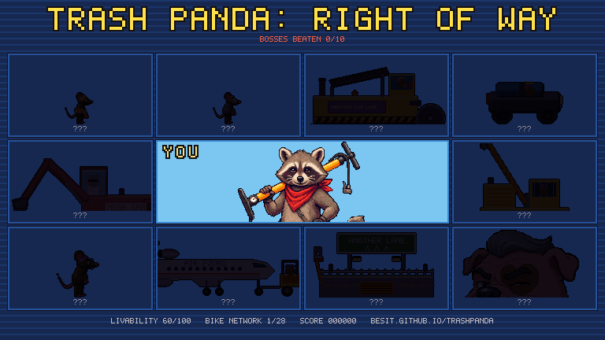 | 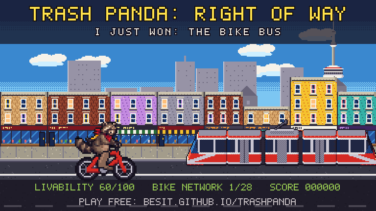 |

## Dog Fjord in the world, redrawn from the hero art
- **The grin:** the hero full-body (F2), brought down to 72 px on his own palette.
- **The laugh:** a ComfyUI take of the same full-body: mouth wide open, eyes squeezed shut.
- **Cleanup:** stray single pixels removed (the eye glints and teeth stay), and the game's black outline around him.
- **The look:** a 3/4 view facing left, the paw in the pocket, the swept grey hair and the brown patch, like the big images.
- **Facing:** he's turned to face the raccoon in the three places he stands left of him (the boss-fight podium, the speed-camera cutscene, riding the Lane Eater).
- **Size:** 72 px tall, from 64. Same frame and positions.

**Before:**
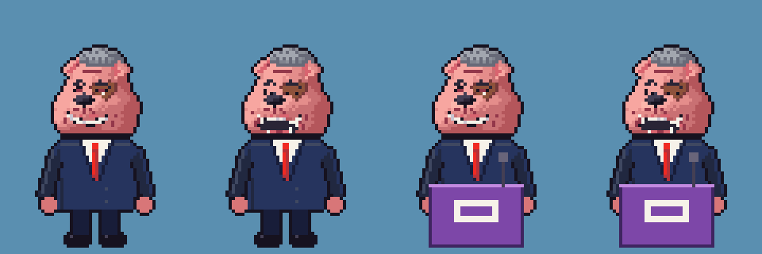

**After:**
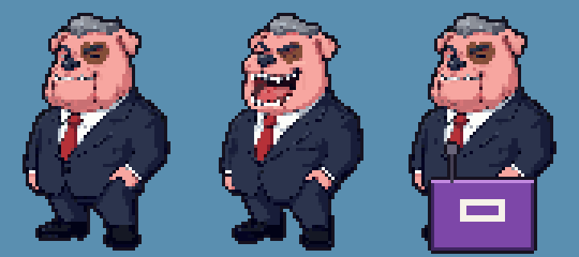

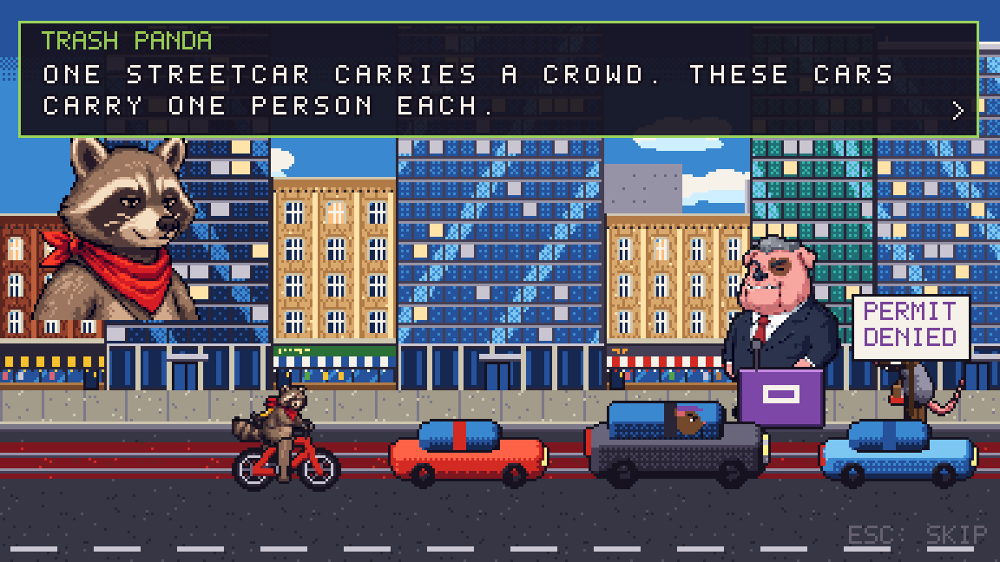

## The side-view raccoon: a new pass (now in the game)
- **The rider:** cut from the hero bike image at 40 px, so he has the hero's proportions: upright, ringed tail, bandana, the pump on his back, the paw on the grips.
- **Drawn in code:** everything that moves, so the animations still work:
  - the bike: spinning wheels, red frame and **red fork**
  - the pedalling legs, with thick thighs and boots
  - the tail's sway
  - the three-part pump swing (wind-up behind his head, overhead, the strike forward)
- **The frame:** 8 rows taller (56 x 52), to fit him upright with room for the raised pump. The hitbox and where he stands are unchanged, so gameplay isn't affected.

**M4.12 (top) and the new pass (bottom):** ride, then the swing.
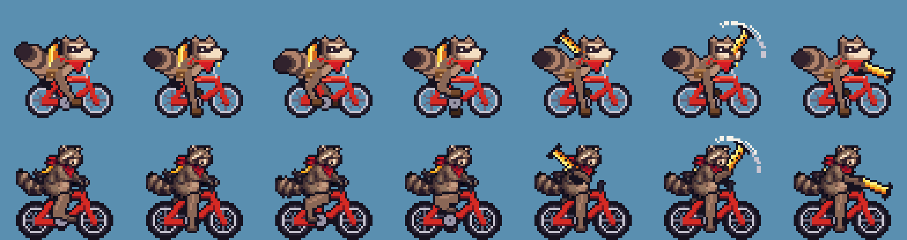

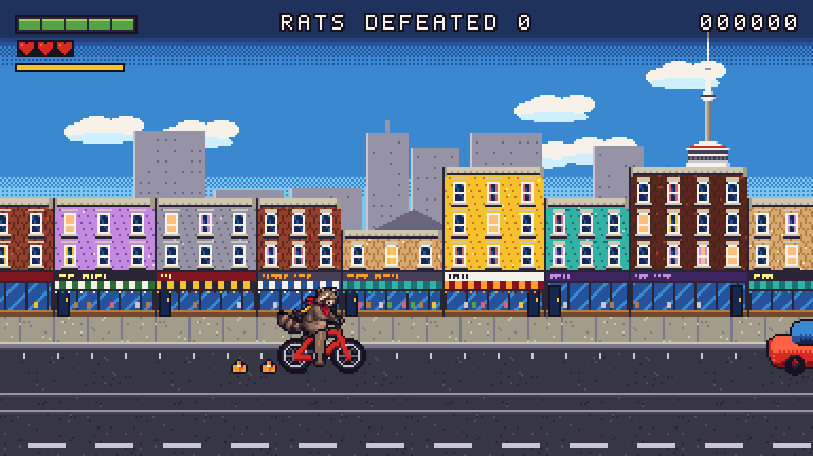

**If you prefer the M4.12 one:** I fixed it too: the red fork and a clearer swing (the arm now shows against his body, with a paw round the pump's grip). Switching back is one line in `tools/build-assets.mjs`.
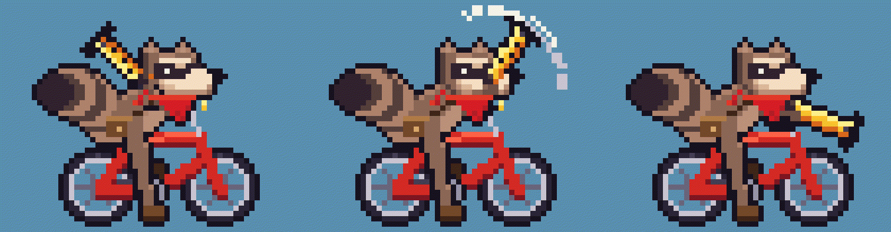

## Open questions
- Which side-view raccoon do you prefer?
- Is Dog Fjord's new size right next to the raccoon?

## Numbers
- The generated assets are 1858 KB. The sunset scene is in its own image file, loaded only when the share screen opens.
