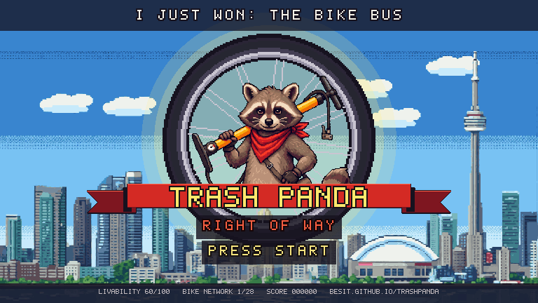
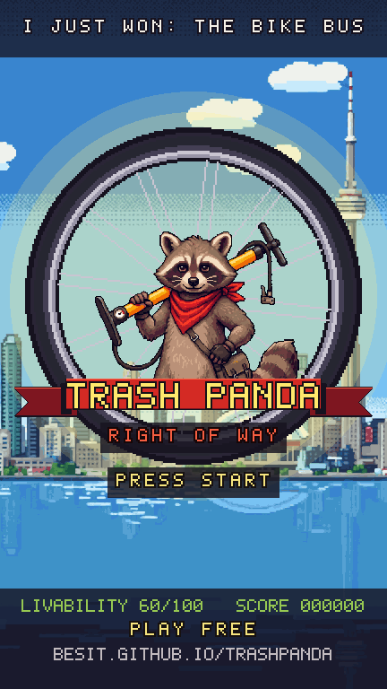
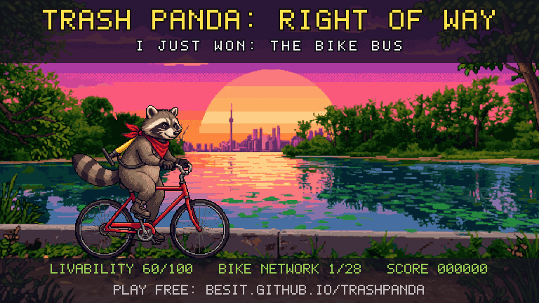
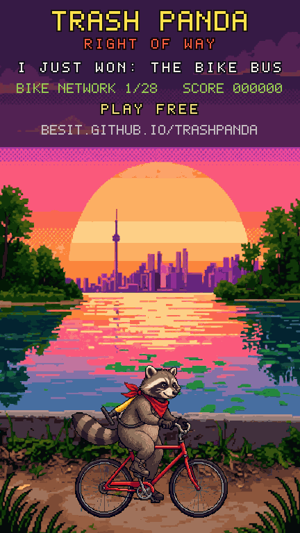
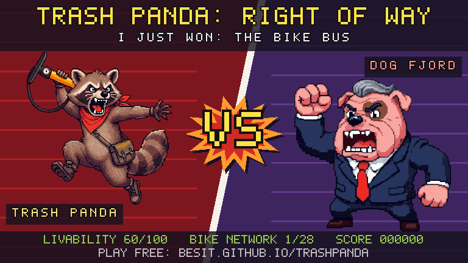
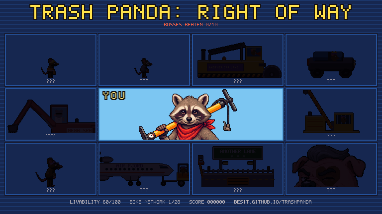
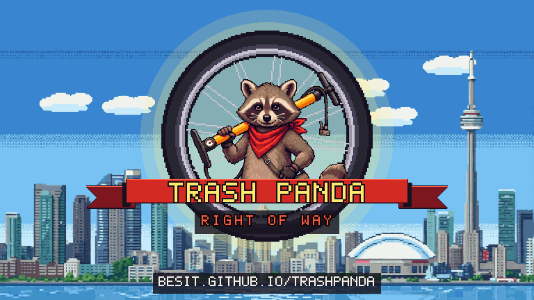
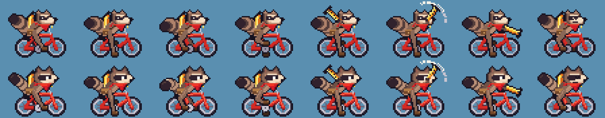
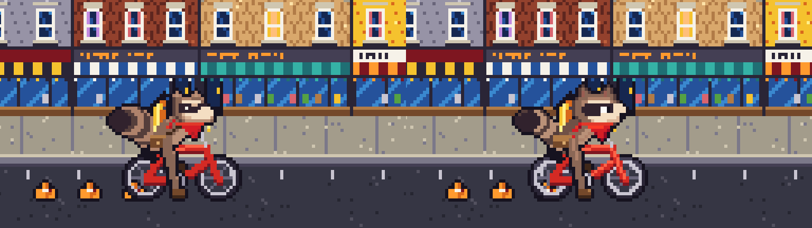

# M4.14 Review: your M4.13 notes, the title poster as the game's link preview, and another side-view raccoon (local preview, not live yet)

M4.13 isn't live either. Everything below is local until you say go.

## The posters
- **VERSUS:** Dog Fjord is now your green-screen regeneration, so there's no pale edge left.
- **Sunset (tall):** a real tall picture instead of a crop:
  - ComfyUI recomposed your lagoon scene as a tall image: the sun centred, the CN Tower in the sun, trees on both sides, the wall and the path at the bottom.
  - It's sampled down 2x on the sunset's colours, like the wide one, so it's pixel art now, not the AI image enlarged.
  - All the words sit in the empty sky at the top, so the raccoon rides the path at the bottom with nothing over him.
- **Bosses (wide):** zoomed in, so the raccoon's head and bandana fill the cell.
- **Title:** the skyline is your reference: the towers, the CN Tower and the dome, the shoreline trees and the lake.
  - The wheel, raccoon and words were removed from your image with ComfyUI, and it's converted to pixel art on its own 48 colours.
  - The tall one is a tall recomposition of the same skyline, with the lake below.

| | |
|---|---|
|  |  |
|  |  |
|  |  |

## The game's link preview
When someone shares the game's link in a chat or on social media, this picture now shows with it: the title poster with only TRASH PANDA, RIGHT OF WAY and the link.

- It's 1536 x 864 and 204 KB.
- The page also has a title and a one-line description for the preview: "A raccoon on a bicycle making Toronto a better place to live. Free, in your browser."
- It only shows once this version is live. Some apps keep an old preview for a while.

## The side-view raccoon
- **In the game:** the M4.12 raccoon again (with M4.13's red fork and clearer swing).
- **The alternative, drawn from scratch:** your M4.12 proportions (big head, big tail, short body), not the hero art's, with more care:
  - a bigger head with a visible eye inside the mask, and ears with a lit inside
  - fur in three tones (a dark back, the mid side, a light belly)
  - dark gloves on the grips and on the pump
  - a slightly smaller tail with clearer rings, lit along the top
  - a simpler bandana knot
  - the bike: a tyre with a lit top, a bright line along the frame, a toothed chainring
- **Same frame and animations,** so switching is one line in `tools/build-assets.mjs`.

**M4.12 (top) and the alternative (bottom):** the ride, the swing, hurt.

**In a mission at 2x (M4.12 left, the alternative right):**

## High scores
I read the live list again (read-only). It still shows only the old 3-letter names: nobody has finished a run since you published the rules. The next finished run with a long name will tell us.

## Open questions
- Keep the M4.12 raccoon, or use the alternative? **Ivan: the M4.12 raccoon.** The alternative stays in `tools/sprites/raccoon_side3.mjs`, not in the game.
- Is the link preview right? It's the image every shared link will show.

## Numbers
- 21 unit tests and 68 browser tests pass.
- The generated assets are 1953 KB. The two poster scenes (sunset and title) are in their own file, loaded only when the share screen opens.
