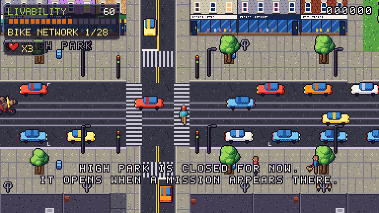
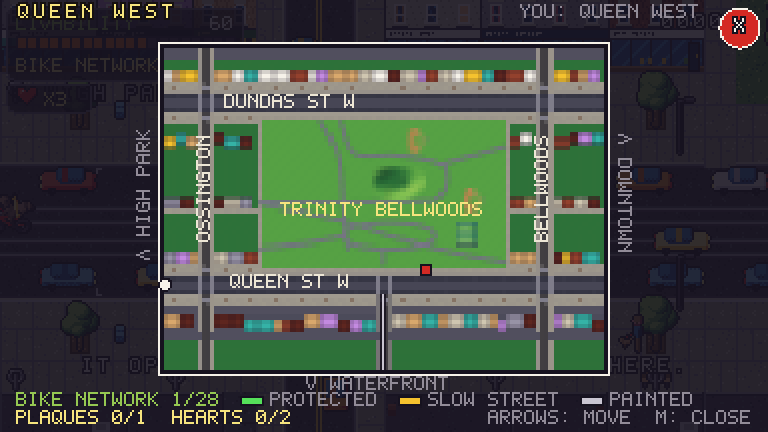
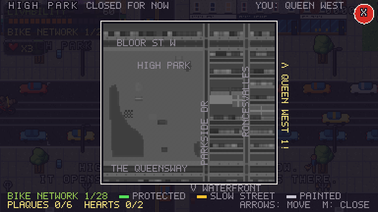
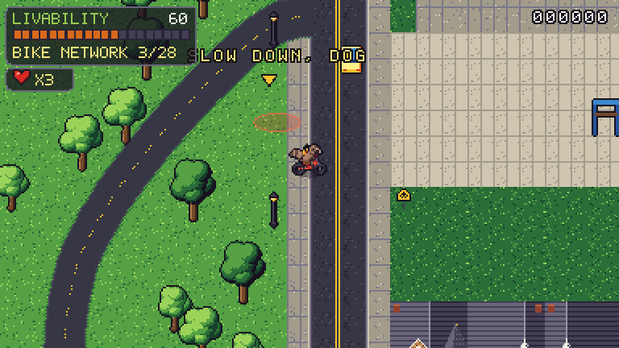
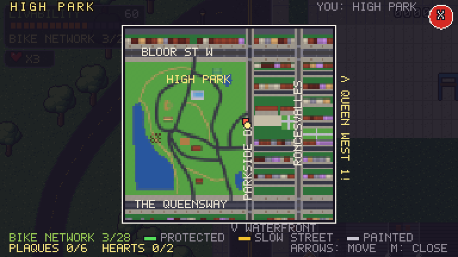

# M4.15 Review: your first play-through notes (local, not live yet)

## Districts open as you go
- **At the start only Queen West is open.** You wrote "besides downtown", but the game starts on Queen West and the first mission is there, so Queen West is the one that's open. Tell me if you meant Downtown.
- **A district opens when a mission appears there:**
  - after the Bike Lane War: High Park and Downtown
  - after King of the Street: the East End and the Waterfront
- **At a closed district's edge** the street ends at the edge of the map, and a note says why. The street sign for a closed district is grey.

- **On the city map** a closed district is grey, with CLOSED FOR NOW next to its name. Its name on the neighbouring maps is grey too.

| At the start: Queen West, the neighbours grey | High Park, closed |
|---|---|
|  |  |

## The other fixes
- **The raccoon's talking head** now stretches from the bottom. It used to stretch from the top when the text box was at the top of the screen.
- **The DVP cars** no longer flash in the top-left corner when they appear. Each new car was drawn for one frame before it was moved into its lane. I counted those frames: 8 in that cutscene before the fix, 0 after.
- **The Parkside Drive marker** is on the left of the street now, on the park's sidewalk below the speed camera. On the city map the street's name moved down so it doesn't sit under the marker.

| On the street | On the city map |
|---|---|
|  |  |

## Numbers
- 22 unit tests (one new: every open district can be reached through open ones, at every step) and 68 browser tests pass.
