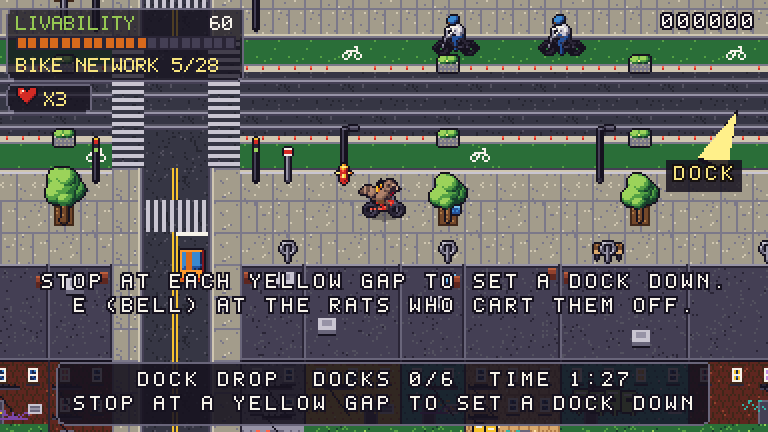
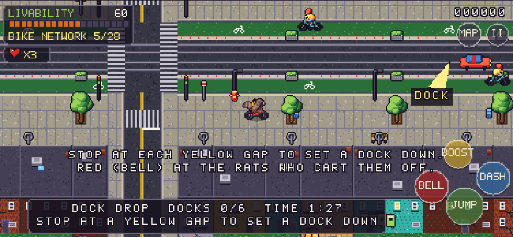
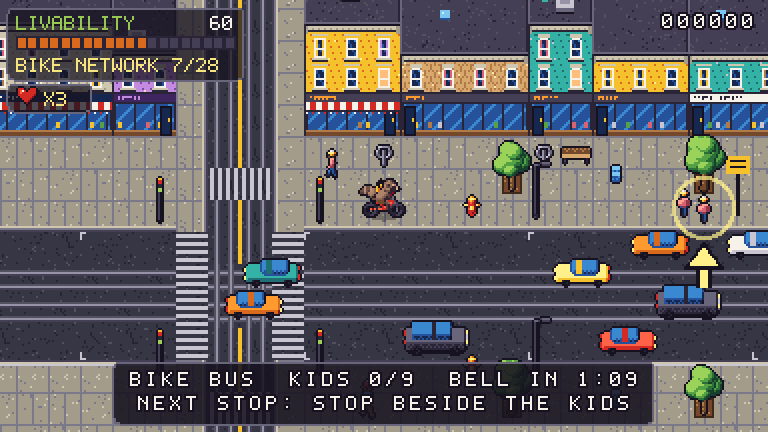
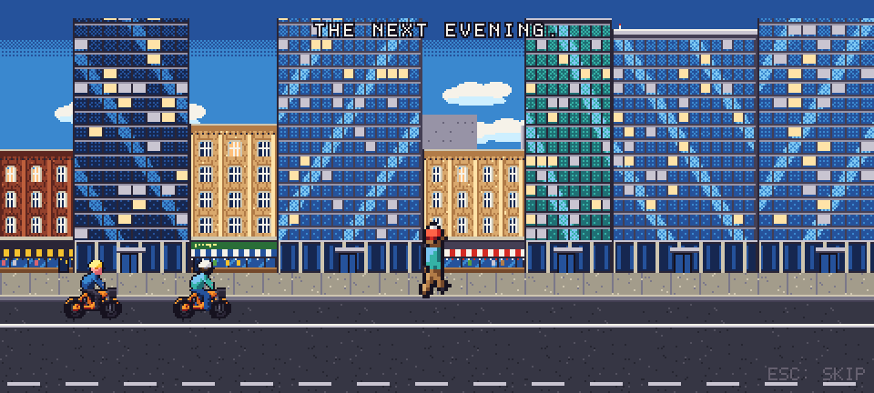
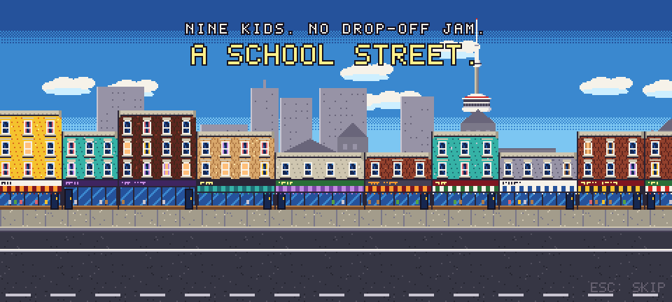

# M4.16 Review: your notes on the Dock Drop, the Bike Bus and the Megamart boss (local, not live yet)

## The status box is at the bottom
In the Dock Drop and the Bike Bus the mission's status box now sits at the bottom of the screen, so the middle is clear. While it's up, the opening hint sits just above it. On a phone it stays left of the buttons.

| Desktop | Phone |
|---|---|
|  |  |

## The closing vignettes
- **Dock Drop:** the pedestrian walks along the sidewalk instead of walking in place.
- **Bike Bus:** the raccoon and the kids start off screen and ride all the way out of the shot. On a wide phone they used to be on screen at the start and stop on screen at the end. The Dock Drop's riders do the same now.

| Dock Drop: walking | Bike Bus: the end, nobody parked on screen |
|---|---|
|  |  |

## The bike share text
"THE GAME'S BIKES ARE UNBRANDED" is gone from the text after the mission.

## The Megamart boss
Megamart's rats join the Monster SUV fight: two when it rolls in, two more at half its health, two more at a quarter. They come from both sides, and any left die with the SUV.

## Something I got wrong
The browser tests run on the built game, and I hadn't rebuilt before testing M4.15. Rebuilt now: the district locks work, and three old tests needed updating because they rode into districts that are now closed at the start. 71 browser tests pass.
