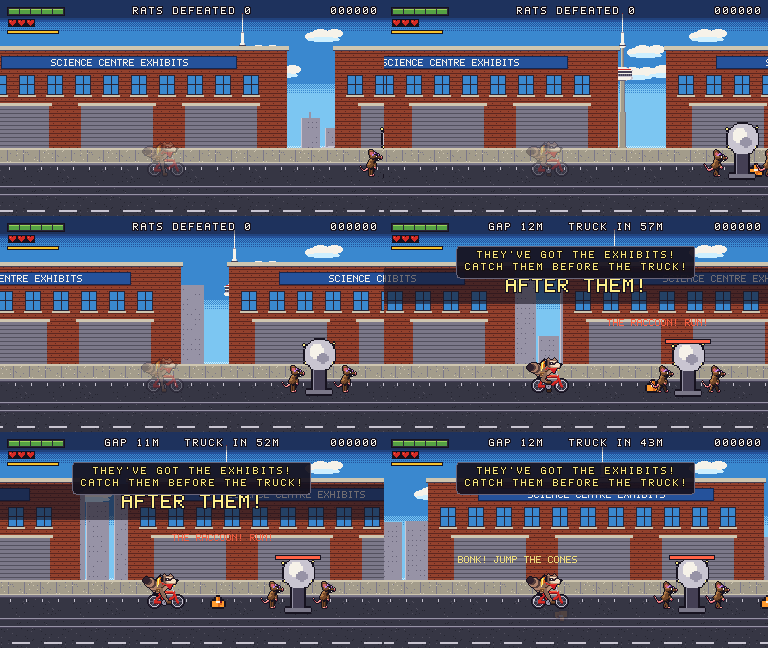
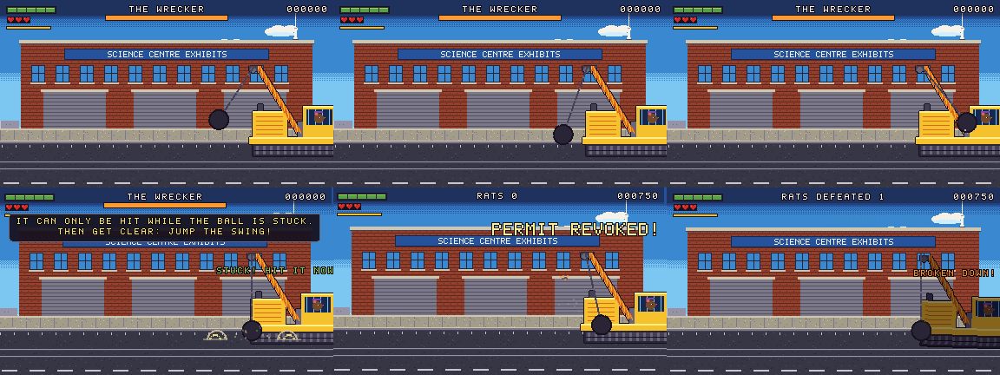
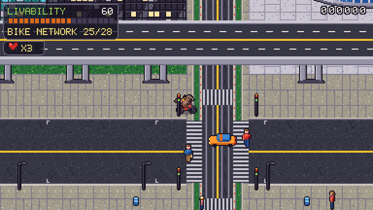
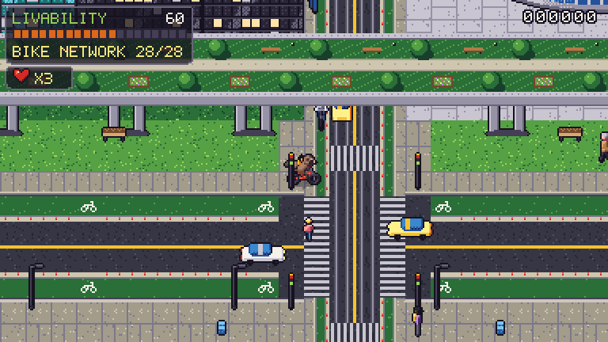
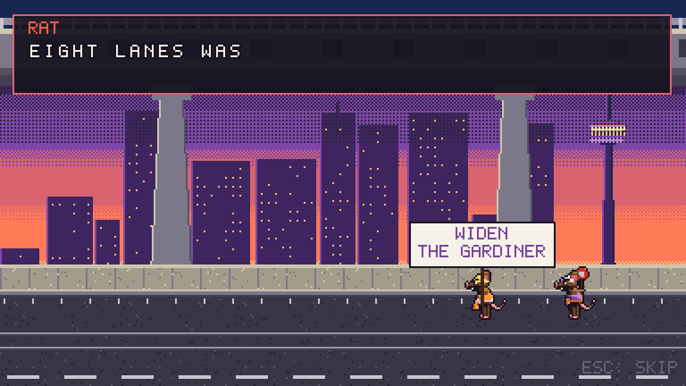
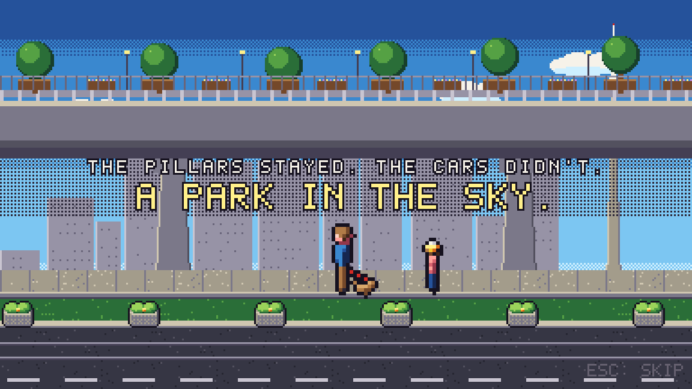
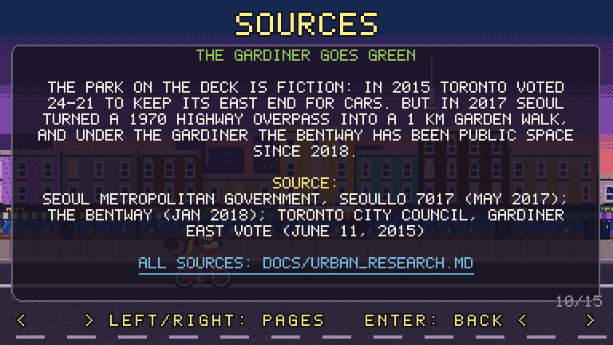
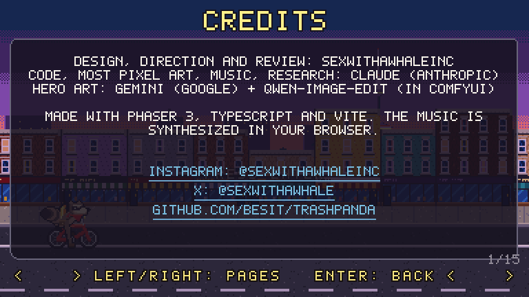
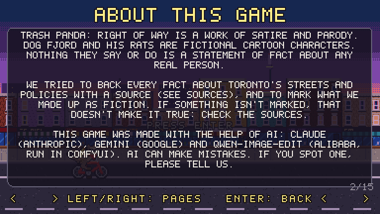

# M4.17 Review: your notes on the spa, the Science Centre and the Gardiner; credits; the release fact check (local, not live yet)

## The Spa Digger
It has about 45% more health (26 instead of 18).

## Save the Science
- **The briefing:** the electric ball is behind the rat's MOVING SALE sign now.
- **The chase:** the rats with the ball start just off the right edge of the screen. They come into view as you catch up, and when you're close they bolt.

- **The Wrecker:**
  - The rope is drawn over the machine.
  - Its dust and its shockwaves are drawn over everything.
  - The swing is symmetrical, as far right as left.
  - When you beat it, it breaks down where it stands: sparks, the ball crashes to the street on its chain, the crane sags and goes grey, and it smokes. No more driving off.

## Death by Highway: the pillars stay, the deck becomes a park
Yes, we can do that, and there's a real precedent. Seoul turned a 1970 highway overpass into a 1 km garden walk in 2017 (Seoullo 7017). The Bentway has been a public space under the Gardiner itself since 2018.
- **On the map:** after the win the cars are gone, and the deck is a park on the same pillars: lawn, a path, trees, flower beds, a bench. Lake Shore still gets its bike lanes.

| Before | After |
|---|---|
|  |  |

- **The closing scene** shows the deck from the side with trees along its railing: "THE PILLARS STAYED. THE CARS DIDN'T." / "A PARK IN THE SKY."
- **While doing this I found a bug:** the opening scene said "UNDER THE GARDINER" but showed Queen West's shops. It shows the Gardiner now.

| Before the mission | After the mission |
|---|---|
|  |  |

- **The text after the mission** is THE GARDINER GOES GREEN. It says the park is fiction, what Toronto actually voted in 2015, and the two real examples.

## Credits and the notice
- **Credits:** Claude for the code, most of the pixel art, the music and the research; Gemini and Qwen-Image-Edit (in ComfyUI) for the hero art.
- **The notice:** "We tried to back every fact about Toronto's streets and policies with a source, and to mark what we made up as fiction. If something isn't marked, that doesn't make it true: check the sources." It also names all three AIs.
- **The README** says the same.

| | |
|---|---|
|  |  |

## The fact check
I reread every fact the game shows (the texts after missions, the plaques, the captions) and searched again for the ones that can change.
- **One fix:** the CN Tower plaque said "the world's tallest tower until 2007". The 2007 record it lost was "tallest free-standing structure" (it stayed the tallest tower until 2009 or 2010). The plaque now says that.
- **Still true:**
  - the speed-camera ban
  - the Ontario Line's cost and schedule
  - the Science Centre's interim site and its 2029 date
  - Ottawa's no to jets at the island airport
  - the bike-lane story up to October 2026 (since then: a Supreme Court leave application, no decision yet; the game doesn't mention it)
- **Plaques I hadn't checked before, now checked with sources:** City Hall, Old City Hall, the Revue, the Jamie Bell playground, the Queen St bridge, the Broadview Hotel.
