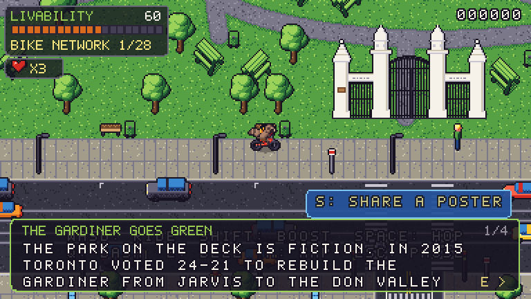

# M4.18 Review: the Gardiner wording, the credits, and the outside audit (local, not live yet)

## Done
- **The Gardiner text** now names the stretch Toronto voted on: "IN 2015 TORONTO VOTED 24-21 TO REBUILD THE GARDINER FROM JARVIS TO THE DON VALLEY PARKWAY, NOT TEAR IT DOWN." ("Gardiner East" is the highway's own eastern end, not the East End neighbourhood.)
- **ComfyUI** is no longer mentioned in the credits, the notice or the README.
- **The card after a mission:** a long third line ran under the "E >" prompt; the lines now stop short of it.

## The audit
I checked each of its points against the original sources before changing anything. The research file now has everything that held up, and an "Audit" section at the end listing what changed.
- **Most of it holds up and is now in the file:**
  - the speed-camera law's date
  - a second provincial law (Bill 60, Nov 2025: no removing car lanes for new bike lanes)
  - the finished 1.2 km of Bloor bike-lane removal
  - the traffic cost of Bloor's lanes
  - the Ontario Place money (the rent is worth about $163M today, not $1.1B)
  - the Science Centre costs
  - how the island-airport law works
- **I removed one claim** that had no good source (the Science Centre being the only building closed over its roof panels).
- **Two things I couldn't confirm** are marked as unconfirmed: a regulation number, and a court filing date.
- **One point I disagreed with:** it said High Park's car-free roads weren't in place, but the City's own pages say they were closed to cars in 2023.

## What it might change in the game: your call
None of these are changed yet.

1. **The text after the Lane Eater** (the one I'd change). It says "A STUDY FOUND MORE ECONOMIC ACTIVITY ALONG THE STREET, NOT LESS." The same study found the Danforth, with no bike lane, grew about as much. So it shows Bloor did fine, not that the lane caused the growth.
   - Proposed: "...CYCLING ON IT ROSE 49%, AND BUSINESSES HELD UP: SPENDING GREW ABOUT AS MUCH AS ON THE DANFORTH, WHICH GOT NO LANES."
2. **The island airport** (I'd change it). "ONTARIO PASSED A LAW TO TAKE OVER THE ISLAND AIRPORT FOR JETS" squeezes two things together: the law took the City's place in running the airport, and jets would still need Ottawa. Ottawa said no "at this stage", and the law still stands.
   - Proposed text after the mission: "...IN 2026 ONTARIO PASSED A LAW TO TAKE THE CITY'S PLACE AT THE ISLAND AIRPORT AND PUSHED FOR JETS. IN JULY OTTAWA, WHICH HAS THE FINAL SAY, SAID NO FOR NOW: SAFETY WORK ONLY."
   - The closing scene: "OTTAWA SAID NO TO JETS" → "OTTAWA SAID NO TO JETS, FOR NOW."
3. **The speed cameras** (small). "HUMPS AND RAISED CROSSINGS DON'T GO AWAY" suggests they're a full replacement for cameras, which the research doesn't show.
   - Proposed: "HUMPS AND RAISED CROSSINGS KEEP WORKING WITHOUT TICKETS."
4. **The Bike Lane War** (optional). "ABOUT 1/9 THE INJURY RISK" is strictly "1/9 the odds". Most people read it as risk, and the research file now explains the difference.
   - Proposed, if you want it exact: "...HAD ABOUT 1/9 THE ODDS OF INJURY OF BUSY STREETS WITH PARKED CARS."
5. **Streetcars after Let the Streetcar Through** (I'd keep it). On the map they never stop at red lights. Real signal priority holds greens and cuts reds; it doesn't remove every red. No text claims it, it's how the game feels.
   - Option: make them stop at some reds.

**No change needed:**
- The new bike-lane law doesn't touch the game: our lanes mostly replace parking lanes, and the bike network is labelled fiction.
- Parkside's real redesign is stalled by that same law, but the game already calls its outcome fiction.
