# M4.2 Review: your M4.1 notes

**Play it:** https://besit.github.io/trashpanda/. Add `?debug` for **SELECT MISSION**, now numbered.

Every note from your M4.1 list is in. Numbers in brackets refer to the gallery at the bottom.

## Global
- **The mission list is numbered in the order missions open up** (01). The order follows each mission's chain of prerequisites: 1 The Bike Lane War, 2 Let the Streetcar Through, 3 King of the Street, 4 Slow Down, Dog, 5 The Lane Eater, 6 The Great Parking Lot, 7 The Waterfront Heist, 8 Save the Science, 9 Finish the Line, 10 Grounded, 11 The Bike Bus, 12 Death by Highway. Missions on the same step of the chain keep the story's order.
- **The district maps are redrawn** at full scale in `docs/maps/` (the North's is gone).
- **Nothing appears from nowhere:**
  - Every boss slides in from beyond the right edge when its arena locks: the bureaucrat bosses, the Monster SUV, the Pink Digger, the Wrecker and the Highway Mech.
  - Rats called in mid-fight come from the nearest screen edge: a guard's backup, a boss's summons, the digger's helpers.
  - The arenas' asphalt patches, fences, survey stakes, rail piles and Parkside's build spots are on the street as you ride up, not popped in when the arena locks.
  - The Highway Mech's slabs fall in from above and land with a thud.
- **The city map** (02–06):
  - Only street names and park names inside the frame. Park names are yellow; the plaque-style names are gone (ponds, the dog bowl, the CN Tower, Chinatown...).
  - Each neighbouring district is marked outside the frame, on the side and at the spot where its streets leave, with its open missions counted.
  - Arrow keys move the way the maps connect: DOWN from High Park, Downtown or the East End is the Waterfront; LEFT/RIGHT along the row; UP from the Waterfront goes to Downtown. On a phone, tap a neighbour's name.
  - Every map is scaled to fill the screen. The East End and High Park looked small because the scale snapped to half steps; it's continuous now.
  - High Park shows Bloor only; it becomes Dundas when it crosses into Queen West.
  - While the Bike Bus runs, its stops, SUVs and the school are on the map, the next one blinking (06).

## Missions
- **The Lane Eater:** the paved-over lane was redrawn every frame from the moving camera edge, at fractional positions, so the lane's flower speckles shimmered. It's now anchored in the world and redrawn only when it grows by a pixel.
- **The Great Parking Lot:**
  - The roof you stomp on is now the SUV's actual roof. It was 18 px above it, which is why you bounced in mid-air. A test drops the raccoon on it and checks the bounce happens within 3 px of the visible roof.
  - Only the front two thirds of the SUV hurts while it charges, so jumping off near its back is safe.
- **The Waterfront Heist:** the Pink Digger breaks down where it stands (07, 08). Sparks and pops, then the arm crashes down and it sags and goes dark under BROKEN DOWN!, and it keeps smoking as a wreck while you ride on.
- **Save the Science:**
  - **Hiding is readable now.** The crates draw in front of the raccoon (it used to be drawn on top of the crate it was "behind"). Hidden, it goes dim with HIDDEN over the crate (09), and near a crate with a guard about, a bobbing HIDE HERE shows where to stand. The title card says: "STAY OUT OF THE BEAMS: PASS WHILE A GUARD LOOKS AWAY, OR STAND BEHIND A CRATE".
  - **The Wrecker is redesigned:**
    - It drives to bring its boom over you. Then it either swings the ball (one-sided, out over the street; jump it at the low point) or hoists it and drops it where you stand. A growing shadow marks the spot, and the impact sends shockwaves both ways (10, 11).
    - **Only the ball and its shockwaves hurt.** The truck is safe to stand by.
    - Pump the engine or stomp the cab any time. Every third attack it stops to let off steam, when pumps do double damage.
  - **The Van de Graaff** draws behind the raccoon while the rats carry it. In the after vignette it stands in front of the passers-by.
  - **The moving truck has a job.** It's labelled THEIR GETAWAY TRUCK / CATCH THEM BEFORE IT!. If the rats reach it, they load the exhibit and it drives off: VROOM! GONE. (12). Catch them first and it leaves empty-handed. It isn't something to fight.
- **Death by Highway:** the background flicker came from the dusk skyline's dithered haze. That layer moves at 8% of your speed, so it jumped one pixel every few frames, and a one-pixel shift flips a checkerboard dither. Slow layers now move in 2-pixel steps, which keeps the dither still.
- **Grounded:** the Jet Tug now revs at the screen edge first (13). Only its tug pokes in and its jet is still off screen, so there's nothing to climb. Then it crosses at 170 px/s (it was 100) and you can ride it once it's rolling.
- **The Bike Bus:**
  - The arrow is much bigger: a bouncing outlined arrow and a pulsing ring over the next stop (14). When it would cover the HUD it flips below the stop, pointing up.
  - Off screen, a big arrow at the edge says what's there: KIDS, SUV or SCHOOL (15).
  - The stops are on the city map (06).
- **Hint boxes clear when a result takes the screen** (a boss falls, you win or lose), so their text never sits over the result.

## Districts
- **Waterfront, the 510's tracks** (16, 17):
  - Spadina's straight rails used to continue into the junction while the curves started halfway down the same row, so the two overlapped. Now the straight rails end at the junction's edge and the curves take over.
  - Both curves share one centre on the junction's corner (radii 40 and 24, still concentric). The turn up Spadina was a tight 16 px, too tight for the car's sections, which is why it broke apart.
- **The turning streetcars:**
  - A car that turned keeps its three sections to the end. It used to swap back to its one-piece sprite, whose pivot sat lower, so it dropped.
  - Sections are drawn by height on screen: on the car going up Spadina, the rear (nearer the camera) is drawn over the middle, the middle over the front.
  - Vertical sections sit a little closer, closing the gap.
- **High Park:** the map shows Bloor only.
- **Downtown:** the arches are closer together, across the pool's right half, clear of the TORONTO sign (18).

## Numbers
53 browser tests (5 new) and 18 unit tests pass.

## Gallery
| | |
|---|---|
| 01 SELECT MISSION, numbered 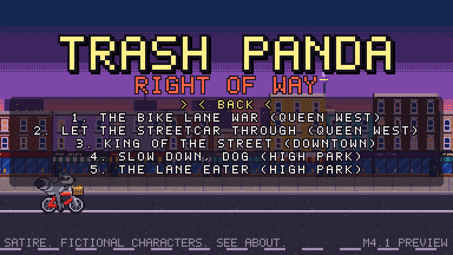 | 02 Queen West, neighbours outside 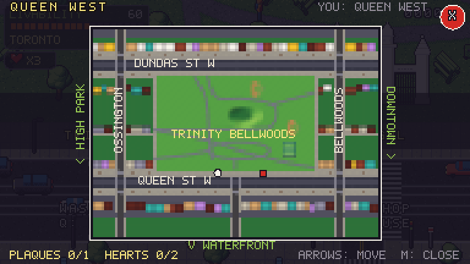 |
| 03 High Park: Bloor only 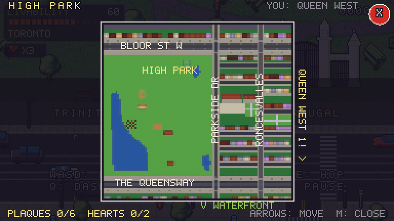 | 04 The Waterfront 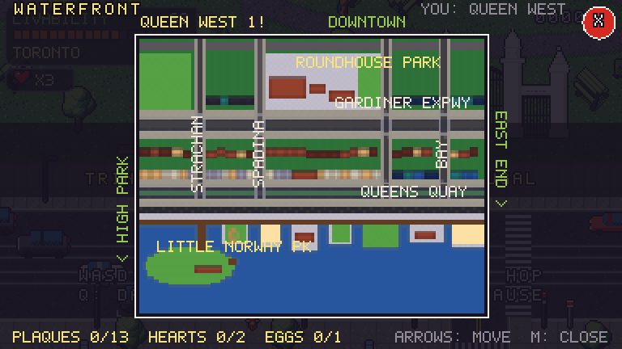 |
| 05 The East End, full size 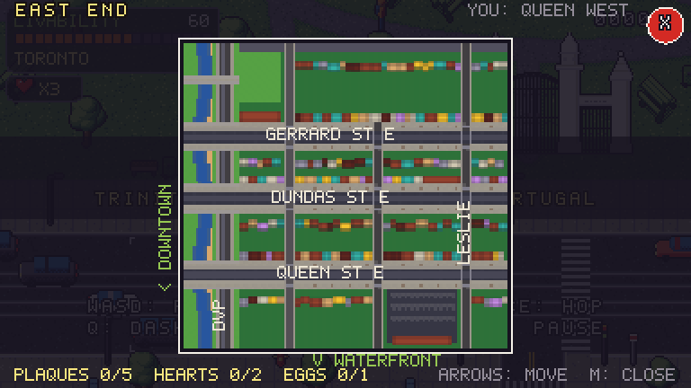 | 06 The Bike Bus's stops on the map 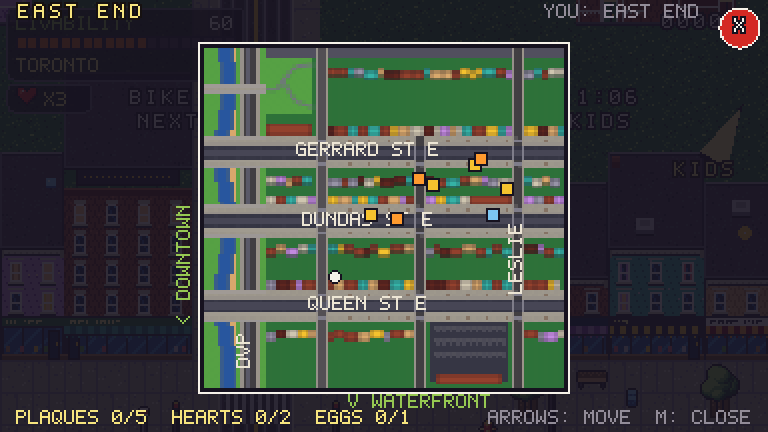 |
| 07 The Pink Digger breaking down 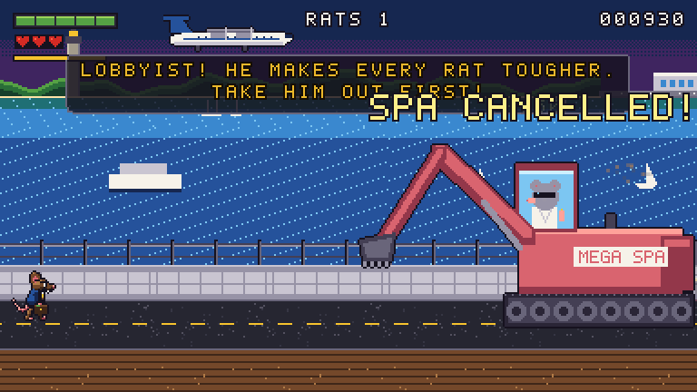 | 08 The wreck 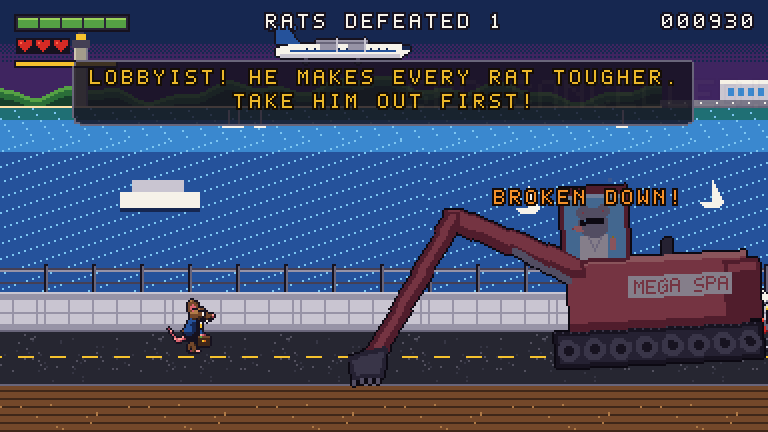 |
| 09 Hidden behind a crate 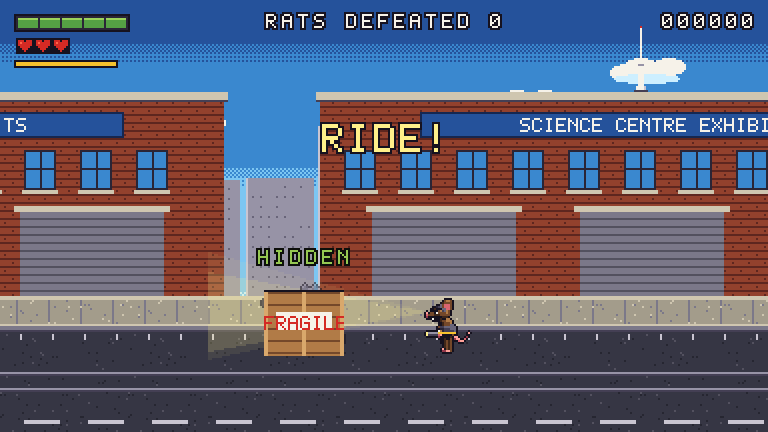 | 10 The Wrecker hoists: its shadow 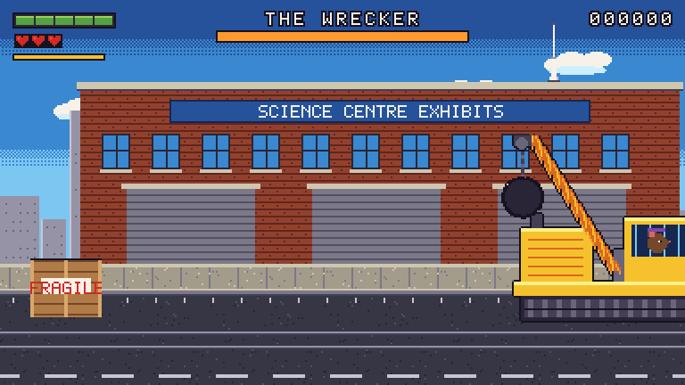 |
| 11 The drop's shockwaves 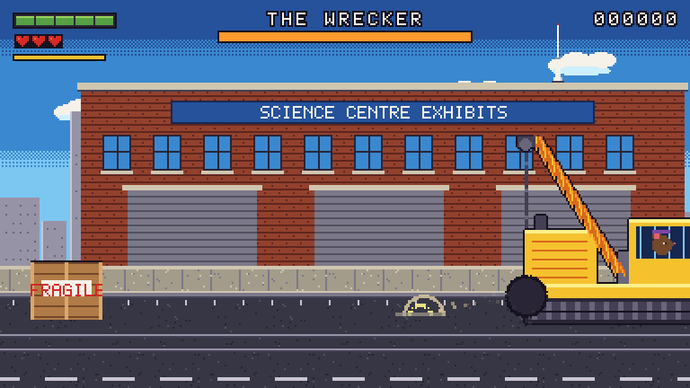 | 12 Into the getaway truck 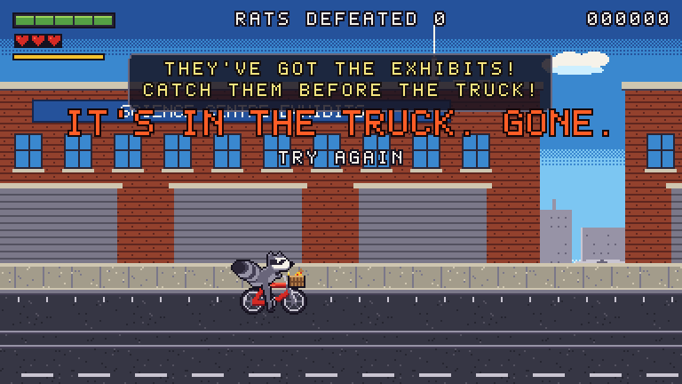 |
| 13 The Jet Tug revs 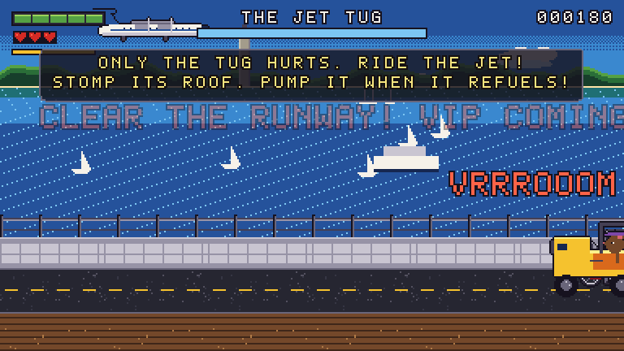 | 14 The Bike Bus arrow + ring 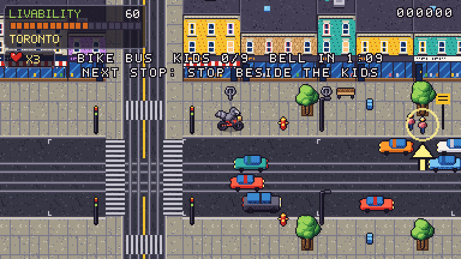 |
| 15 Off screen: KIDS 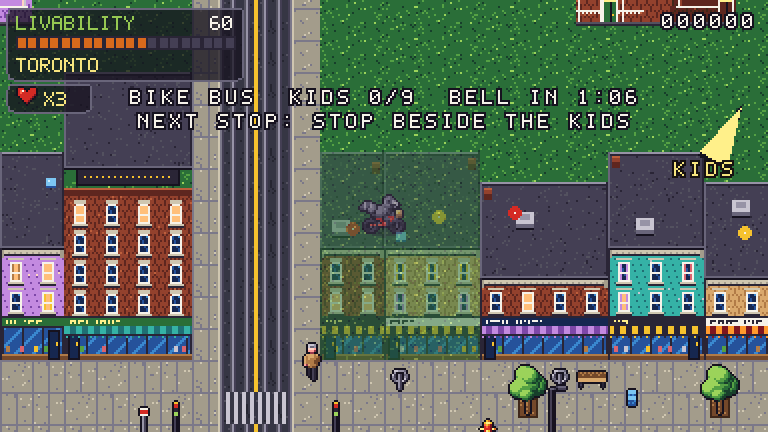 | 16 The Spadina junction, before 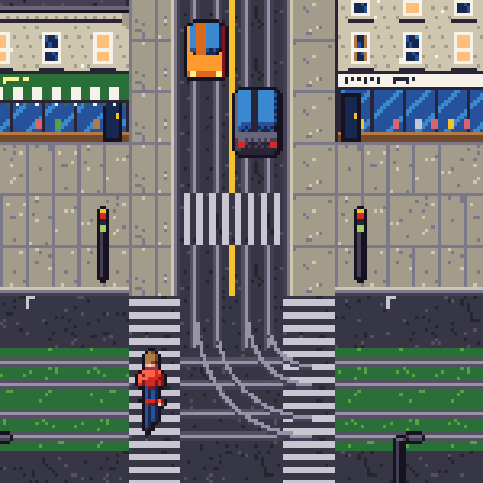 |
| 17 After: the curves take over 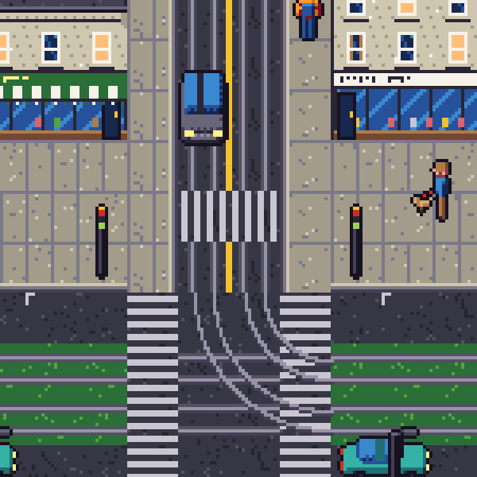 | 18 The arches on the right half 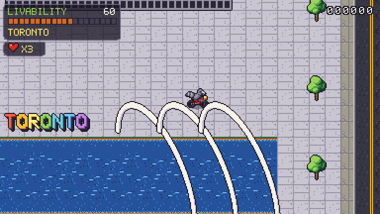 |
