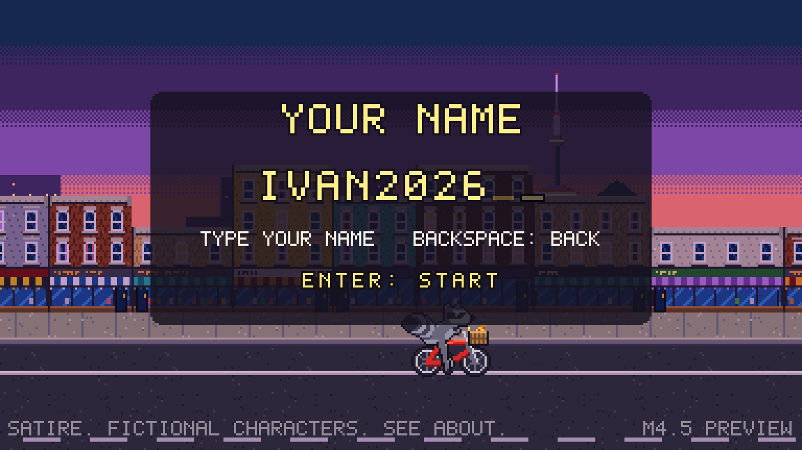
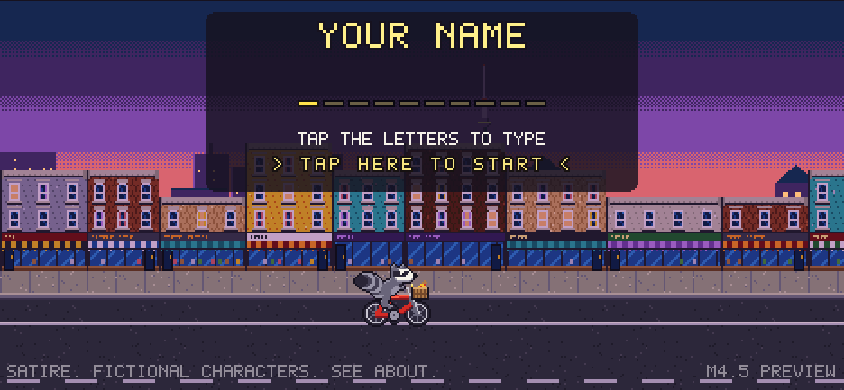
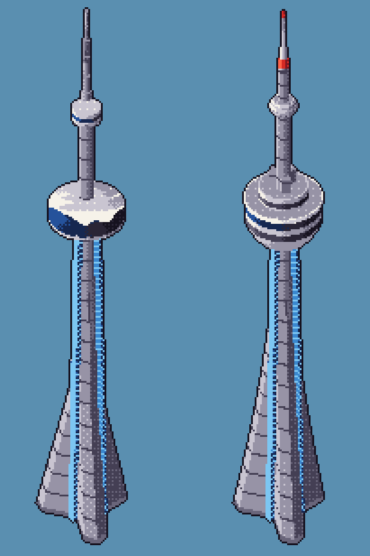
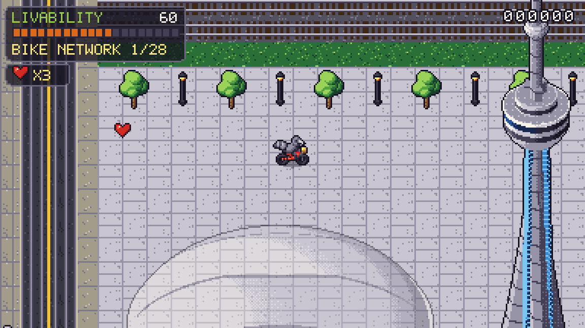
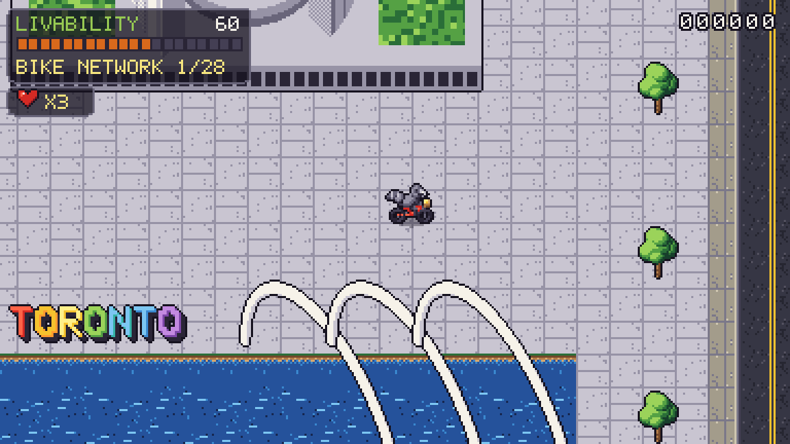
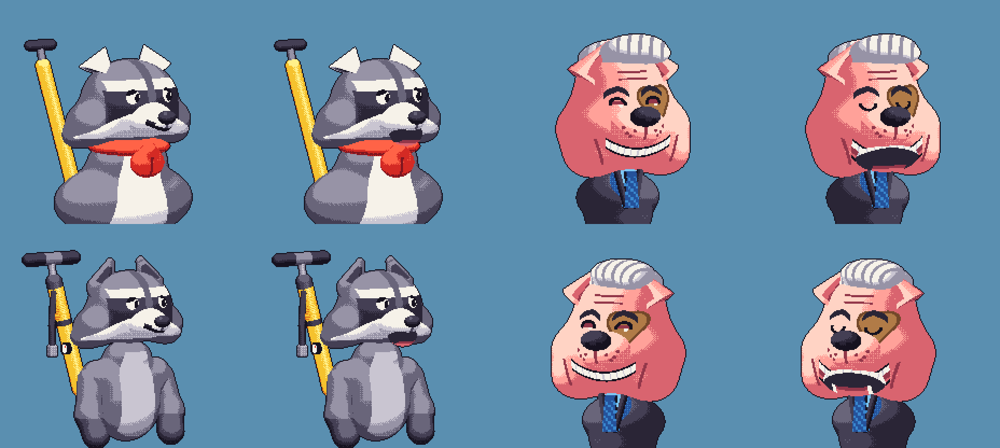
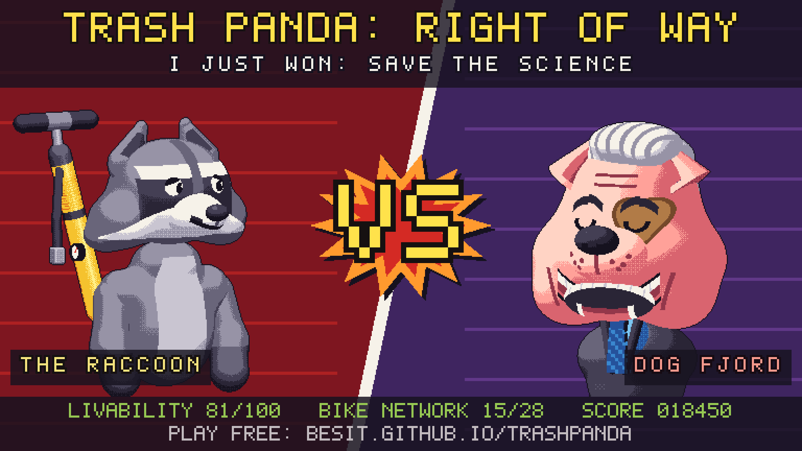
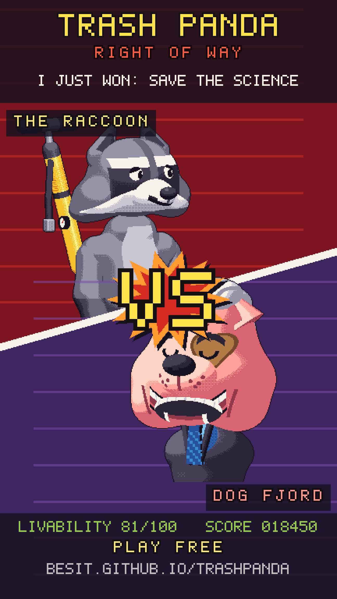

# M4.5 Review: your notes on M4.4

**Play it:** https://besit.github.io/trashpanda/. Add `?debug` for **SELECT MISSION**.

Everything from your list is in. Numbers in brackets refer to the gallery at the bottom.

## Global
- **Names up to 10 characters** (letters and digits) (1, 2):
  - Type your name, Backspace takes a letter back, Enter starts. On a phone, tap the slots and use the phone's keyboard.
  - The arrows still work: UP on the first blank starts a new letter at A.
  - A blank name plays as RAC.
- **The online leaderboard needs one change from you:** its security rules only accept 3 capital letters. Please republish the rules in `docs/LEADERBOARD.md` (the name rule is now `^[A-Z0-9]{1,10}$`) in the Firebase console. Until you do, a long name posts its first three letters, so nothing breaks.
- **Debug games stay off the scoreboard:**
  - A run played with `?debug` is marked for good and never goes into the local high scores or the online board. It stays off even if you carry it on later without `?debug`.
  - Scores already on this device from earlier debug runs can't be told apart from real ones, so they stay until they're pushed out of the top 10.

## Districts
- **The CN Tower** (3, 4):
  - **The taper:** the base now narrows in one smooth curve all the way up to the pod. Before, it dropped sharply about a third of the way up, then ran almost straight.
  - **The top, from your close-up:**
    - the main pod as a stack: a rounded bowl underneath, then dark / light / dark window bands under a white rim, a narrower drum on top with the lift housings
    - the slim upper shaft and the ribbed SkyPod
    - the antenna: thick and segmented, with a red light band, then thin, with a red tip
- **The Freedom Arches** are drawn left to right now, so each arch lies over the one to its left (5). M4.4 had it the wrong way round.

## Posters (all twenty in `docs/reviews/m45/posters/`)
- **The raccoon's hero portrait** (6):
  - no red scarf
  - a proper torso: neck, shoulders, chest and arms. The whole bust fits in the picture with a rounded bottom, so it never looks cut off.
  - ears in fur colour (not white): triangles with round tips and dark insides
  - the pump in detail: end caps, a band, grip ribs, a pressure gauge, the hose and its chuck, a wider T-handle with black grips
  - the smirk from the Title poster on every poster. The yell is gone (it looked odd).
- **VERSUS** (7, 8):
  - Dog Fjord faces left, toward the raccoon. M4.4 rendered him from the wrong side.
  - His laugh is a proper open mouth: a full row of upper teeth, a tongue and two small lower fangs. Before, the teeth only showed at the corners of a black hole. The new mouth also shows in his in-game laughing portrait.
  - On the tall poster the white slash cuts the raccoon off, rather than the edge of his picture.
- **SCORES:** your own run is a lit band behind its row. The "< YOU" beside it ran into the score once names got longer.

## Worth checking
- The new raccoon: the torso and ears in particular.
- The CN Tower's top against your photo.
- Typing a long name on your phone.

## Numbers
- 64 browser tests (2 new, 3 updated for the new name entry) and 21 unit tests pass.

## Gallery
| | |
|---|---|
| 01 A long name, typed  | 02 On a phone  |
| 03 The CN Tower, before / after  | 04 On the map  |
| 05 The arches, left to right  | 06 The portraits, before (top) / after  |
| 07 VERSUS  | 08 VERSUS, tall  |
