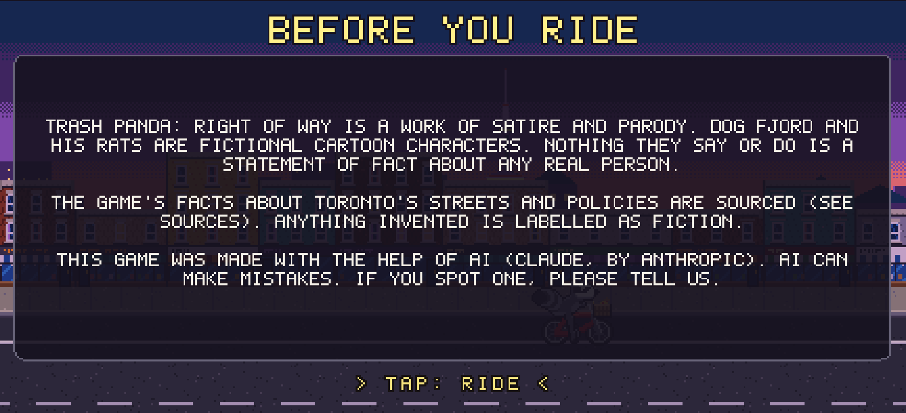
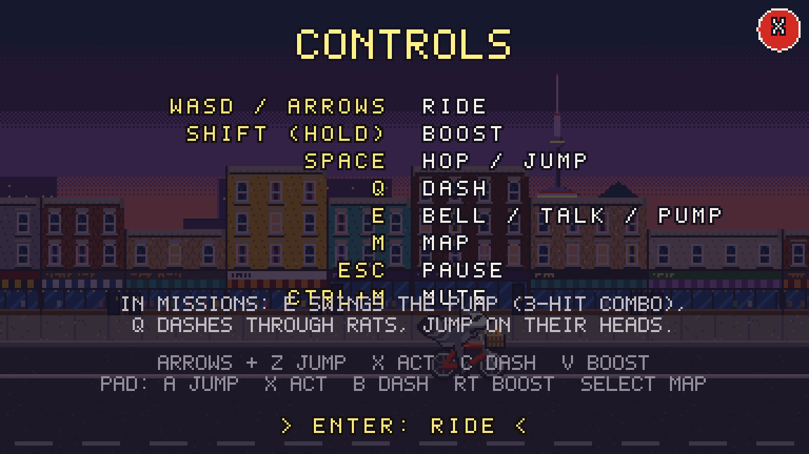
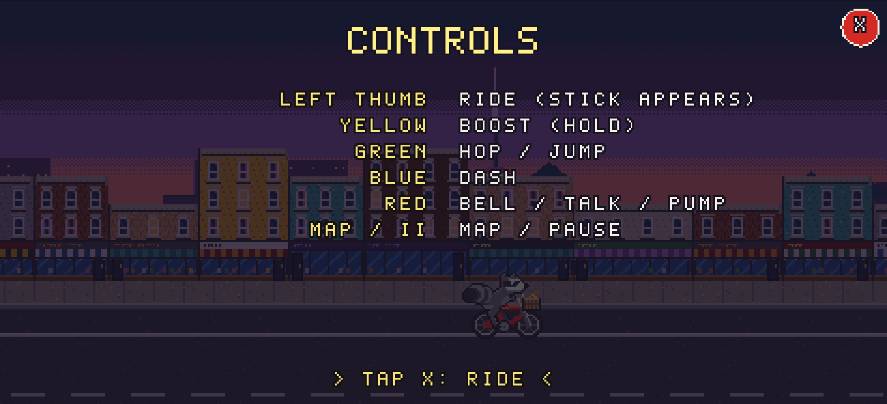
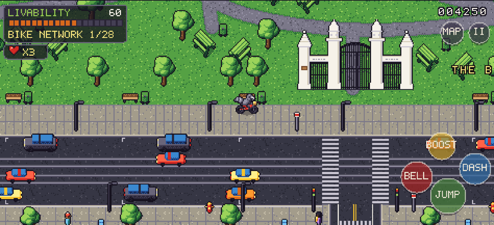
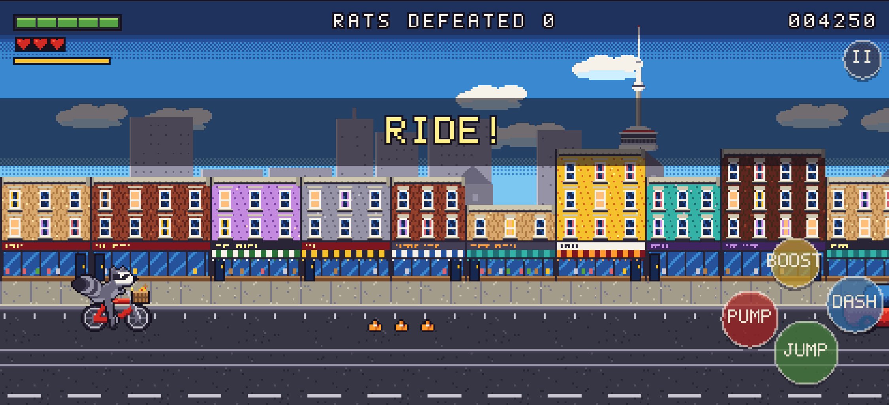
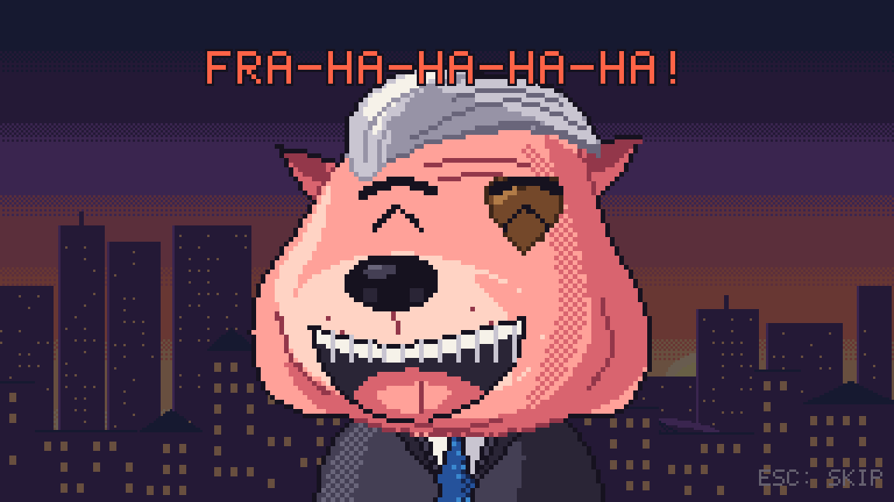
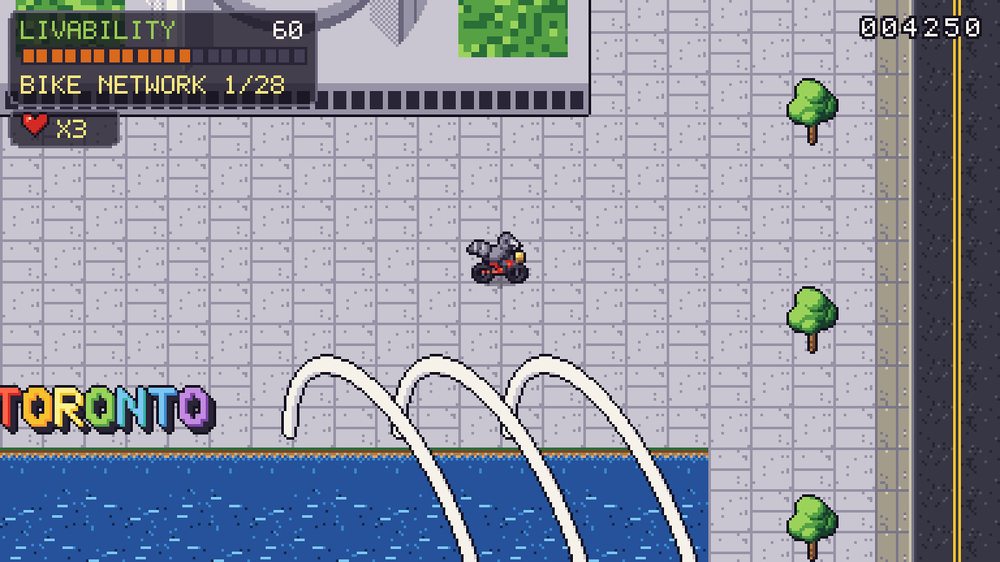
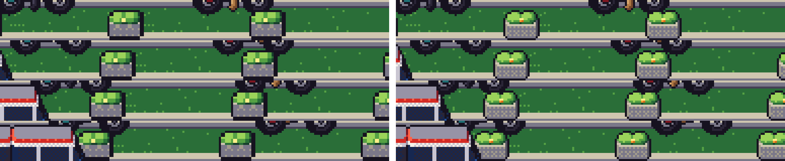
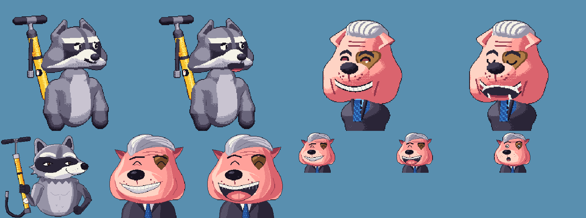
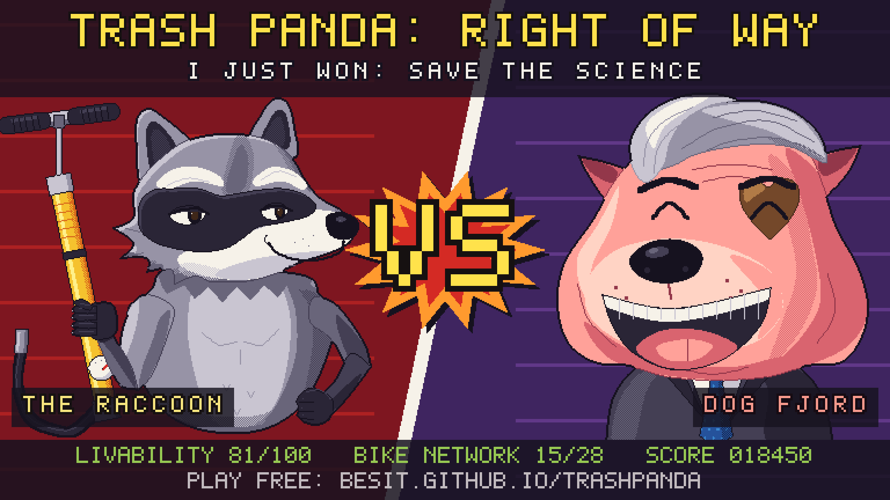

# M4.6 Review: your notes on M4.5

**Play it:** https://besit.github.io/trashpanda/. Add `?debug` for **SELECT MISSION**.

Everything from your list is in. Numbers in brackets refer to the gallery at the bottom.

## Global
- **The portraits are 2D pixel art now** (9, 6, all twenty posters in `docs/reviews/m46/posters/`):
  - No 3D anywhere: flat shapes, hard outlines, cel shading and pixels placed by hand.
  - **The raccoon:** the same smirk. Fur-coloured triangular ears with round tips. A whole torso with a fur ruff under the chin and a pale chest, ending inside the picture. The near paw's fingers wrap round the pump; the other fist is on its hip. The pump keeps its detail: end caps, band, grip ribs, gauge, hose and chuck, and a wide T-handle with black grips.
  - **Dog Fjord:** faces left. Big pink head with jowls, the grey hair swoop with a quiff, folded ears, the brown heart patch, thick brows, the big black nose, the suit and blue tie.
  - **Same drawing at every size:** his in-game dialogue portrait (grin, laugh, shock) is this drawing too, drawn smaller.
- **Controls page:** the first new game on a device shows the controls after the satire notice, then rides into the intro (2, 3). Phones get the touch layout. It shows once; CONTROLS on the title menu still opens it any time.

## Phone
- **The name box that stayed up:** your tap on **TAP HERE TO START** finished the name, then went on to the hidden difficulty list under it, and opened a second, empty name box over the next screens. Taps now only reach a menu that's showing (1). I reproduced it on an emulated iPhone first; the new test does exactly that tap.
- **Score over MAP and pause:** both buttons moved down under the score line, in the city and in missions (4, 5).

## Missions
- **The Bike Lane War flowerbeds:** the planters in its before/after vignettes were a small sprite stretched 1.5x on screen, re-sampled every frame as they scrolled, so their edges and dithering flickered. They're drawn at full size once now, and only move (8). The other stretched props are drawn once too:
  - the King St patios
  - the construction hoardings
  - the van and the Van de Graaff generator in Slow Down, Dog

## Districts
- **Downtown:** the arches are back to M4.4: the left one on top (7).

## Worth checking
- The two new portraits, on the posters and in Dog Fjord's lines in the intro.
- Starting a new name on your iPhone and tapping START.

## Numbers
- 68 browser tests (4 new, 3 updated for the controls page) and 21 unit tests pass.

## Gallery
| | |
|---|---|
| 01 After START on a phone: the notice, no name box  | 02 The controls before the first ride  |
| 03 On a phone  | 04 The score above MAP and pause  |
| 05 In a mission  | 06 Dog Fjord's dialogue portrait  |
| 07 The arches, as in M4.4  | 08 The planters, 4 frames: before (left) / after  |
| 09 The portraits, before (top) / after  | VERSUS  |
