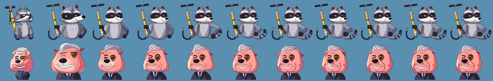
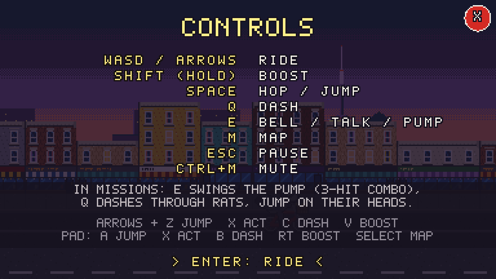
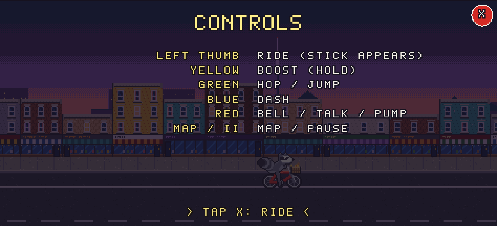
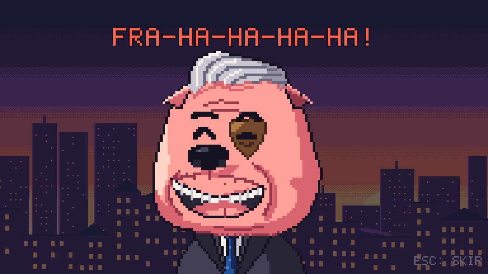
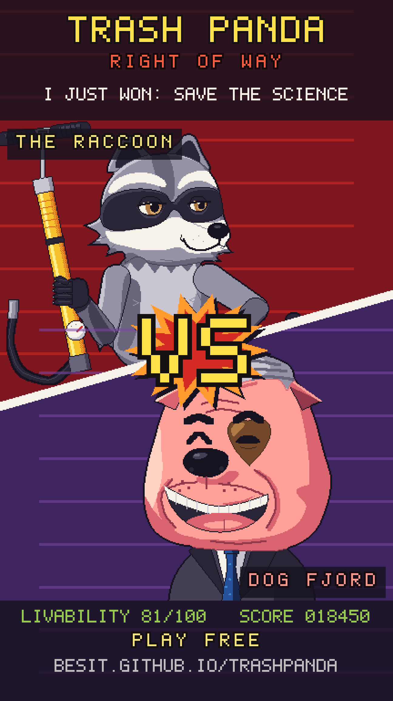
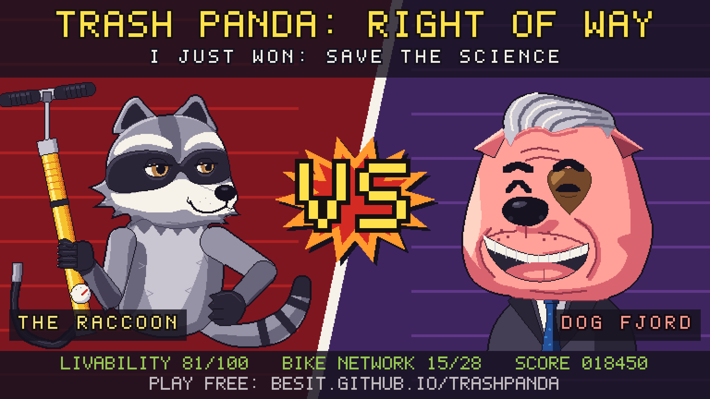
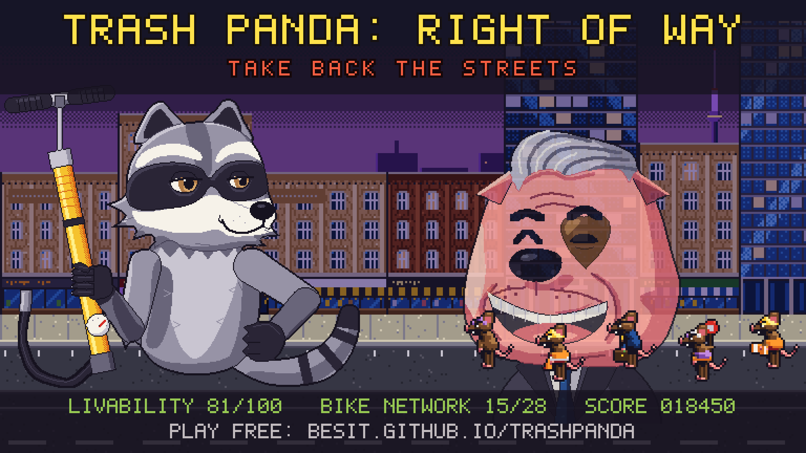

# M4.7 Review: your notes on M4.6

**Play it:** https://besit.github.io/trashpanda/. Add `?debug` for **SELECT MISSION**.

Two items: the controls page's overlapping text, and the portraits, redone in a redraw / judge loop.

## The portraits: 9 rounds of redraw and judge
**How it ran.** Two agents worked in turns. A drawer edited the drawing code and a judge scored each version. Each round:
1. The drawer redrew from the judge's last critique.
2. A sheet rendered the new 2D versions next to the old 3D ones, at poster size and at the in-game 112 x 100 size.
3. The judge scored it against two targets: the 3D versions' proportions, symmetry and overall shapes (your note), and the 2D craft of your refs 3, 4 and 5. It wrote a ranked fix list, which became the next round's brief.

I read every sheet and added my own art-direction notes when the judge missed something. Every round is in the art history (`art/history/portraits_2d/v02` to `v10`).

**All the iterations, side by side** (the old 3D on the left, then M4.6, then rounds 1 to 9):

**The full sheets, one per round** (top: the old 3D; middle: the 2D at poster size; bottom: the small sizes, then the dialogue portraits at 1x and 2x):

| Round | Raccoon | Dog Fjord | What changed |
|---|---|---|---|
| [00](m47/iterations/iter_00.png) (M4.6) | 5.5 | 4.5 | The starting point: the raccoon's head too wide with a long snout; Dog Fjord a tall pink onion with horns for ears. |
| [01](m47/iterations/iter_01.png) | 7 | 5.5 | Both re-proportioned to the 3D numbers. The raccoon got a 3/4 head, amber eyes and a two-lobed mask. The dog got clustered features, but turned cute and his hair became a cap. |
| [02](m47/iterations/iter_02.png) | 7 | 6.5 | The dog's smugness came back: a wink, a heavy-lidded patch eye, a lopsided grin and a pompadour. His head went stiff and trapezoid-shaped. |
| [03](m47/iterations/iter_03.png) | 7.5 | 6.5 | The raccoon got a narrower torso, outlined arms, a ringed tail and a grey jaw. The dog's outline overcorrected into a mushroom. |
| [04](m47/iterations/iter_04.png) | 7.5 | 7 | The dog's head outline was traced from the 3D silhouette, which stopped the guessing. The raccoon got the hand-on-hip triangle. |
| [05](m47/iterations/iter_05.png) | 8 | 7 | Chunky arms for the raccoon. The dog got jowl weight, but his hair turned into a bowl and his ears went sideways. |
| [06](m47/iterations/iter_06.png) | 8 | 7 | The raccoon was polished and frozen. The dog's hair came back as a compact pompadour, but a split-face seam appeared and his ears hid inside his outline. |
| [07](m47/iterations/iter_07.png) | 8 | 7.5 | The dog's ears returned to the top corners as part of his silhouette. The seam went, and the right side became one strong fold. |
| [08](m47/iterations/iter_08.png) | 8 | 7.5 | Final polish: a cleaner lip edge, and the light on the left of the face fades in. The judge's call: "ship both". |
| [09](m47/iterations/iter_09.png) | 8 | 7.5 | A small-size fix I found in the real intro cutscene: at 112, the laughing eye merged into the nose. The eye now sits 2 px clear of it. |

Scores are the judge's, out of 10, on one consistent scale. Every critique and the drawer's notes for each round are in `docs/reviews/m47/loop/`.

**Where they ended up:**
- **The raccoon:** the 3D head's proportions (a 3/4 view with a short snout, eyes close together) in the 2D style of your refs:
  - amber eyes with a highlight, a two-lobed mask, white brows, matching ears
  - a chunky body that stays inside the frame, with a hand-on-hip arm and a ringed tail
  - the pump in the other paw, unchanged
- **Dog Fjord:**
  - the 3D bulldog's outline, traced from it: a broad rounded head, ears folded at the top corners, the swept pompadour on the crown, heavy jowls
  - the 3D's smug look: a wink, a heavy-lidded patch eye and a lopsided grin
  - drawn flat, with three tones of pink and no soft shading
- **What the judge said is still the gap:** the dog's snout only suggests the 3D's muzzle volume. He's also a little more front-facing than the 3D.

**On the posters:** the new Dog Fjord is taller, which put the VS badge over his eyes on the tall VERSUS poster, so he sits lower there now. All twenty posters are in `docs/reviews/m47/posters/`.

## Controls screen
- **The overlap:** on a computer, the last key row (CTRL+M MUTE) ran into the line about missions. The rows are a little tighter now and end well above it (1).
- **Text over the ride:** the small grey notes also sat over the raccoon riding past behind the page. They now have a dark band behind them.
- **Phones:** the phone layout had no overlap (2).

## Worth checking
- The two portraits on the posters, and Dog Fjord's lines in the intro.
- Whether Dog Fjord's look is the right direction. The judge's last note was that his snout could stick out more.

## Numbers
- 68 browser tests and 21 unit tests pass.

## Gallery
| | |
|---|---|
| 01 Controls on a computer  | 02 On a phone  |
| 03 Dog Fjord's dialogue portrait in the intro  | VERSUS (tall)  |
| VERSUS (wide)  | TAKE BACK THE STREETS  |
