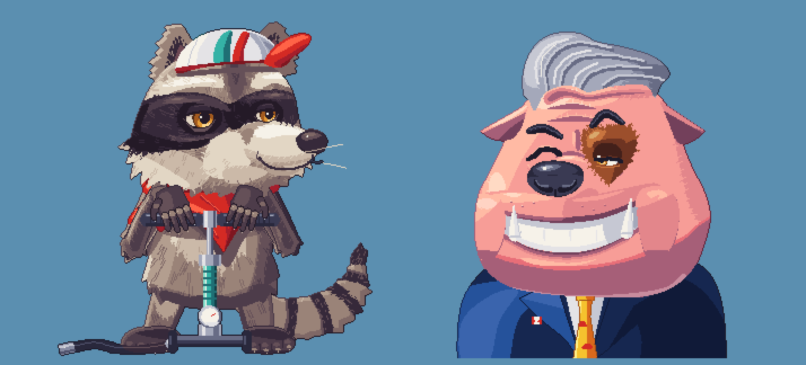
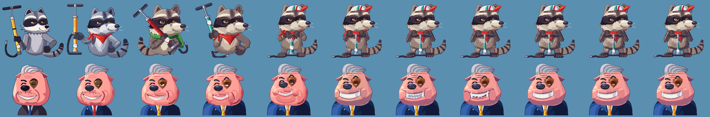
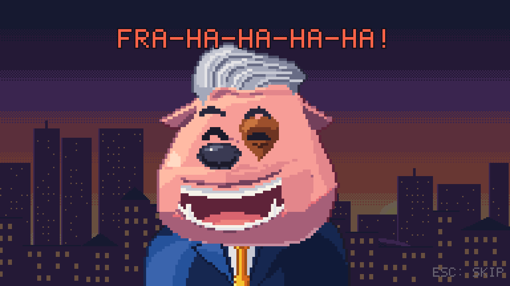
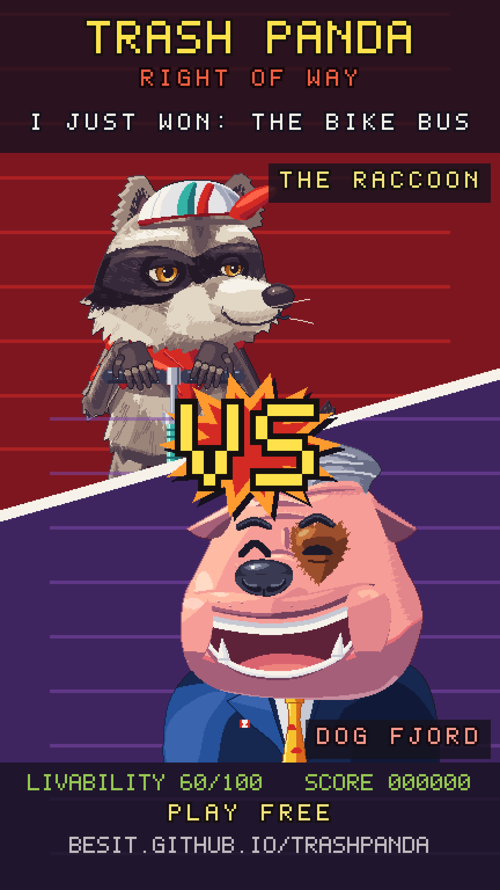
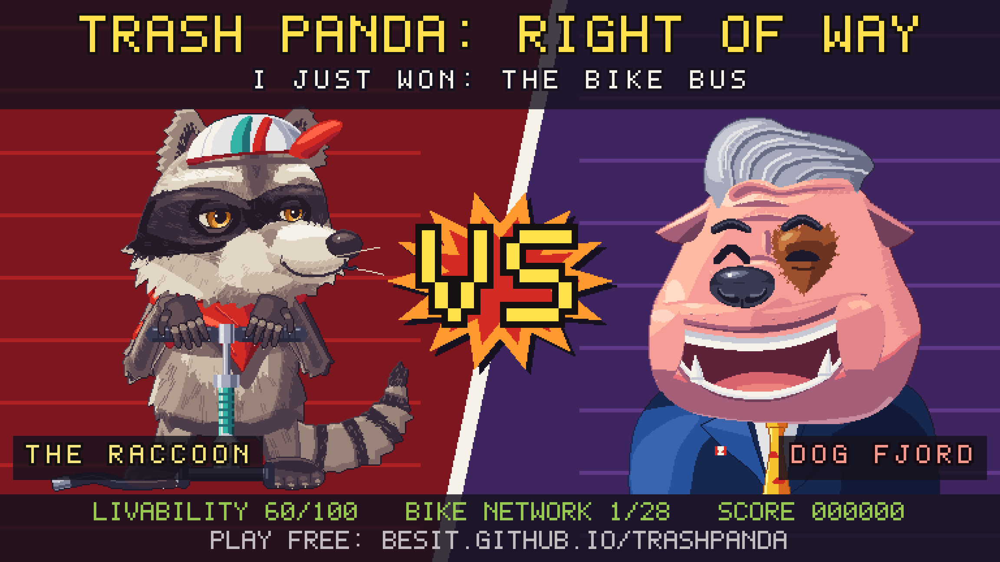
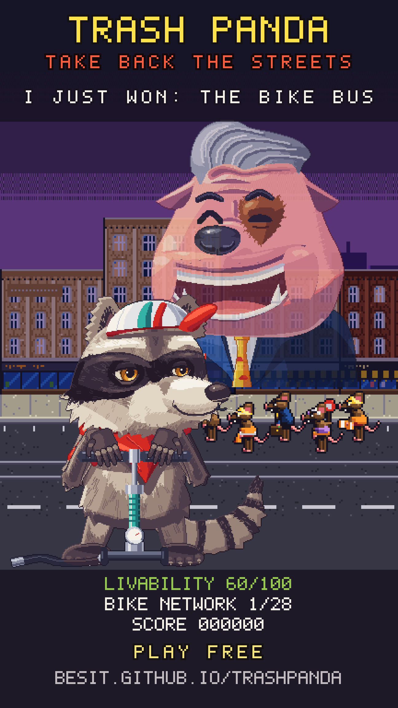
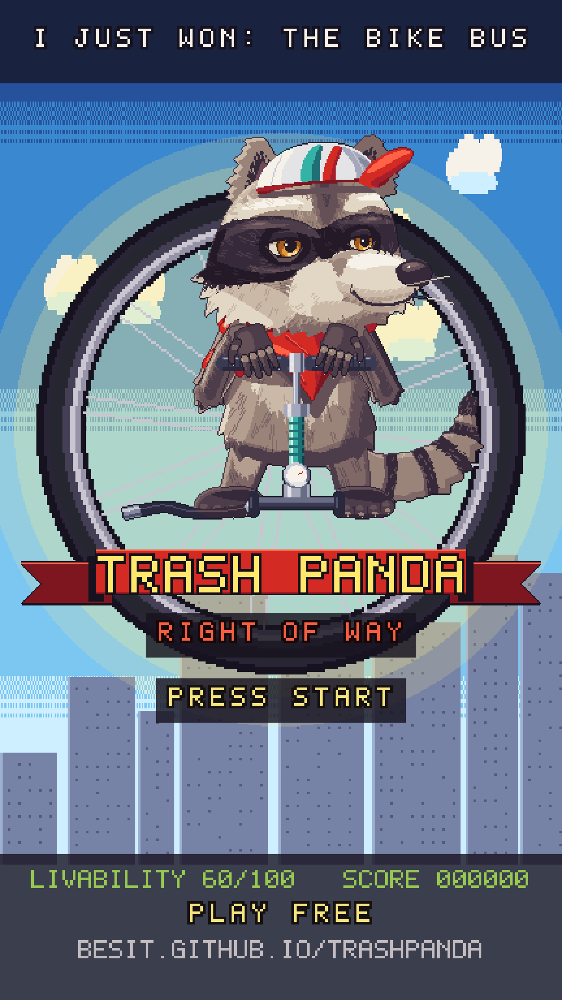
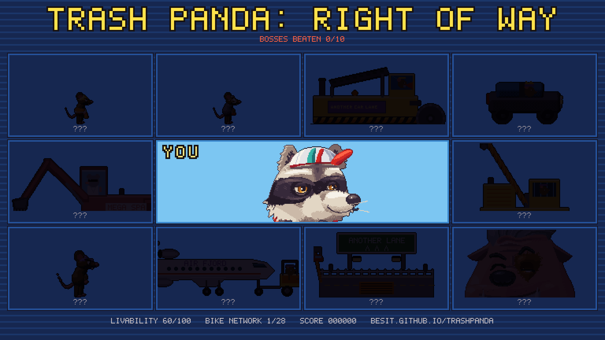

# M4.8 Review: 10 more portrait rounds

**Play it:** https://besit.github.io/trashpanda/. Add `?debug` for **SELECT MISSION**.

Your notes on M4.7:
- get the quality closer to raccoon ref 03
- Dog Fjord's head from iter_04, everything else from iter_09
- a far more creative artist, free to change colours and poses
- a straight pump
- far better artistic quality

## How the loop ran
Same two agents as last time, an artist and a judge, with new rules:
- **The quality bar was ref 03.** The judge's scale put ref 03's craft at 9 to 10. It first scored the M4.7 portraits on that scale: raccoon 4.0, Dog Fjord 3.5. Those are lower than M4.7's final "8 / 7.5" because the yardstick changed: M4.7 was judged against the old 3D proportions, this loop against ref 03's pixel craft.
- **Rounds 1 to 3 were exploration.** Each round the artist drew 2 or 3 genuinely different takes (poses, palettes, costume), and the judge ranked them and picked the direction.
- **Rounds 4 to 10 refined** that one direction. Round 10 was polish only.

I read every sheet and added art direction when the judge missed something. Every round is in the art history: `art/history/portraits_2d/v11` to `v20`, plus the 9 exploration variants in `portraits_2d_explore`.

**All the rounds, side by side** (M4.7 on the left, then rounds 1 to 10):

## The exploration rounds
| Round | a | b | c | What the judge picked |
|---|---|---|---|---|
| 1 | [planted staff, red bandana](m48/variants/r01_a_hero.png) | [warm coat, teal pump across the chest, green scarf](m48/variants/r01_b_hero.png) | [close crop, cycling cap, pump as a rail](m48/variants/r01_c_hero.png) | b's warm coat and swagger, at c's closer crop |
| 2 | [scarf + red pump](m48/variants/r02_a_hero.png) | [bandana + teal pump, Dog Fjord chin up](m48/variants/r02_b_hero.png) | [cap + chrome pump, Dog Fjord sunk into his shoulders](m48/variants/r02_c_hero.png) | The diagonal pump covered the face, so new poses next |
| 3 | [pump over the shoulder](m48/variants/r03_a_hero.png) | [cane: both paws on the T-handle](m48/variants/r03_b_hero.png) | [elbow leaning on the pump, cap](m48/variants/r03_c_hero.png) | **b's cane pose, standing, with c's cap**; Dog Fjord chin up on broad shoulders |

## The refinement rounds
| Round | Raccoon | Dog Fjord | What changed |
|---|---|---|---|
| [00](m48/iterations/iter_00_hero.png) (M4.7) | 4.0 | 3.5 | The start: flat fills, 3 tones, black lines everywhere, a bent pump |
| [01](m48/iterations/iter_01_hero.png) | 5.5 | 4.0 | Colour ramps with cool shadows, drawn fur, eyes with depth, a straight pump |
| [02](m48/iterations/iter_02_hero.png) | 5.5 | 5.0 | Dog Fjord's muzzle, jowls, furry patch and shiny nose |
| [03](m48/iterations/iter_03_hero.png) | 5.5 | 5.5 | A bulldog at last: underbite fangs, the smug half-lidded patch eye back |
| [04](m48/iterations/iter_04_hero.png) | 6.0 | 5.5 | The standing raccoon (short legs, the tail back); iter_04's ears restored |
| [05](m48/iterations/iter_05_hero.png) | 6.5 | 6.0 | The wide crescent grin; the pump mid-stroke with its chrome rod showing; arms with elbows |
| [06](m48/iterations/iter_06_hero.png) | 6.5 | 6.0 | Fur strands inside the raccoon's face; Dog Fjord's pink back (round 5 went grey-mauve with a stubble line) |
| [07](m48/iterations/iter_07_hero.png) | 7.0 | 5.5 | The fur follows the face's flow. Dog Fjord got worse: his lips became pouches and his teeth looked rotten |
| [08](m48/iterations/iter_08_hero.png) | 7.0 | 6.5 | Dog Fjord's mouth went back to round 5's; the raccoon's body got light and shadow |
| [09](m48/iterations/iter_09_hero.png) | 7.0 | 6.5 | Small touches: a sheen on the mask, fangs that read as cones, the shock mouth at small sizes |
| [10](m48/iterations/iter_10_hero.png) | 7.0 | 6.5 | Polish only |

Each round also has a full sheet with every expression and the small in-game sizes ([`iter_NN.png`](m48/iterations/iter_10.png)). Every critique and every artist note is in `docs/reviews/m48/loop/`.

## Where they ended up
- **The raccoon** is a standing cyclist: a cycling cap, the red bandana, both paws on a teal floor pump that is mid-stroke, its ringed tail curled behind. The head has ref 03's techniques:
  - amber eyes with a highlight and a sparkle
  - a mask in four tones with a sheen
  - fur strands that follow the face
  - fringed ears and a bright muzzle
- **The pump is straight.** It's built on one axis, so the handle, rod, barrel and foot can't bend. Only the hose curves.
- **Dog Fjord** has iter_04's head and ears. He's a bulldog now: a wide crescent grin with underbite fangs, the smug half-lidded patch eye, a furry chestnut patch and clean pink skin. He wears a navy suit and a gold tie with little red cars. His laugh is the strongest expression in the set.
- **What the judge says still separates them from ref 03:**
  - Ref 03 textures every surface. Here the texture is sparser below the raccoon's head and on Dog Fjord's skin.
  - The eyes are smaller and less contrasty than ref 03's.
  - These are drawn from shapes in code, while ref 03 is placed pixel by pixel. Hand-placed pixels for the eyes, nose and mouth would close a lot of that gap.

## One thing that went wrong
In rounds 6 and 7 the judge pushed Dog Fjord's mouth toward real bulldog anatomy, and he got lumpier and less likeable while each round's fix list was met. I asked the judge to compare his overall appeal with round 5. It agreed, and round 8 put his round-5 mouth back, keeping the better colours.

## The posters
The new raccoon stands, so his head sits higher in the picture. Three posters needed a nudge:
- **Tall VERSUS:** he sits lower and further left, and his name moved to the right, off his cap.
- **Tall TAKE BACK THE STREETS:** Dog Fjord moved up, so the raccoon's head no longer covers his mouth.
- **Wide bosses grid:** the YOU frame now shows the cap.

All twenty posters are in `docs/reviews/m48/posters/`.

## Worth checking
- **The raccoon's new look:** a standing figure with a cap, where the old one was a bust with a fist on his hip. Is that the direction?
- **Dog Fjord's grin and suit colours.**
- **Dog Fjord in the intro cutscene** (1).

## Numbers
68 browser tests and 21 unit tests pass.

## Gallery
| | |
|---|---|
| 01 Dog Fjord in the intro  | VERSUS (tall)  |
| VERSUS (wide)  | TAKE BACK THE STREETS (tall)  |
| Title (tall)  | Bosses (wide)  |
