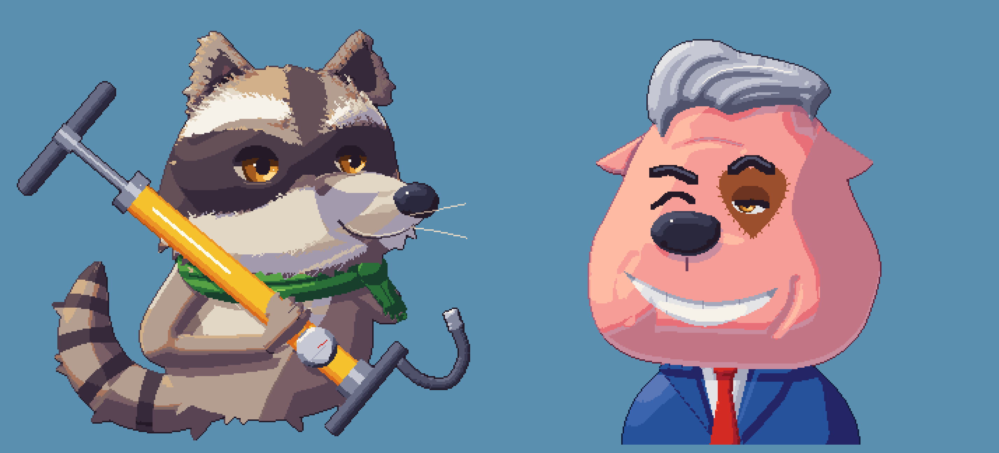
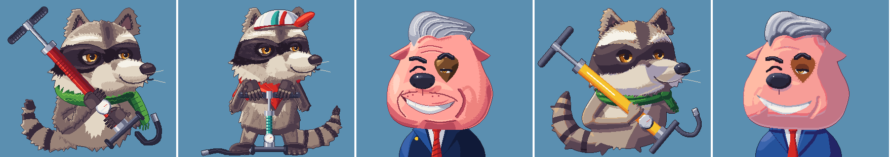
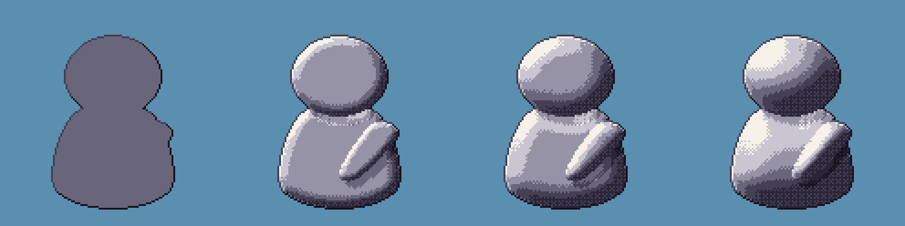
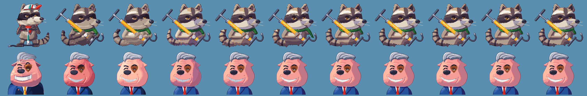
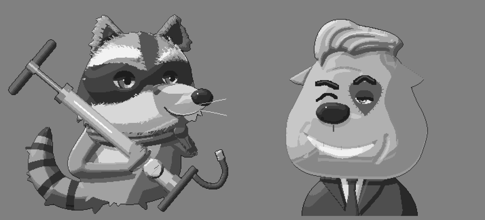
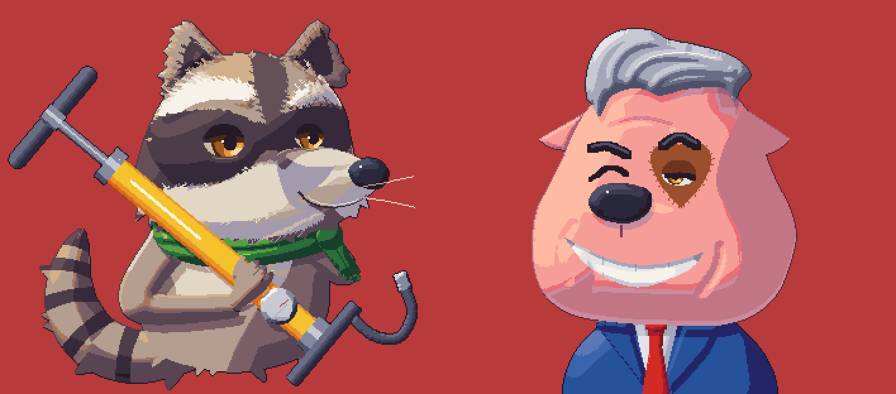

# M4.9 Review: drawing with light (preview, not in the game yet)

Your notes on M4.8:
- Explore pxl and codixel and bring what's good into our drawing system.
- Run 10 more rounds on the hero art. Keep raccoon iter_02's pose and vibe (iter_10 was nice too), make the pump yellow like the game's, and keep Dog Fjord as minimal as iter_01.
- Draw "from shades, not from shapes": think about how light falls, where the shadows and highlights are, not about separate parts.
- Don't build the posters or update the game until you give the green light.

**The game is unchanged.** The new art lives in `tools/sprites/portraits_next.mjs`; the game still builds from `tools/sprites/portraits.mjs`. When you give the green light, the new file replaces the old one, I re-check every poster and the intro cutscene, and it ships.

**Your favourites from M4.8 and the final round, side by side** (left to right: raccoon iter_02, raccoon iter_10, Dog Fjord iter_01, then the new raccoon and Dog Fjord):

## 1. What I took from pxl and codixel
Neither is installed. Both are MIT licensed, so I ported the useful parts into our own toolkit, with credit in `tools/lib/THIRD_PARTY.md`.

**From codixel: light-first shading** (`tools/lib/light2d.mjs`). This is the core of your note:
- A part's silhouette, or several parts merged into one form, is turned into a volume and lit from one direction.
- The light is mapped onto a colour ramp in flat bands, mixed only in a thin dithered strip where two bands meet.
- Parts are separated by cast shadows, contact shadows and a rim of light instead of outlines.
- Also included: pixel-perfect 1 px lines, and hue-shifted ramps (shadows lean cool, lights warm; `tools/ramp.mjs` makes new palette colours).

The demo above shows one silhouette four ways: flat, then lit as one form with three edge roundnesses.

**From pxl and codixel: an automatic pixel-art critic** (`tools/pixelcheck.mjs`).
- **The flaws it lists, with coordinates:** stray pixels, doubled corners in 1-pixel lines, light-in-the-middle "pillow" shading, colours too close to tell apart, and silhouette nubs and holes. It also writes an image with every problem boxed.
- **Two review views:**
  - the picture in greys, to judge light and shadow without colour, as painters do
  - the pixels as text, for exact edits

**From pxl: an annotate page for you** (`tools/annotate/`). You paint marks and pin numbered notes on a portrait in your browser and press Send. I then get your notes with exact pixel positions instead of a description. To use it:
1. Run `node tools/annotate/serve.mjs` in the repo.
2. Open http://127.0.0.1:4330/. The page only runs on your computer.
3. The current portraits are already loaded (`raccoon.png`, `dog_grin.png`). Tell me when you've sent notes.

**Codixel's main idea I did not use:** turning a reference image into pixels. Our characters have no source image, and turning someone else's art into pixels would copy it.

## 2. Ten rounds of painting with light
Same loop as before, a painter agent and a critic agent, with a new brief built around your note:
1. Silhouette first.
2. One light: big masses of light and shadow over the whole figure.
3. Parts separated by light and cast shadow, never by lines.
4. Details last, and few.

Every round was checked in greys and by the pixel critic. Rounds 1 and 2 tried different ways of rendering the light; rounds 3 to 10 refined the chosen one. The critic's scale: your raccoon ref 3 is 9.5. On it, today's game art scored 4.5, your favourite raccoon (iter_02) 5 and your favourite dog (iter_01) 5.5.

**All the rounds** (the M4.8 game art on the left, then rounds 1 to 10):

| Round | Raccoon | Dog Fjord | What changed |
|---|---|---|---|
| [00](m49/iterations/iter_00_hero.png) | 4.5 | 4.5 | The M4.8 game art: every part its own outlined sticker |
| [01](m49/iterations/iter_01_hero.png) | 5.0 | 6.0 | One light for the whole picture. Three ways to render it: [volume](m49/variants/r01_a_hero.png), [flat cel shadows](m49/variants/r01_b_hero.png), [rich and dithered](m49/variants/r01_c_hero.png) |
| [02](m49/iterations/iter_02_hero.png) | 5.5 | 6.0 | The chosen look, "lit volume, hard bands" (no dither); arms in the coat's colour ([with dark arms](m49/variants/r02_b_hero.png), [chunky](m49/variants/r02_c_hero.png)) |
| [03](m49/iterations/iter_03_hero.png) | 5.5 | 6.5 | Light designed, not computed: one shadow side per form, cool shadows, warm lights |
| [04](m49/iterations/iter_04_hero.png) | 6.0 | 7.0 | The arm reads again by its light and shadow, the thick tail is back, and Dog Fjord's far side reads as real shadow |
| [05](m49/iterations/iter_05_hero.png) | 6.5 | 7.5 | Faces done with light: glossy eyes, a cocky brow, lit teeth; the light falls off toward the bottom |
| [06](m49/iterations/iter_06_hero.png) | 7.0 | 7.5 | The tail lit as one tube, a knotted scarf, the far ear in shadow, the smirk as a crease |
| [07](m49/iterations/iter_07_hero.png) | 7.0 | 7.5 | Dog Fjord's laugh and shock brought up to the grin's level |
| [08](m49/iterations/iter_08_hero.png) | 7.0 | 7.5 | Small fixes; checked the two together as on the VERSUS poster |
| [09](m49/iterations/iter_09_hero.png) | 7.0 | 7.5 | Polish, plus an experiment: [hand-clustered fur like ref 3](m49/variants/r09_w_hero.png) |
| [10](m49/iterations/iter_10_hero.png) | 7.5 | 7.5 | The fur kept on the head only ([before and after](m49/head_fur_compare.png)) |

Each round also has a sheet with all expressions and the small in-game sizes, and the same close-up in greys: `m49/iterations/iter_NN.png` and `iter_NN_values.png`. Every critique and every painter's note is in `docs/reviews/m49/loop/`.

## Where they ended up
- **No part is drawn as a separate shape any more.** There are no outlines inside the figures, and everything sits in one light, so a shadow crosses fur, scarf and pump alike.
  - The raccoon's arm reads by the light along its top and the shadow it casts on the chest.
  - The paw only goes dark where it wraps round the pump.
  - The tail is one lit tube with its rings in the light.
- **In greys,** each figure has one light side and one shadow side, and the face is the strongest contrast. Here is the final in greys:
  
- **The raccoon** is in iter_02's pose and swagger: the warm coat, the green scarf, the pump across the chest. The pump is now yellow like the game's and straight. Its eyes are glossy with a highlight, the brow is cocky, and the head's fur breaks up where light meets shadow.
- **Dog Fjord** keeps iter_01's minimal plan and iter_04's head. One big shadow shape wraps his far side under the jaw. He has the wink, the smug patch eye, the bright grin, a navy suit and a red tie. All three expressions read at the small in-game size.
- **The two read as one style** on the VERSUS pairing: the same light, the same darkest darks, the same outline.
  
- **One likeness fix.** The critic flagged that the M4.8 dog's mix of a national-flag lapel pin and a patterned tie pointed too close to a real politician. The new one has iter_01's plain red tie and no pin.

## What the critic says still separates them from ref 3
- **Texture:** ref 3 has hand-placed fur wherever the form turns. Here fur appears only where light meets shadow, so large areas still read as smooth graphic shapes, closer to ref 4.
- **Colour inside a shape:** ref 3 shifts colour subtly inside each area. Ours are flat tones by design: clean, but less glowing.
- **The drawing hand:** ref 3's shapes and eyes have the small asymmetries of an experienced artist. Ours are built from code, so they're correct and readable but less alive.

## For you to decide
- **The green light.** Does this go into the game? If yes, I'll swap the portraits, re-check every poster at full size (the raccoon's pose changes back to the M4.8 iter_02 bust, so the poster layouts move again) and the intro cutscene, then ship.
- **Notes on specific pixels:** the annotate page above is the quickest way to give them.

## Numbers
- The game's portraits render pixel-identical with the new tools loaded.
- The new art passes the pixel critic. The only flags left are the eye's deliberate second highlight and the whiskers.
