# M4 Review: the North, the last three missions, the ending

**Play it:** https://besit.github.io/trashpanda/. Add `?debug` for **SELECT MISSION** (the three new missions are SAVE THE SCIENCE, FINISH THE LINE and DEATH BY HIGHWAY) and **WATCH VIGNETTES** (SCI, LINE, HW, ENDING).

This completes the game's planned content: six districts and eleven main missions, ending in a report card and credits. Numbers in brackets refer to the gallery.

## The North district
Above Queen West and Downtown. North on **Ossington or Bellwoods** brings you to the bottom of **Leslie St**; north on **Spadina, University or Bay** to the bottom of **Don Mills Rd**.
- **The Ontario Science Centre** (Raymond Moriyama, 1969), boarded up with a CLOSED sign (01). Its ribbed concrete pavilion faces Don Mills, and its pods step down toward the ravine behind it. A plaque gives the facts.
- **The ravine** (the Don's East Branch, E. T. Seton Park) runs north–south east of the centre, with a trail, ducks and a swan (02). It's rideable, and there's an easter egg in it.
- **Flemingdon Park's** concrete apartment slabs east of the ravine (03), Don Mills' houses west of it, Line 5's Science Centre station entrances, and a parkette.
- The city map pages to it, and its tally counts its plaques, hearts and egg (05).

## Mission 6: Save the Science
- **The research.** The province closed the centre in June 2024, citing its roof panels; repairs were estimated at at least $22 million. The Auditor General called the move "not fully informed", and the new building at Ontario Place is due in 2029 ([URBAN_RESEARCH §5](../URBAN_RESEARCH.md)). The game reopens it, and the blurb says that's the game's wish.
- **Stealth.** Guard rats stand watch with flashlights that swing left and right. Crouch behind a FRAGILE crate and the beam passes over you (10). Get caught in it and the guard calls two rats and chases you (11).
- **The chase.** Rats carry the Van de Graaff generator toward a moving truck. Catch them before it's loaded (12).
- **The Wrecker.** A crane with a wrecking ball swinging across the arena. Jump the ball. After five swings it hauls the ball up to reload: pump the engine then. Stomp the cab any time (13, 14).
- **Payoff.** The boards come down and an OPEN banner goes up (04, 16).

## Mission 9: Finish the Line
- **The research.** 15.6 km and 15 stations. Downtown tunnelling started in April 2026; in August 2026 Metrolinx put the cost at about $34 billion and the opening at "the early 2030s" ([§8](../URBAN_RESEARCH.md)).
- **The track.** A locked arena of five rail piles to pump into track while rats defend them (20, 21).
- **The Mega Rat.** A giant basic rat. It throws chunks of road, shoves, and leaps to POUND the ground, sending shockwaves both ways along the street (22).
- **Payoff.** Station entrances on Queen and King (23), in the East End (Leslieville, Gerrard) and beside the Science Centre.

## Mission 10: Death by Highway
- **Unlocking.** It opens only once every other mission is done.
- **The briefing.** The intro's highway shot comes back. Dog Fjord asks "...ANOTHER LANE?", adds one, then panics and adds another, and the traffic never moves.
- **The waves.** Three waves under the Gardiner's deck, with every rat type and two SUV Rats (30).
- **The Highway Mech.** A walking stretch of the Gardiner, with a highway sign reading ANOTHER LANE for a head. It **stomps**, sending shockwaves both ways (31), flings cars from its claw, then **overheats**: its chest vent glows, and that's when to pump it (32). At 2/3 and 1/3 health it roars ANOTHER LANE and drops a concrete slab, which you can jump from onto its deck to stomp it (33).
- **Payoff.** The deck and its piers are gone. Lake Shore gets protected bike lanes and a linear park of trees and benches (34 before, 35 after).
- **The research.** The blurb says plainly that in 2015 Toronto voted 24–21 to keep the east Gardiner, beside Seoul's Cheonggyecheon, where 5.8 km of elevated highway came down and a study found the feared jams never came ([§9](../URBAN_RESEARCH.md)).

## The ending
- **The concession.** After the last payoff, Dog Fjord gives up: "ALL RIGHT. ALL RIGHT! I'LL TAKE THE STREETCAR. ...IS THERE A FIRST-CLASS STREETCAR?" "NO, BOSS."
- **The ride out.** The raccoon rides on, over *TORONTO. A PRETTY GOOD CITY. STILL WITH A FEW PROBLEMS. BUT FEWER.*
- **The report card** (40). Missions, Livability, bike lanes, parks, transit upgrades, highway lanes removed, safer school zones, riders rallied, rats defeated and score.
- **The credits,** with the satire and AI notice, then back to the title. The run is saved and sent to the leaderboard first.

## Fixed along the way
- **CONTINUE replayed the last mission's payoff.** Phaser reuses a scene's last start data when it's given none, so after a win, Save + Quit and then CONTINUE replayed the map's "THE CITY IS CHANGING" sequence. Every scene hand-off now passes data, and a test covers it.
- **The camera-chase "caught" wave could end before its rats arrived.** It now counts kills, not rats on screen.

## Things to check
- **Stealth readability:** is the flashlight beam clear enough, and is the turn warning (the beam flickers before it turns) enough?
- **The Highway Mech's length and difficulty,** and whether the deck stomp from the slabs comes up often enough.
- **The ending's tone**, and the report card's rows.
- **The North district's layout.** I placed it from the real geography, compressed: the Science Centre east of Don Mills just south of Eglinton, the ravine east of it.

## Known issues
- **The North's streets are only Eglinton, Wynford, Leslie and Don Mills.** Real Wynford Drive curves around the centre; here it's straight.
- **The Mega Rat's thrown road chunks** reuse the depave arena's asphalt patch sprite.
- **Map images:** the full-scale images in `docs/maps/` were regenerated for all six districts.

## Gallery
| | |
|---|---|
| 01 The Science Centre, boarded up 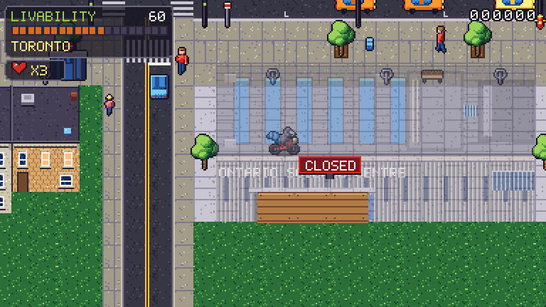 | 02 The ravine 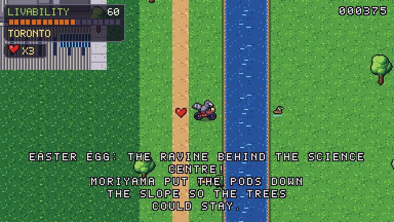 |
| 03 Flemingdon Park 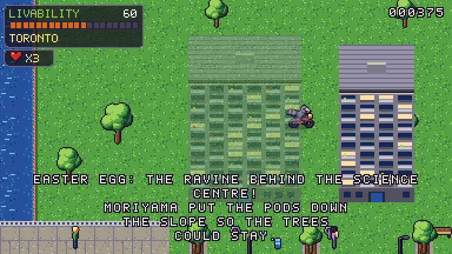 | 04 Reopened 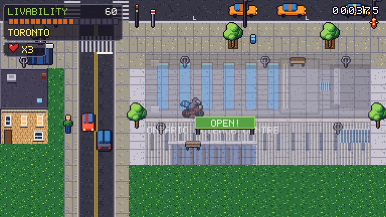 |
| 05 The city map: NORTH 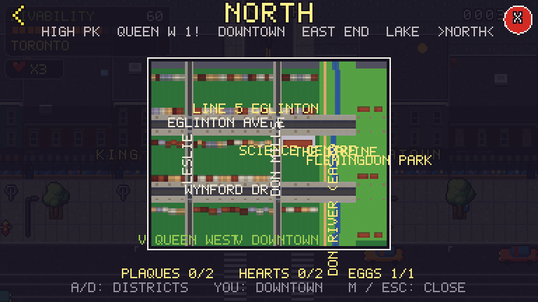 | 10 Hidden behind a crate 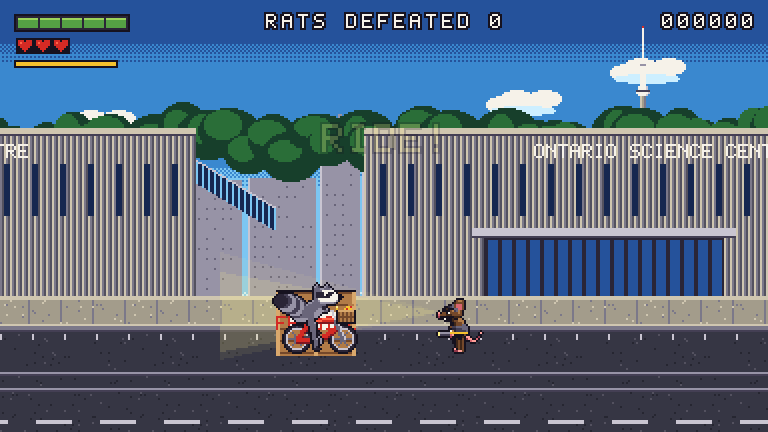 |
| 11 SPOTTED 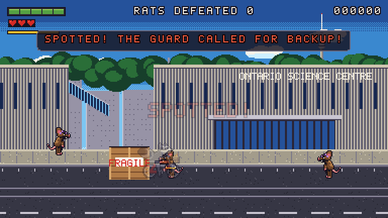 | 12 The exhibits to the truck 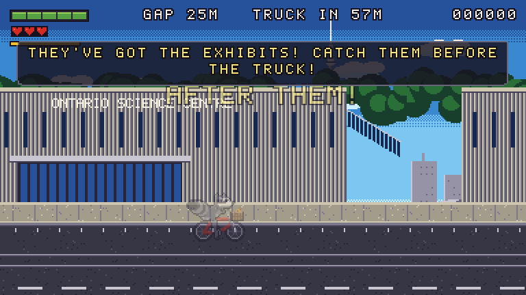 |
| 13 The Wrecker swings 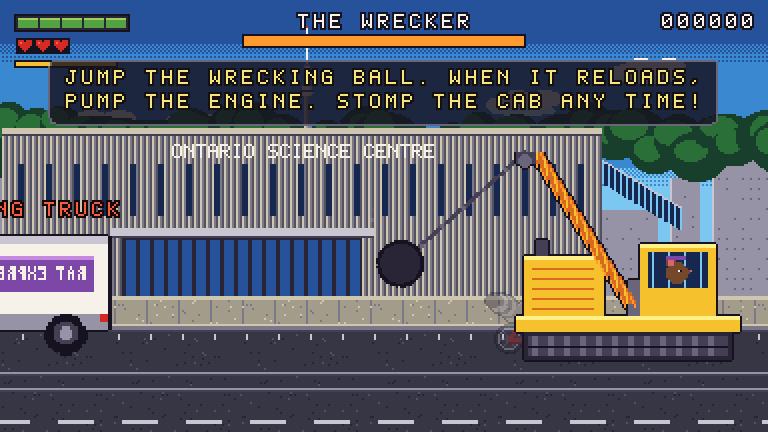 | 14 The Wrecker reloads 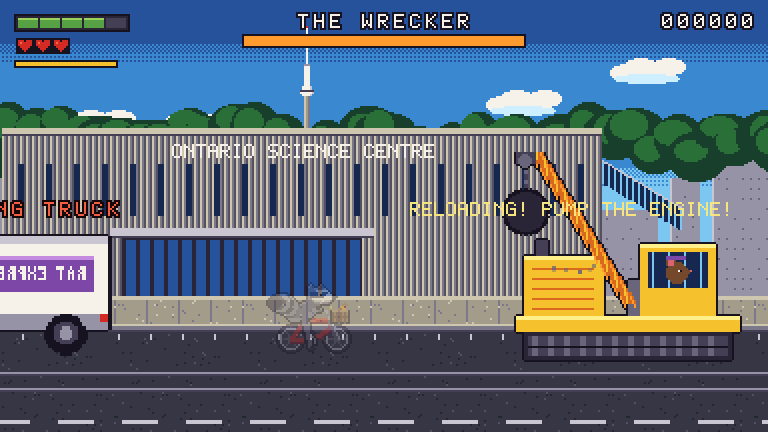 |
| 15 Before: moving sale 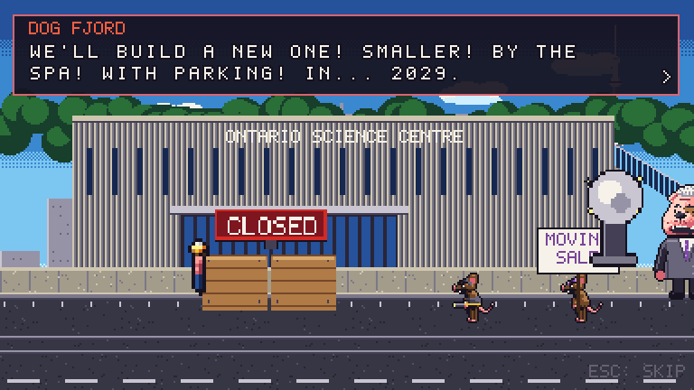 | 16 After: OPEN 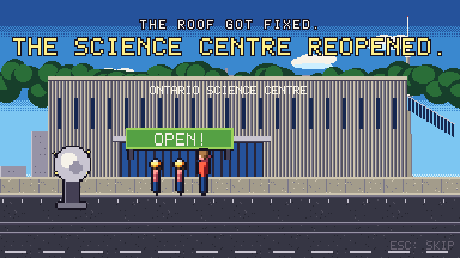 |
| 20 The rail arena 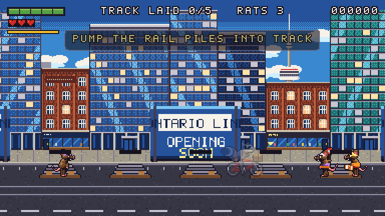 | 21 Track laid 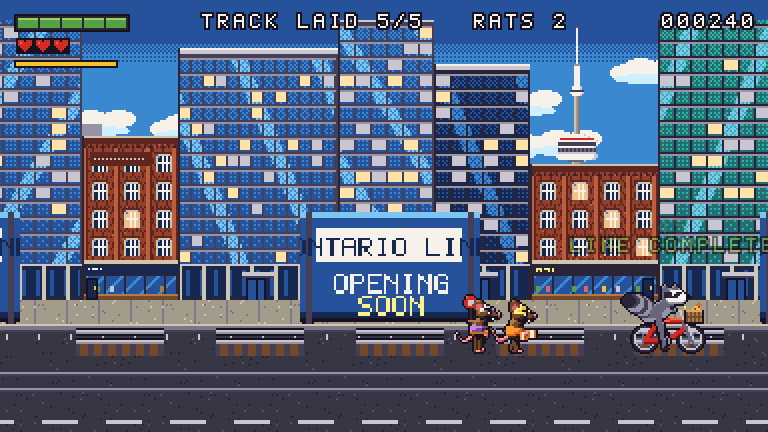 |
| 22 The Mega Rat pounds 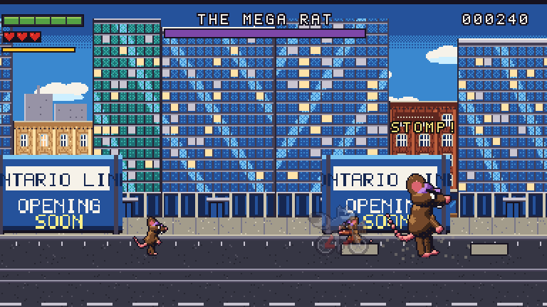 | 23 A station on the map 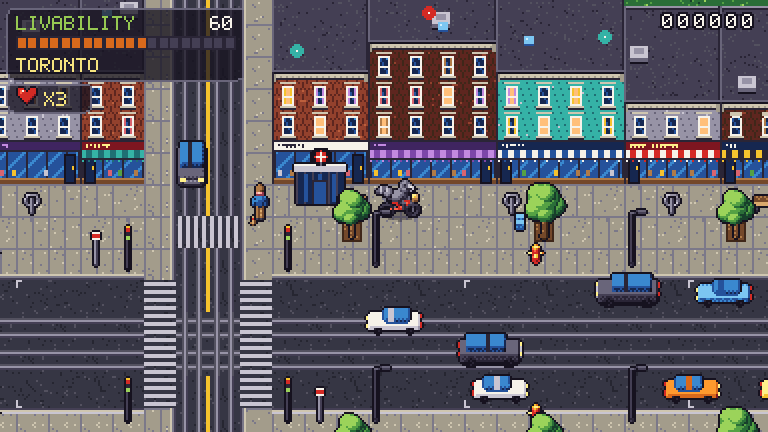 |
| 30 Under the Gardiner 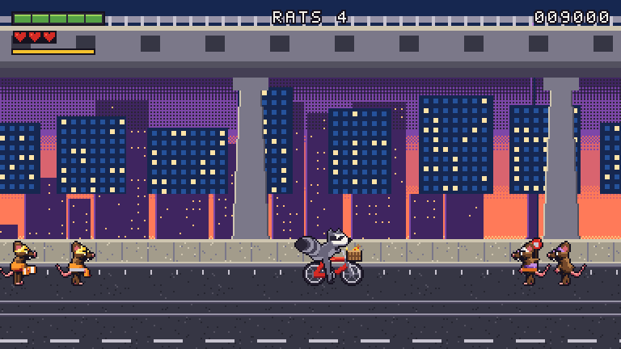 | 31 The Highway Mech stomps 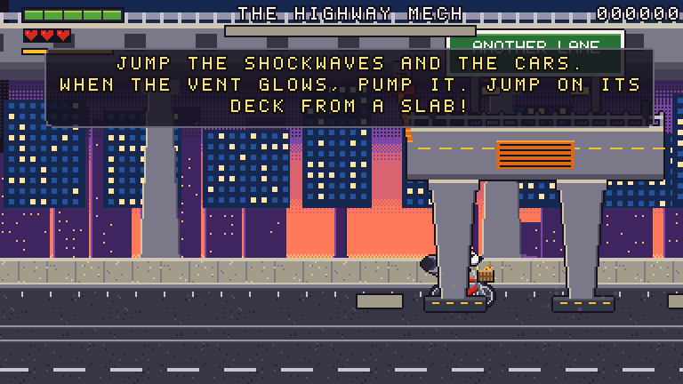 |
| 32 The vent glows 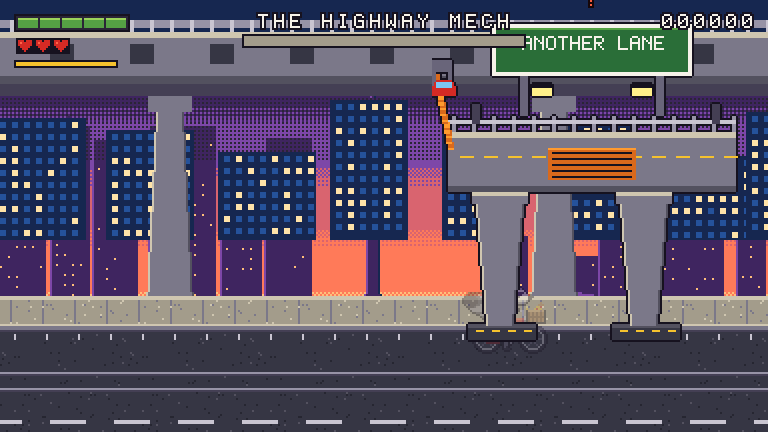 | 33 ANOTHER LANE: a slab 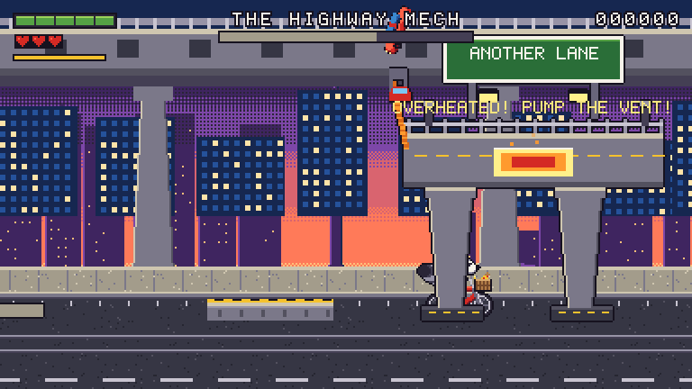 |
| 34 The Gardiner, before 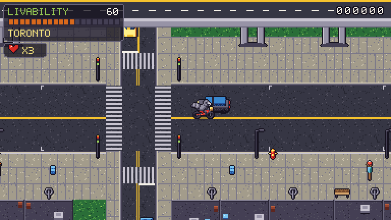 | 35 After 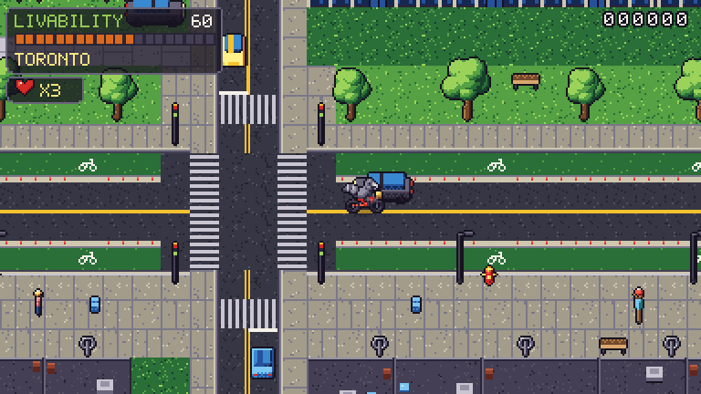 |
| 40 The report card 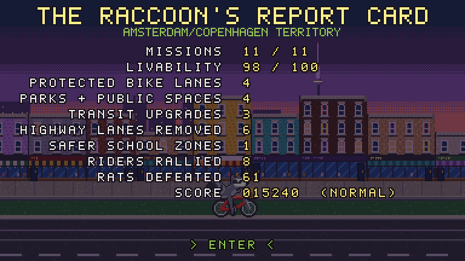 | |
